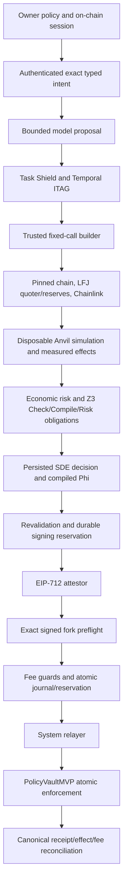

# PaceVant two-operation MVP

Final implementation review: 21 November 2026, Asia/Saigon. This is a single-tenant research/testnet treasury. New public MVP deployment remains pending Owner action. Subsequent user-authorized Demo User wallet consolidation confirmed separately; see the [current review](docs/PACEVANT_CURRENT_SYSTEM_REVIEW.md) for updated balances and receipts.

## Roles and custody

| Role | Existing public address | Authority |
|---|---|---|
| OWNER | `0x607bd883bd3621378812CF5B4B8dDcCFAeBbab1b` | Configure policy/payees/sessions, revoke, pause/unpause, emergency recovery |
| ATTESTOR | `0x5704fA0FF7CBEd213F622c99aC6F9d6E5cbF2989` | Sign only approved, revalidated EIP-712 operations |
| RELAYER | `0x761B1FFB7AA70C7A946D3970A25F5a3859dA328C` | Submit exact journaled vault transactions; pay bounded system AVAX expenses |
| Existing PolicyVault, a contract | `0xd8EC86820709505C3779a4Fe5D828e8ADE663E1D` | Current treasury custody; immutable V2 deployment |

PolicyVault is not an EOA. Demo User is not a system role. Serving settings contain attestor/relayer credentials, never an owner signing capability. Local tests create exactly three disposable role keys and use the Owner as payee; these are not public Fuji identities.

The [read-only public inventory](docs/audit/mvp-public-state.json) verifies chain 43113, the three EOA identities, token decimals, all four deployment code hashes, current session/policy, and actual asset locations. The [official Avalanche network reference](https://build.avax.network/docs/primary-network) identifies Fuji as chain 43113; the exact token/pool identities are additionally verified from contracts.

## Exactly two AI financial operations

| Public operation | Fixed execution | Required checks |
|---|---|---|
| `SWAP_EXACT_IN` | USDC → WAVAX or WAVAX → USDC, direct approved LFJ V1 pool, output to treasury | Registry, official quoter and reserves, independent Chainlink, amount/spend/loss/exposure limits, simulation, proof, signed Phi |
| `USDC_PAYMENT` | Exact Circle test USDC debit, owner-approved EOA receipt | Payee/token identity, per-payment/payee/session/day limits, full measured receipt, signature/nonce/session/Phi |

Rebalancing orchestrates `SWAP_EXACT_IN`; it is not another financial primitive. The public SDK `MvpIntent` accepts only the two operation names. Its internal compatibility mapping uses the shared fixed-operation guard's `TOKEN_SWAP`/`TOKEN_PAYMENT` tags.

Lending, investment vault deposits/redemptions, staking, LP, bridges, multihop, native/WAVAX payments, arbitrary approvals and arbitrary calls are disabled. Canonical startup refuses the former V3 activation setting and accepts only the MVP execution port. `/v3` execution routes are not installed. The MVP vault rejects unsupported kinds on-chain and permanently disables its inherited V1/V2 swap entry points. Research V3 sources and local tests are retained outside the live registry.

## Shared security path

The backend remains the existing FastAPI modular monolith. Planning, alignment, temporal, risk, decision, signing, persistence, execution and monitoring remain separate responsibilities. The model proposes and explains an already authorized bounded action; changing amount, operation, tokens or recipient is rejected deterministically. Live model-provider failure never falls back to scripted semantics.

The new fixed-operation wire uses EIP-712 domain version **3** and a new verifying contract. Original PDRV1/PDRV2 helpers, vectors and deployment remain intact. A distinct domain prevents old swap approvals being interpreted as payments. Signed fields bind chain/vault domain, operation, intent, exact derived call, recipient, input/output, amounts, policy/session, proof/evidence/Phi hashes, certified debit, nonce and expiry.

`PolicyVaultMVP` reuses the common V3 guard through narrow overrides. Its fixed balance ABI retains a zero reserved slot; no ERC-4626 asset or valuation enters the MVP registry. Treasury USDC, WAVAX and the native no-outflow invariant are measured. No untrusted bytes are forwarded as arbitrary calldata.

## Budgets, gas and recovery

Swap notional uses a dedicated USD-e8 session/day budget. Payment principal uses separate USDC base-unit session/day and per-recipient counters. Certified unexplained loss uses the existing session and global daily risk counters. Calendar days are UTC `timestamp // 86400`.

Relayer expenses use a separate system ledger, without credit accounts, refills, reimbursement or customer charging. Maximum gas, gas price, per-transaction fee, physical AVAX and daily expense are checked before broadcast. Fee reservation and the existing raw-transaction journal commit in one database transaction. Canonical success and revert receipts settle `gasUsed * effectiveGasPrice` once; reorg uncertainty retains the maximum hold.

Idempotency claims, signing reservation, immutable evidence, execution file locks and on-chain nonces prevent concurrent/retried requests from becoming extra authorized payments. Unknown or replaced transactions are not successes. The observer reconciles outcomes even with autonomy disabled; autonomous execution requires explicit enablement inside an owner-authorized scope and stops on failed/uncertain execution.

Owner administration is prepared as fixed unsigned data and signed by the separate Owner wallet. An operator credential cannot execute Owner privileges. Pause, revocation and policy rotation are enforced by Solidity after signature verification; signed-but-revoked operations fail. Emergency native recovery is Owner-only, requires pause, sends only to Owner, and is not an AI payment capability.

## Activation boundary

New public execution requires an owner-signed, code-hash-pinned `MvpManifest`, the existing three public roles, `PACEVANT_MVP_MANIFEST_FILE`, and explicit `PACEVANT_MVP_LIVE_ENABLED=1`. No existing deployment file or private environment has been redirected.

When MVP execution is active, legacy mutation entry points are disabled, while historical read/reconciliation paths remain. Without migration, the existing V2 forward API remains available under its existing authorization; the new dashboard accurately reports migration pending. See the [runbook](MVP_DEMO_RUNBOOK.md) and [unsigned plan](docs/audit/mvp-unsigned-migration-plan.json).

MVP operator startup does not call the retired vault's active-session preparation or oracle-file heartbeat. Its chain context reads the new vault and pinned Chainlink rounds. The original deployment manifest remains the identity/history reference. Container serving refuses Owner keys, and ordinary operator serving prefers the public Owner identity over any stale local Owner-key value.

**Public limitations:** the current adapter cannot reverse and the current vault cannot pay. The new versions are tested locally, not deployed publicly. Current reverse quoter selection and approximately 98.86% reference loss also prevent an approved reverse Fuji demonstration. No gate was relaxed.
