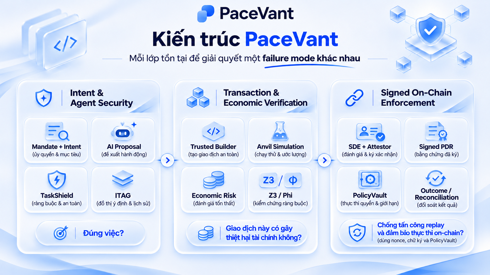
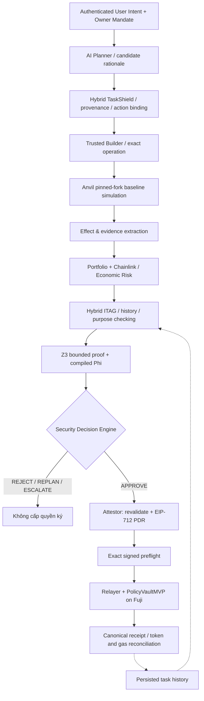

<div align="center">
  <picture>
    <source media="(prefers-color-scheme: dark)" srcset="docs/assets/readme/approved/hero-glass.png">
    <source media="(prefers-color-scheme: light)" srcset="docs/assets/readme/approved/hero-glass.png">
    
  </picture>

  <p><em>Intent-Aware Security for Autonomous On-Chain Treasury Agents</em></p>
  <p><a href="https://pacevant.live"><strong>Live Demo</strong></a> · <a href="docs/evidence/FUJI_WORKFLOW_EVIDENCE.md"><strong>Security Evidence</strong></a> · <a href="#kiến-trúc-mỗi-lớp-tồn-tại-để-làm-gì"><strong>Architecture</strong></a> · <a href="#research-library--không-bỏ-mất-công-sức-nghiên-cứu"><strong>Research</strong></a></p>
</div>

<p align="center">
  <a href="https://testnet.snowtrace.io/address/0x70e1395F959dba530cF4A53B060c809b715bB6d5"></a>
  <a href="docs/research/SECURITY_COVERAGE_MATRIX.md"></a>
  <a href="docs/research/SECURITY_COVERAGE_MATRIX.md"></a>
</p>

### PaceVant trong 60 giây — dành cho giám khảo

**PaceVant** là lớp bảo mật cho **AI Agent tự quản lý treasury trên blockchain**: AI có thể đề xuất thanh toán hoặc swap, nhưng **không được tự ký hay tự ý chuyển tài sản**. Một giao dịch đúng cú pháp vẫn có thể **sai nhiệm vụ, vượt ngân sách qua nhiều bước hoặc gây thiệt hại tài chính**. Đổi mới cốt lõi của nhóm là **ITAG (Intent-Aware Temporal Action Graph)**, kết nối ý định đã xác thực, lịch sử hành động, quyền hạn và bằng chứng để phát hiện **chi tiêu tích lũy vượt mức** hoặc **lệch mục đích dù từng giao dịch vẫn hợp lệ**. Song song, **EVM Simulation** chạy thử calldata trên fork, đo token ra/vào, allowance và hậu quả dự kiến; **Chainlink, Portfolio State và Economic Risk** đánh giá trượt giá, tổn thất, ngân sách và mức độ tập trung tài sản. **Z3/Φ** kiểm các ràng buộc đã mô hình hóa; **SDE** quyết định cho phép hay từ chối; chỉ khi đủ điều kiện, **Attestor mới ký EIP-712 PDR** để **PolicyVault cưỡng chế on-chain**. MVP đã có **payment USDC và swap USDC → WAVAX thành công trên Avalanche Fuji**, cùng bằng chứng từ chối, kiểm thử ITAG trên LOCAL Anvil và thực nghiệm real-model về purpose drift. **Đây là prototype testnet, chưa audit độc lập hoặc hỗ trợ mainnet/custody đa người dùng.**

**Xem trong 1 phút:** [Demo](https://pacevant.live) · [Hai ca ITAG](#itag) · [Economic Risk có số liệu](#economic-case) · [Fuji transaction & bằng chứng](#evidence) · [Kết quả benchmark](#evaluation).  
**Đọc sâu:** Chọn mục trong mục lục phía dưới. Mỗi kết quả có nhãn **PUBLIC FUJI / LOCAL ANVIL / REAL MODEL / SCRIPTED / READ-ONLY** để tránh nhầm giữa giao dịch thật và nghiên cứu. Website triển khai từ `develop`, còn README ở `main` có thể đi trước bản public; xem [runbook](docs/PUBLIC_FUJI_RUNBOOK.md).

### Mục lục

- [Vấn đề và động lực](#problem)
- [PaceVant trong 60 giây](#overview)
- [ITAG: Attack → Defense](#itag)
- [Những gì đã chạy thật](#evidence)
- [Kiến trúc & sơ đồ Mermaid](#architecture)
- [Ba lớp bảo mật](#capabilities)
- [Kết quả đánh giá](#evaluation)
- [Khác biệt so với các hướng trước](#prior-work)
- [Công nghệ đã triển khai](#technology)
- [Dùng thử và tái hiện](#getting-started)
- [Tài liệu nghiên cứu](#research)
- [References — Cơ sở khoa học và tiêu chuẩn](#references)

---

<a id="problem"></a>
## Vấn đề: Đúng giao dịch chưa chắc đúng mục tiêu

**Ví dụ xuyên suốt:** AI được giao đổi USDC sang WAVAX với ngân sách và mục đích rõ ràng. Calldata hợp lệ, transaction không revert **chưa đủ** để kết luận an toàn:

| Điều có thể sai | Cơ chế PaceVant |
| --- | --- |
| Sai token, amount hoặc người nhận so với yêu cầu gốc | **TaskShield:** kiểm từng action với nhiệm vụ đã xác thực |
| Ba lần chi 10 USDC dù task chỉ được cấp 20 USDC | **Deterministic ITAG:** kiểm history và ngân sách tích lũy |
| Dùng tài sản cho mục đích khác dù vẫn tuân thủ giới hạn số học | **Semantic ITAG:** đối chiếu mục tiêu và evidence liên quan |
| Swap thành công nhưng nhận quá ít, trượt giá hoặc vượt exposure | **Simulation + Chainlink/Portfolio + Economic Risk:** đo hậu quả trước ký |
| Giá/pool/policy thay đổi sau khi chạy thử | **Z3/Φ, revalidation, Signed PDR và PolicyVault:** ràng buộc khi thực thi |

**Nguyên tắc:** AI có thể diễn giải nhiệm vụ, nhưng **không một nhận định “SAFE” từ LLM nào tự động cấp quyền ký**.

<a id="overview"></a>
## Trong 60 giây: Vì sao PaceVant cần nhiều lớp bảo mật?

Ba nhóm kiểm tra đảm nhiệm **ba câu hỏi không thể thay thế nhau**:

| Kiểm tra | Câu hỏi | Đầu ra |
| --- | --- | --- |
| **TaskShield + ITAG** | AI còn làm **đúng việc, đúng mục tiêu dài hạn**? | Alignment, history/budget, semantic verdict |
| **Simulation + Economic Risk + Z3** | Dòng tiền dự kiến, loss/slippage/exposure **có chấp nhận được**? | State diff, risk assessment, bounded proof |
| **SDE + Signed PDR + PolicyVault** | Điều kiện đã duyệt **có được cưỡng chế khi thực thi**? | APPROVE/REJECT → chữ ký có điều kiện → receipt/revert |

[Kiến trúc chi tiết 16 bước](docs/architecture/ARCHITECTURE_EXPLAINED.md).

<a id="itag"></a>
## Attack → Defense: Hai vấn đề khác nhau của long-horizon

**ITAG là điểm khác biệt nghiên cứu của PaceVant:** nối **ý định gốc → hành động trước đó → đề xuất mới → nguồn bằng chứng**, rồi kiểm tra cả vi phạm **định lượng theo thời gian** lẫn **xung đột mục đích ngữ nghĩa**. AI chỉ cung cấp phân tích semantic; quyền hạn vẫn đến từ Owner và các kiểm tra bắt buộc.

### A. Vi phạm ngân sách tích lũy — LOCAL Anvil, đã kiểm thử

<p align="center"><a href="docs/evaluation/itag-final/ANVIL_BUDGET_ISOLATION.json"></a></p>

**Task budget 20 USDC:** hai swap **10 + 10 USDC** đã có receipt LOCAL Anvil. AI đề xuất thêm **10 USDC**: giao dịch riêng lẻ vẫn hợp lệ, nhưng tổng chi sẽ là **30 USDC**. **ITAG từ chối trước ký**, nonce không tăng. Trong paired counterfactual, wallet/TaskShield-only vẫn chấp nhận. Đây là **temporal budget enforcement**, không phải kết quả AI semantic. [Artifact và đối chứng](docs/evaluation/itag-final/FINAL_VALIDATION.md).

### B. Vi phạm mục đích — Graph-aware semantic evaluation, thí nghiệm real-model

<p align="center"><a href="docs/assets/readme/approved/purpose-drift-glass.png"></a></p>

*Hình minh họa nghiên cứu; không phải cuộc tấn công public Fuji.*

**Ví dụ:** WAVAX được cấp cho một mục đích treasury cụ thể; AI đề xuất dùng token hợp lệ với amount/recipient hợp lệ **nhưng chuyển sang mục tiêu khác**. Bộ kiểm số học PASS; semantic ITAG có thể ghi **MISALIGNED** từ nhiệm vụ, rationale và evidence, để SDE từ chối.

Thí nghiệm v3.2 với real model: **7/8 purpose-conflict observations** tạo validated semantic lift; **9/10 benign** được duyệt; **16/19 graph-model outputs** hợp lệ. Đây là **mẫu nhỏ, lịch sử tổng hợp và chưa có nhãn độc lập**; chưa chứng minh graph tốt hơn plain-history LLM. [Báo cáo semantic](docs/evaluation/itag-semantic-reliability/FINAL_REPORT.md) · [Code ITAG](backend/src/treasury_backend/modules/temporal/README.md).

---

<a id="evidence"></a>
## PaceVant đã chạy thật được gì?

<p align="center"><a href="docs/audit/public-fuji-live-acceptance-20261121.json"></a></p>

**Đã kiểm chứng trên Avalanche Fuji:** USDC payment và USDC → WAVAX swap với public receipts. Public web mới hỗ trợ **hai nghiệp vụ giới hạn**.

### Does it execute? — Public Fuji acceptance

| Bằng chứng | Kết quả đã ghi nhận | Nguồn kiểm chứng |
| --- | --- | --- |
| **PolicyVaultMVP** | Contract triển khai tại `0x70e1395F959dba530cF4A53B060c809b715bB6d5` | [Snowtrace contract](https://testnet.snowtrace.io/address/0x70e1395F959dba530cF4A53B060c809b715bB6d5) · [Deployment journal](docs/audit/mvp-public-deployment-20261121.json) |
| **USDC payment** | **0,01 Circle test USDC** từ Vault đến payee allowlisted; receipt thành công, payee nhận **10.000 base units** | [Fuji transaction](https://testnet.snowtrace.io/tx/0x10f6a04e22179f4186459e3738c61597048e9b2aac724c01347ba306f4470b8c) |
| **USDC → WAVAX swap** | **0,000001 Circle test USDC → WAVAX**, output về Vault và token deltas được đối soát | [Fuji transaction](https://testnet.snowtrace.io/tx/0xa708f44e355b6926c02693282f8ca6514fd043199ae8d23d3a031d64f82e4b2d) |
| **Bằng chứng audit trail** | Code hash, receipt, balance snapshots, EIP-712, phí gas và browser acceptance | [Public Fuji acceptance](docs/audit/public-fuji-live-acceptance-20261121.json) · [Current Review](docs/PACEVANT_CURRENT_SYSTEM_REVIEW.md) |

<a id="economic-case"></a>
### Economic Risk thực tế: Khi giao dịch chạy được nhưng không nên chạy

**Một ví dụ có số liệu từ Fuji — không phải giả định marketing:** Trong một lần kiểm tra **read-only** tại block **61.376.641**, treasury đang có tỷ trọng WAVAX **24,90%**. Nếu đổi thêm **1 base unit USDC** theo **LFJ quote** ở block đó, tỷ trọng WAVAX dự kiến tăng lên **28,49%**, vượt trần **25%**. Vì vậy **đề xuất này không đạt điều kiện exposure**, dù quote có thể tồn tại và calldata swap có thể hợp lệ.

| Bước | Giá trị trong evidence | Ý nghĩa |
| --- | --- | --- |
| **Portfolio trước giao dịch** | WAVAX exposure **2.490 bps = 24,90%** | Đang dưới trần |
| **Dự báo với Chainlink + LFJ quote** | WAVAX exposure **2.849 bps = 28,49%** | Vượt trần **2.500 bps = 25%** |
| **Economic Risk gate (đánh giá theo quote)** | **Không đạt exposure gate** | Không đủ điều kiện phê duyệt với snapshot và quote này |
| **Quyết định thực thi** | **Không có ký/gửi giao dịch từ phép kiểm này** | Đây là **quote-only/read-only diagnostic**, **chưa** phải full EVM simulation → SDE REJECT trên Fuji |

**Đối chứng có thực thi:** Một swap **PUBLIC FUJI** khác đi qua các stage `SIMULATION → RISK PASS → PROOF VERIFIED → SDE APPROVE`, được ký và có [receipt thành công](https://testnet.snowtrace.io/tx/0xa708f44e355b6926c02693282f8ca6514fd043199ae8d23d3a031d64f82e4b2d): Vault **−1 USDC base unit, +13.266.545.691.051 wei WAVAX**. Receipt xác minh *kết quả thực thi*; acceptance report chỉ ghi **stage summaries**, không phát hành đầy đủ raw simulation state diff để tái tính mọi risk decision độc lập.

**Kết luận kỹ thuật:** **Simulation** đo thay đổi trạng thái dự kiến trên EVM; **Economic Risk** dùng các hiệu ứng này cùng oracle/portfolio để quyết định có nằm trong giới hạn hay không. Ví dụ **28,49%** ở trên chỉ là *read-only quote diagnostic* cho **một snapshot cũ**, không được trình bày như một lần simulation/rejection hoàn chỉnh.

**Nguồn:** [Economic Risk Review](docs/audit/ECONOMIC_RISK_REVIEW.md) · [Số liệu JSON gốc](docs/audit/economic-risk-validation.json) · [Public Fuji acceptance](docs/audit/public-fuji-live-acceptance-20261121.json).

### Một workflow, một đường truy vết từ AI đến blockchain

Một job swap được ghi nhận đi qua **Risk PASS → ITAG PASS / semantic ALIGNED → Z3 VERIFIED → SDE APPROVE → EIP-712 Attestation → Fuji CONFIRMED**. Báo cáo lưu `proof_hash`, `typed_data_hash`, `constraints_hash`, token deltas và phí AVAX thực tế để lần theo từng gate.

[**Xem từng mắt xích có job ID và hash**](docs/evidence/FUJI_WORKFLOW_EVIDENCE.md) · [Bản nghiệm thu gốc](docs/audit/public-fuji-live-acceptance-20261121.json).

> [!NOTE]
> Receipt trên Snowtrace **chứng minh giao dịch on-chain**, không tự chứng minh tất cả suy luận AI/ITAG/Z3 đúng. Việc kiểm từng gate cần trace và artifact của lần chạy tương ứng; các receipt không tự chứng minh mọi commit mới trên `main` đã được deploy.

### Does it prevent unsafe execution? — Không có transaction cũng là kết quả đúng

- **Policy guard trước ký:** payment tới payee ngoài allowlist bị từ chối với `PAYEE_NOT_ALLOWED` trước broadcast. **Không có tx hash** chính vì giao dịch không được gửi. [Báo cáo Fuji](docs/audit/public-fuji-live-acceptance-20261121.json).
- **Bốn historical Fuji `eth_call` probes:** sửa amount, phát lại nonce, hạ minOut hoặc đổi router. Đối chứng thành công; replay bị `NonceReplay()`, ba ca sửa payload bị `BadSignature()`. Đây là **kiểm tra cơ chế hợp đồng trên historical state**, không gửi attack transaction mới và `BadSignature()` **không phải** AI semantic detection. [Báo cáo 4 ca](docs/audit/live-adversarial-20261121/acceptance.json).
- **ITAG LOCAL Anvil:** khi 20 USDC đã dùng hết, đề xuất thêm 10 USDC bị từ chối trước attestation, relayer nonce giữ nguyên. [Raw artifact](docs/evaluation/itag-final/ANVIL_BUDGET_ISOLATION.json).
- **Contract tests:** kiểm nonce replay, fields đã ký, caps, policy, rollback và postconditions. [Forge tests](contracts/test/README.md).

**Phân biệt nhãn môi trường:** `PUBLIC FUJI` ≠ `LOCAL ANVIL` ≠ `HISTORICAL ETH_CALL`.

### Does long-horizon analysis add value?

Trong **12 adverse / 12 benign trajectories SCRIPTED**, wallet-only và TaskShield-only can thiệp **0/12 adverse**; **Deterministic ITAG can thiệp 8/12** và vẫn cho phép **12/12 benign**. Các quyết định gồm reject/replan/escalate; không phải 8 semantic detections. [Xem so sánh và điều kiện thử nghiệm](docs/evaluation/itag-final/FINAL_VALIDATION.md).

---

<a id="architecture"></a>
## Kiến trúc: Mỗi lớp tồn tại để làm gì?

**Luồng chính:** AI đề xuất → TaskShield/ITAG xác minh mục tiêu → Trusted Builder **chạy thử EVM** → Economic Risk/Z3 kiểm hậu quả và giới hạn → SDE quyết định → Attestor ký → PolicyVault thực thi → backend đối soát receipt.

<p align="center"></p>

**Ba ranh giới bảo mật:** **(1) Intent** — Mandate, Planner, TaskShield và ITAG; **(2) Economic & Proof** — Anvil, state diff, Chainlink/Portfolio, Risk, Z3/Φ; **(3) Enforcement** — SDE, Signed PDR, Relayer, PolicyVault và Outcome. **MEV stress/reserve-shift là nghiên cứu LOCAL**, không phải stage chạy mặc định trên mọi public swap.

**Sơ đồ Mermaid mở sẵn — workflow public:**



*Sơ đồ mô tả pipeline; **ITAG graph** là cấu trúc dữ liệu kiểm lịch sử và mục đích ở một bước trong pipeline.*

### Tám chặng để hiểu kiến trúc (không cần biết trước blockchain)

| Chặng | Input → Xử lý → Output |
| --- | --- |
| **1. Mandate & Intent** | Owner cấp chính sách và mục tiêu đã xác thực → `IntentSpec` và phạm vi quyền |
| **2. Planner + TaskShield** | AI đề xuất hành động → kiểm action-task binding và điều khoản bắt buộc → alignment verdict |
| **3. Trusted Builder + Simulation** | Dựng exact calldata → chạy trên **pinned Anvil fork**, đo balances/allowances/logs/gas → simulation evidence |
| **4. Oracle/Portfolio + Economic Risk** | State diff + Chainlink + portfolio → kiểm loss, minOut, slippage, gas, exposure, ngân sách → risk verdict |
| **5. ITAG** | History, task, proposal, graph evidence → kiểm ngân sách tích lũy và semantic purpose → long-horizon verdict |
| **6. Z3 + Φ** | Evidence/price bounds → kiểm bounded SMT conditions, tạo postconditions → proof/Φ |
| **7. SDE + Attestor** | Tổng hợp các gate → APPROVE mới ký **EIP-712 PDR** gắn chính xác operation/constraints |
| **8. Preflight + PolicyVault + Outcome** | Kiểm lại → Relayer gửi, contract kiểm chữ ký/nonce/Φ → receipt, token/gas reconciliation |

**Các thuật ngữ quan trọng:** *Simulation* là chạy thử, không phải giao dịch public; *Z3* giải điều kiện **off-chain** trong giả định đã mô hình hóa; *Φ* là hậu điều kiện smart contract kiểm; *PDR* là quyết định phê duyệt gắn với dữ liệu cụ thể. AI không giữ signing authority; khi thiếu nguồn hoặc kiểm tra thất bại, hệ thống có thể dừng theo hướng **fail-closed**.

[Đọc kiến trúc 16 bước và trust boundaries](docs/architecture/ARCHITECTURE_EXPLAINED.md) · [Xem chain of evidence thật](docs/evidence/FUJI_WORKFLOW_EVIDENCE.md).

### Tại sao không thể chỉ dùng một cơ chế?

| Chỉ một lớp | Rủi ro còn lại |
| --- | --- |
| **TaskShield không có ITAG** | Không thấy tổng chi qua lịch sử hoặc purpose drift |
| **TaskShield/ITAG không có Simulation/Risk** | Đúng nhiệm vụ nhưng swap vẫn gây thiệt hại kinh tế |
| **Simulation không có Z3/Φ và revalidation** | Pool/giá có thể đổi trước inclusion |
| **AI verdict không có PDR/PolicyVault** | Không có cưỡng chế quyền ký và hạn chế on-chain |

### Một hành trình end-to-end: được duyệt và bị chặn

- **PUBLIC FUJI được duyệt:** [Swap USDC → WAVAX](https://testnet.snowtrace.io/tx/0xa708f44e355b6926c02693282f8ca6514fd043199ae8d23d3a031d64f82e4b2d) có `Risk PASS / ITAG PASS / Z3 VERIFIED / SDE APPROVE` và receipt thành công.
- **LOCAL ANVIL bị chặn:** đề xuất chi 10 USDC sau khi task 20 USDC đã dùng hết bị ITAG veto trước ký. **PUBLIC FUJI guard** từ chối `PAYEE_NOT_ALLOWED` trước broadcast. Không gộp ba trường hợp thành một kiểu bằng chứng.

<a id="capabilities"></a>
## Ba lớp năng lực bảo mật

<p align="center"></p>

| Năng lực | Vai trò và trạng thái |
| --- | --- |
| **Task Integrity — Hybrid TaskShield** | Kiểm từng action với authenticated task; benchmark 300 swap cases cho thấy Hybrid **95,67% bằng constraints-only**, chưa chứng minh AI làm tăng accuracy |
| **Long-Horizon Intent — ITAG** | **Đóng góp nghiên cứu chính:** task/action/history/evidence graph, budget verification và semantic purpose checks; có kiểm thử bước đầu |
| **Proof-Bound Economic Execution** | **Anvil Simulation → Economic Risk → Z3/Φ → Signed PDR → PolicyVault**, bảo vệ hậu quả dự kiến và cưỡng chế điều kiện khi thực thi |

[Research Index](docs/research/RESEARCH_INDEX.md) · [Security Coverage](docs/research/SECURITY_COVERAGE_MATRIX.md).

---

<a id="evaluation"></a>
## Đánh giá: Kết quả, ablation và cả thất bại

Để minh bạch, chúng tôi trình bày **cả số liệu tốt lẫn kết quả chưa đạt**. Mỗi bài test kiểm một tầng khác nhau; không thể gộp chúng thành một tỷ lệ “an toàn tuyệt đối”.

### 1. Single-transaction TaskShield — AI có kiểm đúng một action?

**Dữ liệu:** 300 adapted Uniswap V2 **SWAP** cases (68 ACCEPT, 232 REJECT); component/paper-mode regression, không phải end-to-end LFJ/Fuji và không phải untouched held-out.

| Cấu hình | Accuracy | REJECT recall | False accepts / 232 | Uncertain/unavailable |
| --- | ---: | ---: | ---: | ---: |
| A. Original contribution-sum | 49,00% | 40,52% | 132 | 11 |
| B. Offline aggregation fix | 68,67% | 80,17% | 40 | 11 |
| C. Deterministic constraints only | **95,67%** | 100% | **0** | 12 |
| D. Full Hybrid TaskShield | **95,67%** | 100% | **0** | 12 |

**Hiểu kết quả:** Kiểm các điều kiện bắt buộc làm hiệu quả tăng rõ so với cách cộng điểm ban đầu; **Hybrid và constraints-only cùng đạt 95,67%** trên tập này, nên chưa chứng minh AI tạo thêm accuracy. 13/68 benign bị từ chối hoặc chưa đủ dữ liệu cũng cho thấy hạn chế về độ sẵn sàng. Kết quả không được dùng như một chứng nhận 95,67% chống tấn công end-to-end. [Results + reproduction](docs/evaluation/HYBRID_TASK_ALIGNMENT_RESULTS.md) · [Error audit](docs/evaluation/HYBRID_TASK_ALIGNMENT_ERRORS.md).

### 2. Long-horizon deterministic ITAG — history có giúp không?

**Câu hỏi:** Nếu từng giao dịch không sai, lịch sử chi tiêu có tạo ra quyết định khác không?

**Dữ liệu:** 12 adverse + 12 benign **authored scripted** trajectories, cùng các baseline wallet/Shield. **Kết quả:** baseline A/B can thiệp **0/12 adverse**, deterministic ITAG can thiệp **8/12**, giữ **12/12 benign approvals**. Phần này chứng minh benefit trong suite kịch bản, **không phải tám AI semantic detections**. [Evaluation/limitations](docs/evaluation/itag-final/FINAL_VALIDATION.md).

### 3. Graph-aware AI semantic — khi số học không phát hiện purpose drift

**Câu hỏi:** Nếu token, amount và recipient vẫn đúng, AI có thể phát hiện *lý do hành động* đã khác nhiệm vụ không?

**Dữ liệu:** tập nhỏ real-model với bốn purpose-conflict tasks, mỗi task lặp hai lần, cùng benign controls.

**Kết quả v3.2:** **7/8** validated conflict observations, **9/10** benign approvals, **16/19** valid model-catalog responses; có 1 benign false intervention.

**Kết quả không thuận lợi cũng được lưu:** v2.3 có 0 valid findings vì lỗi evidence/schema; v3.x bổ sung grounding. Chưa chứng minh hiệu quả trên attack/protocol chưa gặp. [Báo cáo phương pháp & phiên bản](docs/evaluation/itag-semantic-reliability/FINAL_REPORT.md).

### 4. LOCAL Anvil, formal guards và public Fuji

- **LOCAL Anvil:** 2 giao dịch 10 USDC đã xác nhận; candidate thứ ba bị budget veto trước ký, relayer nonce không tăng. Paired counterfactual giữ risk PASS và Z3 VERIFIED để quy nguyên nhân từ chối về ITAG. [Raw evidence](docs/evaluation/itag-final/ANVIL_BUDGET_ISOLATION.json).
- **Simulation/proof/economic:** EVM fork đo state diff trước/sau, Chainlink/Portfolio/Risk đánh giá mức tổn thất, trượt giá và exposure, Z3 SAT/UNSAT cùng Φ kiểm điều kiện trên bounded assumptions; Solidity có unit/fuzz/integration checks. **Không** bịa “Z3 accuracy” hay “MEV prevention rate” khi không có số đo cùng chuẩn. [Proof source](https://github.com/ursuswh-metamorphic/PaceVant/blob/main/packages/contracts-api/treasury_contracts/proof_v3.py) · [Economic audit](https://github.com/ursuswh-metamorphic/PaceVant/blob/main/MVP_ECONOMIC_RISK_AUDIT.md).
- **Public Fuji:** payment, swap và public guard refusal được báo cáo với receipt/codehash/historical balance evidence; testnet và release-specific, không phải independent mainnet audit. [Acceptance](https://github.com/ursuswh-metamorphic/PaceVant/blob/main/docs/audit/public-fuji-live-acceptance-20261121.json).

[Experiment Catalog](docs/research/EXPERIMENT_CATALOG.md) lưu baseline, raw logs, kết quả âm và hướng dẫn tái hiện.

<a id="prior-work"></a>
## Chúng tôi khác gì với những hướng trước?

**Điểm mới PaceVant theo đuổi là ITAG:** kiểm **ngân sách và mục đích xuyên lịch sử**, kết hợp với simulation/economic verification **trước khi ký phê duyệt ràng buộc on-chain**. Nhóm **không** tuyên bố sáng tạo ra Z3, EIP-712, PDR hoặc simulation.

| Nguồn tham khảo | Điều PaceVant kế thừa và mở rộng |
| --- | --- |
| **[Task Shield — ACL 2025](https://aclanthology.org/2025.acl-long.1435/)** | Xem mỗi tool/action có phục vụ nhiệm vụ được xác thực không → **TaskShield** |
| **[Auditable LLM Arbiter — LAST-X 2026](https://www.ndss-symposium.org/ndss-paper/auto-draft-682/)** | Hybrid intent–transaction alignment và [Intent-Tx-18K](https://github.com/duanyiyao/intent-tx-18k) → TaskShield component benchmark; **ITAG** thêm history/purpose |
| **[PACE — Policy-Attested Contract Execution](docs/paper/PACE_Policy_Attested_Contract_Execution.md)** | Typed intents, signed **PDR**, transaction binding và smart-contract enforcement |
| **[Proof-Gated Signing](docs/paper/Proof_Gated_Signing_Solver_Checked_Transaction_Guards.md)** | **EVM simulation → SMT/Z3 → Φ** bảo vệ các hậu điều kiện trước state drift |
| **[When LLM Agents Act On-Chain](https://doi.org/10.1016/j.icte.2026.09.014)** | Trust boundaries giữa AI reasoning, signing authority và execution |

**Ranh giới đóng góp:** ITAG đã có kết quả về temporal budget và một số purpose conflicts, **chưa** có ablation độc lập *graph-aware LLM vs plain-history LLM*, chưa chứng minh vượt PACE/PGS trong cùng benchmark. Public graph không được mô tả là full causal dependency graph. [Implementation](backend/src/treasury_backend/modules/temporal/operations.py) · [References](#references).

<a id="technology"></a>
## Technology stack & triển khai thực tế

Các thành phần dưới đây thuộc **public runtime hoặc research-only**, không đồng nghĩa mọi module đều được bật trên web.

| Nhóm | Công nghệ được xác nhận | Vai trò / trạng thái |
| --- | --- | --- |
| **AI & security** | DeepSeek, provider adapters Groq/Gemini/Xingchi, Hybrid TaskShield, ITAG | Planner/semantic; metadata/schema/source grounding; real provider theo cấu hình |
| **Blockchain & DeFi** | Avalanche Fuji, EVM, Circle test USDC, WAVAX, LFJ V1 pool, Solidity | Hai fixed public operations qua PolicyVaultMVP + LFJSwapAdapterV3 |
| **Risk & simulation** | **EVM Anvil fork, Chainlink, Portfolio State, Economic Risk**, hypothetical MEV stress experiments | State diff, loss/slippage/exposure checks trong public runtime; stress MEV là nghiên cứu LOCAL riêng |
| **Proof & signing** | Z3 SMT, Φ postconditions, Keccak-256, EIP-712 V3, PDR | Bounded off-chain proof + trusted attestor + on-chain constraints |
| **Backend & reliability** | Python 3.12, FastAPI, Uvicorn, SQLite, uv, systemd, Nginx | Public judge worker, durable journals/recovery, rate limits; một backend, không phải microservices |
| **Frontend** | **React, TypeScript, Vite, React Flow, Tailwind CSS v4, Radix UI, TanStack Query, Motion, Lucide** | Web dashboard, evidence panels, bilingual UI, graph, job/history |
| **Tests & tooling** | pytest, Foundry/Forge, Anvil, Ruff, Vitest, Docker cho các nhánh cũ | Research regressions, contract tests; public VPS dùng Nginx + systemd (không Docker/Node production server) |

Các module **LOCAL/legacy** như rebalance, gas-credit và research paths không mặc nhiên là public features. [Technology Inventory](docs/research/TECHNOLOGY_INVENTORY.md) · [Module map](backend/MODULES.md) · [Current review](docs/PACEVANT_CURRENT_SYSTEM_REVIEW.md).

<a id="getting-started"></a>
## Bắt đầu nhanh & tái hiện an toàn

**Xem ngay:** [Live Demo](https://pacevant.live) → Swap/Payment → **Evidence** và receipt; trên release đã có Research tab, xem **ITAG graph** và hai case budget/purpose drift. Website có quota, có thể phải đợi Chainlink; **ưu tiên recorded evidence**, không cần tạo giao dịch mới. [Runbook](docs/PUBLIC_FUJI_RUNBOOK.md) · [UX Upgrade](docs/audit/LIVE_DEMO_SECURITY_UX_UPGRADE.md).

**Chạy mã nguồn cho phát triển / kiểm thử (không tự bật public Fuji):**

```bash
uv sync --locked
npm ci --prefix frontend
npm run web:build
uv run --locked python tools/contracts/bootstrap.py
uv run --locked python -m treasury_backend.operations.judge_serve --port 8000
```

Các lệnh trên chạy local, **không tự kích hoạt public treasury**.

Public mode cần Owner-signed manifest và kích hoạt tường minh theo [runbook](docs/PUBLIC_FUJI_RUNBOOK.md). Không dùng deploy/gửi transaction làm health-check; không commit keys, `.env`, signed tx hoặc journals.

**Kiểm thử:** `uv run --locked python -m pytest -q`, `uv run --locked python tools/contracts/foundry.py forge test -vv`, `npm test --prefix frontend`, `uv run --locked ruff check backend/src backend/tests tools`. Đây là **lệnh tái hiện**, không phải lời xác nhận đã chạy trong lần sửa tài liệu; real-model cần credentials riêng.

---

<a id="research"></a>
## Research Library — Không bỏ mất công sức nghiên cứu

Đọc sâu về thuật toán, phương pháp đánh giá và provenance; **ưu tiên raw evidence hơn lời quảng bá**.

| Tài liệu | Nội dung |
| --- | --- |
| [Research Index](docs/research/RESEARCH_INDEX.md) | Bản đồ các hướng nghiên cứu AI Security, DeFi, formal verification và deployment |
| [Architecture Explained](docs/architecture/ARCHITECTURE_EXPLAINED.md) | **Vì sao có 16 bước**, từng input/output/threat/limit, trust boundaries và ví dụ thực tế |
| [Fuji Workflow Evidence](docs/evidence/FUJI_WORKFLOW_EVIDENCE.md) | Một job xuyên verdict → proof hash → EIP-712 → transaction → token/gas receipt |
| [Experiment Catalog](docs/research/EXPERIMENT_CATALOG.md) | Baseline, ablation, negative findings, LOCAL/Fuji provenance |
| [Technology Inventory](docs/research/TECHNOLOGY_INVENTORY.md) | Runtime stack, research-only components, code paths |
| [Security Coverage Matrix](docs/research/SECURITY_COVERAGE_MATRIX.md) | Threat → detection → enforcement → evidence → limitations |
| [README Repositioning Review](docs/research/README_REPOSITIONING_REVIEW.md) | Điểm mạnh/yếu trước sửa, technical corrections, before/after |
| [README Iterative Self-Audit](docs/research/README_ITERATIVE_AUDIT.md) | Các vòng tự phản biện, kiểm tra liên kết, vấn đề chưa được chứng minh và hướng sửa |
| [MVP Current System Review](https://github.com/ursuswh-metamorphic/PaceVant/blob/main/docs/PACEVANT_CURRENT_SYSTEM_REVIEW.md) | Trạng thái nghiệm thu Fuji mới nhất và vận hành public |
| [System Design V2.1](docs/AI_Treasury_Security_System_Design_v2.1.md) | **Tài liệu của kiến trúc checkpoint cũ**; vẫn hữu ích cho nghiên cứu/legacy nhưng không thay thế source V3/MVP mới |
| [Reviewer Guide](docs/REVIEWER_GUIDE.md) | Hướng đọc source/evidence; kiểm tra checkpoint trước khi áp dụng |


---

<a id="references"></a>
## References — Cơ sở khoa học và tài liệu tham khảo

Các nguồn nghiên cứu/tiêu chuẩn dưới đây là **cơ sở thiết kế**, không phải kết quả thực nghiệm của PaceVant. Mỗi nguồn ghi rõ phần được tham khảo và phần nhóm tự tích hợp.

### Nghiên cứu học thuật

| Ref. | Nghiên cứu / nguồn gốc | Bài toán và giá trị tham khảo đối với PaceVant |
| --- | --- | --- |
| **[1]** | **Jia, F., Wu, T., Qin, X. & Squicciarini, A. (2025).** [*The Task Shield: Enforcing Task Alignment to Defend Against Indirect Prompt Injection in LLM Agents*](https://aclanthology.org/2025.acl-long.1435/). **ACL 2025 (Long Papers)**. [DOI](https://doi.org/10.18653/v1/2025.acl-long.1435) | Đặt vấn đề bảo mật Agent dưới góc nhìn **mọi hành động phải phục vụ nhiệm vụ của người dùng**, thay vì chỉ lọc lệnh nguy hiểm. PaceVant tham khảo hướng *task alignment* cho **Hybrid TaskShield**, bổ sung source-bound constraints và fail-closed checks. |
| **[2]** | **Yao, D., Jagannath, S., Aroso, B., Krishnan, V. & Zhao, D. (2026).** [*Auditable LLM Arbiter for DeFi Security: A Hybrid Graph-of-Thoughts Approach to Intent–Transaction Alignment*](https://www.ndss-symposium.org/ndss-paper/auto-draft-682/). **LAST-X Workshop / NDSS 2026**. [Dataset INTENT-TX-18K](https://github.com/duanyiyao/intent-tx-18k) | Kết hợp kiểm tra **deterministic** với suy luận **LLM** cho việc giao dịch có khớp ý định hay không. Đây là nguồn tham khảo cho bài toán **single-transaction alignment** và bộ dữ liệu đánh giá TaskShield. **300 mẫu swap của PaceVant là tập đã điều chỉnh**, không phải toàn bộ 18K và không phải benchmark long-horizon của ITAG. |
| **[3]** | **Karanjai, R. et al. (2026).** [*PACE: Policy-Attested Contract Execution for Safe AI Agents in Decentralized Finance*](https://arxiv.org/abs/2608.17220). **arXiv preprint, 2608.17220**. [Ghi chú phân tích trong dự án](docs/paper/PACE_Policy_Attested_Contract_Execution.md) | Cung cấp nền tảng **typed transaction intent**, chính sách xác minh độc lập, **signed Policy Decision Record (PDR)** và ràng buộc giao dịch đã phê duyệt với dữ liệu thực thi on-chain. PaceVant kế thừa hướng *policy-attested execution* và đặt **TaskShield/ITAG + economic verification** trước bước ký. |
| **[4]** | **Ghosh, B. (2026).** [*Proof-Gated Signing: Solver-Checked Transaction Guards that Hold Under State Drift for Onchain AI Agents*](https://arxiv.org/abs/2610.00354). **arXiv preprint, 2610.00354**. [Ghi chú phân tích trong dự án](docs/paper/Proof_Gated_Signing_Solver_Checked_Transaction_Guards.md) | Chỉ ra **simulation trước khi ký có thể trở nên lỗi thời** khi trạng thái blockchain thay đổi. Phương pháp kết hợp **EVM effects → SMT/Z3 → postconditions Φ → smart contract enforcement** là cơ sở tham khảo cho nhánh **Economic Risk, bounded proof và PolicyVault**. Không suy diễn kết quả nghiên cứu này thành hiệu suất thực nghiệm của PaceVant. |
| **[5]** | **Kim, N., Kim, S.-Y., Im, N., Park, S.-H. & Lee, I.-G. (2026).** [*When LLM Agents Act On-Chain: A Systematic Cross-Layer Security Analysis across Reasoning, Identity, and Execution*](https://doi.org/10.1016/j.icte.2026.09.014). **ICT Express, review article**. | Phân tích khoảng trống giữa **xác thực danh tính/quyền hạn** và **hành vi thực thi của Agent**, đồng thời đề xuất cách nhìn bảo mật xuyên các lớp Agent / Trust / Infrastructure. Hỗ trợ việc PaceVant **tách AI Planner, Attestor và PolicyVault thành các trust boundaries**; dự án chưa hiện thực đầy đủ DID/VC. |
| **[6]** | **de Moura, L. & Bjørner, N. (2008).** [*Z3: An Efficient SMT Solver*](https://doi.org/10.1007/978-3-540-78800-3_24). **TACAS 2008**. | Nền tảng khoa học cho việc dùng **SMT solver Z3** để kiểm chứng các điều kiện số học/logic. PaceVant áp dụng Z3 vào **bounded economic constraints**, không khẳng định solver chứng minh mọi loại rủi ro ngoài các giả định đã mô hình hóa. |
| **[7]** | **Daian, P. et al. (2020).** [*Flash Boys 2.0: Frontrunning in Decentralized Exchanges, Miner Extractable Value, and Consensus Instability*](https://ieeexplore.ieee.org/abstract/document/9152675). **IEEE Symposium on Security and Privacy 2020**. | Cơ sở học thuật về **front-running, transaction ordering và MEV**, giúp lý giải tại sao một swap có thể chịu giá bất lợi dù không revert. Nguồn tham khảo cho **threat model và các kịch bản MEV/reserve-shift stress LOCAL**, không phải bằng chứng PaceVant đã chặn mọi MEV attack. |

### Tiêu chuẩn và hiện vật kỹ thuật

- **[8] [EIP-712 — Typed Structured Data Hashing and Signing](https://eips.ethereum.org/EIPS/eip-712):** tiêu chuẩn định dạng và ký dữ liệu có cấu trúc, được sử dụng để ràng buộc phê duyệt của **Attestor** với operation, domain, nonce và các commitment liên quan. Đây là **tiêu chuẩn kỹ thuật**, không phải paper nghiên cứu của nhóm.
- **[9] [INTENT-TX-18K — Dataset for Auditable LLM Arbiter](https://github.com/duanyiyao/intent-tx-18k):** nguồn dữ liệu nghiên cứu về **intent–transaction alignment**. Cách chọn, chuẩn hóa, điều chỉnh và đánh giá **300 swap cases** của PaceVant được giải thích trong [báo cáo benchmark](docs/evaluation/HYBRID_TASK_ALIGNMENT_RESULTS.md) và [data quality report](docs/evaluation/curated-300/benchmark_300_quality_report.md).

**Bằng chứng của PaceVant (khác với nguồn tham khảo):** [Experiment Catalog](docs/research/EXPERIMENT_CATALOG.md) · [ITAG Evaluation](docs/evaluation/itag-final/FINAL_VALIDATION.md) · [Semantic Reliability](docs/evaluation/itag-semantic-reliability/FINAL_REPORT.md) · [Public Fuji Evidence](docs/evidence/FUJI_WORKFLOW_EVIDENCE.md).


---

<div align="center">
  <strong>Bảo vệ mục tiêu dài hạn. Đo trước rủi ro kinh tế. Kiểm chứng trước khi thực thi.</strong><br>
  <small>PaceVant · Guard the mission. Verify every step.</small>
</div>
