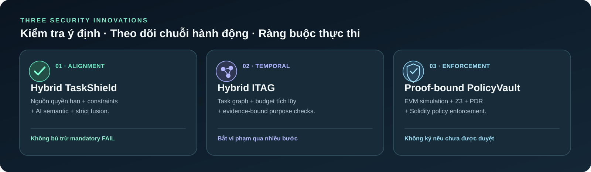
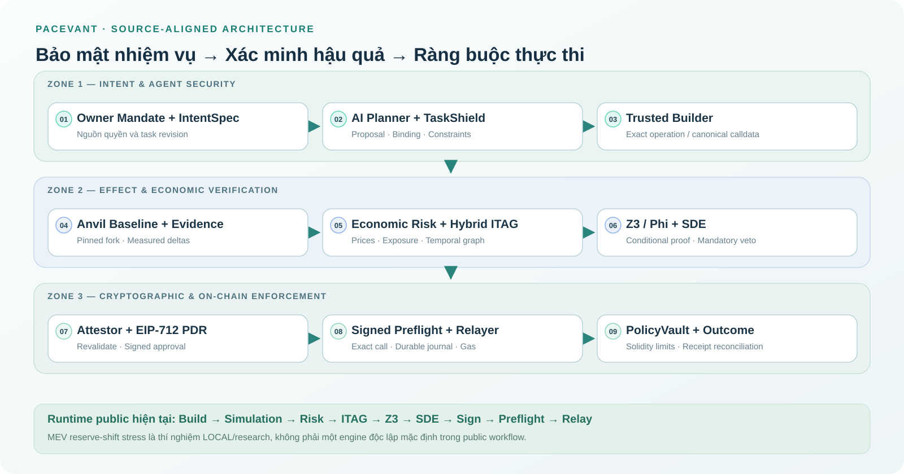

  <picture>
    <source media="(prefers-color-scheme: dark)" srcset="docs/assets/readme/hero-dark.svg">
    <source media="(prefers-color-scheme: light)" srcset="docs/assets/readme/hero-light.svg">
    
  </picture>

  <a href="#xem-cách-pacevant-chặn-giao-dịch">Xem attack/defense</a> ·
  <a href="#ba-đóng-góp-kỹ-thuật-chính">Điểm khác biệt</a> ·
  <a href="#đánh-giá-và-ablation">Benchmark</a> ·
  <a href="#kiến-trúc-end-to-end">Architecture</a> ·
  <a href="#chạy-thử-và-tái-hiện">Quickstart</a> ·
  <a href="docs/research/RESEARCH_INDEX.md">Research Library</a>

<strong>Giữ AI ở vai trò lập kế hoạch; xác minh quyền hạn, ý định và rủi ro trước khi cho phép giao dịch.</strong>

PaceVant là nguyên mẫu **AI Treasury Security** chạy trên EVM, kết nối ba ý tưởng: **Hybrid TaskShield** xác minh một hành động có đúng yêu cầu, **Hybrid ITAG** kiểm tra cả chuỗi giao dịch, và **evidence-bound enforcement** đưa quyết định bảo mật xuống smart contract. Thay vì chỉ hỏi giao dịch *có hợp lệ về kỹ thuật không*, PaceVant kiểm thêm giao dịch *có được người dùng cho phép không, có vi phạm quyền tích lũy không và có đủ bằng chứng để ký không*.

> **Trạng thái kiểm chứng:** nguyên mẫu nghiên cứu / hackathon, đã có swap **Avalanche Fuji testnet** và LOCAL Anvil security tests; **chưa kiểm toán độc lập, chưa hỗ trợ custody production hoặc arbitrary DeFi**, và chưa có public Fuji E2E riêng cho bản Hybrid TaskShield mới nhất. Các chỉ số được gắn với đúng benchmark/checkpoint, không suy ra khả năng bảo vệ tuyệt đối.

  <a href="https://testnet.snowtrace.io/tx/0x315a9bff8ba111487d295903ebd0f6389b1baefd40ea9526fc33bc014a9656ba"><strong>◉ Giao dịch Fuji đã xác nhận</strong></a>
  &nbsp;·&nbsp;
  <a href="docs/audit/WEB_DEMO_LIVE_REVIEW.md"><strong>Live evidence</strong></a>
  &nbsp;·&nbsp;
  <a href="docs/demo/LIVE_WEB_DEMO.md"><strong>Hướng dẫn demo</strong></a>

## Xem cách PaceVant chặn giao dịch

Kịch bản trên **LOCAL Anvil**: người dùng cấp ngân sách **20 USDC**; hai swap **10 USDC** được thực thi và đối soát. Khi Agent đề xuất giao dịch thứ ba **10 USDC**, ITAG nhận ra ngân sách tích lũy đã hết, **từ chối trước khi ký**, và nonce của relayer không đổi. Đây là một bài kiểm thử end-to-end có receipt thật trong môi trường local, **không phải một public Fuji attack**.

  

[Đọc counterfactual / receipt evidence](docs/evaluation/itag-final/FINAL_VALIDATION.md) · [Xem source temporal verifier](backend/src/treasury_backend/modules/temporal/README.md)

### Kết quả nổi bật

  

**Đọc số liệu đúng phạm vi:** 95,67% là accuracy trên **300 adapted Uniswap V2 swap cases**, không phải wallet security E2E; constraints-only cũng đạt 95,67% trên tập đó. Kết quả **8/12** đến từ scripted long-horizon trajectories. Bằng chứng **Fuji** là transaction đã xác nhận thuộc checkpoint trước PR Hybrid TaskShield mới. [Đối chiếu TaskShield](docs/evaluation/HYBRID_TASK_ALIGNMENT_RESULTS.md) · [ITAG](docs/evaluation/itag-final/FINAL_VALIDATION.md) · [Fuji](docs/audit/WEB_DEMO_LIVE_REVIEW.md).

---

## Vấn đề chúng tôi giải quyết

Một AI Agent được giao nhiệm vụ “đổi 100 USDC sang WAVAX” có thể tạo ra giao dịch **đúng cú pháp, hợp lệ theo policy của ví, nhưng không đúng mục đích được người dùng cho phép**. Trong tác vụ dài hơn, từng giao dịch có thể hợp lệ riêng lẻ nhưng cả chuỗi vượt ngân sách, thay đổi mục tiêu hoặc phụ thuộc vào nội dung từ công cụ không đáng tin cậy.

Kiểm tra chữ ký, allowlist và hạn mức mỗi giao dịch là cần thiết, **nhưng chưa đủ** để xác minh *task alignment*, *temporal intent* và hệ quả kinh tế tích lũy. PaceVant chèn các lớp đánh giá này **trước khi ký**, sau đó buộc giao dịch đi qua những ràng buộc thực thi cuối cùng trên smart contract.

| Rủi ro | Ví dụ | Lớp bảo vệ |
| --- | --- | --- |
| Sai ý định trong một giao dịch | Đổi đúng số tiền nhưng sai token đích / người nhận | Hybrid TaskShield + mandatory constraints |
| Prompt injection / goal hijacking | Tool output yêu cầu chuyển tiền sang địa chỉ khác | Authenticated provenance, AI semantic checks, task binding |
| Vi phạm qua nhiều bước | Mỗi lần swap hợp lệ, tổng chuỗi vượt task budget | ITAG history, reservations, ordered constraints |
| Thiệt hại kinh tế dù call hợp lệ | Slippage, tác động thanh khoản, exposure | Anvil simulation, MEV stress, oracle và economic risk |
| Bỏ qua quyết định off-chain | Gửi calldata bị sửa, replay hoặc vượt session | Signed PDR, revalidation, PolicyVault |

## Ba đóng góp kỹ thuật chính

  

### 1. Hybrid Task Alignment Shield — xác minh hành động có đúng yêu cầu không?

- **AI** phân tách và phân tích ngữ nghĩa của authenticated user intent; phát hiện drift, mâu thuẫn và dấu hiệu prompt injection.
- **Deterministic constraints** xác minh token, amount, direction, deadline, minimum output, recipient, chain, router và các yêu cầu bắt buộc có thể kiểm chứng.
- **Task binding + provenance** nối action với nhiệm vụ và revision hợp lệ; tool output không thể tự cấp thêm quyền.
- **Strict fusion:** một mandatory violation không thể bị điểm “đóng góp tích cực” của yêu cầu khác bù trừ; thiếu bằng chứng quan trọng trả về uncertain và không cấp quyền ký.

**Kết quả trên 300 mẫu swap Uniswap V2 đã điều chỉnh:** bản cũ đạt **49,00%** accuracy; Hybrid đạt **95,67%**, với **0/232 false accepts** trong tập regression này. Đáng chú ý, **constraints-only cũng đạt 95,67%**: kết quả này chứng minh hiệu quả của thiết kế kiểm tra điều kiện, *không chứng minh lợi ích tăng thêm của AI trên chính tập 300 mẫu*.

[Xem thiết kế TaskShield](docs/security/HYBRID_TASK_ALIGNMENT.md) · [Ablation A/B/C/D và giới hạn](docs/evaluation/HYBRID_TASK_ALIGNMENT_RESULTS.md) · [Error analysis](docs/evaluation/HYBRID_TASK_ALIGNMENT_ERRORS.md)

### 2. Hybrid ITAG — xác minh chuỗi hành động theo mục tiêu và lịch sử

**Intent-Aware Temporal Action Graph (ITAG)** liên kết IntentSpec đã xác thực, các hành động, evidence, task revisions, lịch sử đã thực thi và những ràng buộc tích lũy. Deterministic temporal verifier kiểm budget/order/replay; graph-aware AI đánh giá các purpose conflicts không được diễn tả đầy đủ bằng điều kiện số học. AI chỉ có thể **veto hoặc escalate**, không mở rộng quyền.

Trong benchmark **12 adverse + 12 benign trajectories** có kịch bản scripted, deterministic ITAG can thiệp **8/12** adverse trong khi vẫn chấp nhận **12/12** benign. Các purpose conflicts nằm trong giới hạn số học là trường hợp khó hơn: nghiên cứu semantic reliability sau đó ghi nhận **7/8 quan sát purpose conflict** có validated semantic lift, **9/10 quan sát benign** được approve, nhưng đây là tập nhỏ, có lặp lại và nhãn chưa được review độc lập.

[Xem ITAG final validation](docs/evaluation/itag-final/FINAL_VALIDATION.md) · [Graph-aware semantic reliability v2.3 → v3.2](docs/evaluation/itag-semantic-reliability/FINAL_REPORT.md) · [Temporal module](backend/src/treasury_backend/modules/temporal/README.md)

### 3. Evidence-bound on-chain enforcement — AI không giữ quyền ký

PaceVant xây exact calldata, mô phỏng chính giao dịch qua **Anvil fork**, thu thập state differences, stress theo các kịch bản MEV, đọc oracle/portfolio, tính risk và chứng minh những postcondition hữu hạn bằng **Z3 SMT**. **Security Decision Engine (SDE)** tổng hợp các veto. **Attestor** chỉ ký PDR sau revalidation; **PolicyVault** kiểm chữ ký, session, hạn mức, replay, calldata commitment và các điều kiện hậu giao dịch có thể thực thi on-chain.

Đây là **off-chain conditional proof + trusted attestor + on-chain enforcement**, **không phải** zero-knowledge proof, ERC-4337 bundler hay bằng chứng rằng smart contract tự chạy LLM/Z3.

[System Design V2.1](docs/AI_Treasury_Security_System_Design_v2.1.md) · [Smart contracts](contracts/README.md) · [Shared hashes & proof engine](packages/contracts-api/README.md)

## Demo và bằng chứng thực thi

### Những tình huống có thể trình diễn

| Kịch bản | Điều cần chứng minh | Môi trường / phạm vi bằng chứng |
| --- | --- | --- |
| Swap hợp lệ | User intent → planner → Shield/ITAG → simulation → proof → signed PDR → vault/LFJ → receipt | **Public Avalanche Fuji** đã có confirmed transaction |
| Giao dịch sai intent | Trường không đúng intent được phát hiện, không được phát hành quyền ký | TaskShield regression, API/security tests, LOCAL |
| Vượt ngân sách long-horizon | Hai swaps hợp lệ; giao dịch tiếp theo bị ITAG chặn trước signing, nonce relayer không đổi | **LOCAL Anvil**, có receipts và counterfactual comparisons |
| Prompt injection | TOOL-role content cố đổi recipient/policy/giả mạo user; xem verdict và model trace | Lab test dùng real provider hoặc scripted tùy case; **không** gửi swap |
| Replay, sai calldata / sai signer | Contract ngăn sửa đổi/replay dựa vào signed commitment | Historical **eth_call** / Solidity regressions; không phải public revert mới |

**Bằng chứng public Fuji đã đối soát:**

- Demo User web swap: [Transaction trên Snowtrace](https://testnet.snowtrace.io/tx/0x315a9bff8ba111487d295903ebd0f6389b1baefd40ea9526fc33bc014a9656ba), block **61375517**; thực hiện Circle test USDC → WAVAX, ghi actual gas debit và trạng thái receipt. [Báo cáo live web](docs/audit/WEB_DEMO_LIVE_REVIEW.md).
- Checkpoint core trước đó: [Transaction trên Snowtrace](https://testnet.snowtrace.io/tx/0xf975361607032ec0709140d32c6d5e98a266f8df6917226e1d6ecb6cf6361b10), block **61371323**, với public chain checks và đối chiếu SMT. [Báo cáo checkpoint](docs/audit/SYSTEM_SECURITY_REAL_DATA_REVIEW.md).
- Hai giao dịch trên thuộc **checkpoint trước PR Hybrid TaskShield gần nhất**; không thay thế cho public Fuji E2E validation sau PR #10.

**Demo web:** chọn “PaceVant – Demo User” không cần Connect Wallet. Token swap nằm trong treasury vault; relayer trả gas on-chain. Gas credit là sponsor allowance **off-chain**, không phải số dư AVAX hoặc tiền gửi của người dùng. [Live web runbook](docs/demo/LIVE_WEB_DEMO.md) giải thích chi tiết.

> Chưa đặt liên kết hosted demo/video ở đây vì repository chưa có bằng chứng nghiệm thu hosting. Không bấm “Swap” để health-check: nếu đủ điều kiện, thao tác đó có thể broadcast giao dịch testnet thật.

## Kiến trúc end-to-end

  

**Sơ đồ tóm tắt** trên thể hiện các gate quan trọng; code có các luồng kiểm song song, revalidation và call-binding chi tiết được mô tả trong [System Design V2.1](docs/AI_Treasury_Security_System_Design_v2.1.md) và [Module Map](backend/MODULES.md).

<strong>Xem Mermaid end-to-end chi tiết (có thể chỉnh sửa và tái hiện)</strong>

~~~mermaid
flowchart TD
    U["Người dùng: intent đã xác thực + Treasury Mandate"] --> P["AI Treasury Planner"]
    P --> T["Hybrid TaskShield: binding + constraints + semantic + fusion"]
    T --> B["Builder: exact transaction / calldata"]
    B --> S["Anvil pinned-fork baseline + MEV stresses"]
    S --> E["Evidence extractor: state diffs / logs / hashes"]
    E --> G["Hybrid ITAG: graph + temporal history + semantic"]
    E --> R["Portfolio + Chainlink + Economic Risk"]
    E --> Z["Z3 SMT: bounded proof / Phi"]
    G --> D["Security Decision Engine"]
    R --> D
    Z --> D
    D -->|APPROVE| V["Revalidation + Attestor + Signed PDR"]
    D -->|REJECT / REPLAN / ESCALATE| X["Không ký / feedback"]
    V --> F["Guarded final preflight + gas hold / tx journal"]
    F --> C["Relayer → PolicyVault → LFJ trên Fuji"]
    C --> O["Outcome Monitor + canonical receipt / gas reconciliation"]
    O --> H["History + experience / future task budget"]
    H -.-> G
~~~

**Hai ranh giới không được đánh đồng:** (1) control plane (AI/risk/proof/SDE) xác minh để *cấp quyền*; (2) PolicyVault kiểm những điều kiện Solidity có thể enforce khi giao dịch *thực thi*. Kết quả simulation tại pinned block không bảo đảm điều kiện chain trong tương lai; vì vậy có revalidation, final preflight và postconditions.

**Kiến trúc triển khai:** một **Python/FastAPI modular monolith**, không phải kiến trúc microservices. Frontend browser HTML/CSS/JavaScript; workflow gọi execution adapter trong process; SQLite lưu trạng thái điều khiển và execution journal; Anvil chạy subprocess để fork EVM. [Sơ đồ module](backend/MODULES.md) · [Canonical system design](docs/AI_Treasury_Security_System_Design_v2.1.md).

## Các tầng kiểm soát bảo mật

| Tầng | Input chính | Output / nguyên tắc |
| --- | --- | --- |
| Authenticated task & mandate | User revision, task budget, owner policy | Phạm vi được phép, không dùng untrusted text làm authority |
| Planner | Natural-language goal, allowed action scope | Transaction proposal được parser/validator kiểm |
| Hybrid TaskShield | Intent, proposed action, provenance | ALIGNED / MISALIGNED / UNCERTAIN + typed violations |
| Transaction builder | Proposal, token identities, allowed router | Exact calldata, minOut, nonce, deadline |
| Baseline & MEV stress | Pinned fork, exact guarded call | EVM receipts/effects, reserve perturbations, hashes |
| ITAG | IntentSpec, graph/history/reservations | Temporal + purpose verdict, explanation |
| Portfolio/oracle/economic risk | Token state, Chainlink round, simulation | Exposure, bounds và evidence |
| Z3 / Phi | State difference, prices, bounded assumptions | Conditional proof evidence + enforced bounds |
| SDE | Toàn bộ gate verdicts | APPROVE / REJECT / REPLAN / ESCALATE |
| Attestor / PDR | Decision, current task/mandate, proof hashes | EIP-712 signed approval (nếu qua toàn bộ gates) |
| PolicyVault | Signed calldata, session, budget, postconditions | On-chain allow/revert, atomic counters |
| Outcome & gas accounting | Receipt, canonical block, logs | Reconcile, idempotency, gas debit/reorg, feedback |

Để review từng trường và trust boundary, đọc [security coverage matrix](docs/research/SECURITY_COVERAGE_MATRIX.md) và [System Design — threat model](docs/AI_Treasury_Security_System_Design_v2.1.md#17-threat-model-invariants-và-coverage).

## Đánh giá và ablation

### A. TaskShield — 300 mẫu single-transaction alignment

| Cấu hình | Accuracy | REJECT recall | False accept | Benign blocked / uncertain |
| --- | ---: | ---: | ---: | ---: |
| A. Score-only TaskShield gốc | 49,00% | 40,52% | 56,90% | 15/68 |
| B. Sửa aggregation, offline replay | 68,67% | 80,17% | 17,24% | 48/68 |
| C. Constraints-only, offline diagnostic | 95,67% | 100,00% | 0% | 13/68 |
| **D. Full Hybrid TaskShield** | **95,67%** | **100,00%** | **0%** | **13/68** |

**Giới hạn phép đo:** 300 mẫu **Uniswap V2 swap đã chỉnh sửa**, có synthetic context; **không** phải 300 transfer, **không** chạy trực tiếp LFJ/Fuji, **không** phải generalization holdout độc lập. 12 trường hợp benign còn uncertain; một case benign bị REJECT. Accuracy 95,67% không đồng nghĩa 95,67% end-to-end security.

[Phương pháp và raw result](docs/evaluation/HYBRID_TASK_ALIGNMENT_RESULTS.md) · [Dataset provenance](docs/evaluation/curated-300/benchmark_300_quality_report.md)

### B. Long-horizon ITAG — đánh giá temporal và purpose drift

| Cấu hình / phép đo | Kết quả | Diễn giải đúng |
| --- | --- | --- |
| Wallet guardrails-only trên 12 adverse scripted | 0/12 interventions | Baseline không xét lịch sử task đầy đủ |
| Deterministic ITAG trên 12 adverse scripted | **8/12** interventions | Phát hiện budget/order/history violations |
| Benign scripted trajectories | **12/12** approvals | Phạm vi suite có kịch bản |
| Graph-aware semantic v3.2 | **7/8** purpose-conflict observations validated lift | Tập nhỏ, lặp cùng cấu trúc, chưa review nhãn độc lập |
| Graph-aware benign v3.2 | **9/10** approvals | Có 1 false intervention do evidence failure |
| Anvil long-horizon budget isolation | Giao dịch thứ ba không được ký | Full local enforcement + nonce unchanged |

**Lịch sử nghiên cứu cần giữ:** bản semantic đầu có evidence-binding errors và **0 validated lift**; sau khi thay graph-bound evidence catalog, selector schema và grounding, các checkpoint v3.0/v3.1/v3.2 cải thiện. Kết quả scripted model **không** được dùng để nhận định độ chính xác của real LLM.

[Final ITAG evaluation](docs/evaluation/itag-final/FINAL_VALIDATION.md) · [Semantic v2.3–v3.2](docs/evaluation/itag-semantic-reliability/FINAL_REPORT.md) · [Experiment catalog](docs/research/EXPERIMENT_CATALOG.md)

### C. Proof, on-chain và kiểm thử tích hợp

- **Z3:** kiểm quan hệ toán trong mô hình và assumptions hữu hạn; giữ SAT/UNSAT artifacts, verification hashes và điều kiện Phi. Không suy ra mọi hành vi thực tế là an toàn.
- **Solidity/PolicyVault:** regression, fuzz, replay, wrong-signer, postcondition, rollback và session/budget cases. Các report checkpoint ghi nhận **60 Solidity tests pass**, bao gồm fuzz cases; số liệu không tự chứng minh trạng thái CI hôm nay.
- **LOCAL Anvil:** swap + ERC-20 transfer, kiểm tra simulation → risk → proof → SDE → attestor → vault → receipt; nhiều integration test dùng AI scripted, có smoke cases real-model riêng.
- **Public Fuji:** receipts và chain queries có thể đối soát; không đồng nhất với independent audit hay nghiệm thu mainnet.

[Research index](docs/research/RESEARCH_INDEX.md) · [Fuji live report](docs/audit/WEB_DEMO_LIVE_REVIEW.md) · [Solidity tests](contracts/test/README.md)

## Công nghệ sử dụng

| Nhóm | Công nghệ / thành phần đã triển khai | Chức năng |
| --- | --- | --- |
| AI Agent | DeepSeek, Groq, Gemini, Xingchi provider adapters | Natural-language planning, semantic assessment, fallback |
| AI Agent Security | Hybrid TaskShield, evidence validation, tool interception | Intent binding, constraint verification, injection / drift detection |
| Long-horizon reasoning | ITAG typed graph, history, semantic fusion | Task budget/order/purpose và evidence provenance |
| Blockchain / DeFi | EVM, Avalanche Fuji, LFJ (Trader Joe), Circle test USDC, WAVAX | Exact-input swap theo route được allowlist |
| Chain data | RPC, Chainlink feeds, token/portfolio reader | Chain state, price round, balances, exposure |
| Execution & stress | Foundry, **Anvil fork**, LFJ stress actor, MEV scenarios | Baseline, reserve perturbation, guarded preflight |
| Formal verification | **Z3 SMT**, bounded postconditions, Phi | Conditional off-chain proof |
| Signing | EIP-712, Keccak-256, signed PDR V2 | Binding evidence → calldata → approval |
| Smart contracts | Solidity, PolicyVault, LFJSwapAdapter, OpenZeppelin | On-chain policy/session/caps/replay enforcement |
| Backend | Python 3.12, FastAPI, Uvicorn, uv | Typed modular monolith và workflow orchestration |
| State & accounting | SQLite, durable raw-tx journal, idempotency | Reservation, recovery, receipt/gas reconciliation |
| Frontend | HTML, CSS, browser JavaScript, graph viewer | Demo account, workflow, evidence, attack views |
| QA & tooling | pytest, Forge, fuzz tests, Ruff, Node syntax checks, Docker | Regressions, source validation, packaging |

**Không có trong live flow:** ERC-4337 bundler/paymaster, ERC-7579 module account, fully autonomous arbitrary-protocol trading, ZK proving, multi-tenant custody. [Technology inventory có source links](docs/research/TECHNOLOGY_INVENTORY.md).

## Các module đã phát triển

Hệ thống chia thành **15 business capabilities** trong backend; chúng là các module trong **một** FastAPI app, không phải 15 microservices.

| Module | Trách nhiệm |
| --- | --- |
| Planning | Goal parsing, provider adapters, bounded proposal |
| Alignment | Hybrid TaskShield, provenance, intent constraints |
| Temporal | ITAG, graph builder, verifier, semantic fusion |
| Portfolio | Chain snapshot, portfolio state |
| Oracle | Price rounds, freshness, provenance |
| Risk | Exposure, economic effects, constraints |
| Proof | Z3 postconditions, proof artifacts |
| Decision | Security Decision Engine |
| Signing | Attestor và signed PDR |
| Execution | Build, fork simulation, evidence, relay |
| Monitoring | Outcome/receipt reconciliation |
| Persistence | Control state, immutable history |
| Experience | Replan guidance từ outcome |
| Gas Credit | Sponsor gas holds, settlement, reorg ledger |
| Workflows | Coordination, evaluation, authorization |

[Module map và import boundaries](backend/MODULES.md) · [Backend overview](backend/README.md) · [Frontend](frontend/README.md) · [Contracts API](packages/contracts-api/README.md)

## Chạy thử và tái hiện

**Điều kiện:** Python 3.12, uv, Foundry/Anvil và quyền truy cập phù hợp cho từng mode. Đọc [runbook demo](docs/demo/LIVE_WEB_DEMO.md) và [config/deployment](deploy/README.md) trước khi sử dụng môi trường public.

~~~powershell
# Cài đặt dependency và artifact
uv sync --locked
uv run --locked python tools/contracts/bootstrap.py

# Mock UI/fixtures: không gửi Fuji transaction
uv run --locked treasury mock

# LOCAL Anvil: asset/test oracle kiểm soát, không gửi Fuji transaction
uv run --locked treasury local

# Fuji: kiểm tra read-only trước
uv run --locked treasury doctor --network fuji
uv run --locked treasury doctor --network fuji --live

# Khởi động backend Fuji; serve không tự gửi transaction
uv run --locked treasury serve --network fuji
~~~

Mở **http://127.0.0.1:8000**. Khi dùng Fuji, lệnh **chạy goal/swap**, owner funding, deploy, renew session hoặc renew policy **có thể gửi giao dịch thực và tiêu testnet AVAX**. Đừng sử dụng chúng như lệnh kiểm tra. Không có cấu hình Fuji hợp lệ thì fail closed, không âm thầm fallback sang mock.

Các kiểm thử cơ bản (không mặc định broadcast public transaction):

~~~powershell
uv run --locked python -m pytest -q
uv run --locked python tools/contracts/foundry.py forge test -vv
uv run --locked ruff check backend/src backend/tests tools
uv run --locked python tools/quality/scan_secrets.py
~~~

Tái hiện từng benchmark theo đúng frozen dataset, checkpoint, provider credential và chế độ model/scripted được mô tả trong [TaskShield results](docs/evaluation/HYBRID_TASK_ALIGNMENT_RESULTS.md) và [ITAG final validation](docs/evaluation/itag-final/FINAL_VALIDATION.md). Không commit file `.env`, keys, signed raw transactions hay local runtime journals.

## Thư viện nghiên cứu và tài liệu chuyên sâu

README này là **cửa vào**, không thay thế artifact và lịch sử nghiên cứu. Mỗi kết quả cần truy được: **question → method → dataset/fixture → source commit → metrics/limitations → raw evidence**.

| Tài liệu | Mục đích |
| --- | --- |
| [Research Index](docs/research/RESEARCH_INDEX.md) | Toàn bộ hướng nghiên cứu, thiết kế, cải tiến và tài liệu liên quan |
| [Experiment Catalog](docs/research/EXPERIMENT_CATALOG.md) | Các thí nghiệm: baseline, ablation, negative results và checkpoints |
| [Technology Inventory](docs/research/TECHNOLOGY_INVENTORY.md) | Công nghệ, chức năng, code path, trạng thái |
| [Security Coverage Matrix](docs/research/SECURITY_COVERAGE_MATRIX.md) | Threat → security gate → enforcement → evidence → giới hạn |
| [System Design V2.1](docs/AI_Treasury_Security_System_Design_v2.1.md) | Kiến trúc as-built, từng module, dữ liệu và trust boundaries |
| [Reviewer Guide](docs/REVIEWER_GUIDE.md) | Lộ trình kiểm chứng cho technical reviewers |
| [Documentation Manifest](docs/DOCUMENTATION_MANIFEST.json) | Phân loại hồ sơ hiện hành / lịch sử và raw artifacts |
| [Live Web Demo](docs/demo/LIVE_WEB_DEMO.md) | Quy trình demo Fuji và các cảnh báo chain-writing |

## Threat model, giới hạn và công việc tiếp theo

PaceVant **không trao quyền ký cho LLM**. Hệ thống dựa trên authenticated IntentSpec/Mandate, trusted operator/attestor, nguồn chain/oracle, kiểm tra bằng chứng, revalidation, contract allowlists và signing policies. **Owner hoặc attestor bị xâm phạm** vẫn là trust assumptions đáng kể; on-chain không tự xác minh độ đúng của một diễn giải ngữ nghĩa do LLM tạo.

Những gì **chưa được chứng minh đầy đủ**: generalization AI security trên tập độc lập quy mô lớn; triển khai swap tùy ý trên mọi DEX; mainnet, external audit, HSM/HA, multi-user custody/real payment, hosting production; và **public Fuji E2E riêng cho Hybrid TaskShield sau PR #10**. Có các mock/fixture profile để kiểm thử, nhưng live profile dùng oracle/chain/DEX thật trong phạm vi route hỗ trợ.

**Ưu tiên tiếp theo:** independent adversarial evaluation, xác minh end-to-end tại HEAD, thử nghiệm các loại intent mới và cải thiện độ bao phủ benign của parser mà không giảm fail-closed guarantees.

[Danh mục threat/invariant và các giới hạn](docs/research/SECURITY_COVERAGE_MATRIX.md) · [Current system review](docs/PACEVANT_CURRENT_SYSTEM_REVIEW.md)

---

**PaceVant — để AI hỗ trợ ra quyết định, nhưng quyền sử dụng tài sản luôn được kiểm chứng.**

*README tiếng Việt — nhánh review, dựa trên source và evidence có sẵn tại checkpoint 21/11/2026. Các liên kết tới báo cáo cũ giữ nguyên provenance; không tự nâng historical results thành chứng nhận HEAD.*