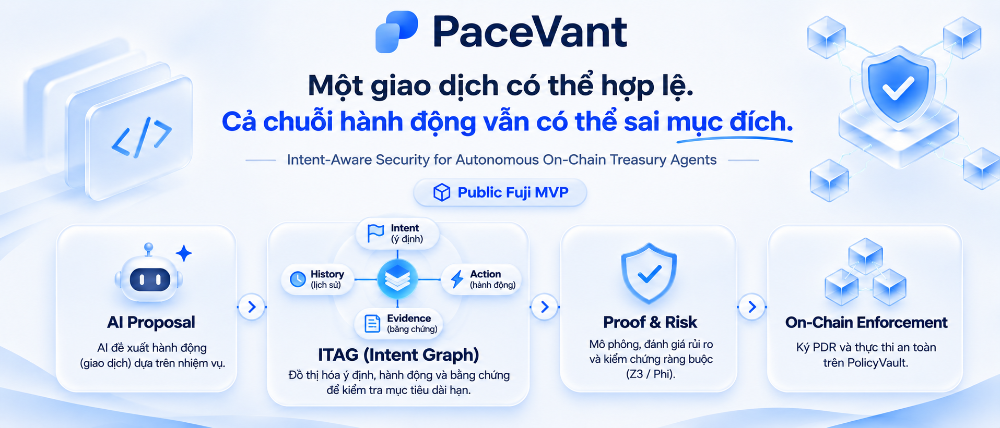
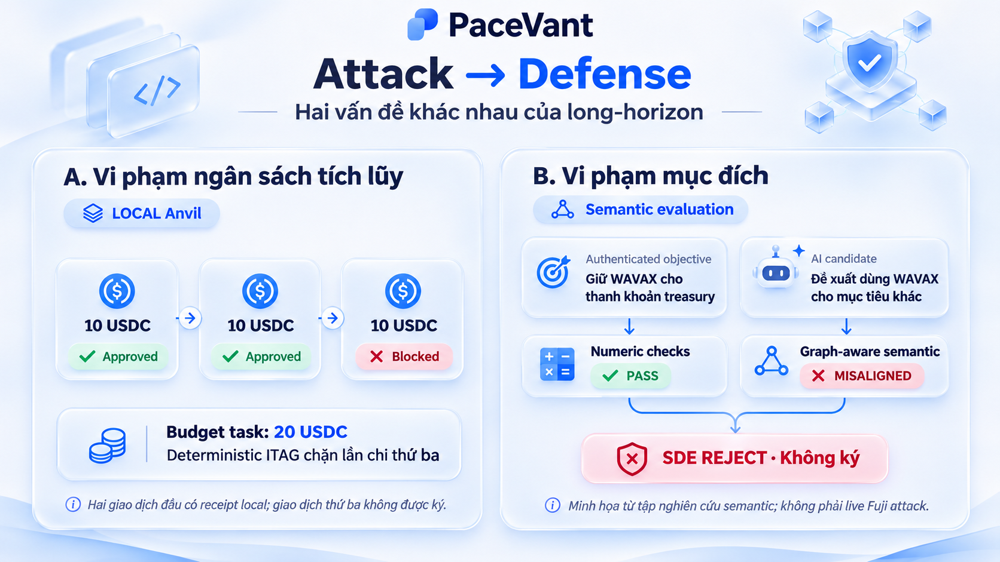
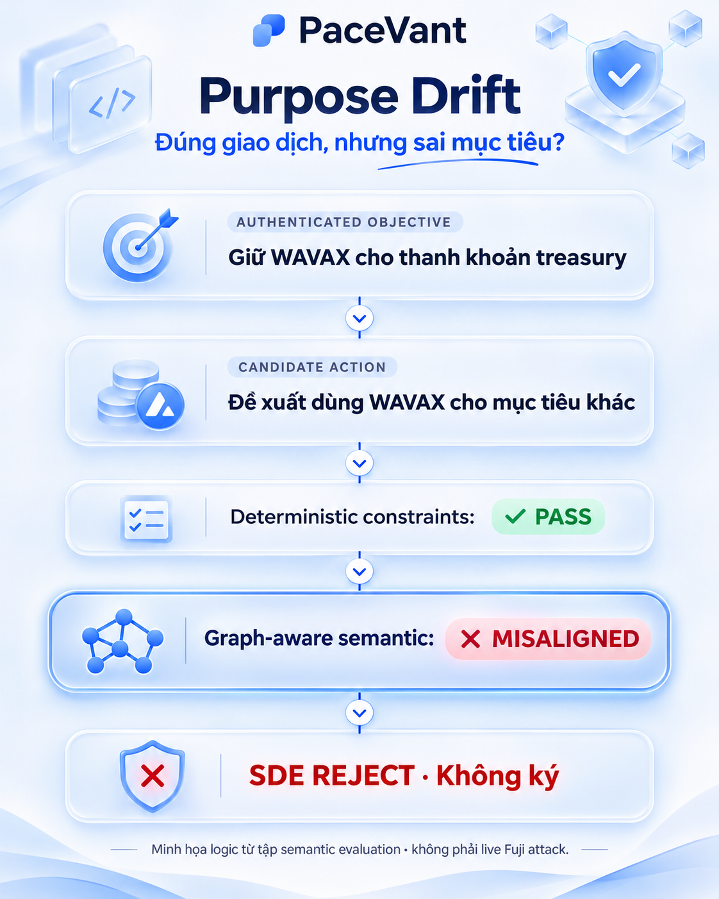
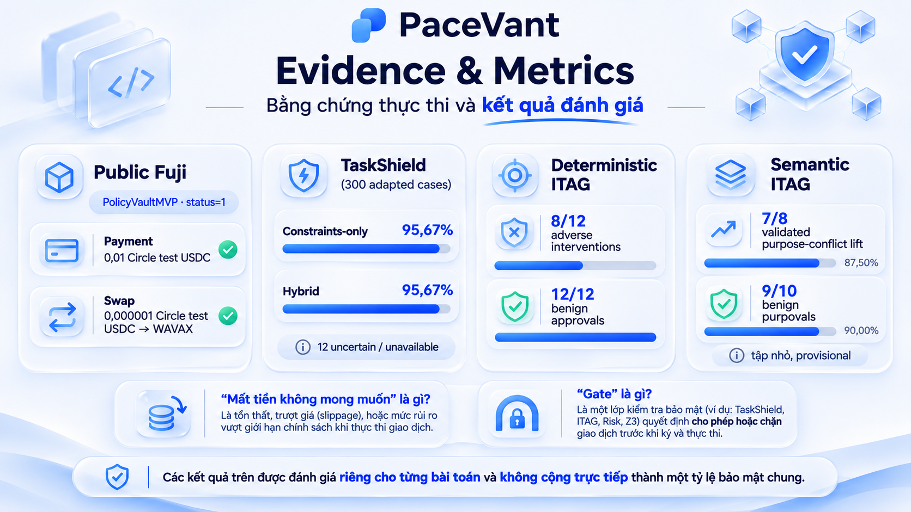
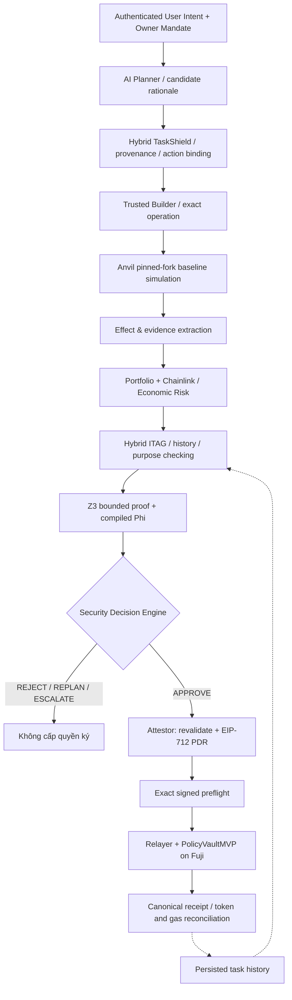
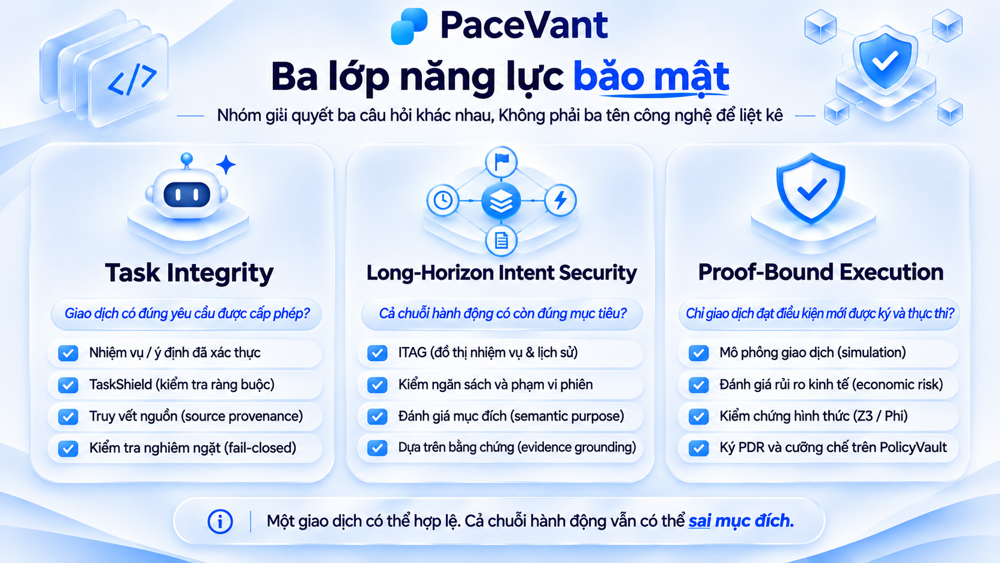

<div align="center">
  <picture>
    <source media="(prefers-color-scheme: dark)" srcset="docs/assets/readme/approved/hero-glass.png">
    <source media="(prefers-color-scheme: light)" srcset="docs/assets/readme/approved/hero-glass.png">
    
  </picture>

  <p><em>Intent-Aware Security for Autonomous On-Chain Treasury Agents</em></p>
  <p><a href="https://pacevant.live"><strong>Live Demo</strong></a> · <a href="docs/evidence/FUJI_WORKFLOW_EVIDENCE.md"><strong>Security Evidence</strong></a> · <a href="#kiến-trúc-mỗi-lớp-tồn-tại-để-làm-gì"><strong>Architecture</strong></a> · <a href="#research-library--không-bỏ-mất-công-sức-nghiên-cứu"><strong>Research</strong></a></p>
</div>

<p align="center">
  <a href="https://testnet.snowtrace.io/address/0x70e1395F959dba530cF4A53B060c809b715bB6d5"></a>
  <a href="docs/research/SECURITY_COVERAGE_MATRIX.md"></a>
  <a href="docs/research/SECURITY_COVERAGE_MATRIX.md"></a>
</p>

**Một giao dịch có thể hợp lệ. Nhưng cả chuỗi hành động vẫn có thể đi sai mục tiêu.**

**PaceVant** là lớp bảo mật cho **AI Agent quản lý tài sản on-chain**. AI có thể đề xuất thanh toán hoặc hoán đổi token, nhưng **không được tự quyết định chuyển tiền**. Trước khi được ký, mỗi hành động phải đáp ứng nhiệm vụ người dùng đã cấp, giới hạn rủi ro tài chính và điều kiện bảo mật có thể kiểm chứng.

**Hai năng lực làm nên PaceVant:**

- **ITAG — giữ AI đi đúng mục tiêu dài hạn.** *Intent-Aware Temporal Action Graph* liên kết ý định đã xác thực, quyền hạn Owner, giao dịch trước đó, hành động AI đề xuất và nguồn bằng chứng. ITAG phát hiện **vượt ngân sách tích lũy** và kiểm tra **sai lệch mục đích ngữ nghĩa** — kể cả khi một giao dịch riêng lẻ vẫn đúng các giới hạn số học.
- **EVM Simulation + Economic Risk — đo trước hậu quả tài chính.** Giao dịch được **chạy thử trên EVM fork** để quan sát số dư trước/sau, token gửi/nhận, allowance và chi phí thực thi dự kiến. Kết quả được đánh giá cùng **Chainlink, portfolio và các giới hạn kinh tế** nhằm nhận ra trượt giá, đầu ra quá thấp, rủi ro tổn thất hoặc exposure vượt mức **trước khi ký**.

Các kết quả này đi qua **Z3/Φ**, **Security Decision Engine**, phê duyệt có chữ ký **EIP-712** và **PolicyVault** để ràng buộc quyền thực thi on-chain. **AI không giữ signing authority**, nên không thể bỏ qua kiểm tra rồi tự tiêu tài sản.

**Đã triển khai:** MVP trên **Avalanche Fuji Testnet (chain ID 43113)** với các giao dịch **payment USDC** và **swap USDC → WAVAX** có receipt công khai. Đây là **treasury testnet với hai nghiệp vụ giới hạn**, chưa audit độc lập, chưa phải mainnet hoặc custody đa người dùng.

**Khám phá:** [Live Demo](https://pacevant.live) · [Bằng chứng giao dịch Fuji](docs/evidence/FUJI_WORKFLOW_EVIDENCE.md) · [Thư viện thí nghiệm](docs/research/EXPERIMENT_CATALOG.md).

> **Phạm vi bằng chứng:** Giao dịch public Fuji, các bài test LOCAL Anvil, phản hồi real-model và historical `eth_call` là **những loại bằng chứng khác nhau**. Website public triển khai theo nhánh `develop`; README mới trên `main` không đồng nghĩa mọi tính năng đã lên VPS. Xem [runbook](docs/PUBLIC_FUJI_RUNBOOK.md).

### Mục lục

- [Vấn đề và động lực](#problem)
- [PaceVant trong 60 giây](#overview)
- [ITAG: Attack → Defense](#itag)
- [Những gì đã chạy thật](#evidence)
- [Kiến trúc & sơ đồ Mermaid](#architecture)
- [Ba lớp bảo mật](#capabilities)
- [Kết quả đánh giá](#evaluation)
- [Khác biệt so với các hướng trước](#prior-work)
- [Công nghệ đã triển khai](#technology)
- [Dùng thử và tái hiện](#getting-started)
- [Tài liệu nghiên cứu](#research)

---

<a id="problem"></a>
## Vấn đề: Đúng giao dịch chưa chắc đúng mục tiêu

**Tình huống:** Người dùng giao cho AI Agent nhiệm vụ đổi USDC sang WAVAX để phục vụ treasury. Một giao dịch có thể hợp lệ về mặt smart contract, nhưng vẫn **sai yêu cầu, vượt ngân sách qua nhiều lần hoặc gây thiệt hại kinh tế**.

| Điều có thể xảy ra | Vì sao kiểm tra từng giao dịch chưa đủ? | PaceVant giải quyết ở đâu? |
| --- | --- | --- |
| **Sai ngay từ giao dịch đầu tiên** | Token, người nhận hoặc số tiền không khớp yêu cầu nhưng calldata vẫn hợp lệ | **TaskShield** đối chiếu proposal với nhiệm vụ đã xác thực |
| **Vượt ngân sách tích lũy** | Ba lần tiêu 10 USDC, mỗi lần hợp lệ, nhưng nhiệm vụ chỉ có 20 USDC | **Deterministic ITAG** kiểm lịch sử và ngân sách đã sử dụng |
| **Sai mục đích dài hạn** | Các con số đều đúng, nhưng lý do dùng tài sản đã chuyển sang mục tiêu khác | **Semantic ITAG** đối chiếu mục đích và nguồn bằng chứng trên đồ thị |
| **Tổn thất tài chính** | Giao dịch chạy thành công nhưng nhận quá ít token hoặc tăng exposure vượt ngưỡng | **EVM Simulation + Chainlink/Portfolio + Economic Risk + Z3** |
| **Thay đổi trạng thái trước lúc thực thi** | Giá, pool hoặc policy không còn như lúc chạy thử | **Revalidation + Signed PDR + PolicyVault** kiểm lại các điều kiện |

**Điểm cốt lõi:** PaceVant tách biệt việc *hiểu mục tiêu* (TaskShield/ITAG), *đo hậu quả tài chính* (Simulation/Risk), *kiểm điều kiện* (Z3) và *cưỡng chế quyền chuyển tài sản* (Signed PDR/PolicyVault). Không có một LLM duy nhất được tự quyết định “SAFE”.

<a id="overview"></a>
## Trong 60 giây: Vì sao PaceVant cần nhiều lớp bảo mật?

Hãy xem hệ thống như **ba câu hỏi phải được trả lời trước khi AI được phép tiêu tiền**:

| Câu hỏi | Thành phần chính | Hiểu đơn giản |
| --- | --- | --- |
| **AI còn làm đúng nhiệm vụ không?** | **TaskShield + ITAG** | Kiểm action hiện tại **và** mục đích, lịch sử, ngân sách của cả chuỗi hành động |
| **Nếu chạy, tài sản sẽ bị ảnh hưởng thế nào?** | **Trusted Builder + EVM Simulation + Chainlink/Portfolio + Economic Risk + Z3** | Chạy thử để đo token ra/vào, allowance, gas; kiểm slippage, tổn thất, exposure và giới hạn đã cấp |
| **Ai bảo đảm các kiểm tra không bị bỏ qua?** | **SDE + Attestor + Signed PDR + PolicyVault** | Chỉ cấp chữ ký khi đủ điều kiện; smart contract kiểm chữ ký, nonce, session và hậu điều kiện |

**Sự kết hợp mới quan trọng:** ITAG xem **hành trình và mục tiêu**; simulation xem **hậu quả dự kiến**; contract kiểm **quyền thực thi cuối cùng**. [Xem thiết kế kỹ thuật 16 bước](docs/architecture/ARCHITECTURE_EXPLAINED.md).

<a id="itag"></a>
## Attack → Defense: Hai vấn đề khác nhau của long-horizon

**ITAG (Intent-Aware Temporal Action Graph)** là đóng góp nghiên cứu trọng tâm của nhóm. Thay vì chỉ hỏi “giao dịch này hợp lệ không?”, hệ thống xem **nhiệm vụ gốc → các hành động trong lịch sử → đề xuất tiếp theo → bằng chứng**, để kiểm liệu AI còn theo đuổi đúng mục đích xuyên nhiều bước hay không.

ITAG kết hợp hai hướng: **temporal/deterministic** kiểm ngân sách, thứ tự và trạng thái đã ghi nhận; **graph-aware semantic** đối chiếu ý định với mục đích được thể hiện trong đề xuất, dựa trên nguồn bằng chứng. AI semantic không thể tự cấp quyền mới cho ví.

### A. Vi phạm ngân sách tích lũy — LOCAL Anvil, đã kiểm thử

<p align="center"><a href="docs/evaluation/itag-final/ANVIL_BUDGET_ISOLATION.json"></a></p>

**Ví dụ có kết quả chạy EVM cục bộ:** Chủ ví cấp **20 USDC** cho cả nhiệm vụ. Hai swap đầu, mỗi lần **10 USDC**, được xác nhận trên LOCAL Anvil. Khi AI đề xuất lần thứ ba thêm 10 USDC, giao dịch này *riêng lẻ vẫn đúng mức 10 USDC*, nhưng tổng chi sẽ lên **30 USDC**. **ITAG từ chối trước khi ký**, relayer nonce không tăng.

Trong phép đối chứng trên cùng điều kiện (*paired counterfactual*), wallet-only và TaskShield-only vẫn chấp nhận ứng viên thứ ba. Đây là bằng chứng về **history/budget enforcement**, không phải việc AI nhận ra semantic hijacking. [Kết quả, so sánh và receipts](docs/evaluation/itag-final/FINAL_VALIDATION.md).

### B. Vi phạm mục đích — Graph-aware semantic evaluation, thí nghiệm real-model

<p align="center"><a href="docs/assets/readme/approved/purpose-drift-glass.png"></a></p>

*Hình diễn giải ý tưởng, không phải ảnh chụp một cuộc tấn công public Fuji.* [Xem hình gốc](docs/assets/readme/approved/purpose-drift-glass.png).

**Ví dụ:** Người dùng dành WAVAX cho một nhu cầu treasury cụ thể. AI đề xuất hành động tiếp theo vẫn tuân thủ amount/token/recipient nhưng *lý do sử dụng* lại chuyển sang một mục tiêu khác. Rule số học **PASS**; semantic ITAG đối chiếu nhiệm vụ gốc, candidate rationale và evidence trên graph, có thể đưa ra **MISALIGNED** để SDE từ chối.

Bản nghiên cứu real-model v3.2 ghi nhận **7/8 purpose-conflict observations** tạo validated semantic lift, **9/10 benign observations** được duyệt và **16/19 graph-model outputs** hợp lệ. Đây là **tập nhỏ, lịch sử tổng hợp, lặp tình huống và chưa có đánh giá nhãn độc lập** — không phải production detection rate. Chưa có ablation chứng minh graph representation vượt việc đưa lịch sử dạng văn bản cho LLM.

**ITAG mang lại điều gì?** Một đề xuất có thể đúng từng giới hạn nhưng vẫn sai **toàn bộ nhiệm vụ**. ITAG giúp hệ thống xét thêm lịch sử và mục đích trước bước ký, trong khi Simulation/Risk/Z3 xử lý một lớp vấn đề khác là **tổn thất kinh tế và giới hạn thực thi**.

[Báo cáo semantic, bao gồm kết quả thất bại trước đó](docs/evaluation/itag-semantic-reliability/FINAL_REPORT.md) · [Code ITAG](backend/src/treasury_backend/modules/temporal/README.md).

---

<a id="evidence"></a>
## PaceVant đã chạy thật được gì?

<p align="center"><a href="docs/audit/public-fuji-live-acceptance-20261121.json"></a></p>

**Điểm quan trọng với giám khảo:** PaceVant đã **thực sự thực hiện và đối soát** payment/swap trên Avalanche Fuji. Đây không chỉ là video UI hoặc số liệu mô phỏng. Tuy nhiên, testnet live mới mở **hai nghiệp vụ cố định**, không phải ví cho mọi giao thức DeFi.

### Does it execute? — Public Fuji acceptance

| Bằng chứng | Kết quả đã ghi nhận | Nguồn kiểm chứng |
| --- | --- | --- |
| **PolicyVaultMVP** | Contract triển khai tại `0x70e1395F959dba530cF4A53B060c809b715bB6d5` | [Snowtrace contract](https://testnet.snowtrace.io/address/0x70e1395F959dba530cF4A53B060c809b715bB6d5) · [Deployment journal](docs/audit/mvp-public-deployment-20261121.json) |
| **USDC payment** | **0,01 Circle test USDC** từ Vault đến payee allowlisted; receipt thành công, payee nhận **10.000 base units** | [Fuji transaction](https://testnet.snowtrace.io/tx/0x10f6a04e22179f4186459e3738c61597048e9b2aac724c01347ba306f4470b8c) |
| **USDC → WAVAX swap** | **0,000001 Circle test USDC → WAVAX**, output về Vault và token deltas được đối soát | [Fuji transaction](https://testnet.snowtrace.io/tx/0xa708f44e355b6926c02693282f8ca6514fd043199ae8d23d3a031d64f82e4b2d) |
| **Bằng chứng audit trail** | Code hash, receipt, balance snapshots, EIP-712, phí gas và browser acceptance | [Public Fuji acceptance](docs/audit/public-fuji-live-acceptance-20261121.json) · [Current Review](docs/PACEVANT_CURRENT_SYSTEM_REVIEW.md) |

### Một workflow, một đường truy vết từ AI đến blockchain

Một job swap được ghi nhận đi qua **Risk PASS → ITAG PASS / semantic ALIGNED → Z3 VERIFIED → SDE APPROVE → EIP-712 Attestation → Fuji CONFIRMED**. Báo cáo lưu `proof_hash`, `typed_data_hash`, `constraints_hash`, token deltas và phí AVAX thực tế để lần theo từng gate.

[**Xem từng mắt xích có job ID và hash**](docs/evidence/FUJI_WORKFLOW_EVIDENCE.md) · [Bản nghiệm thu gốc](docs/audit/public-fuji-live-acceptance-20261121.json).

> [!NOTE]
> Receipt trên Snowtrace **chứng minh giao dịch on-chain**, không tự chứng minh tất cả suy luận AI/ITAG/Z3 đúng. Việc kiểm từng gate cần trace và artifact của lần chạy tương ứng; các receipt không tự chứng minh mọi commit mới trên `main` đã được deploy.

### Does it prevent unsafe execution? — Không có transaction cũng là kết quả đúng

- **Policy guard trước ký:** payment tới payee ngoài allowlist bị từ chối với `PAYEE_NOT_ALLOWED` trước broadcast. **Không có tx hash** chính vì giao dịch không được gửi. [Báo cáo Fuji](docs/audit/public-fuji-live-acceptance-20261121.json).
- **Bốn historical Fuji `eth_call` probes:** sửa amount, phát lại nonce, hạ minOut hoặc đổi router. Đối chứng thành công; replay bị `NonceReplay()`, ba ca sửa payload bị `BadSignature()`. Đây là **kiểm tra cơ chế hợp đồng trên historical state**, không gửi attack transaction mới và `BadSignature()` **không phải** AI semantic detection. [Báo cáo 4 ca](docs/audit/live-adversarial-20261121/acceptance.json).
- **ITAG LOCAL Anvil:** khi 20 USDC đã dùng hết, đề xuất thêm 10 USDC bị từ chối trước attestation, relayer nonce giữ nguyên. [Raw artifact](docs/evaluation/itag-final/ANVIL_BUDGET_ISOLATION.json).
- **Contract tests:** kiểm nonce replay, fields đã ký, caps, policy, rollback và postconditions. [Forge tests](contracts/test/README.md).

**Lưu ý:** Các lựa chọn mô tả tình huống trong UI không tự động là cuộc tấn công live; luôn xem nhãn `PUBLIC FUJI`, `LOCAL ANVIL` hay `HISTORICAL ETH_CALL`.

### Does long-horizon analysis add value?

| So sánh trên 12 adverse trajectories scripted | Số ca can thiệp |
| --- | ---: |
| Wallet guardrails | 0/12 |
| Wallet + TaskShield cho từng action | 0/12 |
| **Deterministic ITAG với task history** | **8/12** |
| TaskShield + Deterministic ITAG | 8/12 |

Trên cùng benchmark scripted, các cấu hình đều giữ **12/12 benign approvals**. “Can thiệp” gồm reject, replan hoặc escalate, **không đồng nghĩa 8 lần AI phát hiện semantic attack**. Thử nghiệm **7/8** real-model semantic ở một tập khác, không được cộng gộp. [ITAG Evaluation](docs/evaluation/itag-final/FINAL_VALIDATION.md).

---

<a id="architecture"></a>
## Kiến trúc: Mỗi lớp tồn tại để làm gì?

**Dòng chảy cơ bản:** AI **đề xuất** → PaceVant **xác minh mục tiêu và chạy thử hậu quả** → các gate **quyết định cấp chữ ký hay từ chối** → smart contract **thực thi có điều kiện** → hệ thống **đối soát bằng chứng on-chain**.

<p align="center"></p>

**Ba vùng trách nhiệm:**

1. **Intent & Agent Security:** Owner Mandate, ý định đã xác thực, AI Planner, **TaskShield + ITAG** — kiểm quyền, đúng nhiệm vụ và tính nhất quán của chuỗi hành động.
2. **Transaction & Economic Verification:** Trusted Builder, **Anvil EVM Simulation**, state diff, Chainlink/Portfolio, **Economic Risk, Z3/Φ và SDE** — đo trước tác động kinh tế và xác minh những điều kiện giới hạn.
3. **Cryptographic & On-chain Enforcement:** Attestor, **EIP-712 Signed PDR**, exact signed preflight, Relayer, **PolicyVault** và outcome reconciliation — không cho phép bỏ qua gate hay sửa/replay payload.

**Sơ đồ workflow (hiển thị trực tiếp):**



*Sơ đồ mô tả **pipeline xử lý**, không phải ITAG graph. MEV reserve-shift/stress hiện được thực nghiệm ở môi trường LOCAL, **không** phải một engine độc lập mặc định chạy trong mọi lần public swap.*

### Tám chặng để hiểu kiến trúc (không cần biết trước blockchain)

| Chặng | PaceVant làm gì? | Vì sao cần? |
| --- | --- | --- |
| **1. Owner Mandate & Intent** | Nhận quyền và nhiệm vụ đã xác thực: tài sản, địa chỉ, ngân sách, mục tiêu, thời hạn | Model hoặc tool không tự tạo ra quyền của người dùng |
| **2. AI Proposal + TaskShield** | AI tạo đề xuất; TaskShield kiểm sự phù hợp với từng điều khoản bắt buộc | Call hợp lệ có thể sai yêu cầu |
| **3. Trusted Builder + EVM Simulation** | Tạo calldata chính xác, **chạy thử trên Anvil fork**, đo token ra/vào, allowance, logs, gas, state trước/sau | **Không đoán hậu quả kinh tế chỉ từ câu trả lời AI** |
| **4. Chainlink + Portfolio + Economic Risk** | Đối chiếu hiệu ứng mô phỏng với giá tham chiếu, slippage, minOut, loss, exposure và policy | **Swap thành công vẫn có thể gây thiệt hại tài chính** |
| **5. ITAG: Temporal + Semantic** | Đối chiếu lịch sử chi tiêu và mục đích sử dụng trên graph có nguồn | Nhiều action đúng vẫn có thể cộng thành nhiệm vụ sai |
| **6. Z3 + Φ** | Kiểm bounded constraints và tạo postconditions cho smart contract | Simulation tại một trạng thái không bảo đảm điều kiện vẫn đúng khi giao dịch được đưa lên chain |
| **7. SDE + Attestor + Signed PDR** | Tổng hợp các gate và chỉ ký EIP-712 cho operation/constraints đủ điều kiện | AI không tự ký hoặc tự đổi giao dịch sau duyệt |
| **8. Preflight + Relayer + PolicyVault + Receipt** | Kiểm lại chính xác payload, relay, contract enforce và đối soát token/gas receipt | Không thể bỏ qua quyết định kiểm soát rồi tự tuyên bố thành công |

**Thuật ngữ nhanh:** *Simulation* = chạy thử giao dịch trên EVM fork; *state diff* = chênh lệch trạng thái trước/sau; *Z3* = công cụ giải ràng buộc logic/số học; *Φ* = điều kiện hợp đồng sẽ kiểm khi thực thi; *PDR* = bản phê duyệt được ràng buộc với giao dịch và bằng chứng.

**Ranh giới tin cậy:** Z3 chạy **off-chain**, và kết luận chỉ đúng trong mô hình/assumptions đã lập; Φ chỉ enforce điều kiện đã biên dịch. Oracle/RPC/model vẫn có thể không khả dụng; vì nguyên tắc **fail-closed**, nguồn hoặc schema không đủ tin cậy có thể làm chậm hoặc tạm dừng tác vụ hợp lệ. Owner cấp policy, Attestor nắm quyền ký độc lập, Relayer trả gas AVAX.

[**Đào sâu 16 bước, input/output/threat và source**](docs/architecture/ARCHITECTURE_EXPLAINED.md) · [Xem hash và receipt của workflow thật](docs/evidence/FUJI_WORKFLOW_EVIDENCE.md).

### Tại sao không thể chỉ dùng một cơ chế?

| Nếu chỉ dùng… | Khoảng trống | PaceVant bổ sung |
| --- | --- | --- |
| AI Planner | AI có thể hiểu sai task hoặc tin tool output không đáng tin | Authenticated Intent + TaskShield |
| TaskShield | Action đúng yêu cầu nhưng nhận về quá ít token, chịu lỗ | **EVM Simulation + Economic Risk** |
| Simulation | Giá/trạng thái có thể đổi trước khi transaction được include | Revalidation + Z3/Φ + PolicyVault |
| Wallet allowlist | Không kiểm ngân sách tích lũy và purpose relation | **Hybrid ITAG** |
| LLM/Graph verdict | Kết luận off-chain không tự enforce trên chain | Signed PDR + PolicyVault |
| Smart contract thuần | Không hiểu nhiệm vụ bằng ngôn ngữ tự nhiên | TaskShield + ITAG |

### Một hành trình end-to-end: được duyệt và bị chặn

**Trường hợp được duyệt (PUBLIC FUJI):** AI đề xuất swap USDC → WAVAX; Builder dựng call; Simulation trích xuất tác động; Risk, ITAG, Z3 và SDE đưa ra verdict; Attestor ký, PolicyVault thực thi. Trong [giao dịch đã xác nhận](https://testnet.snowtrace.io/tx/0xa708f44e355b6926c02693282f8ca6514fd043199ae8d23d3a031d64f82e4b2d), Vault giảm **1 base unit USDC** và tăng **13.266.545.691.051 wei WAVAX**.

**Trường hợp bị chặn:** Trên LOCAL Anvil, task đã dùng 20 USDC nên đề xuất chi thêm 10 USDC bị ITAG từ chối trước ký. Trên public Fuji, guard từ chối payee không allowlisted trước broadcast. **Không đánh đồng** LOCAL budget case và public guard case với cùng một attack hay transaction.

<a id="capabilities"></a>
## Ba lớp năng lực bảo mật

<p align="center"></p>

| Lớp | Nói dễ hiểu | Năng lực kỹ thuật / tình trạng |
| --- | --- | --- |
| **Task Integrity — Hybrid TaskShield** | *AI có làm đúng việc đang được giao không?* | Authenticated source/intent binding, mandatory constraints, semantic checks, fail-closed. Có benchmark 300 mẫu; Hybrid **chưa hơn** constraints-only về accuracy trên tập này |
| **Long-Horizon Intent — Hybrid ITAG** | *Sau nhiều hành động, AI còn theo đúng mục tiêu hay không?* | **Core research differentiator:** task/action/evidence graph, temporal budget/history và semantic purpose checks. Có bằng chứng bước đầu, chưa independent held-out evaluation |
| **Proof-Bound Economic Execution — Simulation/Risk/Z3/PDR/PolicyVault** | *Giao dịch sẽ gây tác động tài chính gì, và ai enforce điều kiện an toàn?* | EVM state diff, Chainlink/portfolio/risk, bounded proof, EIP-712 và on-chain checks. Kết hợp nhiều công nghệ đã có trong các hướng nghiên cứu trước |

[Research Index](docs/research/RESEARCH_INDEX.md) · [Security Coverage](docs/research/SECURITY_COVERAGE_MATRIX.md).

---

<a id="evaluation"></a>
## Đánh giá: Kết quả, ablation và cả thất bại

Để minh bạch, chúng tôi trình bày **cả số liệu tốt lẫn kết quả chưa đạt**. Mỗi bài test kiểm một tầng khác nhau; không thể gộp chúng thành một tỷ lệ “an toàn tuyệt đối”.

### 1. Single-transaction TaskShield — AI có kiểm đúng một action?

**Dữ liệu:** 300 adapted Uniswap V2 **SWAP** cases (68 ACCEPT, 232 REJECT); component/paper-mode regression, không phải end-to-end LFJ/Fuji và không phải untouched held-out.

| Cấu hình | Accuracy | REJECT recall | False accepts / 232 | Uncertain/unavailable |
| --- | ---: | ---: | ---: | ---: |
| A. Original contribution-sum | 49,00% | 40,52% | 132 | 11 |
| B. Offline aggregation fix | 68,67% | 80,17% | 40 | 11 |
| C. Deterministic constraints only | **95,67%** | 100% | **0** | 12 |
| D. Full Hybrid TaskShield | **95,67%** | 100% | **0** | 12 |

**Hiểu kết quả:** Kiểm các điều kiện bắt buộc làm hiệu quả tăng rõ so với cách cộng điểm ban đầu; **Hybrid và constraints-only cùng đạt 95,67%** trên tập này, nên chưa chứng minh AI tạo thêm accuracy. 13/68 benign bị từ chối hoặc chưa đủ dữ liệu cũng cho thấy hạn chế về độ sẵn sàng. Kết quả không được dùng như một chứng nhận 95,67% chống tấn công end-to-end. [Results + reproduction](docs/evaluation/HYBRID_TASK_ALIGNMENT_RESULTS.md) · [Error audit](docs/evaluation/HYBRID_TASK_ALIGNMENT_ERRORS.md).

### 2. Long-horizon deterministic ITAG — history có giúp không?

**Câu hỏi:** Nếu từng giao dịch không sai, lịch sử chi tiêu có tạo ra quyết định khác không?

**Dữ liệu:** 12 adverse + 12 benign **authored scripted** trajectories, cùng các baseline wallet/Shield. **Kết quả:** baseline A/B can thiệp **0/12 adverse**, deterministic ITAG can thiệp **8/12**, giữ **12/12 benign approvals**. Phần này chứng minh benefit trong suite kịch bản, **không phải tám AI semantic detections**. [Evaluation/limitations](docs/evaluation/itag-final/FINAL_VALIDATION.md).

### 3. Graph-aware AI semantic — khi số học không phát hiện purpose drift

**Câu hỏi:** Nếu token, amount và recipient vẫn đúng, AI có thể phát hiện *lý do hành động* đã khác nhiệm vụ không?

**Dữ liệu:** tập nhỏ real-model với bốn purpose-conflict tasks, mỗi task lặp hai lần, cùng benign controls.

**Kết quả v3.2:** 7/8 validated lift observations; 9/10 benign approvals; 16/19 valid model-catalog responses; 1 benign false intervention.

**Negative result được giữ:** v2.3 có 0 valid findings vì lỗi source binding/schema; các bản v3.x giải quyết bằng evidence catalog và grounding. Không suy ra performance trên unseen attacker/protocol. [Báo cáo phương pháp & phiên bản](docs/evaluation/itag-semantic-reliability/FINAL_REPORT.md).

### 4. LOCAL Anvil, formal guards và public Fuji

- **LOCAL Anvil:** 2 giao dịch 10 USDC đã xác nhận; candidate thứ ba bị budget veto trước ký, relayer nonce không tăng. Paired counterfactual giữ risk PASS và Z3 VERIFIED để quy nguyên nhân từ chối về ITAG. [Raw evidence](docs/evaluation/itag-final/ANVIL_BUDGET_ISOLATION.json).
- **Simulation/proof/economic:** EVM fork đo state diff trước/sau, Chainlink/Portfolio/Risk đánh giá mức tổn thất, trượt giá và exposure, Z3 SAT/UNSAT cùng Φ kiểm điều kiện trên bounded assumptions; Solidity có unit/fuzz/integration checks. **Không** bịa “Z3 accuracy” hay “MEV prevention rate” khi không có số đo cùng chuẩn. [Proof source](https://github.com/ursuswh-metamorphic/PaceVant/blob/main/packages/contracts-api/treasury_contracts/proof_v3.py) · [Economic audit](https://github.com/ursuswh-metamorphic/PaceVant/blob/main/MVP_ECONOMIC_RISK_AUDIT.md).
- **Public Fuji:** payment, swap và public guard refusal được báo cáo với receipt/codehash/historical balance evidence; testnet và release-specific, không phải independent mainnet audit. [Acceptance](https://github.com/ursuswh-metamorphic/PaceVant/blob/main/docs/audit/public-fuji-live-acceptance-20261121.json).

**Kiểm thử và provenance:** [Experiment Catalog](docs/research/EXPERIMENT_CATALOG.md) giữ baseline, attempts, negative results, môi trường, raw logs và cách tái hiện; không ghi scripted model như inference thực.

<a id="prior-work"></a>
## Chúng tôi khác gì với những hướng trước?

**Điểm chúng tôi đóng góp không phải phát minh lại** simulation, EIP-712, allowlist hay Z3. Thay vào đó, PaceVant kết hợp **kiểm mục tiêu dài hạn bằng ITAG** và **đánh giá tác động kinh tế từ EVM simulation** trước khi giao dịch được phép đi qua phê duyệt có chữ ký và PolicyVault. Phần ITAG là hướng nghiên cứu cần tiếp tục ablation độc lập.

| Hướng / nghiên cứu tham khảo | Trọng tâm chính | PaceVant bổ sung / khác biệt ở mức thiết kế |
| --- | --- | --- |
| Wallet allowlist / per-tx policy | Chặn call/token/amount ngoài phạm vi từng lần | Kiểm task binding, history, purpose và economic effect, không chỉ call hợp lệ |
| [Auditable LLM Arbiter — LAST-X/NDSS 2026](https://www.ndss-symposium.org/ndss-paper/auto-draft-682/) | Graph-of-Thoughts kết hợp rule/LLM kiểm intent–transaction alignment; phát hành [Intent-Tx-18K](https://github.com/duanyiyao/intent-tx-18k) | Tham khảo hybrid verification, sửa TaskShield bằng source-bound constraints; **300 adapted Uniswap V2 cases** chỉ đo component, Hybrid hiện **không vượt constraints-only** trên tập này. ITAG thêm chiều lịch sử nhưng chưa benchmark đối đầu với Arbiter. |
| [PACE — Policy-Attested Contract Execution](https://github.com/ursuswh-metamorphic/PaceVant/blob/main/docs/paper/PACE_Policy_Attested_Contract_Execution.md) | Typed intents, policy verification, signed PDR và binding on-chain | Áp dụng nền bảo vệ transaction, bổ sung TaskShield + ITAG xuyên hành động và semantic evidence; không tự nhận đã sáng tạo cơ chế PDR. |
| [Proof-Gated Signing](https://github.com/ursuswh-metamorphic/PaceVant/blob/main/docs/paper/Proof_Gated_Signing_Solver_Checked_Transaction_Guards.md) | Simulation, SMT proof, compiled postconditions chống state drift | Áp dụng/điều chỉnh bounded economic guard cho fixed swap/payment, kết hợp với long-horizon intent checks; không tự nhận đã sáng tạo Z3/Phi. |
| [When LLM Agents Act On-Chain — ICT Express 2026](https://doi.org/10.1016/j.icte.2026.09.014) | Phân tích gap xuyên **Agent / Trust / Infrastructure**, quyền định danh DID/VC và các tấn công ghép tầng | PaceVant hiện thực hóa **một phần** hướng agent-intent + execution: tách quyền ký, gate có bằng chứng, PolicyVault; **chưa có DID/VC, A2A credential delegation hoặc bảo vệ xuyên mọi giao thức**. |
| LLM semantic reviewer độc lập | Đánh giá ngôn ngữ, dễ gặp schema và provenance errors | Evidence-bound catalog, deterministic veto và explicit uncertainty |

**Chưa có benchmark đối đầu trên cùng attack set/protocol** chứng minh PaceVant vượt PACE hoặc PGS về attack-prevention rate. Đóng góp ITAG hiện là **research differentiator có bằng chứng bước đầu**, không phải novelty đã được đánh giá peer review.

**Câu hỏi nghiên cứu còn mở cần nói thẳng:** ITAG đã chứng minh giá trị của *temporal budgets* và có real-model evidence cho một số **declared purpose conflicts**; nhưng chưa có so sánh cùng mẫu `history + deterministic rules` vs `history + plain LLM` vs `graph-aware LLM` vs `graph + evidence grounding`. Public MVP graph hiện có task/candidate/mandate/recent outcomes, cạnh `AUTHORIZES`; không nên gọi đây là full causal graph hay chứng minh đã kiểm mọi đường phụ thuộc nhiều bước. [Xem implementation](https://github.com/ursuswh-metamorphic/PaceVant/blob/main/backend/src/treasury_backend/modules/temporal/operations.py).

<a id="technology"></a>
## Technology stack & triển khai thực tế

Bảng dưới đây phân biệt **công nghệ có trong source**, **thành phần đang chạy trên public Fuji** và **thí nghiệm LOCAL**, để giám khảo hiểu đúng những gì nhóm đã xây.

| Nhóm | Công nghệ được xác nhận | Vai trò / trạng thái |
| --- | --- | --- |
| **AI & security** | DeepSeek, provider adapters Groq/Gemini/Xingchi, Hybrid TaskShield, ITAG | Planner/semantic; metadata/schema/source grounding; real provider theo cấu hình |
| **Blockchain & DeFi** | Avalanche Fuji, EVM, Circle test USDC, WAVAX, LFJ V1 pool, Solidity | Hai fixed public operations qua PolicyVaultMVP + LFJSwapAdapterV3 |
| **Risk & simulation** | **EVM Anvil fork, Chainlink, Portfolio State, Economic Risk**, hypothetical MEV stress experiments | State diff, loss/slippage/exposure checks trong public runtime; stress MEV là nghiên cứu LOCAL riêng |
| **Proof & signing** | Z3 SMT, Φ postconditions, Keccak-256, EIP-712 V3, PDR | Bounded off-chain proof + trusted attestor + on-chain constraints |
| **Backend & reliability** | Python 3.12, FastAPI, Uvicorn, SQLite, uv, systemd, Nginx | Public judge worker, durable journals/recovery, rate limits; một backend, không phải microservices |
| **Frontend** | **React, TypeScript, Vite, React Flow, Tailwind CSS v4, Radix UI, TanStack Query, Motion, Lucide** | Web dashboard, evidence panels, bilingual UI, graph, job/history |
| **Tests & tooling** | pytest, Foundry/Forge, Anvil, Ruff, Vitest, Docker cho các nhánh cũ | Research regressions, contract tests; public VPS dùng Nginx + systemd (không Docker/Node production server) |

Các công cụ có code trong repo **không nhất thiết thuộc mọi public run**. Ví dụ ERC-20 transfer LOCAL, optional rebalance/autonomy, legacy Demo User gas-credit và V2/V3 research paths không tự động được expose từ Judge website. [Technology Inventory](docs/research/TECHNOLOGY_INVENTORY.md) · [Module map](backend/MODULES.md) · [Current review](https://github.com/ursuswh-metamorphic/PaceVant/blob/main/docs/PACEVANT_CURRENT_SYSTEM_REVIEW.md).

<a id="getting-started"></a>
## Bắt đầu nhanh & tái hiện an toàn

**Giám khảo có thể bắt đầu ở [pacevant.live](https://pacevant.live):** (1) Xem **Swap/Payment** và các bước xác minh, (2) mở **Evidence** để kiểm receipt public hoặc các historical `eth_call` có chứng cứ, (3) trên bản frontend có tab **Nghiên cứu**, xem lại budget/purpose-drift ITAG với graph có nguồn. Public demo có quota và đôi khi phải chờ Chainlink; các tình huống mô tả không tự gửi transaction. **Ưu tiên recorded evidence** khi cần đánh giá nhanh. [Runbook](docs/PUBLIC_FUJI_RUNBOOK.md) · [Frontend UX upgrade](docs/audit/LIVE_DEMO_SECURITY_UX_UPGRADE.md).

**Chạy mã nguồn cho phát triển / kiểm thử (không tự bật public Fuji):**

```bash
uv sync --locked
npm ci --prefix frontend
npm run web:build
uv run --locked python tools/contracts/bootstrap.py
uv run --locked python -m treasury_backend.operations.judge_serve --port 8000
```

Lệnh judge local mặc định phục vụ chế độ isolated/model-only fork theo cấu hình; **không tự động activate public treasury**.

Public mode cần Owner-signed manifest, effective configuration, roles và explicit activation theo [Public Fuji Runbook](https://github.com/ursuswh-metamorphic/PaceVant/blob/main/docs/PUBLIC_FUJI_RUNBOOK.md). Không chạy deploy, fund, renew policy/session hoặc submit giao dịch thật như health-check. Không commit `.env`, owner/attestor/relayer secrets, raw signed tx/journal hay visitor credentials.

**Kiểm thử có thể tái hiện:** `uv run --locked python -m pytest -q`, `uv run --locked python tools/contracts/foundry.py forge test -vv`, `npm test --prefix frontend`, `uv run --locked ruff check backend/src backend/tests tools`. Đây là **lệnh hướng dẫn**, không phải tuyên bố đã chạy lại trong lần sửa README. Các benchmark real-model cần cấu hình provider credential riêng và đọc provenance trong từng báo cáo.

---

<a id="research"></a>
## Research Library — Không bỏ mất công sức nghiên cứu

Nếu muốn kiểm chứng thuật toán, dữ liệu, cách đo hoặc các phiên bản hệ thống, giám khảo có thể đọc tiếp theo bảng dưới đây. **Source code và raw evidence được ưu tiên hơn số liệu truyền thông.**

| Tài liệu | Nội dung |
| --- | --- |
| [Research Index](docs/research/RESEARCH_INDEX.md) | Bản đồ các hướng nghiên cứu AI Security, DeFi, formal verification và deployment |
| [Architecture Explained](docs/architecture/ARCHITECTURE_EXPLAINED.md) | **Vì sao có 16 bước**, từng input/output/threat/limit, trust boundaries và ví dụ thực tế |
| [Fuji Workflow Evidence](docs/evidence/FUJI_WORKFLOW_EVIDENCE.md) | Một job xuyên verdict → proof hash → EIP-712 → transaction → token/gas receipt |
| [Experiment Catalog](docs/research/EXPERIMENT_CATALOG.md) | Baseline, ablation, negative findings, LOCAL/Fuji provenance |
| [Technology Inventory](docs/research/TECHNOLOGY_INVENTORY.md) | Runtime stack, research-only components, code paths |
| [Security Coverage Matrix](docs/research/SECURITY_COVERAGE_MATRIX.md) | Threat → detection → enforcement → evidence → limitations |
| [README Repositioning Review](docs/research/README_REPOSITIONING_REVIEW.md) | Điểm mạnh/yếu trước sửa, technical corrections, before/after |
| [README Iterative Self-Audit](docs/research/README_ITERATIVE_AUDIT.md) | Các vòng tự phản biện, kiểm tra liên kết, vấn đề chưa được chứng minh và hướng sửa |
| [MVP Current System Review](https://github.com/ursuswh-metamorphic/PaceVant/blob/main/docs/PACEVANT_CURRENT_SYSTEM_REVIEW.md) | Trạng thái nghiệm thu Fuji mới nhất và vận hành public |
| [System Design V2.1](docs/AI_Treasury_Security_System_Design_v2.1.md) | **Tài liệu của kiến trúc checkpoint cũ**; vẫn hữu ích cho nghiên cứu/legacy nhưng không thay thế source V3/MVP mới |
| [Reviewer Guide](docs/REVIEWER_GUIDE.md) | Hướng đọc source/evidence; kiểm tra checkpoint trước khi áp dụng |


---

<div align="center">
  <strong>Bảo vệ mục tiêu dài hạn. Đo trước rủi ro kinh tế. Kiểm chứng trước khi thực thi.</strong><br>
  <small>PaceVant · Guard the mission. Verify every step.</small>
</div>
