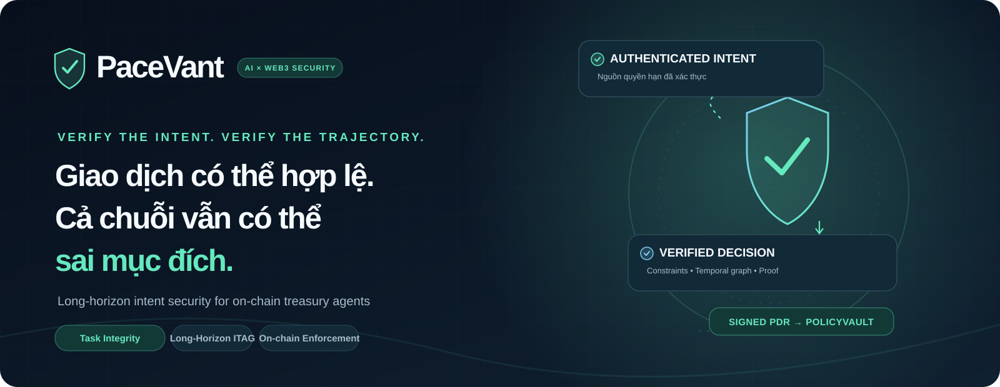
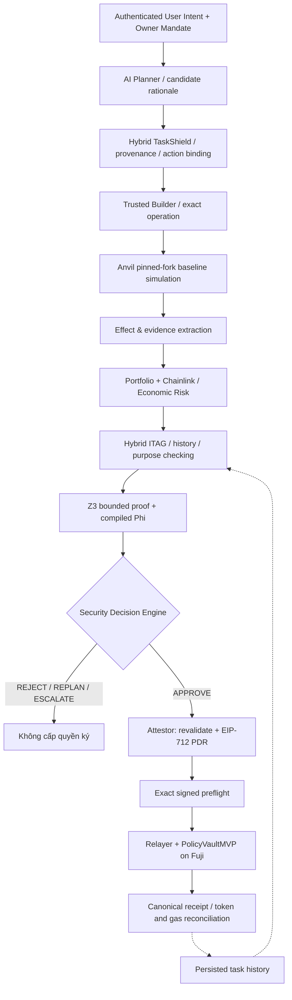

<div align="center">
  <picture>
    <source media="(prefers-color-scheme: dark)" srcset="docs/assets/readme/hero-dark.svg">
    <source media="(prefers-color-scheme: light)" srcset="docs/assets/readme/hero-light.svg">
    
  </picture>

  <p><strong>Intent-Aware Security for Autonomous On-Chain Treasury Agents</strong></p>
  <p><a href="https://pacevant.live"><strong>Live Demo</strong></a> · <a href="docs/audit/public-fuji-live-acceptance-20261121.json"><strong>Security Evidence</strong></a> · <a href="#kiến-trúc-mỗi-lớp-tồn-tại-để-làm-gì"><strong>Architecture & Research</strong></a></p>
</div>

**Một giao dịch có thể hợp lệ. Cả chuỗi hành động vẫn có thể sai mục đích.**

PaceVant là **lớp kiểm soát bảo mật dành cho AI Agent quản lý treasury on-chain**. AI được phép đề xuất swap hoặc thanh toán, nhưng không tự có quyền tiêu tài sản. PaceVant đối chiếu hành động với nhiệm vụ được xác thực, lịch sử giao dịch, mục đích sử dụng và những giới hạn kinh tế; chỉ sau đó thành phần ký độc lập mới cấp quyền thực thi, còn smart contract tiếp tục kiểm các điều kiện bắt buộc ngay tại thời điểm chạy giao dịch.

**Trạng thái:** public MVP trên **Avalanche Fuji (chain ID 43113)** đã có payment/swap được đối soát; single-tenant, hai nghiệp vụ giới hạn; **chưa audit độc lập, chưa phải production custody/mainnet**. Website public sử dụng nhánh triển khai `develop` theo [runbook](docs/PUBLIC_FUJI_RUNBOOK.md). Nhánh README này là bản viết tài liệu, **không phải bản deploy**; evidence public đã xác nhận theo release/tx riêng, không mặc nhiên chứng nhận mọi commit mới trên `main`.

---

## Vấn đề: Đúng giao dịch chưa chắc đúng mục tiêu

Hãy tưởng tượng người dùng giao cho AI Agent nhiệm vụ **đổi một lượng USDC sang WAVAX để duy trì thanh khoản treasury**. Để an toàn, không thể chỉ kiểm cú pháp calldata hoặc hợp đồng nằm trong allowlist:

| Khi nào nguy hiểm? | Vì sao kiểm tra đơn lẻ có thể bỏ sót? | PaceVant kiểm ở đâu? |
| --- | --- | --- |
| **Sai giao dịch:** AI đề xuất USDC → token khác hoặc đổi người nhận | Call vẫn có thể hợp lệ theo ABI và chạy thành công | **Hybrid TaskShield** đối chiếu từng yêu cầu bắt buộc với user intent |
| **Sai ngân sách tích lũy:** ba lần tiêu 10 USDC trong task chỉ cấp 20 USDC | Mỗi giao dịch riêng lẻ đều không vượt hạn mức 10 USDC | **Deterministic ITAG** kiểm history và reservations |
| **Sai mục đích:** từng swap hợp lệ về amount/token nhưng asset sau đó được đề xuất dùng cho mục tiêu khác | Rules số học không tự hiểu quan hệ mục đích xuyên lịch sử | **Graph-aware semantic ITAG** kiểm conflict trên evidence liên quan |
| **Thiệt hại kinh tế:** swap thành công nhưng nhận quá ít hoặc exposure quá lớn | “Không revert” ≠ “có lợi về kinh tế” | **Simulation, portfolio, oracle, Economic Risk, Z3** |
| **Trạng thái blockchain thay đổi:** giá/policy khác khi giao dịch được include | Simulation mô tả một block, không phải mọi trạng thái tương lai | **Revalidation, signed PDR, preflight và PolicyVault postconditions** |

**Giải pháp không phải thêm một LLM để bỏ phiếu “SAFE/UNSAFE”.** PaceVant tách việc *hiểu mục tiêu*, *kiểm những điều đo chính xác được*, *đánh giá chuỗi hành động* và *cưỡng chế giới hạn khi thực thi*. AI không sở hữu signing authority.

## Attack → Defense: Hai vấn đề khác nhau của long-horizon

### A. Vi phạm ngân sách tích lũy — LOCAL Anvil, đã kiểm thử

<p align="center"><a href="docs/evaluation/itag-final/ANVIL_BUDGET_ISOLATION.json"></a></p>

Ngân sách task là **20 USDC**. Hai swap **10 USDC** được xác nhận với receipts LOCAL. Khi Agent tiếp tục đề xuất thêm 10 USDC, baseline wallet/TaskShield-only trong paired counterfactual vẫn chấp nhận, nhưng **deterministic ITAG phát hiện đã chi hết ngân sách**. Workflow không cấp chữ ký mới; relayer nonce không thay đổi.

**Đây là đóng góp của temporal history/budget verification, không phải bằng chứng LLM đã suy luận về mục đích.** [Bản so sánh và receipts](docs/evaluation/itag-final/FINAL_VALIDATION.md).

### B. Vi phạm mục đích — Graph-aware semantic evaluation, thí nghiệm real-model

**Ví dụ minh họa:** IntentSpec đã xác thực yêu cầu giữ WAVAX nhận từ swap cho nhiệm vụ thanh khoản. Một candidate sau đó vẫn nằm trong ngân sách và dùng token/địa chỉ hợp lệ nhưng phần *rationale* đề xuất sử dụng WAVAX vì một mục tiêu khác, không được người dùng cấp phép. Bộ kiểm số học có thể PASS; semantic verifier phải đối chiếu **mục tiêu gốc, candidate rationale và evidence anchors** để xác định purpose conflict. Không có authority mới nào được tạo ra chỉ từ lời nói của Agent hoặc tool.

Trong kiểm thử semantic reliability phiên bản v3.2, **7/8 quan sát purpose-conflict** tạo validated semantic lift, **9/10 quan sát benign** được duyệt; **16/19 graph-model responses thực tế** vượt qua catalog validation. Đây là **tập nhỏ có lặp lại template, nhãn chưa được review độc lập**, không phải tám họ tấn công độc lập hay bằng chứng phát hiện mọi hidden-purpose attack.

[Thí nghiệm và lỗi schema/evidence đã được sửa](docs/evaluation/itag-semantic-reliability/FINAL_REPORT.md) · [Source ITAG](backend/src/treasury_backend/modules/temporal/README.md). **Scenario B không được tuyên bố đã thực thi như một cuộc tấn công public Fuji.**

## PaceVant đã chạy thật được gì?

<p align="center"><a href="docs/audit/public-fuji-live-acceptance-20261121.json"></a></p>

Website **<https://pacevant.live>** dùng frontend React và backend Python; public mode chỉ mở **USDC_PAYMENT** và **SWAP_EXACT_IN** với số tiền, router, recipient được giới hạn. Đây là testnet treasury do Owner kiểm soát, không phải ví khách hàng tự kết nối và giao dịch bất kỳ tài sản nào.

### Does it execute? — Public Fuji acceptance

| Bằng chứng | Đã xác minh | Đường kiểm chứng |
| --- | --- | --- |
| **PolicyVaultMVP** | Contract `0x70e1395F959dba530cF4A53B060c809b715bB6d5` đã deploy; [deployment journal](docs/audit/mvp-public-deployment-20261121.json) | [Snowtrace contract](https://testnet.snowtrace.io/address/0x70e1395F959dba530cF4A53B060c809b715bB6d5) |
| **Payment từ web** | **0,01 Circle test USDC** Vault → allowlisted EOA; receipt `status=1`, payee delta 10.000 base units | [Transaction](https://testnet.snowtrace.io/tx/0x10f6a04e22179f4186459e3738c61597048e9b2aac724c01347ba306f4470b8c) |
| **Swap từ web** | **0,000001 Circle test USDC → WAVAX**, output về Vault; receipt `status=1` và token deltas đã đối soát | [Transaction](https://testnet.snowtrace.io/tx/0xa708f44e355b6926c02693282f8ca6514fd043199ae8d23d3a031d64f82e4b2d) |
| **Bằng chứng tổng hợp** | Public RPC receipts, historical balances, code hashes, EIP-712 attestation, gas relayer, browser acceptance | [Public Fuji acceptance 21/11](docs/audit/public-fuji-live-acceptance-20261121.json) · [Current system review](docs/PACEVANT_CURRENT_SYSTEM_REVIEW.md) |

**Checkpoint rõ ràng:** báo cáo public Fuji ghi lại hai bản browser acceptance release SHA riêng, không chứng minh `main` HEAD đã được deploy nguyên trạng. Các receipts cũ của V2/Demo User vẫn tồn tại trong [research archive](docs/research/EXPERIMENT_CATALOG.md), nhưng không được gộp với contract MVP mới.

### Does it prevent unsafe execution? — Không có transaction cũng là kết quả đúng

- Public guard với policy thật từ chối `PAYEE_NOT_ALLOWED` **trước khi ký và không broadcast**, vì vậy **không thể có Snowtrace transaction cho lượt bị chặn**. Evidence nằm trong [public acceptance report](docs/audit/public-fuji-live-acceptance-20261121.json).
- **LOCAL Anvil:** ITAG budget isolation chặn lần chi thứ ba; không phát sinh attestation, nonce relayer giữ nguyên. [Raw artifact](docs/evaluation/itag-final/ANVIL_BUDGET_ISOLATION.json).
- Solidity/Forge và API tests kiểm anti-replay, signed fields, caps, negative cases. [Contracts tests](contracts/test/README.md) · [Merge test notes](docs/audit/MAIN_MERGE_20261121.md).
- **Sáu tùy chọn tấn công trên website hiện là UI preview**, không chèn adversarial payload vào backend. Không được gọi chúng là sáu cuộc tấn công live đã bị chặn.

### Does long-horizon analysis add value?

| So sánh trên 12 scripted adverse trajectories | Số trường hợp can thiệp |
| --- | ---: |
| Wallet guardrails | 0/12 |
| Wallet + action-level TaskShield | 0/12 |
| **Deterministic ITAG** | **8/12** |
| Deterministic ITAG + TaskShield | 8/12 |

Cùng benchmark, 12/12 benign được giữ lại ở các cấu hình scripted này. Graph-aware **real-model semantic test là một thí nghiệm khác** (7/8 validated purpose-conflict observations), không cộng trực tiếp hai mẫu số. [ITAG final evaluation](docs/evaluation/itag-final/FINAL_VALIDATION.md).

## Kiến trúc: Mỗi lớp tồn tại để làm gì?

**Tổng quan trong một phút:** AI chỉ đưa ra một candidate swap/payment trong phạm vi Owner và task đã xác thực. PaceVant xây exact call, chạy thử trên EVM fork để đo hậu quả, kiểm rủi ro kinh tế và graph history, rồi dùng Z3 chứng minh các giới hạn hữu hạn đã mô hình hóa. Nếu tất cả gate bắt buộc PASS, Attestor ký approval gắn với đúng operation; Relayer gửi và PolicyVault kiểm lại các điều kiện on-chain. Cuối cùng hệ thống đối chiếu receipt, token deltas và gas, không dựa vào câu trả lời của AI để tuyên bố thành công.

<p align="center"></p>

**Ba vùng trách nhiệm:**

1. **Intent & Agent Security:** Owner Mandate, authenticated task, planner, Hybrid TaskShield, ITAG. Chống *đề xuất sai quyền, sai mục đích, sai lịch sử*.
2. **Transaction & Economic Verification:** Trusted Builder, baseline Anvil simulation, evidence extraction, Chainlink/portfolio, Economic Risk, Z3/Phi, SDE. Chống *giao dịch đúng ý định nhưng hậu quả không chấp nhận được*.
3. **Cryptographic & On-chain Enforcement:** Attestor, EIP-712 signed PDR, exact signed preflight, Relayer, PolicyVault, outcome reconciliation. Chống *bỏ qua gate, thay payload, replay hoặc trạng thái on-chain không còn thỏa điều kiện*.

**Thứ tự đúng trong public workflow:** Owner authority → AI proposal / Shield interception → trusted builder → **baseline simulation** → **economic risk** → **ITAG** → **Z3 proof** → **SDE** → signing/revalidation → exact signed preflight → relay → outcome/reconciliation. MEV hypothetical reserve-shift research **không phải một stage stress engine độc lập chạy mặc định trong `TreasuryWorkflows.run()` public**.

<details>
<summary><strong>Xem sơ đồ Mermaid mô tả những gate và ranh giới theo public workflow</strong></summary>



</details>

### Đi từng bước: Input → Mục đích → Cách làm → Output → Nguy cơ ngăn chặn → Giới hạn

Ví dụ xuyên suốt là **AI được phép swap USDC → WAVAX cho một nhiệm vụ treasury**, trong public MVP amount được cố định theo scenario; payment là operation được cấp riêng. Những ví dụ ngoài phạm vi public luôn được ghi là minh họa hoặc LOCAL.

#### 01. Treasury Mandate & Authenticated User Intent

**Input:** Owner policy, contract/session, authenticated task (`IntentSpec`), operation, token/amount/recipient, deadline và budget. **Mục đích:** phân biệt *quyền Owner cấp* với *nhiệm vụ người dùng thực sự muốn*. **Cách làm:** backend kiểm user/task provenance và policy/session được ký hoặc cấu hình, ghi task ID/revision. **Output:** typed authority và phạm vi có thể thực hiện. **Chặn:** tool output tự xưng là yêu cầu mới, chuyển token hoặc người nhận ngoài phạm vi. **Giới hạn:** Owner/key compromise không nằm trong lời bảo đảm “Agent không tự ý dùng tiền”.

#### 02. AI Treasury Planner

**Input:** mục tiêu đã xác thực cùng fixed operation registry. **Mục đích:** biến ngôn ngữ tự nhiên thành một đề xuất có thể đánh giá. **Cách làm:** model đưa structured proposal và rationale; backend giữ operation/token/amount/recipient trong scope đã cấp. **Output:** candidate plan; **không phải authorization**. **Chặn:** proposal vượt domain được phép sẽ không tự trở thành giao dịch hợp lệ. **Giới hạn:** AI vẫn có thể hiểu sai ý nghĩa và trả output không hợp lệ; public demo không phải autonomous trader đa giao thức.

#### 03. Hybrid Task Alignment Shield

**Input:** original user message, task binding/revision, candidate action và source provenance. **Mục đích:** kiểm *AI có làm đúng việc được giao không*. **Cách làm:** deterministic checks so exact fields (token, amount, recipient, chain, deadline...), model semantic xem goal drift/tool injection, strict fusion không cho positive score bù mandatory FAIL. **Output:** ALIGNED / MISALIGNED / UNCERTAIN + typed evidence. **Chặn:** đổi token đích, địa chỉ, task hoặc ý định khi không có quyền. **Giới hạn:** ngôn ngữ mơ hồ có thể làm yêu cầu hợp lệ thành UNCERTAIN; semantic model chưa được chứng minh tổng quát trên mọi kiểu tấn công.

#### 04. Trusted Transaction Builder

**Input:** typed authorized intent, chain registry, token/DEX address, router, quote, deadline và nonce. **Mục đích:** ngăn model tự đặt calldata hoặc target tùy ý. **Cách làm:** backend chuẩn hóa đơn vị/decimals và tạo exact operation/call cho loại nghiệp vụ được hỗ trợ. **Output:** built operation và commitment. **Chặn:** arbitrary calldata/router, sai token, sai amount hoặc recipient. **Giới hạn:** builder chỉ an toàn trong phạm vi registry và adapter đã kiểm; không tự hiểu động cơ của transaction.

#### 05. Baseline EVM Simulation

**Input:** exact built transaction và chain state tại pinned fork block. **Mục đích:** biết điều gì sẽ xảy ra **trước khi gửi**. **Cách làm:** chạy guarded call trên Anvil fork, thu status, traces/logs, balance/allowance deltas. **Output:** simulation effects. **Chặn:** nhiều lỗi execution, revert hoặc effect sai kỳ vọng. **Giới hạn:** đây là một trạng thái đã pin, không phải lời hứa rằng liquidity và block state sẽ y nguyên khi inclusion.

#### 06. Deterministic Evidence Extractor

**Input:** receipts, logs, traces, balances và allowances từ simulation. **Mục đích:** đưa quyết định sau này dựa trên dữ liệu đo được, không dựa vào câu AI khẳng định “an toàn”. **Cách làm:** chuẩn hóa before/after deltas, operation effects, block/hash provenance và evidence commitments. **Output:** typed effect report và source references. **Chặn:** mô tả sai sự thật hoặc sửa evidence không khớp dữ liệu đã pin. **Giới hạn:** chất lượng phụ thuộc EVM adapter, token semantics và dữ liệu nguồn có thể quan sát.

#### 07. Portfolio & Oracle Context

**Input:** Vault balances, exposure, policy/session, Chainlink price rounds và timestamp. **Mục đích:** một swap hợp lệ riêng lẻ vẫn có thể làm treasury quá tập trung vào một tài sản. **Cách làm:** đọc chain state và oracle provenance, ràng buộc giá, freshness và token identities. **Output:** economic context có nguồn gốc. **Chặn:** dùng giá cũ, sai asset, exposure vượt giới hạn. **Giới hạn:** giới hạn exposure **25%** là cấu hình MVP, không phải một khuyến nghị tài chính chung; testnet price reference không chứng minh redeemability.

#### 08. Economic Risk Evaluator

**Input:** candidate, measured effects, portfolio/oracle context, spend/gas/risk caps. **Mục đích:** kiểm *hậu quả kinh tế* khác với TaskShield chỉ kiểm *đúng yêu cầu*. **Cách làm:** so loss/exposure, slip/quote, payee receipt, allowances và phí gas trong phạm vi policy. **Output:** PASS/FAIL kèm risk/economic findings. **Chặn:** giao dịch chạy thành công nhưng gây lỗ hoặc vượt ngân sách được phép. **Giới hạn:** chỉ lượng hóa những token, giá và risk dimensions được cấu hình, không tự đánh giá mọi thị trường và chiến lược.

#### 09. MEV, Slippage & State Drift — Nhánh nghiên cứu và bảo vệ lúc thực thi

**Input:** price/quote, reserve conditions và các kịch bản local reserve perturbations. **Mục đích:** đánh giá rủi ro do chênh lệch giữa *thời điểm kiểm tra* và *thời điểm được đưa vào block*. **Cách làm:** nghiên cứu MEV stress bằng hypothetical actor trên Anvil fork; trong **public MVP**, baseline simulation, slippage/quote, policy, revalidation, preflight và Phi là những kiểm soát đang được gọi trong runtime. **Output:** local stress evidence (khi chạy thí nghiệm) hoặc các giới hạn thực thi đã gắn trong operation. **Chặn:** một số thiệt hại vượt guard khi chain state đổi. **Giới hạn:** **không có độc lập MEV sandwich stress engine mặc định trong public `run()`**, không thể bảo đảm ngăn mọi MEV attack.

#### 10. Hybrid ITAG — Kiểm tra nhiệm vụ qua nhiều hành động

**Input:** authenticated IntentSpec, candidate/rationale, task history, reservations, graph nodes/edges và evidence catalog. **Mục đích:** phát hiện vấn đề chỉ xuất hiện khi *xem cả chuỗi*, không chỉ current transaction. **Cách làm:** deterministic verifier kiểm budget/order/history; graph-aware model đánh giá purpose mismatch trên **những source anchors thực sự tồn tại**, strict fusion không cho model tạo authority. **Output:** temporal/semantic verdict, intervention reason và evidence. **Chặn:** vượt ngân sách nhiều lần; task drift dù vẫn nằm trong các giới hạn số học. **Giới hạn:** graph chỉ chứa loại node/edge implementation tạo ra; không nhìn thấy động cơ ẩn không được biểu lộ, và model có thể bị escalated do invalid evidence.

**Vì sao cần graph chứ không chỉ “10 + 10 + 10”?** Cộng budget là phần **deterministic** và cố ý không giao cho LLM. Graph giúp kết nối mục tiêu gốc, hành động, rationale, lịch sử, outcome và nguồn evidence để kiểm **mối quan hệ mục đích**. [ITAG methodology](docs/evaluation/itag-final/FINAL_VALIDATION.md) · [semantic reliability](docs/evaluation/itag-semantic-reliability/FINAL_REPORT.md).

#### 11. Z3 Formal Verification & Φ (Phi)

**Input:** operation, measured effects, oracle bounds, tracked assets, risk policy. **Mục đích:** simulation cho biết một kịch bản; solver kiểm xem trong **khoảng bất định đã mô hình hóa**, điều kiện giá trị/an toàn vẫn được duy trì hay không. **Cách làm:** Z3 SMT giải các nghĩa vụ `Check/Compile/Risk` hữu hạn; biên dịch giới hạn token deltas/receipt/allowance thành **Φ postconditions**. **Output:** conditional proof artifact và giới hạn enforce được. **Chặn:** execution có hậu quả nằm ngoài bound được duyệt. **Giới hạn:** Z3 **chạy off-chain, không phải zero-knowledge proof**; chứng minh có điều kiện theo price bands, token semantics và tài sản được theo dõi.

#### 12. Security Decision Engine (SDE)

**Input:** TaskShield/ITAG, risk, proof và dữ liệu policy/operation. **Mục đích:** tránh tình trạng một lớp PASS làm “xóa” lỗi từ lớp khác. **Cách làm:** các mandatory gates có quyền veto; verdict cuối có thể APPROVE, REJECT, REPLAN hoặc ESCALATE. **Output:** security decision có reason/evidence hashes. **Chặn:** ký một giao dịch sai intent hoặc risk chỉ vì simulation chạy thành công. **Giới hạn:** SDE không tự sửa dữ liệu sai từ một trusted input; quyết định cũng phải được ràng buộc với đúng action sau đó.

#### 13. Attestor & Signed Policy Decision Record

**Input:** SDE approval, exact operation, policy/session, task revision, Phi và evidence commitments. **Mục đích:** tách khả năng AI đề xuất khỏi quyền chi tiền. **Cách làm:** Attestor revalidate rồi ký structured authorization theo **EIP-712** (domain version 3 của MVP), chỉ một lần cho operation cụ thể. **Output:** signed PDR và signed constraints. **Chặn:** đổi calldata hoặc chi tiền bằng một proposal chưa được duyệt. **Giới hạn:** Attestor vẫn là trusted signer (cần bảo vệ key); PDR **khác** transaction hash và receipt.

#### 14. Exact Signed Preflight & Relayer

**Input:** signed operation/Phi, current state và gas/session context. **Mục đích:** tránh sử dụng một approval cũ cho trạng thái hoặc giao dịch khác. **Cách làm:** kiểm revalidation/final preflight, durable nonce/raw-tx journal và relay bounded gas; relayer trả **AVAX gas**. **Output:** transaction được gửi hoặc trạng thái từ chối/không rõ (không blind resubmit). **Chặn:** stale binding, duplicate broadcast, replay do recovery sai. **Giới hạn:** RPC có thể chậm hoặc trả kết quả chưa hội tụ; preflight không đảm bảo future state luôn giống state đã kiểm.

#### 15. PolicyVaultMVP — On-chain Enforcement

**Input:** EIP-712 approval, signed operation, policy/session/caps, call, Φ và state tại EVM inclusion. **Mục đích:** nếu off-chain APPROVE thì vẫn phải kiểm **giới hạn khi thực thi**, trong cùng transaction. **Cách làm:** Solidity xác minh chữ ký, nonce, deadline, allowed operation, contract/token identities, spend/risk caps, min output/receipt, deltas/allowance postconditions; vi phạm thì **atomic revert**. **Output:** thực thi swap/payment được phép hoặc revert. **Chặn:** calldata sửa, replay, vượt policy và effect không đạt giới hạn ký. **Giới hạn:** vault không chạy AI/ITAG/Z3, không tự hiểu ngôn ngữ tự nhiên; bảo đảm phụ thuộc các tracked effects và trusted authority.

#### 16. Outcome Monitor, Reconciliation & Feedback

**Input:** transaction hash, public receipts/logs, canonical block, token balances và gas. **Mục đích:** chỉ nói “thành công” sau khi có **bằng chứng chain**. **Cách làm:** reconcile status, token/recipient deltas, relayer `gasUsed × effectiveGasPrice`, pending/reorg/recovery; lưu history cho các lần xét tiếp theo. **Output:** outcome có thể truy vết và persisted history. **Chặn:** fake success từ UI, charge hai lần, retry không xác thực hoặc quên chi tiêu trước. **Giới hạn:** không thể đảo ngược một giao dịch đã settle nếu chính sách cho phép nhầm; autonomous experience-replanning chưa được chứng minh đầy đủ trên public MVP.

### Tại sao không thể chỉ dùng một cơ chế?

| Nếu chỉ dùng… | Khoảng trống vẫn còn | PaceVant bổ sung |
| --- | --- | --- |
| LLM Planner | Proposal có thể sai người nhận / task | Authenticated TaskShield + binding |
| TaskShield | Hành động đúng yêu cầu nhưng làm lỗ | Simulation + Economic Risk |
| Simulation | Giá/trạng thái có thể đổi trước inclusion | Z3/Phi, revalidation, on-chain postconditions |
| Transaction-only allowlist | Không xét lịch sử và purpose relation | Hybrid ITAG |
| Graph/AI verdict | Quyết định off-chain có thể bị bỏ qua khi gửi | Signed PDR + PolicyVault |
| Smart contract thuần | Không hiểu natural-language task | Off-chain intent/semantic security |
| Outcome monitoring | Phát hiện sau khi tiền đã chuyển | Pre-signing mandatory vetoes |

### Một hành trình end-to-end: được duyệt và bị chặn

**Nhánh hợp lệ có bằng chứng public:** user chọn fixed `SWAP_EXACT_IN` USDC → WAVAX; planner đề xuất, builder tạo call, simulation tạo effects, risk + ITAG PASS, Z3 proof VERIFIED, SDE APPROVE, Attestor ký EIP-712, contract thực thi trên Fuji. Public receipt cho thấy Vault giảm đúng **1 base unit USDC** và tăng **13.266.545.691.051 wei WAVAX** trong giao dịch [`0xa708…e4b2d`](https://testnet.snowtrace.io/tx/0xa708f44e355b6926c02693282f8ca6514fd043199ae8d23d3a031d64f82e4b2d).

**Nhánh sai bị chặn có bằng chứng LOCAL:** task budget 20 USDC đã tiêu đủ 20; candidate thêm 10 bị deterministic ITAG veto trước ký. **Nhánh public policy guard:** payment tới payee không nằm trong allowlist trả `PAYEE_NOT_ALLOWED` trước broadcast; do không gửi giao dịch nên không có tx hash. **Không đánh đồng** ba kịch bản thành cùng một loại attack, cùng một deploy hoặc cùng một dataset.

## Ba lớp năng lực bảo mật

<p align="center"></p>

| Lớp | Đóng góp kỹ thuật | Phần nào là nghiên cứu / phần nào là engineering? |
| --- | --- | --- |
| **Task Integrity — Hybrid TaskShield** | User-source binding, structured constraint checks, semantic checks, fail-closed fusion | Thiết kế hybrid có ablation; chưa chứng minh AI tạo lift trên 300-case corpus |
| **Long-Horizon Intent — Hybrid ITAG** | Authenticated task/action/evidence graph, deterministic temporal history và evidence-grounded semantic purpose checks | **Research differentiator chính**; có kết quả bước đầu nhưng thiếu independent held-out evaluation |
| **Proof-Bound Execution — Risk/Z3/PDR/PolicyVault** | EVM baseline, bounded economic proof, EIP-712 approval và enforce on-chain | **Security architecture và engineering integration**, kế thừa những nguyên tắc đã có trong PACE/PGS |

[Research index](docs/research/RESEARCH_INDEX.md) · [Security coverage](docs/research/SECURITY_COVERAGE_MATRIX.md).

## Đánh giá: Kết quả, ablation và cả thất bại

Đây là **các thí nghiệm có câu hỏi và mẫu số riêng**, không thể cộng thành một “security accuracy” duy nhất.

### 1. Single-transaction TaskShield — AI có kiểm đúng một action?

**Dữ liệu:** 300 adapted Uniswap V2 **SWAP** cases (68 ACCEPT, 232 REJECT); component/paper-mode regression, không phải end-to-end LFJ/Fuji và không phải untouched held-out.

| Cấu hình | Accuracy | REJECT recall | False accepts / 232 | Uncertain/unavailable |
| --- | ---: | ---: | ---: | ---: |
| A. Original contribution-sum | 49,00% | 40,52% | 132 | 11 |
| B. Offline aggregation fix | 68,67% | 80,17% | 40 | 11 |
| C. Deterministic constraints only | **95,67%** | 100% | **0** | 12 |
| D. Full Hybrid TaskShield | **95,67%** | 100% | **0** | 12 |

**Ý nghĩa:** sửa lỗi cộng contribution bằng mandatory constraints giúp tăng kết quả; **Hybrid không vượt constraints-only trên tập này**. 13/68 benign bị REJECT hoặc uncertain, cho thấy vấn đề liveness/coverage. Kết quả không được dùng như một chứng nhận 95,67% chống tấn công end-to-end. [Results + reproduction](docs/evaluation/HYBRID_TASK_ALIGNMENT_RESULTS.md) · [Error audit](docs/evaluation/HYBRID_TASK_ALIGNMENT_ERRORS.md).

### 2. Long-horizon deterministic ITAG — history có giúp không?

**Dữ liệu:** 12 adverse + 12 benign **authored scripted** trajectories, cùng các baseline wallet/Shield. **Kết quả:** baseline A/B can thiệp **0/12 adverse**, deterministic ITAG can thiệp **8/12**, giữ **12/12 benign approvals**. Phần này chứng minh benefit trong suite kịch bản, **không phải tám AI semantic detections**. [Evaluation/limitations](docs/evaluation/itag-final/FINAL_VALIDATION.md).

### 3. Graph-aware AI semantic — khi số học không phát hiện purpose drift

**Dữ liệu:** tập nhỏ real-model với bốn purpose-conflict tasks, mỗi task lặp hai lần, cùng benign controls. **Kết quả v3.2:** 7/8 validated lift observations; 9/10 benign approvals; 16/19 valid model-catalog responses; 1 benign false intervention. **Negative result được giữ:** v2.3 có 0 valid findings vì lỗi source binding/schema; các bản v3.x giải quyết bằng evidence catalog và grounding. Không suy ra performance trên unseen attacker/protocol. [Báo cáo phương pháp & phiên bản](docs/evaluation/itag-semantic-reliability/FINAL_REPORT.md).

### 4. LOCAL Anvil, formal guards và public Fuji

- **LOCAL Anvil:** 2 giao dịch 10 USDC đã xác nhận; candidate thứ ba bị budget veto trước ký, relayer nonce không tăng. Paired counterfactual giữ risk PASS và Z3 VERIFIED để quy nguyên nhân từ chối về ITAG. [Raw evidence](docs/evaluation/itag-final/ANVIL_BUDGET_ISOLATION.json).
- **Proof/economic:** Z3 SAT/UNSAT và Φ trên bounded assumptions; risk/policy regressions và hợp đồng Solidity có unit/fuzz/integration checks. **Không** bịa “Z3 accuracy” hay “MEV prevention rate” khi không có số đo cùng chuẩn. [Proof source](packages/contracts-api/treasury_contracts/proof_v3.py) · [Economic audit](MVP_ECONOMIC_RISK_AUDIT.md).
- **Public Fuji:** payment, swap và public guard refusal được báo cáo với receipt/codehash/historical balance evidence; testnet và release-specific, không phải independent mainnet audit. [Acceptance](docs/audit/public-fuji-live-acceptance-20261121.json).

**Kiểm thử và provenance:** [Experiment Catalog](docs/research/EXPERIMENT_CATALOG.md) giữ baseline, attempts, negative results, môi trường, raw logs và cách tái hiện; không ghi scripted model như inference thực.

## Chúng tôi khác gì với những hướng trước?

PaceVant không tuyên bố phát minh ra mô phỏng transaction, EIP-712, allowlist, SMT/Z3 hay signed decision record. Đó là các cơ chế đã có prior work. Phần nhóm đang kiểm chứng là **đưa authenticated task/intent và long-horizon semantic purpose lên trước đường ký có ràng buộc proof**, kèm ablation làm rõ từng lớp.

| Hướng / nghiên cứu tham khảo | Trọng tâm chính | PaceVant bổ sung / khác biệt ở mức thiết kế |
| --- | --- | --- |
| Wallet allowlist / per-tx policy | Chặn call/token/amount ngoài phạm vi từng lần | Kiểm task binding, history, purpose và economic effect, không chỉ call hợp lệ |
| [PACE — Policy-Attested Contract Execution](docs/paper/PACE_Policy_Attested_Contract_Execution.md) | Typed intents, policy verification, signed PDR và binding on-chain | Áp dụng nền bảo vệ transaction, bổ sung TaskShield + ITAG xuyên hành động và semantic evidence |
| [Proof-Gated Signing](docs/paper/Proof_Gated_Signing_Solver_Checked_Transaction_Guards.md) | Simulation, SMT proof, compiled postconditions chống state drift | Áp dụng/điều chỉnh bounded economic guard cho fixed swap/payment, kết hợp với long-horizon intent checks |
| LLM semantic reviewer độc lập | Đánh giá ngôn ngữ, dễ gặp schema và provenance errors | Evidence-bound catalog, deterministic veto và explicit uncertainty |

**Chưa có benchmark đối đầu trên cùng attack set/protocol** chứng minh PaceVant vượt PACE hoặc PGS về attack-prevention rate. Đóng góp ITAG hiện là **research differentiator có bằng chứng bước đầu**, không phải novelty đã được đánh giá peer review.

## Technology stack & triển khai thực tế

| Nhóm | Công nghệ được xác nhận | Vai trò / trạng thái |
| --- | --- | --- |
| **AI & security** | DeepSeek, provider adapters Groq/Gemini/Xingchi, Hybrid TaskShield, ITAG | Planner/semantic; metadata/schema/source grounding; real provider theo cấu hình |
| **Blockchain & DeFi** | Avalanche Fuji, EVM, Circle test USDC, WAVAX, LFJ V1 pool, Solidity | Hai fixed public operations qua PolicyVaultMVP + LFJSwapAdapterV3 |
| **Risk & simulation** | Chainlink, portfolio/price bounds, Anvil fork, hypothetical MEV stress experiments | Baseline simulation trong public runtime; stress nghiên cứu LOCAL riêng |
| **Proof & signing** | Z3 SMT, Φ postconditions, Keccak-256, EIP-712 V3, PDR | Bounded off-chain proof + trusted attestor + on-chain constraints |
| **Backend & reliability** | Python 3.12, FastAPI, Uvicorn, SQLite, uv, systemd, Nginx | Public judge worker, durable journals/recovery, rate limits; một backend, không phải microservices |
| **Frontend** | **React, TypeScript, Vite, React Flow, Tailwind CSS v4, Radix UI, TanStack Query, Motion, Lucide** | Web dashboard, evidence panels, bilingual UI, graph, job/history |
| **Tests & tooling** | pytest, Foundry/Forge, Anvil, Ruff, Vitest, Docker cho các nhánh cũ | Research regressions, contract tests; public VPS dùng Nginx + systemd (không Docker/Node production server) |

Các công cụ có code trong repo **không nhất thiết thuộc mọi public run**. Ví dụ ERC-20 transfer LOCAL, optional rebalance/autonomy, legacy Demo User gas-credit và V2/V3 research paths không tự động được expose từ Judge website. [Technology Inventory](docs/research/TECHNOLOGY_INVENTORY.md) · [Module map](backend/MODULES.md) · [Current review](docs/PACEVANT_CURRENT_SYSTEM_REVIEW.md).

## Bắt đầu nhanh & tái hiện an toàn

**Xem demo public:** [pacevant.live](https://pacevant.live) → chọn **Swap** hoặc **Payment**, đọc giải thích từng stage và mở tx hash sau khi CONFIRMED. Public judge có giới hạn quota, ngân sách testnet và có thể đợi Chainlink round mới. **Sáu attack options trong UI chỉ là preview**, không tự gửi adversarial transactions. [Hướng dẫn](docs/PUBLIC_FUJI_RUNBOOK.md).

**Chạy mã nguồn cho phát triển / kiểm thử (không tự bật public Fuji):**

```bash
uv sync --locked
npm ci --prefix frontend
npm run web:build
uv run --locked python tools/contracts/bootstrap.py
uv run --locked python -m treasury_backend.operations.judge_serve --port 8000
```

Lệnh judge local mặc định phục vụ chế độ isolated/model-only fork theo cấu hình; **không tự động activate public treasury**. Public mode cần Owner-signed manifest, effective configuration, roles và explicit activation theo [Public Fuji Runbook](docs/PUBLIC_FUJI_RUNBOOK.md). Không chạy deploy, fund, renew policy/session hoặc submit giao dịch thật như health-check. Không commit `.env`, owner/attestor/relayer secrets, raw signed tx/journal hay visitor credentials.

**Kiểm thử có thể tái hiện:** `uv run --locked python -m pytest -q`, `uv run --locked python tools/contracts/foundry.py forge test -vv`, `npm test --prefix frontend`, `uv run --locked ruff check backend/src backend/tests tools`. Đây là **lệnh hướng dẫn**, không phải tuyên bố đã chạy lại trong lần sửa README. Các benchmark real-model cần cấu hình provider credential riêng và đọc provenance trong từng báo cáo.

## Research Library — Không bỏ mất công sức nghiên cứu

| Tài liệu | Nội dung |
| --- | --- |
| [Research Index](docs/research/RESEARCH_INDEX.md) | Bản đồ các hướng nghiên cứu AI Security, DeFi, formal verification và deployment |
| [Experiment Catalog](docs/research/EXPERIMENT_CATALOG.md) | Baseline, ablation, negative findings, LOCAL/Fuji provenance |
| [Technology Inventory](docs/research/TECHNOLOGY_INVENTORY.md) | Runtime stack, research-only components, code paths |
| [Security Coverage Matrix](docs/research/SECURITY_COVERAGE_MATRIX.md) | Threat → detection → enforcement → evidence → limitations |
| [README Repositioning Review](docs/research/README_REPOSITIONING_REVIEW.md) | Điểm mạnh/yếu trước sửa, technical corrections, before/after |
| [MVP Current System Review](docs/PACEVANT_CURRENT_SYSTEM_REVIEW.md) | Trạng thái nghiệm thu Fuji mới nhất và vận hành public |
| [System Design V2.1](docs/AI_Treasury_Security_System_Design_v2.1.md) | **Tài liệu của kiến trúc checkpoint cũ**; vẫn hữu ích cho nghiên cứu/legacy nhưng không thay thế source V3/MVP mới |
| [Reviewer Guide](docs/REVIEWER_GUIDE.md) | Hướng đọc source/evidence; kiểm tra checkpoint trước khi áp dụng |

## Giới hạn & giả định bảo mật

**Đã có bằng chứng:** public Fuji payment/swap trong fixed scenario, receipt/canonical effects, bounded signing/enforcement, local ITAG budget rejection, source-bound TaskShield regressions, graph semantic observations trong tập nhỏ.

**Chưa chứng minh / chưa hỗ trợ:** independent audit; ERC-4337/7579 bundler hoặc modular smart account; arbitrary DeFi, lending/bridge/LP; custody đa người dùng; mainnet; mọi kiểu MEV/prompt injection; large held-out AI generalization; semantic reasoning đọc được hidden motivations; autonomous experience replanning trên public. Người dùng đang dùng **public testnet** với amount cố định, **không** được nhập calldata, recipient hay contract tùy ý.

**Ranh giới tin cậy:** Owner cấp policy và sessions; Attestor được tin cậy để ký kết quả đã kiểm; Relayer trả gas; oracle/price band, tracked assets, EVM token semantics, RPC/provider availability vẫn là assumptions. Phi chỉ enforce **những điều kiện được biên dịch**, không bảo đảm mọi tài sản/protocol ngoài phạm vi. Model/schema fail có thể dẫn đến UNCERTAIN/ESCALATE, khiến một tác vụ hợp lệ bị tạm dừng — đó là chi phí availability của fail-closed security.

**Đọc kết quả đúng môi trường:** `PUBLIC FUJI` (receipt thực), `LOCAL ANVIL` (EVM local thật), `REAL MODEL` (provider responses), `SCRIPTED` (fixture/wiring), `HISTORICAL` (checkpoint cũ), `NOT VERIFIED` (chưa kiểm chứng). Không gộp chúng thành một tỷ lệ an toàn duy nhất.

---

<div align="center">
  <strong>Một giao dịch có thể hợp lệ. Cả chuỗi hành động vẫn có thể sai mục đích.</strong><br>
  <small>PaceVant · Intent-aware verification · Evidence-bound authorization · On-chain enforcement</small>
</div>
