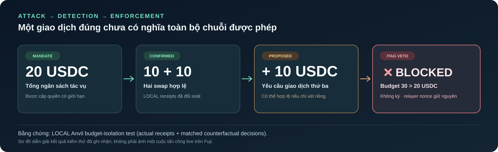
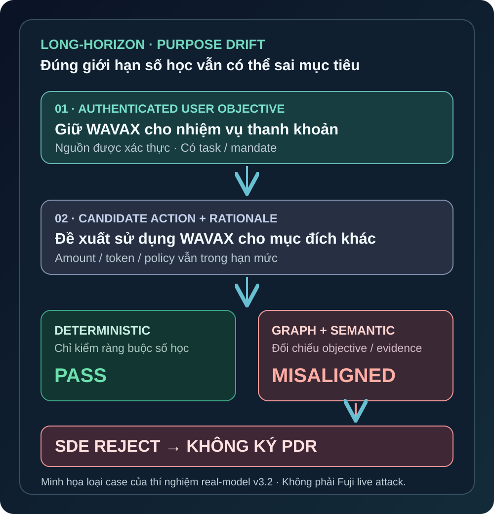
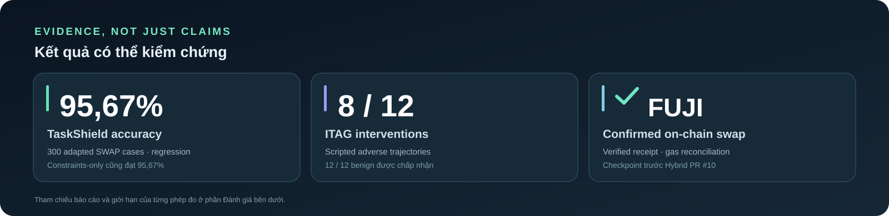
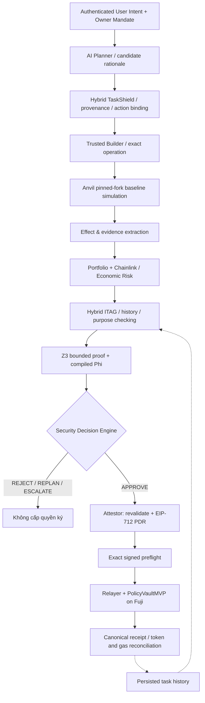

<div align="center">
  <picture>
    <source media="(prefers-color-scheme: dark)" srcset="docs/assets/readme/hero-dark.svg">
    <source media="(prefers-color-scheme: light)" srcset="docs/assets/readme/hero-light.svg">
    
  </picture>

  <p><strong>Intent-Aware Security for Autonomous On-Chain Treasury Agents</strong></p>
  <p><a href="https://pacevant.live"><strong>Live Demo</strong></a> · <a href="docs/evidence/FUJI_WORKFLOW_EVIDENCE.md"><strong>Security Evidence</strong></a> · <a href="#kiến-trúc-mỗi-lớp-tồn-tại-để-làm-gì"><strong>Architecture & Research</strong></a></p>
</div>

**Một giao dịch có thể hợp lệ. Cả chuỗi hành động vẫn có thể sai mục đích.**

PaceVant là **lớp kiểm soát bảo mật dành cho AI Agent quản lý treasury on-chain**. AI được phép đề xuất swap hoặc thanh toán, nhưng không tự có quyền tiêu tài sản. PaceVant đối chiếu hành động với nhiệm vụ được xác thực, lịch sử giao dịch, mục đích sử dụng và những giới hạn kinh tế; chỉ sau đó thành phần ký độc lập mới cấp quyền thực thi, còn smart contract tiếp tục kiểm các điều kiện bắt buộc ngay tại thời điểm chạy giao dịch.

**Trạng thái:** public MVP trên **Avalanche Fuji (chain ID 43113)** đã có payment/swap được đối soát; single-tenant, hai nghiệp vụ giới hạn; **chưa audit độc lập, chưa phải production custody/mainnet**. Website public sử dụng nhánh triển khai `develop` theo [runbook](https://github.com/ursuswh-metamorphic/PaceVant/blob/main/docs/PUBLIC_FUJI_RUNBOOK.md). Nhánh README này là bản viết tài liệu, **không phải bản deploy**; evidence public đã xác nhận theo release/tx riêng, không mặc nhiên chứng nhận mọi commit mới trên `main`.

---

## Vấn đề: Đúng giao dịch chưa chắc đúng mục tiêu

Hãy tưởng tượng người dùng giao cho AI Agent nhiệm vụ **đổi một lượng USDC sang WAVAX để duy trì thanh khoản treasury**. Để an toàn, không thể chỉ kiểm cú pháp calldata hoặc hợp đồng nằm trong allowlist:

| Khi nào nguy hiểm? | Vì sao kiểm tra đơn lẻ có thể bỏ sót? | PaceVant kiểm ở đâu? |
| --- | --- | --- |
| **Sai giao dịch:** AI đề xuất USDC → token khác hoặc đổi người nhận | Call vẫn có thể hợp lệ theo ABI và chạy thành công | **Hybrid TaskShield** đối chiếu từng yêu cầu bắt buộc với user intent |
| **Sai ngân sách tích lũy:** ba lần tiêu 10 USDC trong task chỉ cấp 20 USDC | Mỗi giao dịch riêng lẻ đều không vượt hạn mức 10 USDC | **Deterministic ITAG** kiểm history và reservations |
| **Sai mục đích:** từng swap hợp lệ về amount/token nhưng asset sau đó được đề xuất dùng cho mục tiêu khác | Rules số học không tự hiểu quan hệ mục đích xuyên lịch sử | **Graph-aware semantic ITAG** kiểm conflict trên evidence liên quan |
| **Thiệt hại kinh tế:** swap thành công nhưng nhận quá ít hoặc exposure quá lớn | “Không revert” ≠ “có lợi về kinh tế” | **Simulation, portfolio, oracle, Economic Risk, Z3** |
| **Trạng thái blockchain thay đổi:** giá/policy khác khi giao dịch được include | Simulation mô tả một block, không phải mọi trạng thái tương lai | **Revalidation, signed PDR, preflight và PolicyVault postconditions** |

**Giải pháp không phải thêm một LLM để bỏ phiếu “SAFE/UNSAFE”.** PaceVant tách việc *hiểu mục tiêu*, *kiểm những điều đo chính xác được*, *đánh giá chuỗi hành động* và *cưỡng chế giới hạn khi thực thi*. AI không sở hữu signing authority.

## Trong 60 giây: Vì sao PaceVant cần nhiều lớp bảo mật?

| Câu hỏi | Lớp chịu trách nhiệm | Ví dụ dễ hiểu |
| --- | --- | --- |
| **AI đang làm đúng việc được giao không?** | **TaskShield + ITAG** | Đúng token trong lần swap này **và** không lệch mục tiêu khi nhìn cả lịch sử. |
| **Đúng việc rồi, nhưng có làm mất tiền không?** | **Builder + Anvil + Economic Risk + Z3** | Swap chạy được nhưng đầu ra quá ít hoặc danh mục vượt exposure giới hạn. |
| **Ai bảo đảm quyết định không bị bỏ qua?** | **SDE + Attestor + PolicyVault** | Không có chữ ký nếu bị chặn; hợp đồng tiếp tục kiểm nonce, session và hậu điều kiện. |

**Một ví dụ xuyên suốt:** AI được giao mua WAVAX bằng test USDC trong treasury. TaskShield kiểm giao dịch hiện tại có đúng yêu cầu; ITAG xét các hoạt động trước và mục tiêu; Simulation/Risk/Z3 đo tác động và giới hạn; SDE chỉ cho Attestor ký nếu tất cả gate đạt; PolicyVault thực thi có kiểm soát và hệ thống đối chiếu kết quả thật từ Fuji. [Đọc kiến trúc giải thích đủ 16 bước](docs/architecture/ARCHITECTURE_EXPLAINED.md).

## Attack → Defense: Hai vấn đề khác nhau của long-horizon

### A. Vi phạm ngân sách tích lũy — LOCAL Anvil, đã kiểm thử

<p align="center"><a href="docs/evaluation/itag-final/ANVIL_BUDGET_ISOLATION.json"></a></p>

Ngân sách task là **20 USDC**. Hai swap **10 USDC** được xác nhận với receipts LOCAL. Khi Agent tiếp tục đề xuất thêm 10 USDC, baseline wallet/TaskShield-only trong paired counterfactual vẫn chấp nhận, nhưng **deterministic ITAG phát hiện đã chi hết ngân sách**. Workflow không cấp chữ ký mới; relayer nonce không thay đổi.

**Đây là đóng góp của temporal history/budget verification, không phải bằng chứng LLM đã suy luận về mục đích.** [Bản so sánh và receipts](docs/evaluation/itag-final/FINAL_VALIDATION.md).

### B. Vi phạm mục đích — Graph-aware semantic evaluation, thí nghiệm real-model

<p align="center"><a href="docs/assets/readme/purpose-drift.svg"><picture><source media="(max-width: 640px)" srcset="docs/assets/readme/purpose-drift-mobile.svg"></picture></a></p>

<sub>Minh họa để giải thích logic của các cặp semantic-evaluation; [mở hình kích thước gốc](docs/assets/readme/purpose-drift.svg) hoặc [xem báo cáo thực nghiệm](docs/evaluation/itag-semantic-reliability/FINAL_REPORT.md). Hình không thay thế actual attack trace.</sub>

**Ví dụ minh họa:** IntentSpec đã xác thực yêu cầu giữ WAVAX nhận từ swap cho nhiệm vụ thanh khoản. Một candidate sau đó vẫn nằm trong ngân sách và dùng token/địa chỉ hợp lệ nhưng phần *rationale* đề xuất sử dụng WAVAX vì một mục tiêu khác, không được người dùng cấp phép. Bộ kiểm số học có thể PASS; semantic verifier phải đối chiếu **mục tiêu gốc, candidate rationale và evidence anchors** để xác định purpose conflict. Không có authority mới nào được tạo ra chỉ từ lời nói của Agent hoặc tool.

Trong kiểm thử semantic reliability phiên bản v3.2, **7/8 quan sát purpose-conflict** tạo validated semantic lift, **9/10 quan sát benign** được duyệt; **16/19 graph-model responses thực tế** vượt qua catalog validation. Đây là **tập nhỏ có lặp lại template, nhãn chưa được review độc lập**, không phải tám họ tấn công độc lập hay bằng chứng phát hiện mọi hidden-purpose attack.

[Thí nghiệm và lỗi schema/evidence đã được sửa](docs/evaluation/itag-semantic-reliability/FINAL_REPORT.md) · [Source ITAG](backend/src/treasury_backend/modules/temporal/README.md). **Scenario B không được tuyên bố đã thực thi như một cuộc tấn công public Fuji.** Kết quả hiện tại chứng minh *semantic validation có thể tạo quyết định khác deterministic baseline trên những cặp đã cung cấp*. **Chưa có ablation độc lập tách hiệu quả cấu trúc graph khỏi cách đưa lịch sử dạng văn bản cho LLM**; không dùng 7/8 để chứng minh graph representation đã vượt plain-history LLM.

## PaceVant đã chạy thật được gì?

<p align="center"><a href="https://github.com/ursuswh-metamorphic/PaceVant/blob/main/docs/audit/public-fuji-live-acceptance-20261121.json"></a></p>

Website **<https://pacevant.live>** dùng frontend React và backend Python; public mode chỉ mở **USDC_PAYMENT** và **SWAP_EXACT_IN** với số tiền, router, recipient được giới hạn. Đây là testnet treasury do Owner kiểm soát, không phải ví khách hàng tự kết nối và giao dịch bất kỳ tài sản nào.

### Does it execute? — Public Fuji acceptance

| Bằng chứng | Đã xác minh | Đường kiểm chứng |
| --- | --- | --- |
| **PolicyVaultMVP** | Contract `0x70e1395F959dba530cF4A53B060c809b715bB6d5` đã deploy; [deployment journal](https://github.com/ursuswh-metamorphic/PaceVant/blob/main/docs/audit/mvp-public-deployment-20261121.json) | [Snowtrace contract](https://testnet.snowtrace.io/address/0x70e1395F959dba530cF4A53B060c809b715bB6d5) |
| **Payment từ web** | **0,01 Circle test USDC** Vault → allowlisted EOA; receipt `status=1`, payee delta 10.000 base units | [Transaction](https://testnet.snowtrace.io/tx/0x10f6a04e22179f4186459e3738c61597048e9b2aac724c01347ba306f4470b8c) |
| **Swap từ web** | **0,000001 Circle test USDC → WAVAX**, output về Vault; receipt `status=1` và token deltas đã đối soát | [Transaction](https://testnet.snowtrace.io/tx/0xa708f44e355b6926c02693282f8ca6514fd043199ae8d23d3a031d64f82e4b2d) |
| **Bằng chứng tổng hợp** | Public RPC receipts, historical balances, code hashes, EIP-712 attestation, gas relayer, browser acceptance | [Public Fuji acceptance 21/11](https://github.com/ursuswh-metamorphic/PaceVant/blob/main/docs/audit/public-fuji-live-acceptance-20261121.json) · [Current system review](https://github.com/ursuswh-metamorphic/PaceVant/blob/main/docs/PACEVANT_CURRENT_SYSTEM_REVIEW.md) |

### Một workflow, một đường truy vết từ AI đến blockchain

**Đây là bằng chứng thực thi đáng kể nhất:** cùng job `judge_05e0231adab44474a7fff9fcacd7c48e` được ghi trong public acceptance với **Risk PASS → ITAG PASS / semantic ALIGNED → Z3 VERIFIED → SDE APPROVE → EIP-712 attestation (nonce 1003) → Fuji swap CONFIRMED**. Report còn lưu `proof_hash`, `typed_data_hash`, `constraints_hash`, actual balance deltas và AVAX gas debit.

[**Đi theo từng mắt xích bằng chứng (có job ID, hash và mức độ kiểm chứng)**](docs/evidence/FUJI_WORKFLOW_EVIDENCE.md) · [Raw acceptance JSON](https://github.com/ursuswh-metamorphic/PaceVant/blob/main/docs/audit/public-fuji-live-acceptance-20261121.json).

**Phải hiểu đúng:** Đây là chuỗi stage/verdict **được backend lưu trong báo cáo nghiệm thu**, kết hợp với receipt công khai. Receipt trên Snowtrace không tự chứng minh LLM/ITAG/Z3 đã tính đúng; full raw stage traces và độc lập dựng lại EIP-712 signature là công việc kiểm chứng sâu hơn.

**Checkpoint rõ ràng:** báo cáo public Fuji ghi lại hai bản browser acceptance release SHA riêng, không chứng minh `main` HEAD đã được deploy nguyên trạng. Các receipts cũ của V2/Demo User vẫn tồn tại trong [research archive](docs/research/EXPERIMENT_CATALOG.md), nhưng không được gộp với contract MVP mới.

### Does it prevent unsafe execution? — Không có transaction cũng là kết quả đúng

- Public guard với policy thật từ chối `PAYEE_NOT_ALLOWED` **trước khi ký và không broadcast**, vì vậy **không thể có Snowtrace transaction cho lượt bị chặn**. Evidence nằm trong [public acceptance report](https://github.com/ursuswh-metamorphic/PaceVant/blob/main/docs/audit/public-fuji-live-acceptance-20261121.json).
- **LOCAL Anvil:** ITAG budget isolation chặn lần chi thứ ba; không phát sinh attestation, nonce relayer giữ nguyên. [Raw artifact](docs/evaluation/itag-final/ANVIL_BUDGET_ISOLATION.json).
- Solidity/Forge và API tests kiểm anti-replay, signed fields, caps, negative cases. [Contracts tests](contracts/test/README.md) · [Merge test notes](https://github.com/ursuswh-metamorphic/PaceVant/blob/main/docs/audit/MAIN_MERGE_20261121.md).
- **Sáu tùy chọn tấn công trên website hiện là UI preview**, không chèn adversarial payload vào backend. Không được gọi chúng là sáu cuộc tấn công live đã bị chặn.

### Does long-horizon analysis add value?

| So sánh trên 12 scripted adverse trajectories | Số trường hợp can thiệp |
| --- | ---: |
| Wallet guardrails | 0/12 |
| Wallet + action-level TaskShield | 0/12 |
| **Deterministic ITAG** | **8/12** |
| Deterministic ITAG + TaskShield | 8/12 |

Cùng benchmark, 12/12 benign được giữ lại ở các cấu hình scripted này. Graph-aware **real-model semantic test là một thí nghiệm khác** (7/8 validated purpose-conflict observations), không cộng trực tiếp hai mẫu số. [ITAG final evaluation](docs/evaluation/itag-final/FINAL_VALIDATION.md).

## Kiến trúc: Mỗi lớp tồn tại để làm gì?

**Tổng quan trong một phút:** AI chỉ đưa ra một candidate swap/payment trong phạm vi Owner và task đã xác thực. PaceVant xây exact call, chạy thử trên EVM fork để đo hậu quả, kiểm rủi ro kinh tế và graph history, rồi dùng Z3 chứng minh các giới hạn hữu hạn đã mô hình hóa. Nếu tất cả gate bắt buộc PASS, Attestor ký approval gắn với đúng operation; Relayer gửi và PolicyVault kiểm lại các điều kiện on-chain. Cuối cùng hệ thống đối chiếu receipt, token deltas và gas, không dựa vào câu trả lời của AI để tuyên bố thành công.

<p align="center"></p>

**Ba vùng trách nhiệm:**

1. **Intent & Agent Security:** Owner Mandate, authenticated task, planner, Hybrid TaskShield, ITAG. Chống *đề xuất sai quyền, sai mục đích, sai lịch sử*.
2. **Transaction & Economic Verification:** Trusted Builder, baseline Anvil simulation, evidence extraction, Chainlink/portfolio, Economic Risk, Z3/Phi, SDE. Chống *giao dịch đúng ý định nhưng hậu quả không chấp nhận được*.
3. **Cryptographic & On-chain Enforcement:** Attestor, EIP-712 signed PDR, exact signed preflight, Relayer, PolicyVault, outcome reconciliation. Chống *bỏ qua gate, thay payload, replay hoặc trạng thái on-chain không còn thỏa điều kiện*.

**Thứ tự đúng trong public workflow:** Owner authority → AI proposal / Shield interception → trusted builder → **baseline simulation** → **economic risk** → **ITAG** → **Z3 proof** → **SDE** → signing/revalidation → exact signed preflight → relay → outcome/reconciliation. MEV hypothetical reserve-shift research **không phải một stage stress engine độc lập chạy mặc định trong `TreasuryWorkflows.run()` public**.

<details>
<summary><strong>Xem sơ đồ Mermaid mô tả những gate và ranh giới theo public workflow</strong></summary>



</details>

### Tám chặng để hiểu kiến trúc (không cần biết trước blockchain)

**Cách đọc:** Mỗi chặng trả lời *vì sao phải tồn tại*, không chỉ nêu tên công nghệ. Thứ tự dưới đây là cách gộp dễ hiểu, còn [16 bước giải thích đầy đủ](docs/architecture/ARCHITECTURE_EXPLAINED.md) giữ input, phương pháp, output, threat, giới hạn và source tương ứng từng module.

| Chặng | Câu hỏi thực tế / đầu ra | Nếu bỏ qua thì sao? |
| --- | --- | --- |
| **1. Cấp quyền (Mandate + Intent)** | Owner đặt chính sách, task được xác thực: *AI được phép làm gì, trong bao lâu, với bao nhiêu tiền?* → scope/IntentSpec | Nội dung do AI hoặc tool tự viết có thể bị hiểu nhầm thành quyền người dùng cấp. |
| **2. AI đề xuất + TaskShield** | Model tạo proposal; TaskShield kiểm token, amount, recipient, task binding và nguồn dữ liệu → verdict + typed violations | Giao dịch đúng EVM nhưng sai yêu cầu vẫn được đi tiếp. |
| **3. Trusted Builder + Anvil Simulation** | Backend dựng **exact calldata**, fork blockchain để chạy thử; đo before/after token, approvals, logs → effects | Tin nguyên calldata hoặc lời khẳng định “an toàn” của Agent mà không kiểm hậu quả. |
| **4. Portfolio, Oracle + Economic Risk** | Dùng Chainlink và số dư thật để kiểm slippage, minOut, loss, exposure, gas → PASS/FAIL | Swap đúng nhiệm vụ nhưng nhận quá ít WAVAX hoặc đẩy tài sản vượt tỷ trọng được phép. |
| **5. ITAG — history và purpose** | Kiểm ngân sách/thứ tự từ lịch sử bằng rule; đối chiếu mục tiêu/candidate rationale bằng graph-aware semantic có evidence → PASS/REJECT | Nhiều transaction riêng lẻ hợp lệ có thể vượt task budget hoặc sai mục đích. |
| **6. Z3 + Phi** | Kiểm những giới hạn hữu hạn trong price bands đã định; biên dịch postconditions Solidity có thể thực thi → proof/Φ | Simulation chỉ cho biết một trạng thái; khi chain thay đổi không còn ràng buộc hậu quả. |
| **7. SDE + Attestor + signed PDR** | Tổng hợp mọi gate; chỉ APPROVE mới được ký dữ liệu EIP-712 gắn với operation/constraints → quyền ký có điều kiện | AI tự quyết hoặc thay transaction sau khi được duyệt. |
| **8. Preflight + Relayer + PolicyVault + Monitor** | Kiểm lại trước gửi; Vault kiểm chữ ký, nonce, session, hạn mức, deltas và allowance; cuối cùng đối soát public receipt → execution hoặc reject/revert | Off-chain verdict có thể bị bỏ qua, replay hoặc UI tuyên bố thành công sai. |

**Ba sự phân biệt dễ nhầm:** TaskShield kiểm **đúng nhiệm vụ**, Economic Risk kiểm **hậu quả kinh tế**, ITAG kiểm **tính nhất quán qua lịch sử/mục tiêu**. Z3 **không** chạy trên blockchain; Phi là ràng buộc để Solidity kiểm. Relayer trả **AVAX gas**, không phải người được AI giao quyền tự tiêu treasury.

**MEV/state drift:** Public runtime có baseline simulation, oracle/slippage checks, signed preflight và on-chain postconditions. Các kịch bản perturb reserves/MEV stress nằm trong **LOCAL research**, không phải một engine stress độc lập mặc định trên mọi public swap.

[**Đọc tài liệu kiến trúc chuyên sâu: 16 bước, trust boundaries, examples và source**](docs/architecture/ARCHITECTURE_EXPLAINED.md) · [Một Fuji workflow với quyết định và hashes thật](docs/evidence/FUJI_WORKFLOW_EVIDENCE.md).

### Tại sao không thể chỉ dùng một cơ chế?

| Nếu chỉ dùng… | Khoảng trống vẫn còn | PaceVant bổ sung |
| --- | --- | --- |
| LLM Planner | Proposal có thể sai người nhận / task | Authenticated TaskShield + binding |
| TaskShield | Hành động đúng yêu cầu nhưng làm lỗ | Simulation + Economic Risk |
| Simulation | Giá/trạng thái có thể đổi trước inclusion | Z3/Phi, revalidation, on-chain postconditions |
| Transaction-only allowlist | Không xét lịch sử và purpose relation | Hybrid ITAG |
| Graph/AI verdict | Quyết định off-chain có thể bị bỏ qua khi gửi | Signed PDR + PolicyVault |
| Smart contract thuần | Không hiểu natural-language task | Off-chain intent/semantic security |
| Outcome monitoring | Phát hiện sau khi tiền đã chuyển | Pre-signing mandatory vetoes |

### Một hành trình end-to-end: được duyệt và bị chặn

**Nhánh hợp lệ có bằng chứng public:** user chọn fixed `SWAP_EXACT_IN` USDC → WAVAX; planner đề xuất, builder tạo call, simulation tạo effects, risk + ITAG PASS, Z3 proof VERIFIED, SDE APPROVE, Attestor ký EIP-712, contract thực thi trên Fuji. Public receipt cho thấy Vault giảm đúng **1 base unit USDC** và tăng **13.266.545.691.051 wei WAVAX** trong giao dịch [`0xa708…e4b2d`](https://testnet.snowtrace.io/tx/0xa708f44e355b6926c02693282f8ca6514fd043199ae8d23d3a031d64f82e4b2d).

**Nhánh sai bị chặn có bằng chứng LOCAL:** task budget 20 USDC đã tiêu đủ 20; candidate thêm 10 bị deterministic ITAG veto trước ký. **Nhánh public policy guard:** payment tới payee không nằm trong allowlist trả `PAYEE_NOT_ALLOWED` trước broadcast; do không gửi giao dịch nên không có tx hash. **Không đánh đồng** ba kịch bản thành cùng một loại attack, cùng một deploy hoặc cùng một dataset.

## Ba lớp năng lực bảo mật

<p align="center"></p>

| Lớp | Đóng góp kỹ thuật | Phần nào là nghiên cứu / phần nào là engineering? |
| --- | --- | --- |
| **Task Integrity — Hybrid TaskShield** | User-source binding, structured constraint checks, semantic checks, fail-closed fusion | Thiết kế hybrid có ablation; chưa chứng minh AI tạo lift trên 300-case corpus |
| **Long-Horizon Intent — Hybrid ITAG** | Authenticated task/action/evidence graph, deterministic temporal history và evidence-grounded semantic purpose checks | **Research differentiator chính**; có kết quả bước đầu nhưng thiếu independent held-out evaluation |
| **Proof-Bound Execution — Risk/Z3/PDR/PolicyVault** | EVM baseline, bounded economic proof, EIP-712 approval và enforce on-chain | **Security architecture và engineering integration**, kế thừa những nguyên tắc đã có trong PACE/PGS |

[Research index](docs/research/RESEARCH_INDEX.md) · [Security coverage](docs/research/SECURITY_COVERAGE_MATRIX.md).

## Đánh giá: Kết quả, ablation và cả thất bại

Đây là **các thí nghiệm có câu hỏi và mẫu số riêng**, không thể cộng thành một “security accuracy” duy nhất.

### 1. Single-transaction TaskShield — AI có kiểm đúng một action?

**Dữ liệu:** 300 adapted Uniswap V2 **SWAP** cases (68 ACCEPT, 232 REJECT); component/paper-mode regression, không phải end-to-end LFJ/Fuji và không phải untouched held-out.

| Cấu hình | Accuracy | REJECT recall | False accepts / 232 | Uncertain/unavailable |
| --- | ---: | ---: | ---: | ---: |
| A. Original contribution-sum | 49,00% | 40,52% | 132 | 11 |
| B. Offline aggregation fix | 68,67% | 80,17% | 40 | 11 |
| C. Deterministic constraints only | **95,67%** | 100% | **0** | 12 |
| D. Full Hybrid TaskShield | **95,67%** | 100% | **0** | 12 |

**Ý nghĩa:** sửa lỗi cộng contribution bằng mandatory constraints giúp tăng kết quả; **Hybrid không vượt constraints-only trên tập này**. 13/68 benign bị REJECT hoặc uncertain, cho thấy vấn đề liveness/coverage. Kết quả không được dùng như một chứng nhận 95,67% chống tấn công end-to-end. [Results + reproduction](docs/evaluation/HYBRID_TASK_ALIGNMENT_RESULTS.md) · [Error audit](docs/evaluation/HYBRID_TASK_ALIGNMENT_ERRORS.md).

### 2. Long-horizon deterministic ITAG — history có giúp không?

**Dữ liệu:** 12 adverse + 12 benign **authored scripted** trajectories, cùng các baseline wallet/Shield. **Kết quả:** baseline A/B can thiệp **0/12 adverse**, deterministic ITAG can thiệp **8/12**, giữ **12/12 benign approvals**. Phần này chứng minh benefit trong suite kịch bản, **không phải tám AI semantic detections**. [Evaluation/limitations](docs/evaluation/itag-final/FINAL_VALIDATION.md).

### 3. Graph-aware AI semantic — khi số học không phát hiện purpose drift

**Dữ liệu:** tập nhỏ real-model với bốn purpose-conflict tasks, mỗi task lặp hai lần, cùng benign controls. **Kết quả v3.2:** 7/8 validated lift observations; 9/10 benign approvals; 16/19 valid model-catalog responses; 1 benign false intervention. **Negative result được giữ:** v2.3 có 0 valid findings vì lỗi source binding/schema; các bản v3.x giải quyết bằng evidence catalog và grounding. Không suy ra performance trên unseen attacker/protocol. [Báo cáo phương pháp & phiên bản](docs/evaluation/itag-semantic-reliability/FINAL_REPORT.md).

### 4. LOCAL Anvil, formal guards và public Fuji

- **LOCAL Anvil:** 2 giao dịch 10 USDC đã xác nhận; candidate thứ ba bị budget veto trước ký, relayer nonce không tăng. Paired counterfactual giữ risk PASS và Z3 VERIFIED để quy nguyên nhân từ chối về ITAG. [Raw evidence](docs/evaluation/itag-final/ANVIL_BUDGET_ISOLATION.json).
- **Proof/economic:** Z3 SAT/UNSAT và Φ trên bounded assumptions; risk/policy regressions và hợp đồng Solidity có unit/fuzz/integration checks. **Không** bịa “Z3 accuracy” hay “MEV prevention rate” khi không có số đo cùng chuẩn. [Proof source](https://github.com/ursuswh-metamorphic/PaceVant/blob/main/packages/contracts-api/treasury_contracts/proof_v3.py) · [Economic audit](https://github.com/ursuswh-metamorphic/PaceVant/blob/main/MVP_ECONOMIC_RISK_AUDIT.md).
- **Public Fuji:** payment, swap và public guard refusal được báo cáo với receipt/codehash/historical balance evidence; testnet và release-specific, không phải independent mainnet audit. [Acceptance](https://github.com/ursuswh-metamorphic/PaceVant/blob/main/docs/audit/public-fuji-live-acceptance-20261121.json).

**Kiểm thử và provenance:** [Experiment Catalog](docs/research/EXPERIMENT_CATALOG.md) giữ baseline, attempts, negative results, môi trường, raw logs và cách tái hiện; không ghi scripted model như inference thực.

## Chúng tôi khác gì với những hướng trước?

PaceVant không tuyên bố phát minh ra mô phỏng transaction, EIP-712, allowlist, SMT/Z3 hay signed decision record. Đó là các cơ chế đã có prior work. Phần nhóm đang kiểm chứng là **đưa authenticated task/intent và long-horizon semantic purpose lên trước đường ký có ràng buộc proof**, kèm ablation làm rõ từng lớp.

| Hướng / nghiên cứu tham khảo | Trọng tâm chính | PaceVant bổ sung / khác biệt ở mức thiết kế |
| --- | --- | --- |
| Wallet allowlist / per-tx policy | Chặn call/token/amount ngoài phạm vi từng lần | Kiểm task binding, history, purpose và economic effect, không chỉ call hợp lệ |
| [Auditable LLM Arbiter — LAST-X/NDSS 2026](https://www.ndss-symposium.org/ndss-paper/auto-draft-682/) | Graph-of-Thoughts kết hợp rule/LLM kiểm intent–transaction alignment; phát hành [Intent-Tx-18K](https://github.com/duanyiyao/intent-tx-18k) | Tham khảo hybrid verification, sửa TaskShield bằng source-bound constraints; **300 adapted Uniswap V2 cases** chỉ đo component, Hybrid hiện **không vượt constraints-only** trên tập này. ITAG thêm chiều lịch sử nhưng chưa benchmark đối đầu với Arbiter. |
| [PACE — Policy-Attested Contract Execution](https://github.com/ursuswh-metamorphic/PaceVant/blob/main/docs/paper/PACE_Policy_Attested_Contract_Execution.md) | Typed intents, policy verification, signed PDR và binding on-chain | Áp dụng nền bảo vệ transaction, bổ sung TaskShield + ITAG xuyên hành động và semantic evidence; không tự nhận đã sáng tạo cơ chế PDR. |
| [Proof-Gated Signing](https://github.com/ursuswh-metamorphic/PaceVant/blob/main/docs/paper/Proof_Gated_Signing_Solver_Checked_Transaction_Guards.md) | Simulation, SMT proof, compiled postconditions chống state drift | Áp dụng/điều chỉnh bounded economic guard cho fixed swap/payment, kết hợp với long-horizon intent checks; không tự nhận đã sáng tạo Z3/Phi. |
| [When LLM Agents Act On-Chain — ICT Express 2026](https://doi.org/10.1016/j.icte.2026.09.014) | Phân tích gap xuyên **Agent / Trust / Infrastructure**, quyền định danh DID/VC và các tấn công ghép tầng | PaceVant hiện thực hóa **một phần** hướng agent-intent + execution: tách quyền ký, gate có bằng chứng, PolicyVault; **chưa có DID/VC, A2A credential delegation hoặc bảo vệ xuyên mọi giao thức**. |
| LLM semantic reviewer độc lập | Đánh giá ngôn ngữ, dễ gặp schema và provenance errors | Evidence-bound catalog, deterministic veto và explicit uncertainty |

**Chưa có benchmark đối đầu trên cùng attack set/protocol** chứng minh PaceVant vượt PACE hoặc PGS về attack-prevention rate. Đóng góp ITAG hiện là **research differentiator có bằng chứng bước đầu**, không phải novelty đã được đánh giá peer review.

**Câu hỏi nghiên cứu còn mở cần nói thẳng:** ITAG đã chứng minh giá trị của *temporal budgets* và có real-model evidence cho một số **declared purpose conflicts**; nhưng chưa có so sánh cùng mẫu `history + deterministic rules` vs `history + plain LLM` vs `graph-aware LLM` vs `graph + evidence grounding`. Public MVP graph hiện có task/candidate/mandate/recent outcomes, cạnh `AUTHORIZES`; không nên gọi đây là full causal graph hay chứng minh đã kiểm mọi đường phụ thuộc nhiều bước. [Xem implementation](https://github.com/ursuswh-metamorphic/PaceVant/blob/main/backend/src/treasury_backend/modules/temporal/operations.py).

## Technology stack & triển khai thực tế

| Nhóm | Công nghệ được xác nhận | Vai trò / trạng thái |
| --- | --- | --- |
| **AI & security** | DeepSeek, provider adapters Groq/Gemini/Xingchi, Hybrid TaskShield, ITAG | Planner/semantic; metadata/schema/source grounding; real provider theo cấu hình |
| **Blockchain & DeFi** | Avalanche Fuji, EVM, Circle test USDC, WAVAX, LFJ V1 pool, Solidity | Hai fixed public operations qua PolicyVaultMVP + LFJSwapAdapterV3 |
| **Risk & simulation** | Chainlink, portfolio/price bounds, Anvil fork, hypothetical MEV stress experiments | Baseline simulation trong public runtime; stress nghiên cứu LOCAL riêng |
| **Proof & signing** | Z3 SMT, Φ postconditions, Keccak-256, EIP-712 V3, PDR | Bounded off-chain proof + trusted attestor + on-chain constraints |
| **Backend & reliability** | Python 3.12, FastAPI, Uvicorn, SQLite, uv, systemd, Nginx | Public judge worker, durable journals/recovery, rate limits; một backend, không phải microservices |
| **Frontend** | **React, TypeScript, Vite, React Flow, Tailwind CSS v4, Radix UI, TanStack Query, Motion, Lucide** | Web dashboard, evidence panels, bilingual UI, graph, job/history |
| **Tests & tooling** | pytest, Foundry/Forge, Anvil, Ruff, Vitest, Docker cho các nhánh cũ | Research regressions, contract tests; public VPS dùng Nginx + systemd (không Docker/Node production server) |

Các công cụ có code trong repo **không nhất thiết thuộc mọi public run**. Ví dụ ERC-20 transfer LOCAL, optional rebalance/autonomy, legacy Demo User gas-credit và V2/V3 research paths không tự động được expose từ Judge website. [Technology Inventory](docs/research/TECHNOLOGY_INVENTORY.md) · [Module map](backend/MODULES.md) · [Current review](https://github.com/ursuswh-metamorphic/PaceVant/blob/main/docs/PACEVANT_CURRENT_SYSTEM_REVIEW.md).

## Bắt đầu nhanh & tái hiện an toàn

**Xem demo public:** [pacevant.live](https://pacevant.live) → chọn **Swap** hoặc **Payment**, đọc giải thích từng stage và mở tx hash sau khi CONFIRMED. Public judge có giới hạn quota, ngân sách testnet và có thể đợi Chainlink round mới. **Sáu attack options trong UI chỉ là preview**, không tự gửi adversarial transactions. [Hướng dẫn](https://github.com/ursuswh-metamorphic/PaceVant/blob/main/docs/PUBLIC_FUJI_RUNBOOK.md).

**Chạy mã nguồn cho phát triển / kiểm thử (không tự bật public Fuji):**

```bash
uv sync --locked
npm ci --prefix frontend
npm run web:build
uv run --locked python tools/contracts/bootstrap.py
uv run --locked python -m treasury_backend.operations.judge_serve --port 8000
```

Lệnh judge local mặc định phục vụ chế độ isolated/model-only fork theo cấu hình; **không tự động activate public treasury**. Public mode cần Owner-signed manifest, effective configuration, roles và explicit activation theo [Public Fuji Runbook](https://github.com/ursuswh-metamorphic/PaceVant/blob/main/docs/PUBLIC_FUJI_RUNBOOK.md). Không chạy deploy, fund, renew policy/session hoặc submit giao dịch thật như health-check. Không commit `.env`, owner/attestor/relayer secrets, raw signed tx/journal hay visitor credentials.

**Kiểm thử có thể tái hiện:** `uv run --locked python -m pytest -q`, `uv run --locked python tools/contracts/foundry.py forge test -vv`, `npm test --prefix frontend`, `uv run --locked ruff check backend/src backend/tests tools`. Đây là **lệnh hướng dẫn**, không phải tuyên bố đã chạy lại trong lần sửa README. Các benchmark real-model cần cấu hình provider credential riêng và đọc provenance trong từng báo cáo.

## Research Library — Không bỏ mất công sức nghiên cứu

| Tài liệu | Nội dung |
| --- | --- |
| [Research Index](docs/research/RESEARCH_INDEX.md) | Bản đồ các hướng nghiên cứu AI Security, DeFi, formal verification và deployment |
| [Architecture Explained](docs/architecture/ARCHITECTURE_EXPLAINED.md) | **Vì sao có 16 bước**, từng input/output/threat/limit, trust boundaries và ví dụ thực tế |
| [Fuji Workflow Evidence](docs/evidence/FUJI_WORKFLOW_EVIDENCE.md) | Một job xuyên verdict → proof hash → EIP-712 → transaction → token/gas receipt |
| [Experiment Catalog](docs/research/EXPERIMENT_CATALOG.md) | Baseline, ablation, negative findings, LOCAL/Fuji provenance |
| [Technology Inventory](docs/research/TECHNOLOGY_INVENTORY.md) | Runtime stack, research-only components, code paths |
| [Security Coverage Matrix](docs/research/SECURITY_COVERAGE_MATRIX.md) | Threat → detection → enforcement → evidence → limitations |
| [README Repositioning Review](docs/research/README_REPOSITIONING_REVIEW.md) | Điểm mạnh/yếu trước sửa, technical corrections, before/after |
| [README Iterative Self-Audit](docs/research/README_ITERATIVE_AUDIT.md) | Nhiều vòng tự phản biện, kiểm tra 25 links, rubric viết **9,19/10** và giới hạn chưa kiểm chứng |
| [MVP Current System Review](https://github.com/ursuswh-metamorphic/PaceVant/blob/main/docs/PACEVANT_CURRENT_SYSTEM_REVIEW.md) | Trạng thái nghiệm thu Fuji mới nhất và vận hành public |
| [System Design V2.1](docs/AI_Treasury_Security_System_Design_v2.1.md) | **Tài liệu của kiến trúc checkpoint cũ**; vẫn hữu ích cho nghiên cứu/legacy nhưng không thay thế source V3/MVP mới |
| [Reviewer Guide](docs/REVIEWER_GUIDE.md) | Hướng đọc source/evidence; kiểm tra checkpoint trước khi áp dụng |

## Giới hạn & giả định bảo mật

**Đã có bằng chứng:** public Fuji payment/swap trong fixed scenario, receipt/canonical effects, bounded signing/enforcement, local ITAG budget rejection, source-bound TaskShield regressions, graph semantic observations trong tập nhỏ. **Chưa có bằng chứng độc lập rằng bản thân graph encoding tốt hơn plain textual history trong mọi mục tiêu semantic**, hay public graph có đầy đủ causal/dependency edges.

**Chưa chứng minh / chưa hỗ trợ:** independent audit; ERC-4337/7579 bundler hoặc modular smart account; arbitrary DeFi, lending/bridge/LP; custody đa người dùng; mainnet; mọi kiểu MEV/prompt injection; large held-out AI generalization; semantic reasoning đọc được hidden motivations; autonomous experience replanning trên public. Người dùng đang dùng **public testnet** với amount cố định, **không** được nhập calldata, recipient hay contract tùy ý.

**Ranh giới tin cậy:** Owner cấp policy và sessions; Attestor được tin cậy để ký kết quả đã kiểm; Relayer trả gas; oracle/price band, tracked assets, EVM token semantics, RPC/provider availability vẫn là assumptions. Phi chỉ enforce **những điều kiện được biên dịch**, không bảo đảm mọi tài sản/protocol ngoài phạm vi. Model/schema fail có thể dẫn đến UNCERTAIN/ESCALATE, khiến một tác vụ hợp lệ bị tạm dừng — đó là chi phí availability của fail-closed security.

**Đọc kết quả đúng môi trường:** `PUBLIC FUJI` (receipt thực), `LOCAL ANVIL` (EVM local thật), `REAL MODEL` (provider responses), `SCRIPTED` (fixture/wiring), `HISTORICAL` (checkpoint cũ), `NOT VERIFIED` (chưa kiểm chứng). Không gộp chúng thành một tỷ lệ an toàn duy nhất.

---

<div align="center">
  <strong>Một giao dịch có thể hợp lệ. Cả chuỗi hành động vẫn có thể sai mục đích.</strong><br>
  <small>PaceVant · Intent-aware verification · Evidence-bound authorization · On-chain enforcement</small>
</div>
