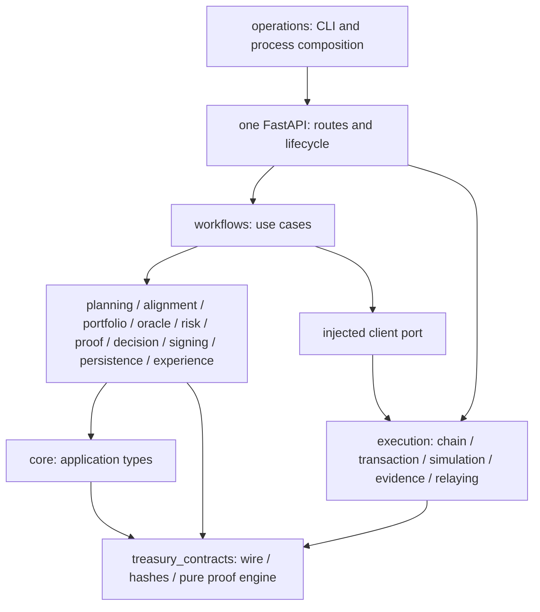

# Module map and collaboration rules

This is a modular monolith served by one FastAPI/Uvicorn process. Folders are divided by responsibility rather than person A/B. The API composition injects an in-process execution adapter into workflow; module boundaries remain explicit without an internal HTTP hop. See [single-app architecture](../docs/architecture/UNIFIED_BACKEND.md).

| Capability | Folder | Public interface / output |
| --- | --- | --- |
| Planning | `modules/planning` | `GoalPlanner.parse` (real Groq / explicit rules), then `propose` -> checked proposal |
| Alignment / Task Shield | `modules/alignment` | deterministic constraints; `TaskShield` / `ShieldRuntime`, objective revisions and tool interception |
| Portfolio | `modules/portfolio` | `PortfolioReader.collect`, `decision_snapshot` -> observed / authorization snapshots |
| Outcome reconciliation | `modules/monitoring` | `OutcomeMonitor`, read-only worker and authenticated history APIs |
| Intent budgets / temporal evidence | `modules/temporal` | `TemporalService`, authenticated IntentSpec, graph/verifier/semantic fusion and atomic approval revalidation |
| Pricing | `modules/oracle` | `PriceProvider.read` -> `OraclePrice` |
| Economic risk | `modules/risk` | `evaluate` -> risk assessment |
| Proof mapping | `modules/proof` | `prove` -> shared proof evidence |
| Decision | `modules/decision` | `decide` -> security decision |
| Attestation | `modules/signing` | `Attestor` -> signed PDR |
| Control persistence | `modules/persistence` | `Store` |
| Retry guidance | `modules/experience` | `next_amount` |
| Use cases/monitoring | `modules/workflows` | `ControlPlane` |
| Chain/build/simulate/relay | `modules/execution` | `Chain`, `Builder`, `Simulator`, `Relayer` |

All paths above are relative to `backend/src/treasury_backend`. Each folder has its own README, including the five execution subcomponents.

## Dependency direction

- `core` must not import business modules. `config` reads settings; domain logic does not read `.env` itself.
- Business modules expose explicit APIs through `__init__.py`. Use shared typed inputs rather than importing another module's private helpers.
- `workflows` is the coordinator. Feature modules must not import it to call back into orchestration.
- Control business code must not import execution internals; use the `workflows.client` port. `api/app.py` injects `LocalExecutionSDK` and `VerifiedExecutionClient` while registering execution routes on the same app. Execution must not import control signing or `operations`.
- `operations` is the composition root and owns deployment/process wiring. Runtime execution must not gain owner/attestor keys through a transitive import or inherited environment.
- SDK/protocol, `core`, `config`, `api`, migrations and Solidity are shared review areas. Most feature work stays in one folder, but a signed-field/ABI change necessarily spans SDK, backend, contracts, fixtures and tests.

Architecture tests currently enforce the unambiguous import namespace, no execution->signing/operator dependency, no core->feature dependency, no control-feature->execution dependency, no feature->workflow coordinator dependency and no SDK->backend dependency (including relative imports). Other rules above are review requirements; they are not all mechanically enforced.

## Add a feature

1. Choose the existing capability, or add `modules/<feature>/` with `__init__.py`, implementation, README and `tests/`.
2. Define input/output DTOs. Local feature DTOs stay with the feature; only truly cross-feature application types go to `core`, only wire contracts go to the SDK.
3. Add pure behavior first, then register the use case in workflows or an HTTP handler in `api`. Put external interfaces/adapters in the owning module, as in oracle.
4. Update its README with units, failure behavior, env inputs and a focused test command. Update this map when adding a capability.
5. Run focused tests, architecture tests and affected chain/protocol regressions. See [contributing](../CONTRIBUTING.md).

Frontend features follow the same ownership principle under `frontend/src/features`. Build/deploy boundaries are root backend Dockerfile and `frontend/Dockerfile`, not per-feature containers.
