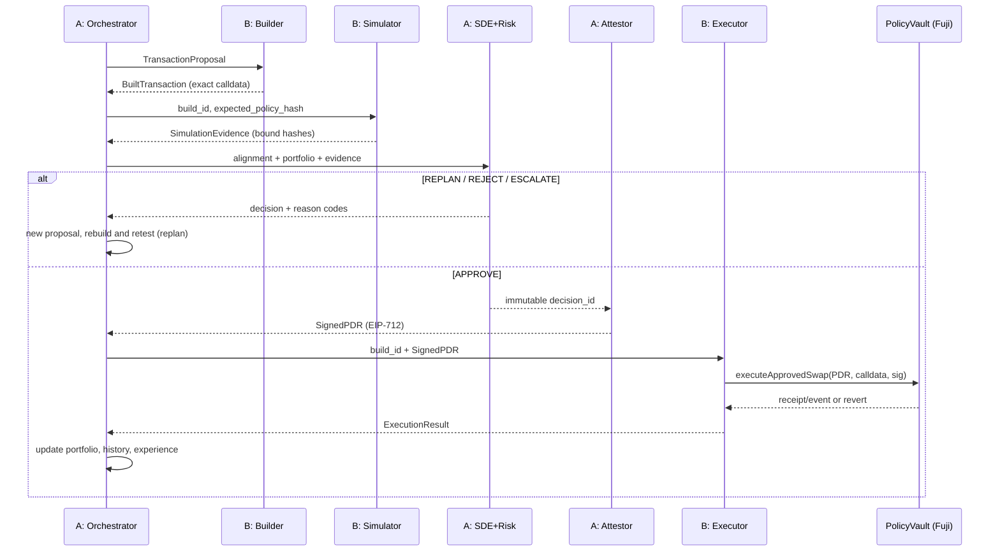

# AI Treasury Security — Shared Integration Contract & Runbook (A + B)

**Phiên bản:** Integration contract v1.1 — 16/11/2026  
**Dùng cùng:** `01_GUIDE_PERSON_A_CONTROL_PLANE.md`, `02_GUIDE_PERSON_B_EXECUTION_PLANE.md` và `AI_Treasury_Security_System_Design_v1.0.md` (thiết kế nền).  
**Ưu tiên:** Khi khác nhau về team ownership, **file integration này và hai guide A/B là quyết định nhóm mới nhất**; tài liệu System Design v1.0 chỉ làm kiến trúc tổng quan.

> **Nguyên tắc số 1:** Đây là **single source of truth** cho interface. Không một người tự đổi tên field, type, base units, EIP-712 field order, error code hay HTTP route. Sửa contract → cập nhật fixtures → merge PR → mới sửa implementation.
>
> **Nguyên tắc số 2:** Người A và B code độc lập từ ngày đầu. A dùng mock B client; B dùng sample proposal + local test signer. **Mock evidence không được dùng để ký PDR Fuji.**

## 0. Phạm vi và các quyết định đã đóng băng

| Mục | Quyết định |
|---|---|
| Network | Avalanche Fuji C-Chain; `chain_id = 43113` |
| RPC | `https://api.avax-test.network/ext/bc/C/rpc` |
| Token | `MockUSDC` (6 decimals), `MockWAVAX` (18 decimals), chỉ testnet |
| Swap P0 | `SWAP_EXACT_INPUT` USDC → WAVAX, một `MockSwapAdapter` do team triển khai; chiều ngược P1 |
| Wallet model | `PolicyVault.sol` custom PDR-enforced vault, **chưa phải ERC-4337** |
| Signature | EIP-712 `Approval`, domain `TreasuryPolicyVault` / version `1` |
| Core policy demo | ≤500 USDC/trade; ≤1,000 USDC/day (UTC); ≤25% WAVAX portfolio exposure; ≤1% slippage |
| Currency | Số token là **decimal string ở base units**; giá USD string theo `1e8`; bps số nguyên |
| Verification | Fixed baseline + scripted stress; **không** AI Verification Agent |
| Replan | Tối đa 2 vòng, mỗi proposal mới phải build/sim/risk/check lại |
| Deadline | Tích hợp cơ bản 18/11; demo freeze 20/11; submission 21/11/2026 |

**Bảo đảm được kiểm chứng:** quyền và limits on-chain, binding exact call, baseline effects đã mô phỏng, các tình huống stress đã thử. **Không bảo đảm:** lợi nhuận, khả năng dự đoán mọi MEV, không có lỗ hổng DeFi, hoặc oracle đúng vĩnh viễn.

## 1. Ownership + thời điểm bàn giao

| Phần | Owner | Bàn giao cho bên kia |
|---|---|---|
| `TreasuryMandate`, Planner, Shield | **A** | `TransactionProposal` đã validate |
| Transaction Builder | **B** | `BuiltTransaction` có exact calldata hash |
| Simulation/Stress/Evidence Extractor | **B** | `SimulationEvidence` + artifact refs |
| Portfolio State, Economic Risk, SDE | **A** | `SecurityDecision` immutable |
| Attestor + typed EIP-712 signing | **A** | `SignedPDR` sau APPROVE |
| PolicyVault / on-chain checks / Relayer | **B** | `ExecutionResult` + receipt |
| Outcome-to-Experience/Planner, demo UI | **A** | Replan / dashboard cập nhật |
| JSON schemas, fixtures, golden vector, CI integration | **Cả hai** | PR review chéo bắt buộc |

### Sơ đồ sequence (không có vòng phụ thuộc giữa hai người khi code)



## 2. Monorepo + branch rules

```text
ai-treasury-security/
  apps/control-plane/           # A
  apps/execution-plane/         # B
  apps/dashboard/               # A
  contracts/                    # B (Foundry)
  packages/contracts-api/       # Shared JSON Schemas / generated models
  fixtures/                     # Shared; normal, injection, exposure, drift, replay
  tests/integration/            # Shared E2E / golden vectors
  docs/
    01_GUIDE_PERSON_A_CONTROL_PLANE.md
    02_GUIDE_PERSON_B_EXECUTION_PLANE.md
    03_SHARED_INTEGRATION_CONTRACT.md
  docker-compose.yml
  .env.example                  # Public vars only, NEVER live keys
```

**Git:** `feat/a-*` và `feat/b-*`; mọi PR thay `packages/contracts-api`, fixtures hay `Approval` cần hai người approve. Pin Foundry/OpenZeppelin/Python dependency versions trong repo, commit lockfiles. Pin deployment addresses sau khi deploy, không hardcode trước.

## 3. Common data types (wire-format)

**Wire rules:** JSON keys `snake_case`; timestamps Unix seconds (integer); token amount string thập phân **nguyên** base units; `uint256` truyền string; hashes `0x` + 64 lowercase hex ký tự; address là 20-byte hex chuẩn (checksum khi hiển thị). `float` **cấm** cho giá/tiền/token amount. `status` phải lấy đúng enum. Các ví dụ dưới là schema minh họa, **không phải địa chỉ/transaction có thể chạy ngay**.

### 3.1 `TransactionProposal` (A → B)

```json
{
  "intent_id": "intent_001",
  "mandate_id": "mandate_001",
  "mandate_version": 1,
  "action": "SWAP_EXACT_INPUT",
  "chain_id": 43113,
  "vault_address": "0x1111111111111111111111111111111111111111",
  "router": "0x2222222222222222222222222222222222222222",
  "token_in": "0x3333333333333333333333333333333333333333",
  "token_out": "0x4444444444444444444444444444444444444444",
  "amount_in_base_units": "500000000",
  "slippage_bps": 100,
  "recipient": "0x1111111111111111111111111111111111111111",
  "deadline": 1799990000,
  "user_goal_reason": "Conservative USDC to WAVAX rebalance"
}
```

`deadline` là absolute Unix timestamp tương lai, do **orchestrator đáng tin cậy** tạo trong TTL được phép chứ không dùng giá trị tùy ý từ LLM; **giá trị trên chỉ là placeholder**. A không được điền calldata/minOut đã được coi là approved; B xác định calldata và minOut từ quote/adapter deterministic.

### 3.2 `BuiltTransaction` (B → A)

```json
{
  "build_id": "build_001",
  "intent_id": "intent_001",
  "chain_id": 43113,
  "vault_address": "0x1111111111111111111111111111111111111111",
  "router": "0x2222222222222222222222222222222222222222",
  "token_in": "0x3333333333333333333333333333333333333333",
  "token_out": "0x4444444444444444444444444444444444444444",
  "amount_in_base_units": "500000000",
  "min_amount_out_base_units": "24750000000000000000",
  "router_calldata": "0x...",
  "calldata_hash": "0x...",
  "policy_hash": "0x...",
  "nonce": "1001",
  "deadline": 1799990000,
  "quote_ref": "quote_001",
  "adapter_version": "mock-swap-v1"
}
```

`calldata_hash = keccak256(router_calldata_bytes)`; B buộc `router` + decoded fields + call selector và recipient đều đúng allowlist. `nonce` do B cấp từ nonce allocator/DB synchronized trong runtime, **không phải LLM cung cấp**, và Vault dùng mapping chống replay (`usedNonce[nonce]`). Khi cùng lúc có nhiều proposal, cấp nonce riêng để test cumulative budget; nonce bị consumed khi giao dịch thành công.

**Lưu ý:** MinOut số `24.75` WAVAX ở ví dụ trên **không phải mức minOut 24.9** của case MEV trước đó; nó chỉ minh họa giá quote/slippage 1%. Khi chạy demo drift muốn minOut 24.9, dùng quote/constraint tạo ra minOut 24.9 một cách nhất quán, không sửa thủ công sau simulation.

### 3.3 `SimulationEvidence` (B → A)

```json
{
  "schema_version": "1.1",
  "intent_id": "intent_001",
  "build_id": "build_001",
  "chain_id": 43113,
  "vault_address": "0x1111111111111111111111111111111111111111",
  "policy_hash": "0x...",
  "calldata_hash": "0x...",
  "nonce": "1001",
  "deadline": 1799990000,
  "fork_block": 12345678,
  "bytecode_hash": "0x...",
  "simulation_mode": "LOCAL_TEST_ATTESTOR",
  "baseline": {
    "execution_status": "SUCCESS",
    "token_in_delta_base_units": "-500000000",
    "token_out_delta_base_units": "25000000000000000000",
    "unexpected_transfer": false,
    "unauthorized_approval": false,
    "gas_used": "210000"
  },
  "stress_tests": [
    {"scenario_id":"reserve_shift_mild", "status":"SUCCESS_SAFE", "output_base_units":"24950000000000000000"},
    {"scenario_id":"reserve_shift_adverse", "status":"PROTECTED_REVERT", "revert_reason":"MIN_OUTPUT_NOT_MET"}
  ],
  "verification_status": "COMPLETE",
  "parser_version": "extractor-v1",
  "source": "REAL_LOCAL_SIM",
  "artifact_refs": ["artifact://simulation/build_001/report.json"],
  "evidence_manifest_ref": "artifact://simulation/build_001/manifest.json",
  "evidence_root": "0x..."
}
```

Valid `baseline.execution_status`: `SUCCESS | REVERTED | INCONCLUSIVE`. Valid stress `status`: `SUCCESS_SAFE | PROTECTED_REVERT | UNSAFE_EXECUTION | INCONCLUSIVE`. `PROTECTED_REVERT` không bị gắn nhãn thiệt hại xảy ra: swap rollback, nhưng execution gas có thể tốn khi thực thi thật.

`verification_status` có giá trị `COMPLETE | INCOMPLETE | INCONCLUSIVE`. A không approve khi `INCOMPLETE` hoặc `INCONCLUSIVE`. A tải `evidence_manifest_ref`, tính lại `evidence_root` để chống việc report và root bất nhất. Trường `source` có thể `MOCK_FIXTURE | REAL_LOCAL_SIM | FORK_SIM`. **Attestor ở chế độ Fuji từ chối `MOCK_FIXTURE` và `REAL_LOCAL_SIM` thuần túy; chỉ chấp nhận `FORK_SIM` với bytecode/policy/state/deployment đối chiếu được. Nếu chưa có Fuji fork đáng tin cậy, demo trên local Anvil và gắn nhãn rõ ràng, không tuyên bố đã chứng minh execution trên Fuji.**

### 3.4 `PortfolioSnapshot` (B chain reads + A pricing/state)

```json
{
  "snapshot_id": "snapshot_001",
  "chain_id": 43113,
  "vault_address": "0x1111111111111111111111111111111111111111",
  "block_number": 12345678,
  "usdc_base_units": "7700000000",
  "wavax_base_units": "115000000000000000000",
  "price_usdc_usd_e8": "100000000",
  "price_wavax_usd_e8": "2000000000",
  "price_source": "TRUSTED_TEST_ORACLE",
  "price_timestamp": 1799990000,
  "history_version": 12
}
```

Nguồn balance/on-chain nonce/policyHash đến từ B/chain, nguồn price/vocabulary/portfolio history đến từ A với provenance. Snapshot dùng để risk phải cùng chain và gần cùng block với simulation (chính sách freshness chốt trong code và ghi vào evidence, demo default TTL ≤60s và block drift ≤3, chỉ là cấu hình thử nghiệm). Nếu không bảo đảm state consistency thì `ESCALATE`.

### 3.5 `EconomicRiskAssessment` (A internal)

```json
{
  "intent_id": "intent_001",
  "build_id": "build_001",
  "snapshot_id": "snapshot_001",
  "result": "FAIL",
  "projected_wavax_exposure_bps": 2800,
  "max_wavax_exposure_bps": 2500,
  "violations": ["TOKEN_EXPOSURE_LIMIT"],
  "calculation_version": "risk-v1"
}
```

Valid `result`: `PASS | FAIL | INCONCLUSIVE`; giá 7,700 USDC + 115 WAVAX × $20 = $10,000; thêm 500 USDC value WAVAX thành $2,800/$10,000 = 28%. Assumption: không tính phí, giá giữ nguyên cho fixture unit test, không phải bảo đảm thị trường.

### 3.6 `SecurityDecision` (A internal immutably stored)

```json
{
  "decision_id": "decision_001",
  "intent_id": "intent_001",
  "build_id": "build_001",
  "verdict": "REPLAN",
  "reason_codes": ["TOKEN_EXPOSURE_LIMIT"],
  "policy_hash": "0x...",
  "calldata_hash": "0x...",
  "simulation_evidence_root": "0x...",
  "mandate_version": 1,
  "snapshot_id": "snapshot_001",
  "created_at": 1799990000,
  "expires_at": 1799990030,
  "source": "SDE_V1"
}
```

Valid `verdict`: `APPROVE | REPLAN | REJECT | ESCALATE`. Attestor nhận `decision_id` rồi **tự load các bản ghi**; không nhận một decision/policy tự do từ client. `source=SDE_V1` không có nghĩa tự động tin cậy: kiểm tra dữ liệu trong DB không bị sửa, chain context và evidence binding, quyền caller.

### 3.7 `SignedPDR` (A → B, chỉ APPROVE)

```json
{
  "decision_id": "decision_pass_001",
  "build_id": "build_001",
  "domain": {
    "name": "TreasuryPolicyVault",
    "version": "1",
    "chainId": 43113,
    "verifyingContract": "0x1111111111111111111111111111111111111111"
  },
  "approval": {
    "policyHash": "0x...",
    "evidenceRoot": "0x...",
    "router": "0x2222222222222222222222222222222222222222",
    "tokenIn": "0x3333333333333333333333333333333333333333",
    "tokenOut": "0x4444444444444444444444444444444444444444",
    "amountIn": "500000000",
    "minAmountOut": "24750000000000000000",
    "calldataHash": "0x...",
    "nonce": "1001",
    "deadline": "1799990000"
  },
  "signature": "0x...",
  "typed_data_hash": "0x..."
}
```

**Đặc biệt:** Wire JSON ngoài EIP-712 dùng `snake_case`, nhưng EIP-712 **phải dùng `camelCase` đúng Solidity type members**. `SignedPDR.approval` EIP712 không thêm `chainId`/`vault` vào struct vì chúng đã ở domain; `policyHash` + Vault domain ràng buộc version/account. PDR chỉ được phát hành khi `SecurityDecision.verdict == APPROVE` và `SignedPDR` chính xác với `BuiltTransaction` và root của sim.

### 3.8 `ExecutionResult` (B → A)

```json
{
  "build_id": "build_001",
  "decision_id": "decision_pass_001",
  "chain_id": 43113,
  "tx_hash": "0x...",
  "status": "CONFIRMED",
  "block_number": 12345680,
  "gas_used": "210000",
  "actual_token_in_delta_base_units": "-500000000",
  "actual_token_out_delta_base_units": "25000000000000000000",
  "revert_reason": null,
  "event_refs": ["SwapExecuted"],
  "artifact_refs": ["artifact://execution/build_001/receipt.json"]
}
```

Valid execution statuses: `SUBMITTED | PENDING | CONFIRMED | REVERTED | FAILED_TO_SUBMIT | STALE_REQUIRES_REEVALUATION`. `CONFIRMED` dựa receipt (theo finality policy, nếu cần), không dựa vào `APPROVE`. Receipt revert không tự hàm ý tiền bị chuyển: báo theo state diff thực.

## 4. EIP-712 / Solidity — hợp đồng bất biến giữa A và B

**Domain:**

```text
EIP712Domain(
  name = "TreasuryPolicyVault",
  version = "1",
  chainId = 43113,
  verifyingContract = <actual deployed PolicyVault address>
)
```

**Solidity struct và exact member order:**

```solidity
struct Approval {
    bytes32 policyHash;
    bytes32 evidenceRoot;
    address router;
    address tokenIn;
    address tokenOut;
    uint256 amountIn;
    uint256 minAmountOut;
    bytes32 calldataHash;
    uint256 nonce;
    uint256 deadline;
}
```

**Exact primary type string:**

```text
Approval(bytes32 policyHash,bytes32 evidenceRoot,address router,address tokenIn,address tokenOut,uint256 amountIn,uint256 minAmountOut,bytes32 calldataHash,uint256 nonce,uint256 deadline)
```

**Hashing rules:**

1. `calldataHash = keccak256(routerCalldata bytes)`. B là source of truth và A cross-check built/evidence/approved.
2. `policyHash`: keccak256 của owner-authorized policy commitment do contract lưu; hash/version thay đổi thì PDR cũ thất hiệu lực. Hai người dùng chung policy-hash fixture do B xuất từ contract, không tự tái tạo bằng chuỗi JSON khác nhau.
3. `evidenceRoot`: `keccak256(UTF8(RFC 8785 / JCS canonical JSON of evidence manifest))`. Manifest gồm `chain_id, vault_address, policy_hash, calldata_hash, fork_block, bytecode_hash, scenario artifact content hashes, parser_version, verification_status` và **không chứa `evidence_root`**. A có thể hash lại manifest để xác nhận B không truyền sai. Golden manifest/bytes/hash commit vào `fixtures/eip712_golden/`.
4. EIP-712 digest lấy bằng thư viện EIP712 đúng chuẩn; Solidity `EIP712._hashTypedDataV4` + `ECDSA.recover`/`SignatureChecker` phải khớp thư viện Python bên A.
5. `Signature` chỉ attestor được owner cấu hình; owner key, relayer key và attestor key là ba quyền khác nhau.
6. PDR TTL ≤30s trong demo (configurable), validation bằng `block.timestamp`, nonce id duy nhất; no unlimited approval.
7. **Không được tự thêm field vào Approval** mà không tăng version và cập nhật cả hai bên.

**Cross-language golden test yêu cầu trước khi ghép:** B publish deployed local vault address, policyHash, routerCalldata bytes, `calldataHash`, nonce, deadline; A chạy signer test để xuất `(digest, signature, signer)`. B viết forge test `recover(signedPDR) == attestor`, `executeApprovedSwap` pass với đúng bytes và fail khi thay 1 byte calldata / 1 field. Nếu không pass, **chưa tích hợp tiếp**.

**Lưu ý mô phỏng PDR:** Chỉ ký approval production sau APPROVE. Trong local simulation, B dùng **ephemeral test signer riêng trong fork/test deployment** và cùng bytecode/path `executeApprovedSwap`; không mở cửa ký sớm cho AI và không đưa test signing key lên Fuji. Khi sim local khác live state/deployment, gắn `simulation_mode`/provenance và từ chối dùng làm chứng minh tương đương nếu sai khác chính yếu.

## 5. HTTP API contract / service ownership

Base URLs khi local:

```text
A control-plane  http://localhost:8000
B execution-plane http://localhost:8001
```

| Service | Method | Path | Request | Response |
|---|---|---|---|---|
| **A** | POST | `/v1/workflows/start` | goal + mandate_id | `{workflow_id, status}` |
| **A** | POST | `/v1/agent/propose` | goal + mandate_id | `TransactionProposal` |
| **A** | POST | `/v1/alignment/check` | proposal + task metadata | TaskAlignmentVerdict |
| **A** | POST | `/v1/risk/evaluate` | evidence + snapshot ref | EconomicRiskAssessment |
| **A** | POST | `/v1/decisions` | immutable refs + alignment | SecurityDecision |
| **A internal** | POST | `/v1/approvals/attest` | `{decision_id}` | `SignedPDR` |
| **A** | GET | `/v1/workflows/{id}` | path param | timeline/status |
| **A** | GET | `/v1/treasury` | none | portfolio + mandate |
| **B** | GET | `/v1/chain/context` | none | chain, active policyHash, vault, router, tokens, block |
| **B** | GET | `/v1/portfolio/onchain-snapshot` | none | vault balances at block + onchain budget counters |
| **B** | POST | `/v1/build` | TransactionProposal | BuiltTransaction |
| **B** | POST | `/v1/simulations` | `{build_id,expected_policy_hash}` | SimulationEvidence |
| **B** | POST | `/v1/executions` | `{build_id,signed_pdr}` | `{tx_hash,status}` |
| **B** | GET | `/v1/executions/{tx_hash}` | path param | ExecutionResult |

**Security/Auth:** A→B mTLS/private network token or backend service API key (dev `.env`), never expose executor/attestor to browser. Use `X-Request-Id` and `workflow_id` for correlation. Owner-only mutation APIs must verify signed owner authorization; demo manual owner setup is acceptable but explicitly documented.

### Error envelope (mọi 4xx/5xx)

```json
{
  "error": {
    "code": "STALE_REQUIRES_REEVALUATION",
    "message": "Live policy/nonce/chain state no longer matches approved evidence",
    "retryable": false,
    "correlation_id": "workflow_001"
  }
}
```

**Common reason codes (no free-text gate):**

| Code | Owner | SDE outcome/action |
|---|---|---|
| `TASK_MISALIGNED` | A Shield | REJECT |
| `TASK_UNCERTAIN` | A Shield | ESCALATE |
| `TOKEN_NOT_ALLOWED`, `ROUTER_NOT_ALLOWED`, `BAD_RECIPIENT` | B Builder/Vault | REJECT |
| `UNAUTHORIZED_APPROVAL`, `UNEXPECTED_TRANSFER` | B Evidence | REJECT |
| `TOKEN_EXPOSURE_LIMIT` | A Risk | REPLAN |
| `TRADE_SIZE_LIMIT`, `REQUIRED_STRESS_NOT_SATISFIED` | A/B | REPLAN |
| `SIMULATION_INCOMPLETE`, `STALE_PRICE`, `HASH_MISMATCH` | A+B | ESCALATE / re-check, never sign |
| `POLICY_REVOKED`, `BAD_SIGNATURE`, `NONCE_REPLAY` | B Vault | REJECT / onchain revert |
| `MIN_OUTPUT_NOT_MET` | B Vault | PROTECTED_REVERT, monitor/replan by policy |

**HTTP statuses:** 400 invalid schema, 401/403 denied auth, 409 conflict/stale/nonce mismatch, 422 semantic validation, 503 simulator/RPC unavailable. Không biến HTTP timeout thành simulation PASS; idempotency key cho requests build/sim/execute (đặc biệt khi retry sau network drop); tránh submit hai lần vì HTTP retry.

## 6. Đường tích hợp thật (happy path + negative paths)

### Normal happy path

1. Owner cấu hình mandate/hard limits trong Vault, A đọc active `policyHash` từ B.
2. A tạo `TransactionProposal`; Shield `ALIGNED`.
3. A `POST B /v1/build` → B trả `BuiltTransaction` exact calldata.
4. A `POST B /v1/simulations` → B chạy local fork/test path, trích xuất evidence, lưu artifact, trả root.
5. A fetch `PortfolioSnapshot` với chain balances từ B và trusted test price; kiểm tra freshness/same-chain/block.
6. A Economic Risk Evaluator tính exposure/cost; SDE so sánh tất cả và trả APPROVE nếu PASS.
7. A internal `POST /v1/approvals/attest` với `decision_id`, signer tự recheck binding + TTL, ký EIP-712.
8. A `POST B /v1/executions` với build_id + SignedPDR; B preflight không mutate payload, gửi relayer.
9. Vault verify chữ ký/call/nonce/daily limits, swap, postcondition; B monitor tx + gửi `ExecutionResult`.
10. A update Portfolio/Experience và dashboard: chỉ hiện CONFIRMED khi có receipt success.

### Reject/replan flow

- Nếu SDE trả REPLAN (vd token exposure 28%): không gọi Attestor, gửi reason codes về Planner, tạo **intent/build mới**; không dùng lại hash hoặc sim cũ.
- Nếu MISALIGNED: REJECT trước transaction submission, có thể giữ audit record.
- Nếu evidence stale/incomplete: ESCALATE hoặc tái chạy sim/risk theo policy; **không** lấy `APPROVE` từ lần trước.
- Nếu onchain minOut revert: ghi `PROTECTED_REVERT`, relayer gas vẫn có thể tốn; không báo là token bị swap ra ở giá xấu.
- Nếu owner thay policy hoặc revoke attestor: PDR đã ký nhưng chưa execute bị Vault từ chối.

## 7. Mock-first song song: quy trình kiểm tra ngay ngày đầu

**A tự chạy:**

```text
Input: fixture(normal_swap + synthetic simulation evidence + portfolio)
Expected: SDE APPROVE in local test mode
Output: SecurityDecision + optional test-only signed typed data
```

**B tự chạy:**

```text
Input: fixture(TransactionProposal + known local test signature)
Expected: exact builder calldata → simulated swap → test Vault execution
Output: BuiltTransaction, SimulationEvidence, ExecutionResult
```

**Integration:** lần ghép đầu chỉ cần `POST /v1/build` nhận proposal của A và cho A nhận evidence từ B. Lần ghép thứ hai làm cross-language EIP712 signature. Lần thứ ba full pipeline A APPROVE → A attestor → B Vault → receipt.

**Fixture policy:** `fixtures/mock/*` có `source=MOCK_FIXTURE`; artifacts `fixtures/golden/*` có exact expected hash, được lưu trong git. Không có đường `mock=true` trên API thực thi Fuji.

## 8. CI & contract tests (ngăn lệch interface)

```text
schema_validate:
  jsonschema / pydantic validate all shared fixture examples
python_unit:
  risk, SDE, attestor gate, mock execution client
forge_unit:
  vault execution, nonce replay, allowlist, postconditions, policy revoke
integration_signature:
  Python EIP-712 signature passes Solidity recover and vice versa
integration_wire:
  A proposal → B builder → A parse B evidence → A decision
integration_e2e:
  approved PDR on local chain -> Vault execution -> receipt
```

**P0 gates phải PASS trước submission:**

| Gate | Assertion | Ai sign-off |
|---|---|---|
| G0 Shared | schema fixture parse ở A & B, hash rule thống nhất | A+B |
| G1 Local Vault | valid PDR executes, altered calldata/replay denied | B; A review |
| G2 Local SDE | exposure 28% → REPLAN; missing data → no signature | A; B review |
| G3 EIP-712 | identical typed-data digest/signature recover across languages | A+B |
| G4 E2E | real sim evidence → APPROVE → signed PDR → vault executes | A+B |
| G5 Security negative | prompt injection, stale/changed policy, minOut revert | A+B |
| G6 Fuji | testnet tx receipt with mocked funds; no live keys | A+B |

## 9. Lịch đồng bộ, hạn chế blocking

| Ngày | Người A | Người B | Integration jointly |
|---|---|---|---|
| **16/11** | FastAPI + mock B + risk/SDE | Foundry + mock adapter + Vault skeleton | **Chốt schema EIP-712 & fixtures** |
| **17/11** | Planner, Shield, Experience | Builder, local sim, baseline | A→B `/build`; B→A mocked evidence |
| **18/11** | Attestor gate + UI skeleton | Evidence extractor + Vault checks | **Golden signature + full local PDR execute** |
| **19/11** | Injection, exposure, orchestration | MEV stress, relayer, Fuji deployment | Bốn demo cases + replay |
| **20/11** | UI polish + narrated demo | Receipt monitor + security fixes | **Code freeze, regression, rehearsal** |
| **21/11** | — | — | Submission / contingency |

**Daily 15-minute integration check:** 1) merged API versions? 2) fixture hash still passes? 3) blockers on integration gate? 4) next one end-to-end test? No waiting until the last day.

## 10. Demo cases and expected assertions

| ID | Scenario | Expected |
|---|---|---|
| N | Normal swap within all limits | `ALIGNED → PASS → APPROVE → PDR → CONFIRMED` |
| P | Market feed prompt-injects alternate recipient | `MISALIGNED` or Builder rejects recipient; no unauthorized execution |
| E | Portfolio AVAX share 23% → 28% from $500 swap | `REPLAN TOKEN_EXPOSURE_LIMIT`; no PDR |
| M | Post-simulation reserve shift, amountOut < minOut | Vault revert, classified `PROTECTED_REVERT`, token not swapped |
| R | Replay signed PDR / alter calldata | Vault rejects |
| C | Daily spent $700; two $200 swap PDRs | First can pass ($900), second reverts ($1,100 > $1,000) |
| S | Stale price / incomplete evidence | `ESCALATE`/no signature |
| O | Owner revokes attestor / mandate hash changes | Old PDR rejected onchain |

**Lưu ý khoa học:** N và E dùng controlled test oracle và mock liquidity; M là state-drift adversarial stress, **không** claim ngăn toàn bộ MEV. PDR signature chứng minh attestor ủy quyền chứ không bảo đảm LLM reasoning đúng.

## 11. Tài liệu tham khảo kỹ thuật / review trước khi code

- Foundry Anvil: https://book.getfoundry.sh/anvil/
- OpenZeppelin EIP712: https://docs.openzeppelin.com/contracts/5.x/api/utils/cryptography
- EIP-712: https://eips.ethereum.org/EIPS/eip-712
- ERC-4337 (chỉ sau MVP): https://eips.ethereum.org/EIPS/eip-4337
- ERC-7579 (chỉ sau MVP): https://ercs.ethereum.org/ERCS/erc-7579
- Avalanche C-Chain/Fuji: https://build.avax.network/docs/primary-network

**Definition of Done chung:** Khi giao dịch/plan/call thay đổi 1 byte, bắt buộc build → simulate → risk → SDE → attest lại; chỉ Owner được thay mandate; và chỉ giao dịch chính xác đã được SDE duyệt + PDR hợp lệ mới được Vault thực thi.

**Implementation handoff:** [06_AB_INTEGRATION_HANDOFF.md](06_AB_INTEGRATION_HANDOFF.md) mô tả SDK/model/OpenAPI/ABI và hành vi runtime B hiện tại; [07_AI_MERGE_PLAYBOOK.md](07_AI_MERGE_PLAYBOOK.md) cung cấp quy trình merge. Các tài liệu bàn giao không tự cấp quyền thay đổi contract v1.1 hoặc thay thế review chéo/gates A+B.
