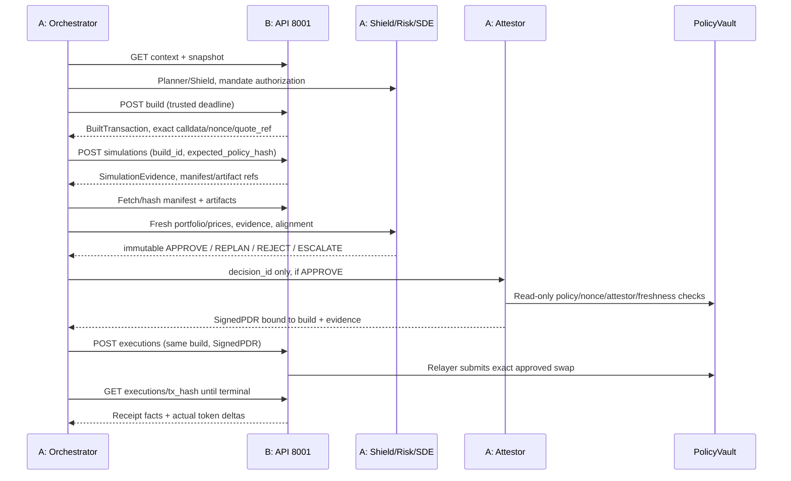

# Bàn giao Execution Plane B cho Control Plane A

> Historical / compatibility document. For the current runtime use [V2.1 system design](AI_Treasury_Security_System_Design_v2.1.md) and [readiness audit](audit/V2_1_READINESS_REVIEW.md). Old A/B layouts, PoC evidence and removed pre-refactor paths describe their original checkpoint; they are not current deployment instructions or new validation evidence. References to removed artifacts are retained as plain code text.

Phiên bản interface: **1.1**. Ngày rà soát: **16/11/2026**. Đối tượng: người A và AI hỗ trợ merge/implement phần A.

Tài liệu này mô tả **hành vi code hiện tại**, các bước ghép và tiêu chí nghiệm thu. Nguồn chuẩn vẫn là [03_SHARED_INTEGRATION_CONTRACT.md](03_SHARED_INTEGRATION_CONTRACT.md); ownership và yêu cầu A/B nằm trong guide 01/02. System Design v1.0 là nền kiến trúc. Không dùng tài liệu PoC lịch sử làm API hiện hành.

## 1. Kết luận và giới hạn xác nhận

Phần B cung cấp đủ đường giao tiếp để A implement đúng guide và ghép qua HTTP: proposal → build → real simulation/evidence → signed PDR → execution/receipt. SDK được đóng gói độc lập; A không cần import backend B.

Đã kiểm tra một consumer chạy ở **tiến trình/cwd khác**, Python isolated mode, chỉ dùng SDK chung để gọi HTTP thật, xác minh artifacts, đọc nonce on-chain, ký EIP-712, thử tamper và thực thi. Đã kiểm tra wheel SDK cài trong môi trường không có backend `app`, có đủ ABI cần thiết.

**Chưa xác nhận:** implementation thực tế của A, Planner/Shield/SDE/production attestor, dashboard A, hoặc giao dịch PolicyVault mới trên Fuji. Consumer probe là kiểm tra protocol/local test signer, không thay cho A-01…A-10. Chỉ có thể xác nhận merge toàn hệ thống sau khi A cung cấp code và chạy các gate cuối tài liệu.

## 2. Phạm vi và ownership

| Phần | Owner | Quy tắc khi merge |
|---|---|---|
| `apps/control-plane/`, `apps/dashboard/` | A | A triển khai Planner, Shield, risk, SDE, attestor, orchestration/UI |
| `apps/execution-plane/`, `contracts/` | B | Giữ execution checks, builder, simulation, evidence, relayer |
| `packages/contracts-api/`, `fixtures/`, `tests/integration/` | A+B | Review cùng nhau; không tự đổi wire contract/signature |
| Root `package.json`, `package-lock.json`, CI, `.env.example` | A+B | Hợp nhất thay đổi; không chọn wholesale phiên bản một bên |
| `.env`, runtime DB, local keys | Theo máy chạy | Không commit, không dùng Git merge secrets |

PoC React/Vite/Hardhat/ERC-4337 cũ đã bị xóa theo yêu cầu. `docs/LEGACY_POC_README.md`, `ARCHITECTURE.md`, `SMART_ACCOUNTS.md`, các report cũ là tài liệu lịch sử. Không khôi phục chúng để giải quyết conflict với bản PolicyVault.

## 3. Runtime và trust boundary



LLM không cấp quyền, không tạo calldata cuối, không giữ key. A attestor chỉ ký từ decision APPROVE immutable đã load trong DB của A. B không thể xác minh logic nội bộ DB A chỉ từ `decision_id`; B tin chữ ký attestor cho **đúng Approval** và Vault cưỡng chế các hạn mức on-chain. `decision_id` là audit reference ngoài EIP-712, không tự là bằng chứng APPROVE.

| Constraint | Enforcement hiện tại |
|---|---|
| USDC → WAVAX, router/tokens/selector/recipient | Builder + Vault |
| ≤500 USDC/swap, ≤1,000 USDC/ngày UTC | Builder precheck + Vault atomic counter |
| Exact amountIn, output ≥ signed minOut, allowance exact/reset | Vault postconditions + extractor |
| Slippage ≤ mandate max (demo 100 bps) | Builder; A recheck quote/minOut. Vault enforce signed minOut, không có USD oracle |
| WAVAX exposure ≤25%, giá/history/freshness/risk | A; B không tự cung cấp giá USD |
| Alignment, approve/replan/reject, tối đa 2 replan | A |
| Replay, policy revoke, signature/domain | Vault; B preflight hỗ trợ |

## 4. Cài đặt và tách Python app namespace

Tại root repository:

```powershell
npm ci --ignore-scripts
npm run setup
npm run check
npm run local
```

Lệnh `local` compile, khởi động/tái dùng Anvil loopback 31337, bootstrap mock deployment nếu cần, giữ API key rồi chạy B tại `http://127.0.0.1:8001`. Sau bootstrap, node mine mỗi 2 giây để timestamp không stale khi UI/planner idle. Không đổi TTL hoặc block-drift gate để che lỗi. Nếu chạy node thủ công bằng `npm run anvil`, nó dùng automining; cần mine block trước workflow khi idle lâu hoặc chạy node với interval mining.

Runner local dùng `evm_setIntervalMining`, nhận khoảng thời gian theo giây; xem [Anvil RPC implementation/reference](https://foundry-rs.github.io/foundry/anvil/eth/api/struct.EthApi.html#method.anvil_set_interval_mining). RPC này không được gọi trên Fuji trong luồng bootstrap local.

A chạy **process/uv environment riêng**, port 8000; B chạy port 8001. Hai service có thể cùng tên Python package `app`, nhưng không được import hai backend `app` vào cùng interpreter, không thêm `apps/execution-plane` vào `sys.path` của A.

Trong `apps/control-plane` của A:

```powershell
uv add ../../packages/contracts-api
```

Dependency tương ứng trong pyproject của A:

```toml
[project]
# Các dependency khác thuộc A; đây là phần bổ sung.
dependencies = ["treasury-contracts-api==1.1.0"]

[tool.uv.sources]
treasury-contracts-api = { path = "../../packages/contracts-api", editable = true }
```

Đây là đoạn cần **merge vào** pyproject có sẵn, không thay toàn bộ file. B hỗ trợ Python `>=3.10,<3.14`; dùng Python 3.13 cho môi trường tích hợp đã kiểm tra. Shared SDK pin Pydantic 2.12.4, web3 7.14.0, httpx 0.28.1, rfc8785 0.1.4; A chọn dependency tương thích. Mỗi service giữ uv.lock riêng; không nối hai lockfile bằng tay.

Nếu A dùng Docker, image A chỉ cần SDK và dependencies A, không cần import hay cài backend B. Base URL B và RPC phải reachable từ container, không mặc định hiểu localhost là máy host. Image B cần cả Anvil binary, compiled Foundry artifacts/storageLayout và monorepo paths tương ứng hoặc absolute path overrides. Compose full A+B chưa được cung cấp/kiểm thử trong lần bàn giao này.

## 5. File chuẩn để AI đọc/copy đúng

| Nội dung | Đường dẫn từ root |
|---|---|
| DTO Python | `packages/contracts-api/treasury_contracts/models.py` |
| SDK HTTP/error handling | `packages/contracts-api/treasury_contracts/client.py` |
| Hash/JCS/EIP-712 helpers | `packages/contracts-api/treasury_contracts/crypto.py` |
| Read-only nonce/policy helper | `packages/contracts-api/treasury_contracts/onchain.py` |
| JSON Schemas | `packages/contracts-api/*.schema.json` |
| OpenAPI cố định được export | `packages/contracts-api/openapi.json` |
| ABI đóng gói trong SDK | `packages/contracts-api/treasury_contracts/abi/PolicyVault.json` |
| Vector chữ ký/manifest chuẩn | `fixtures/eip712_golden/` |
| Probe consumer độc lập, chỉ local test | `tests/integration/a_consumer_probe.py` |
| Integration tests của B | `apps/execution-plane/tests/test_consumer_contract.py`, `test_integration.py` |
| Machine-readable handoff index | `docs/handoff/integration-manifest.json` |

`npm run schemas` sinh lại schema, OpenAPI và ABI sau khi compile. Không viết lại DTO từ JSON minh họa trong guide. JSON Schema là artifact sinh từ model, không là bản thứ hai để sửa tay. Khi đổi API/Approval cần cập nhật shared contract/version, fixtures, generator output và được A+B review.

## 6. Wire format bắt buộc

- Keys ngoài EIP-712 là snake_case. Riêng `SignedPDR.domain` và `.approval` giữ đúng EIP-712 camelCase.
- Amount, minOut, nonce và các uint256: **decimal string nguyên**. USDC 6 decimals, WAVAX 18. Timestamps ngoài Approval là Unix seconds dạng int; `Approval.deadline` là uint256 string.
- Hash là `0x` + 64 lowercase hex; signature là `0x` + 130 lowercase hex; calldata là chuỗi hex byte chẵn.
- Address là 20-byte hex; SDK/API output thường checksum. PDR chấp nhận địa chỉ checksum hoặc lowercase vì binding so EIP-712 digest; ABI encoding chuyển về checksum để web3.py chấp nhận. Không sửa nội dung build/evidence đã lưu chỉ để chuẩn hóa hiển thị.
- Model strict, extra fields bị từ chối. `workflow_id` không phải field thêm vào TransactionProposal: dùng `intent_id` và `X-Request-ID`, A giữ workflow mapping riêng.
- `build_id` không đồng nhất `calldata_hash`: hai build cùng calldata nhưng nonce/quote snapshot khác vẫn có ID khác. Persist nguyên response B.

## 7. REST contract thực tế

Mọi `/v1/*` cần `X-API-Key: <B_API_KEY>`. POST cần `Idempotency-Key` dài 1–128 ký tự. Gửi `X-Request-ID` theo workflow; lỗi trả lại `error.correlation_id`. `/health`, `/docs`, `/openapi.json` không cần API key. Browser chỉ gọi A; không đưa credential B vào dashboard, không cần mở CORS B để ghép A.

| Method/path | Request | Response/model |
|---|---|---|
| GET `/v1/chain/context` | none | `ChainContext` |
| GET `/v1/portfolio/onchain-snapshot` | none | `OnchainSnapshot` |
| POST `/v1/build` | `TransactionProposal` | `BuiltTransaction` |
| POST `/v1/simulations` | `SimulationRequest` | `SimulationEvidence` |
| POST `/v1/executions` | `ExecutionRequest` | `ExecutionSubmission` (`tx_hash`, `status`) |
| GET `/v1/executions/{tx_hash}` | tx hash đã được B journal | `ExecutionResult` |
| GET `/v1/artifacts/{content_hash}` | 64 hex **không** `0x` trong path | Raw canonical JSON bytes, ETag |

`ExecutionClient.context()`, `.snapshot()`, `.execute()` trả dict đã validate để giữ tính tương thích. `.build()`, `.simulate()`, `.result()` trả shared model. Có context manager `with ExecutionClient(...) as b:`. SDK không tự approve/sign hoặc tự retry.

SDK là **đồng bộ**: không `await b.build(...)` trực tiếp. Trong async orchestrator/API A, đưa các call SDK/blocking Web3 vào threadpool hoặc dùng sync handlers; không chặn event loop trong lúc chờ simulation. Deadline/timeout vẫn phải được A theo dõi riêng.

### 7.1 Context dùng cho mandate reader A

`ChainContext` gồm chain/vault/router/tokens, `policy_hash`, `policy_active`, `policy_version`, `policy_expires_at`, `attestor`, `owner`, `paused`, limits, `max_approval_ttl`, block/hash/timestamp và `mode`.

**Không so `mandate_version` bằng `policy_version` một cách máy móc.** Mandate version do A/owner quản lý; Vault `policyVersion` tăng cả khi đổi allowlist/attestor/configuration. Deployment mặc định có mandate metadata version 1 nhưng Vault generation có thể là 2. A phải giữ mapping mandate version → owner-authorized **active policy_hash** và so hash on-chain, không tự tái tạo policy hash từ JSON.

Local context là chain ID **31337**; mandate/proposal A ở test mode phải dùng cùng chain/vault. Fuji bắt buộc **43113**. Không hardcode Fuji chain/address vào mọi local fixture.

### 7.2 Snapshot B khác PortfolioSnapshot đầy đủ của A

B trả `snapshot_id`, chain/vault/block/hash/time/policy, `usdc_base_units`, `wavax_base_units`, `allowance_base_units`, `utc_day`, `daily_spent_usdc_base_units`, `max_spend_per_day_base_units`, `provenance`.

B **không** trả `price_*`, `price_source`, `price_timestamp`, `history_version` hoặc exposure. A thêm các trường đó từ nguồn riêng có provenance để tạo PortfolioSnapshot/risk input. Không đọc giá $20 từ lý do LLM rồi gọi đó là trusted oracle. Quote mock adapter dùng cho builder không tự chứng minh nguồn giá USD độc lập.

### 7.3 Deadline, nonce và freshness

Planner và Shield nên chạy **trước** khi bắt đầu critical path build/sim/attest. Orchestrator tạo deadline trusted ngay trước build, ví dụ `min(now, context.timestamp) + 25`, không lấy từ LLM hoặc sửa deadline sau simulation. Vault demo TTL tối đa 30 giây, evidence freshness ≤60 giây và block drift ≤3. Khoảng 3 block trên node interval 2s chỉ còn vài giây cho evaluate/attest; không có bảo đảm request thành công khi dữ liệu stale.

Approval nonce do B cấp, bắt đầu từ allocator của từng chain/vault. Nó **không phải** transaction count của owner/relayer/vault. A giữ nguyên `built.nonce`, kiểm tra `usedNonce` bằng read-only helper trước ký. Nonce chỉ consumed khi tx thành công; revert rollback counter/allowance/token effects. Mỗi replan dùng intent/build mới và mô phỏng/đánh giá/ký mới.

### 7.4 Error và retry

Lỗi 4xx/5xx có envelope `{"error":{"code":...,"message":...,"retryable":false,"correlation_id":...}}`. SDK raise `ExecutionAPIError`, cũng là subclass của `httpx.HTTPStatusError`; dùng `.code`, `.status_code`, `.retryable`, `.correlation_id`. Transport timeout là exception httpx riêng; không gọi nó là PASS.

| HTTP/code điển hình | Cách A xử lý |
|---|---|
| 400 `INVALID_SCHEMA` | Sửa serialization/model; không auto-sign |
| 401 `UNAUTHORIZED` | Sửa backend API key, không đưa key lên UI |
| 404 `NOT_FOUND` | Build/tx không ở runtime B này; đối chiếu network/DB/deployment |
| 409 `IDEMPOTENCY_CONFLICT` | Key bị dùng lại cho payload khác; kiểm tra workflow attempt |
| 409 `HASH_MISMATCH` | Binding sai; không vá PDR cũ |
| 409 `STALE_REQUIRES_REEVALUATION` | Fresh snapshot/build/sim/risk/SDE/sign lại; không coi là tx đã submit |
| 422 `BAD_RECIPIENT`, `TOKEN_NOT_ALLOWED`, `ROUTER_NOT_ALLOWED` | Hard authorization rejection |
| 422 `TRADE_SIZE_LIMIT`, `BAD_PRICE_OR_SLIPPAGE` | Gửi reason về replan theo policy A |
| 422 `BAD_SIGNATURE` | Không retry ký cùng decision tùy tiện; đối chiếu signer/domain/digest |
| 503 service/RPC/simulation | Fail closed; retry có giới hạn, giữ idempotency payload |

Build/sim cùng key + payload trả cùng artifact immutable. Execute cùng key + payload giữ cùng transaction hash; response status có thể tiến từ PENDING/SUBMITTED sang CONFIRMED/REVERTED. Sau RPC drop, retry thực thi lại đúng raw signed bytes từ journal nếu cần, **không tạo transaction mới**. Không đổi PDR/calldata/minOut khi retry transport. POST success/SUBMITTED chưa phải receipt success; luôn poll GET.

Nếu đã có tx hash nhưng trạng thái chưa rõ, reconcile hash đó trước khi tạo attempt mới. Lập build/PDR mới có thể biểu diễn một giao dịch kinh tế thứ hai, không còn là idempotent retry.

## 8. Evidence verification và source gates

```python
from treasury_contracts.client import ExecutionClient

with ExecutionClient(base_url, api_key, request_id=workflow_id) as b:
    built = b.build(proposal, f"{workflow_id}:0:build")
    sim = b.simulate(built, f"{workflow_id}:0:simulate")
    manifest = b.verify_evidence(built, sim)
    # Tiếp tục risk/SDE chỉ sau các gate nguồn, freshness, status bên dưới.
```

SDK kiểm tra exact build/evidence bindings, canonical bytes của manifest và từng artifact, `evidence_root`, report facts và content hashes. Nó **không** quyết định SDE, không tự chứng minh nguồn B trung thực, không xác minh oracle hoặc kết luận exposure. A cần đối chiếu chain/deployment/freshness và semantic/risk predicates riêng.

- `source=REAL_LOCAL_SIM`: local test execution. Chỉ A test-mode có thể chấp nhận.
- `source=FORK_SIM`: Fuji attestor chỉ xem xét khi bytecode/policy/state/deployment/fork provenance khớp và các gate khác pass.
- `source=MOCK_FIXTURE`: không cấp quyền thực thi Fuji. Fixtures B hiện tại dùng `verification_status=INCOMPLETE` để tránh nhầm là proof thật.
- `verification_status != COMPLETE` hoặc baseline khác SUCCESS: không APPROVE/sign.
- Missing trace, fork mismatch, RPC/timeout: không biến thành COMPLETE. Cần ESCALATE/retry/rebuild theo chính sách.

Manifest không chứa `evidence_root`, root là `keccak256(JCS UTF-8 manifest bytes)`. B dùng simulation-only evidenceRoot sentinel trong PDR mô phỏng; manifest cuối được tạo sau chạy. Ephemeral signer, gas-balance overrides và giá stress chỉ thay trong fork, được ghi provenance. Golden vector kiểm chứng production-shaped EIP-712 riêng.

Ba scenario hiện tại: baseline; mild ×9980/10000; adverse ×9800/10000. Với proposal 200 USDC/slippage 40 bps: baseline 10 WAVAX; minOut 9.96; mild 9.98 thành công; adverse dự kiến 9.8 nên revert, **actual output 0**. Với 500 USDC tương ứng 25/24.9/24.95/24.5. Ví dụ 24.6 trong guide là một trạng thái stress khác; không hardcode nó như kết quả bắt buộc mọi runner.

`PROTECTED_REVERT` là rollback bảo vệ, không phải `UNSAFE_EXECUTION` hay tổn thất token đã xảy ra. A phải định nghĩa rõ mandate có cho phép adverse stress rollback hay bắt replan vì strategy cần thành công. Nếu A yêu cầu mọi stress phải SUCCESS_SAFE thì normal demo có thể đúng là REPLAN; không đổi nhãn report để ép APPROVE.

## 9. Attestor integration chính xác

```python
from eth_account import Account
from web3 import Web3
from treasury_contracts import SignedPDR
from treasury_contracts.crypto import approval_for, domain_for, message, digest
from treasury_contracts.onchain import read_approval_state

# Nằm TRONG attestor của A, sau khi đã load immutable APPROVE decision_id từ DB.
# Các biến decision/built/evidence/manifest lấy từ records đã kiểm chứng, không từ client tùy ý.
state = read_approval_state(trusted_rpc_url, built)
# A MUST check policy_hash, active/not paused/expiry, nonce_unused,
# signer == state.attestor, code hash/deployment, TTL/block drift, evidence/risk/decision TTL.
domain = domain_for(built)
approval = approval_for(built, evidence.evidence_root)
signature = Account.sign_message(message(domain, approval), attestor_private_key).signature
pdr = SignedPDR(
    decision_id=decision.decision_id,
    build_id=built.build_id,
    domain=domain,
    approval=approval,
    signature=Web3.to_hex(signature),
    typed_data_hash=digest(domain, approval),
)
# Chỉ sau khi audit/double-sign gate của A đã commit:
submitted = b.execute(built.build_id, pdr, f"{workflow_id}:0:execute")
```

Đây là wiring fragment, **không phải implementation đầy đủ của authorization gate A**. Không copy thành endpoint nhận Approval tự do. `read_approval_state` chỉ đọc chain; không tự authorize hoặc ký.

Primary type và field order bất biến:

```text
Approval(bytes32 policyHash,bytes32 evidenceRoot,address router,address tokenIn,address tokenOut,uint256 amountIn,uint256 minAmountOut,bytes32 calldataHash,uint256 nonce,uint256 deadline)
```

Domain: `TreasuryPolicyVault`, version `1`, `chainId=built.chain_id`, `verifyingContract=built.vault_address`. Không dùng personal_sign, không thêm chainId/vault vào Approval, không ký JSON string bằng raw keccak. Cùng digest/signature phải qua Python/viem/Solidity golden tests.

Local A test attestor phải khớp `context.attestor`. Bootstrap có dev key trong `.execution-data/local-keys.json`; chỉ operator/test harness local được đọc để cấp vào A test process. Không đặt local key vào Fuji profile hoặc production code. Fuji A tự giữ key riêng, cung cấp public `B_FUJI_ATTESTOR_ADDRESS` cho B; B không tạo production attestor key.

## 10. Economic risk và feedback cần A thực hiện

B snapshot ban đầu là 7,700 USDC và 115 WAVAX. Với trusted **test** price $20: mua $500 làm exposure 28%, mua $200 làm exposure 25%, giả định không fee/price change. Giá thực phải lấy từ nguồn A có provenance, không hardcode fixture cho transaction thật.

Để so threshold không dùng float/rounding, với token units sau sim `u`, `w` và giá `p_u`, `p_w` theo 1e8:

```python
U = u * p_u * 10**18
W = w * p_w * 10**6
passes = (U + W > 0) and W * 10000 <= (U + W) * 2500
```

A kiểm tra snapshot/price timestamps, same chain/vault/policy, block drift, daily budget từ chain và cost policy. Unknown decimals/price/history hoặc thiếu dữ liệu phải INCONCLUSIVE/ESCALATE. Sau CONFIRMED, cập nhật history từ receipt facts rồi lấy snapshot mới; sau REVERTED không trừ token như một swap thành công. `revert_reason=CRITICAL_MISMATCH_PAUSE_REVIEW` cần pause/review dù receipt đã success.

MVP A nên **serialize workflow theo chain/vault đến khi receipt terminal**, tránh ký nhiều lệnh cùng dựa trên một snapshot exposure. Pending/unknown submission phải reconcile trước khi mở attempt kinh tế mới. Daily budget vẫn do Vault enforce atomically; lock off-chain không thay thế on-chain checks và không biến exposure thành on-chain policy.

## 11. Cấu hình một file khi merge

`.env` hiện có được giữ ở máy, gitignore; `.env.example` là template merge. B chỉ đọc `B_*`, bỏ qua biến A. Local/Fuji tách RPC/relayer/DB/deployment trong `B_LOCAL_*`, `B_FUJI_*`; `B_API_KEY` dùng chung backend A→B. Không tái dùng owner/relayer làm attestor.

A có thể tự định nghĩa settings sau; đây là **gợi ý cho A implement**, không phải endpoint/config đã có của A:

```dotenv
A_EXECUTION_BASE_URL=http://127.0.0.1:8001
A_EXECUTION_API_KEY=${B_API_KEY}
A_CHAIN_RPC_URL=${B_LOCAL_RPC_URL}
A_EXPECTED_CHAIN_ID=31337
A_DATA_DIR=.control-data
# A_ATTESTOR_PRIVATE_KEY được A cấp riêng; không tự copy key Fuji của owner/relayer.
```

Trong A dùng `extra="ignore"` khi đọc `.env` chung và `SecretStr` cho key. DB A tách khỏi `.execution-data*/`; không đọc/ghi trực tiếp SQLite của B để lấy quyền ký. Khi đổi sang Fuji: URL B đúng instance Fuji, expected chain 43113, RPC/read-only deployment và A attestor key phải cùng network/account, chỉ chấp nhận FORK_SIM hợp lệ.

## 12. Merge và gates

1. Đọc guide 01/02/03 rồi tài liệu này; xem [07_AI_MERGE_PLAYBOOK.md](07_AI_MERGE_PLAYBOOK.md) để dùng AI.
2. Giữ B sources/shared DTO, đưa A vào `apps/control-plane/` và `apps/dashboard/`; không ghi đè root package/Foundry config.
3. A cài shared SDK local path, chạy riêng port 8000, dùng backend HTTP credential.
4. Ghép read context/snapshot → build → simulate + verify artifacts trước khi thêm signing.
5. Chạy golden signature và SDK consumer test, rồi ghép immutable SDE decision → A attestor → B execute.
6. Chạy N/P/E/M/R/C/S/O theo shared doc và nghiệm thu A-01…A-10. Phiên bản A thật chưa có nên các gate A vẫn pending.

```powershell
npm run check
npm run test:consumer
# Sau khi đã merge A và A có tests:
uv run --directory apps/control-plane pytest -q
```

Gate B/SDK pass không được ghi thành G2/G4 full A hoặc G6 Fuji pass. Fuji vẫn chờ địa chỉ attestor, test AVAX, RPC fork fidelity/TTL và transaction receipt thật. Khi hoàn tất merge, cập nhật release report theo evidence thực, không sửa fixture thành production proof.
