# PaceVant — Thiết kế hệ thống V2.1 hiện tại

**Cập nhật AI provider:** planner hỗ trợ failover `Gemini/Gemma 4 → Groq → Xingchi gpt-6.1-sol`, với quota/cache/cooldown riêng và trace provider thực dùng trong event `PLANNED`. [Cấu hình và kiểm chứng live](integrations/AI_PROVIDER_ROTATION.md). Không có fallback fixture/rules khi provider lỗi; sai amount/direction vẫn từ chối và mọi gate risk/proof/signing giữ nguyên. Các mô tả Groq-only bên dưới là provider ban đầu; entrypoint `GoalPlanner` hiện chọn theo cấu hình này.

**Loại tài liệu:** as-built, mô tả mã đang có sau refactor module và gộp API. **Ngày rà soát:** 20/11/2026. **Phạm vi:** proof-gated swap treasury cho testnet/research. Đây là bản thiết kế hiện trạng được viết từ repository; không phải bản design V2.1 bên ngoài từng được implementation plan dẫn chiếu nhưng chưa được cung cấp.

Nguồn đối chiếu: [implementation plan gốc](IMPLEMENTATION_PLAN_V1_TO_V2_1.md), source/tests hiện tại và [báo cáo rà soát](audit/V2_1_READINESS_REVIEW.md). File plan được giữ nguyên, không tự đánh dấu các checkbox của bản yêu cầu thành hoàn tất.

**Tích hợp từ main `8e833d3`:** FastAPI gộp có Fuji Observatory và LFJ cho vault V2.1. Live profile dùng Circle test USDC/WAVAX, direct Chainlink rounds và owner-approved policy. LFJ faucet USDC khác address vẫn bị chặn riêng. [Runbook live](demo/FUJI_LIVE_END_TO_END.md) và [report nghiệm thu](integrations/fuji-live-validation.json) là nguồn hiện tại; tài liệu tích hợp trước đó giữ checkpoint của route faucet.

**Live cutover 20/11/2026:** `.env` đã gắn ba ví, đủ 72 tên biến như template, dùng Groq `openai/gpt-oss-20b` và Chainlink RPC. Workflow đầy đủ đã CONFIRMED trên Fuji block **61340481**, transaction `0x956caf670aa366d86f7950322b0c5781bed77809749bbcfe227b08fb4c4b8182`: 14 public-chain checks và ba negative eth_calls đều pass. Hosting/production vẫn cần kiểm chứng riêng.

**Freshness live:** AVAX updatedAt ≤600s, USDC updatedAt ≤86400s; observation/simulation/session state ≤180s, approval TTL owner 180s, drift ≤120 blocks. Không tăng chain-state freshness thành 24 giờ. `setApprovalTtl` chỉ owner, tối đa 300s, vô hiệu policy cũ khi đổi; TTL nằm trong active policy hash. Revalidation yêu cầu pinned/latest rounds khớp. USD chỉ là testnet reference valuation. Stress provision external actor bằng minter impersonation **chỉ trên Anvil**; không thay balance/feed/policy của treasury để baseline thành công.

**Cách đọc để phản biện:** mục 1–6 mô tả sản phẩm và đường chạy; mục 7–11 là hợp đồng proof/on-chain/dữ liệu/API; mục 12–14 là vận hành và mức kiểm chứng; mục 15–20 giải thích chi tiết các quyết định, failure modes và câu hỏi cần review. Các hình Mermaid có source ngay trong file; [bộ hình SVG](architecture/diagrams/README.md) dùng khi công cụ đọc Markdown không render Mermaid.

| Điểm đến | Nội dung cần đánh giá |
| --- | --- |
| [Kiến trúc](#2-kiến-trúc-tổng-thể-và-ngôn-ngữ) / [module](#3-cấu-trúc-source-và-module) | Ranh giới trách nhiệm, dependency, process và tài sản |
| [Nguồn dữ liệu](#4-chế-độ-chạy-và-sổ-nguồn-dữ-liệu) / [trust](#5-vai-trò-ví-quyền-và-trust-boundary) | Phần thực thi thật, mock và thành phần được tin cậy |
| [Luồng giao dịch](#6-luồng-giao-dịch-v21) / [proof](#7-proof-đơn-vị-và-phạm-vi-bảo-đảm) | Các gate, thời điểm đọc state, toán và giới hạn bảo đảm |
| [Vault](#8-approvalv2-và-enforcement-on-chain) / [state machine](#9-state-machine-monitor-và-recovery) | Tính nguyên tử, replay, pending, receipt và reorg |
| [Data contracts](#15-hợp-đồng-dữ-liệu-và-bất-biến-xuyên-module) / [consistency](#16-tính-nhất-quán-concurrency-và-cửa-sổ-lỗi) | Identity, hash, idempotency, DB và chain khác nhau thế nào |
| [Threat model](#17-threat-model-và-ma-trận-bảo-vệ) / [tradeoffs](#18-các-quyết-định-thiết-kế-để-nhóm-phản-biện) | Điều gì được bảo vệ, điều gì chưa được bảo vệ và vì sao |
| [Mở rộng](#19-kế-hoạch-mở-rộng-và-tiêu-chí-chấp-nhận) / [câu hỏi review](#20-hướng-dẫn-phản-biện-và-các-câu-hỏi-còn-mở) | Scope tiếp theo, tiêu chí nghiệm thu và các quyết định chưa chốt |

Thuật ngữ: **mandate** là phạm vi/quy tắc chủ quỹ giao; **intent** là đề xuất swap có cấu trúc; **SDE** là điểm tổng hợp quyết định bảo mật; **attestor** là bên ký approval sau kiểm tra; **PDR** là envelope phê duyệt có chữ ký; **Phi (Φ)** là các điều kiện kết quả vault phải enforce; **certified risk debit** là rủi ro dự phòng được chứng nhận theo mô hình, không phải tiền lỗ đã thực hiện. **Simulation** dự báo trên fork; **proof** kiểm quan hệ toán trong mô hình; **enforcement** kiểm điều kiện trên chain khi transaction thực thi.

## 1. Hệ thống hiện có gì và đã sẵn sàng đến đâu?

PaceVant nhận một goal swap có cấu trúc giới hạn, kiểm tra mục tiêu/mandate, dựng giao dịch xác định, mô phỏng trên fork, đánh giá kinh tế, chứng minh điều kiện an toàn, ký phê duyệt, gửi giao dịch qua vault và đối chiếu receipt. Lõi V2.1 đã chạy end-to-end trên Anvil với proof, chữ ký, giao dịch và accounting EVM thật.

| Mục tiêu | Hiện trạng |
| --- | --- |
| Xem UI/luồng mẫu không cần chain | Có: MOCK dùng fixture V1; **không chạy proof/Phi/session V2.1** |
| Test lõi V2.1 thực thi trên máy | Có: LOCAL dùng Anvil, mock contracts, proof/Z3, ApprovalV2 và receipt thật |
| Demo trên public Avalanche Fuji | Đã kiểm chứng Groq → risk/proof → ký → swap LFJ → public receipt; xem report live |
| Oracle | Direct Chainlink cho risk/proof Circle-USDC/WAVAX, original rounds và per-feed age. Observatory Witnet/Pyth/CoinGecko riêng, chỉ tham khảo |
| LLM planner / semantic verifier | Có real Groq bounded planner + strict JSON và independent goal validation; chưa có semantic verifier/agent hội thoại tự do |
| Swap LFJ | Circle test USDC → Fuji WAVAX: build, fork stress, proof, ký, relaying và public receipt đã kiểm. Route LFJ faucet USDC vẫn bị chặn |
| Chạy production/quỹ thật | Chưa sẵn sàng: chưa audit/hosting/HSM/HA; live Fuji testnet không thay nghiệm thu production |

LOCAL dùng mock tokens/adapter với proof/chữ ký/EVM thật. Live setup `treasury fuji-demo --setup` chọn Circle test USDC, WAVAX và pool LFJ; lệnh deploy mặc định `--adapter mock` vẫn dành cho controlled research. Xem [runbook live](demo/FUJI_LIVE_END_TO_END.md).

## 2. Kiến trúc tổng thể và ngôn ngữ


Hình 1. Đường phụ thuộc/chức năng của runtime hiện tại. Các box control/execution nằm trong cùng API process; Anvil fork là process riêng. RPC trỏ Anvil source khi LOCAL hoặc Fuji khi FUJI. Owner và producer giá thuộc luồng quản trị/dữ liệu mô tả thêm ở mục 5 và 12.

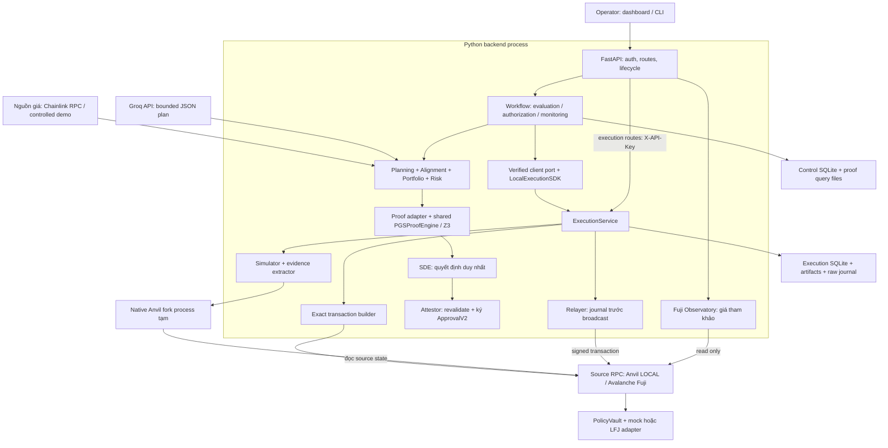

| Thành phần | Công nghệ / vai trò |
| --- | --- |
| Backend nghiệp vụ, API, CLI | Python 3.12, FastAPI, Uvicorn, Web3.py, Pydantic, httpx |
| Proof | Python `int`/`Fraction`, Z3; một engine trong shared SDK |
| Persistence | SQLite WAL, immutable records/triggers, file locks, content-addressed files |
| On-chain | Solidity `PolicyVault` và `ISwapAdapter`. LOCAL dùng mock contracts. LFJ dùng adapter riêng với token và pool Fuji |
| Frontend | HTML/CSS và ES modules chạy trong trình duyệt; không có Node server |
| Build/test Solidity | Native Forge gọi solc; compiler cấu hình trong `foundry.toml` |
| Simulation | Native Anvil, tạo fork/process tạm khi mô phỏng |
| Deploy frontend riêng | Static hosting hoặc Nginx proxy |

**Runtime mặc định chỉ có một API backend.** Launcher Python có thể quản lý heartbeat và một Uvicorn child; LOCAL thêm source Anvil và mỗi simulation tạo fork Anvil tạm. Do đó “một API process” không có nghĩa toàn hệ thống chỉ có một OS process.

App factory: [api/app.py](../backend/src/treasury_backend/api/app.py). Runner: `python -m treasury_backend.api.serve`. Một root `pyproject.toml`, `uv.lock`, `.venv` dùng cho toàn backend. Package `treasury_contracts` là thư viện protocol/proof dùng chung, không phải dịch vụ HTTP riêng.

`LocalExecutionSDK` gọi `ExecutionService` trực tiếp. Nó tái sử dụng SDK validation/evidence codec và các envelope trong bộ nhớ; không gọi loopback HTTP/ASGI để giao tiếp nội bộ. Các kết nối RPC tới chain và verification provider vẫn là HTTP thật. Standalone control/execution factories được giữ cho tests/consumer legacy, không được launcher/container khởi động mặc định.

## 3. Cấu trúc source và module

```text
backend/src/treasury_backend/
  api/                app composition, routers, auth, local adapter, lifecycle
  config/             validated settings; compatibility B_* profile names
  core/               application DTOs, errors, strict JSON
  modules/
    planning/         parser và typed proposals
    alignment/        mandate/goal/injection rules
    portfolio/        snapshot, freshness, policy context
    oracle/           price DTO/provider/demo producer
    risk/             economic eligibility
    proof/            adapter vào shared proof engine
    decision/         SDE
    signing/          Attestor
    persistence/      control SQLite/audit/reservations
    experience/       retry guidance có giới hạn
    workflows/        điều phối các pha và reconcile
    execution/
      service.py      facade dùng chung cho gọi nội bộ và HTTP
      chain/          RPC/deployment/contract readers
      transaction/    exact calldata builder
      simulation/     pinned fork và final Phi preflight
      evidence/       receipt/trace/transfer extraction
      relaying/       journal, broadcast, retry, receipt/reorg
      storage.py      execution SQLite/artifacts/idempotency
  operations/         env/profile/deploy/prepare/serve/demo/renew
```

Các phần khác: `frontend/`, `contracts/`, `packages/contracts-api/`, `fixtures/`, `tools/`, `deploy/`, `docs/`. `scripts/` là compatibility launchers. Mỗi module/thành phần có README; [MODULES.md](../backend/MODULES.md) và [CONTRIBUTING.md](../CONTRIBUTING.md) hướng dẫn phát triển nhóm.

| Module | Interface chính | Đầu vào → đầu ra / giới hạn |
| --- | --- | --- |
| Planning | `GoalPlanner.parse`, `propose` | `groq` real API hoặc explicit `rules`; draft direction/amount được kiểm độc lập, compiler tạo proposal từ mandate |
| Alignment | `check` | Goal/proposal/mandate/tool text → `ALIGNED`, `MISALIGNED`, `UNCERTAIN`; rule-based |
| Portfolio | `snapshot`, `policy_issues`, `fresh` | Chain balances + price + history → economic snapshot và issues |
| Oracle | `ChainlinkPriceProvider`, `PriceProvider`, Fuji Observatory | Direct pinned Chainlink cho Circle live; controlled JSON cho demos; Observatory riêng chỉ tham khảo |
| Risk | `evaluate` | Exact attempt/simulation/snapshot/context → risk PASS/FAIL/INCONCLUSIVE + amount hint |
| Proof adapter | `prove` | V2 context/effects + prices → typed proof artifact từ SDK |
| Decision | `decide` | Tất cả gate → APPROVE/REPLAN/REJECT/ESCALATE; không giữ private key |
| Signing | `Attestor.attest` | Immutable decision + revalidation callback → signed PDR; không ký arbitrary payload |
| Persistence | `Store` | Immutable decisions/proofs/Phi, events, signing reservations, audit/history |
| Experience | `next_amount` | Lịch sử attempt của workflow → amount nhỏ hơn hoặc None; không học máy |
| Workflows | `ControlPlane` | API use cases → pipeline, attest/submit, query/recovery/reconcile |
| Execution facade | `ExecutionService` | Typed operations → build/simulation/preflight/execution; chung locks/rate limits |
| Chain | `Chain` | Settings/manifest → verified code/context/balances từ RPC |
| Transaction | `Builder.build` | Proposal → immutable exact calldata, nonce, quote/snapshot artifacts |
| Simulation | `Simulator.simulate`, `preflight_v2` | Stored build → fork evidence / final Phi preflight artifact |
| Evidence | `token_facts`, `assess` | Logs/trace/balances/receipt → facts, safe/rollback classification |
| Relaying | `Relayer.execute`, `monitor` | Exact build + signed PDR → journaled tx hash và receipt facts |

Workflow phụ thuộc client port; API composition inject execution adapter. Execution không import signing/operator; core không import feature. Thay đổi ABI/signed fields/proof formulas cần phối hợp SDK, backend, contracts, fixtures/tests. Không cam kết mọi feature chỉ sửa đúng một folder.

### 3.1 Cách các module phối hợp

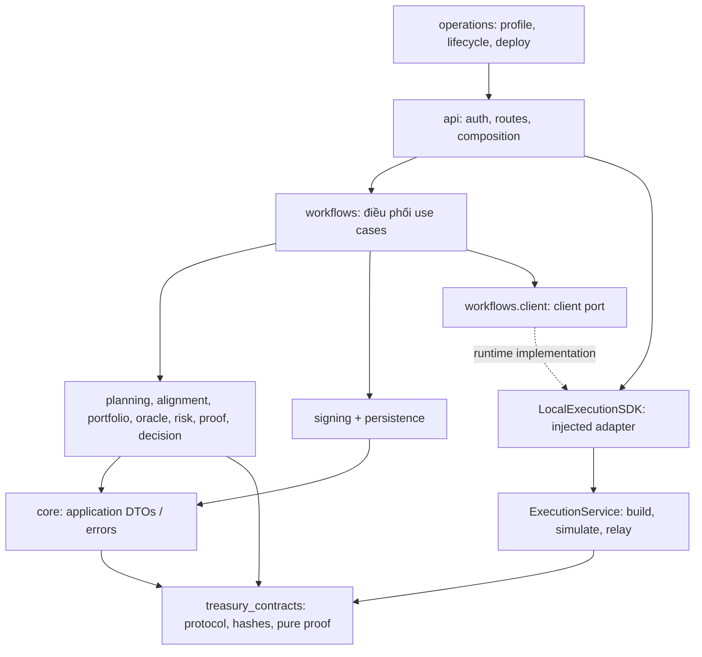

[Hình 2 — SVG](architecture/diagrams/02-modules.svg). Hướng phụ thuộc source; mũi tên không phải HTTP connection. `api/app.py` là nơi lắp adapter vào workflow. Shared SDK không import backend; execution không import attestor để xin chữ ký. Bản thân kiểm tra import không tạo security boundary giữa hai module trong cùng interpreter.

### 3.2 Thiết kế bên trong các nhóm module

| Nhóm | Trách nhiệm chi tiết | Không được tự làm |
| --- | --- | --- |
| Planning / alignment | Groq hoặc rules tạo bounded plan; đối chiếu goal/direction/amount/precision rồi compile mandate fields; kiểm injection | Không tự đổi recipient/router/calldata, không ký hoặc cấp allowlist |
| Portfolio / oracle / risk | Đọc balances và chi phí đã reconcile; gắn giá có source/timestamp/scope; tính projected exposure và eligibility | Không lấy adapter quote làm oracle, không sửa timestamp cũ để qua gate, không ghi chain budget |
| Proof / shared engine | Map effects + registry + owner config + prices/session thành các nghĩa vụ; sinh Phi/debit và query commitments | Không gọi tool do goal cung cấp, không chọn hẹp price bands để ép pass, không cấp approval khi UNKNOWN |
| Decision | Hợp nhất alignment/provenance/risk/proof/current context; chọn APPROVE/REPLAN/REJECT/ESCALATE | Không bỏ qua risk vì proof đã pass; không giữ private key |
| Signing | Reread immutable decision, revalidate toàn bộ attempt, reserve nonce/scope và ký exact ApprovalV2 | Không nhận arbitrary EIP-712 fields từ dashboard hoặc planner |
| Workflows | Điều phối evaluation → authorization → submission → monitoring; quản lý attempts và query/recovery | Không tự thay thế proof engine hoặc trực tiếp tạo adapter calldata |
| Execution | Dựng exact call, mô phỏng, kiểm chữ ký, journal raw tx, broadcast, đọc receipt và facts | Không tự trở thành SDE/attestor; receipt success không tự chứng minh mọi policy ngoài chain |
| API / operations | API xác thực/chuyển đổi request; operations chuẩn bị profile/process/deployment và owner actions | Không tự deploy/renew khi container start; không gửi owner key vào serving environment |
| Frontend | Form goal, token trong tab memory, treasury/proof/session/timeline và polling | Không giữ ví ký, không tự quyết APPROVE, không chứa secret trong public config |

`ControlPlane` là facade của ba phần `evaluation.py`, `authorization.py`, `monitoring.py`. Một HTTP request start hiện chạy pipeline đồng bộ tới submission/response; không có queue/job worker durable. Groq plan được giải quyết trước approval TTL, cache draft 300s và durable quota/cooldown cạnh control DB; không cache authorization hoặc fallback khi API lỗi. Gọi lại start có thể tạo workflow mới, nên browser không được tự retry mutation này như một GET an toàn. Idempotency execution không tự biến toàn bộ workflow API thành exactly-once service.

## 4. Chế độ chạy và sổ nguồn dữ liệu

| Nguồn / hành vi | MOCK | LOCAL | FUJI |
| --- | --- | --- | --- |
| Mandate | `fixtures/mock/mandate.json`, địa chỉ giả có nhãn fixture | Sinh từ deployment/chain; một số baseline limits cố định trong operator | Tương tự LOCAL + owner-approved proof config |
| Số dư/context | State trong `MockExecutionClient` | RPC đọc Anvil thực | RPC đọc Fuji thực khi triển khai |
| Calldata | ABI placeholder riêng fixture | Builder encode exact adapter call | Cùng builder, deployment Fuji |
| Price | USDC=1, WAVAX=20 fixture | Nominal env 1/20, demo writer | Circle live đọc Chainlink tại simulation block, giữ original rounds; USD chỉ tham chiếu testnet |
| Swap/liquidity | Tính toán Python fixture | MockERC20 + MockSwapAdapter trên EVM | Mock profile hoặc pool LFJ V1 đã xác minh, tùy manifest |
| Proof V2.1 | Không trong MOCK V1 | Z3, Phi, certified debit thật | Đã VERIFIED trên Circle/Chainlink/LFJ public workflow; artifacts và SMT kèm report |
| Chữ ký | V1 offline bằng key tạm | ApprovalV2 + relayer envelope thật | Chữ ký attestor và giao dịch relayer đã đối chiếu trên Fuji public |
| Receipt / tx hash / gas | Receipt, hash và gas giả lập | Receipt/hash/gas từ EVM local | Receipt public nếu thực hiện demo |
| Stress | Fixture statuses | Sửa quote mock trong fork | Circle: external actor giả định mint trên Anvil rồi swap LFJ để tạo shift 20/200 bps. Không sửa số dư treasury khi setup. Không đủ impact → INCONCLUSIVE |

Planner provider là trục riêng: `rules` chạy offline hoặc `groq` gọi API thật trong bất kỳ chain mode nào. Vì vậy Groq + MOCK vẫn có receipt fixture; chỉ Groq + LOCAL/FUJI mới có execution EVM theo chain mode. Private env hiện chọn Groq/FUJI; canonical local CLI override chain sang LOCAL.

### 4.1 Những gì đang mock hoặc cố định

- `MockUSDC` 6 decimals, `MockWAVAX` 18 decimals, mint bởi owner; không phải USDC/WAVAX thị trường, MockWAVAX không redeem ra AVAX.
- `MockSwapAdapter` không phải AMM/DEX. Owner chỉnh `outputPerUsdc`; default 1 USDC → 0,05 WAVAX. Liquidity được mint khi deploy.
- Vốn khởi tạo demo: vault 7.700 mock USDC + 115 mock WAVAX; adapter được mint mock liquidity. Không lấy balance người dùng làm treasury demo.
- Risk baseline trong operator: 500 USDC/swap, 1.000 USDC/ngày, exposure 25%, execution cost $50/ngày, tối đa hai replans, mild stress phải thành công và adverse có thể protected revert. Không phải tất cả đều có form/env để owner thay đổi; sửa baseline cần đồng bộ owner commitment/config/code.
- Oracle demo dùng giá nominal env, kiểm head freshness rồi gắn timestamp producer. Đây không phải timestamp một market feed. External mode giữ timestamp producer, không tự refresh giá cũ.
- Hai fixed stresses: mild 9980/10000 và adverse 9800/10000 của quote mục tiêu; reverse dùng phép đổi quote tương ứng. Không mô phỏng đầy đủ mempool/MEV hoặc mọi thị trường.
- Groq hiểu bounded template buy/sell rồi trả strict JSON, parser độc lập kiểm amount/chiều/precision. Provider `rules` là offline option có nhãn riêng. Chưa hỗ trợ hội thoại tự do, agent tự dùng tool hay semantic LLM verifier; “Experience” chỉ giảm amount theo luật. API lỗi/quota hết không tạo plan giả.
- Unit tests của Fuji verifier có mocked RPC responses; chúng không chứng minh public RPC/Fuji đã chạy.

### 4.2 Oracle quan sát và giá đủ điều kiện ký

Interface [oracle](../backend/src/treasury_backend/modules/oracle/README.md) cung cấp USD-e8, chain/vault, source, original round metadata và pinned block/hash. `TRUSTED_TEST_ORACLE` dành cho controlled demos. `CHAINLINK_FUJI_CIRCLE_USDC_AVAX_V1` chọn direct RPC provider qua owner source hash; JSON file không được tự nhận source Chainlink. Source hash gắn exact asset/feed/heartbeat và ý nghĩa testnet reference valuation; oracle evidence hash gắn raw rounds và original timestamps.

Fuji Observatory đọc Chainlink/Witnet/Pyth theo block qua `GET /v1/fuji/wallet/{address}`. Định giá cho SDE cần asset mapping theo contract address, nguồn độc lập, precision, observation time, freshness và owner commitment. LFJ faucet USDC có địa chỉ khác Circle USDC. Đường LFJ không nhận giá demo hoặc quote từ chính pool để cấp quyền. [Chi tiết nguồn và định danh](integrations/FUJI_LFJ_V2_1.md).

## 5. Vai trò ví, quyền và trust boundary

| Vai trò | Làm gì | Nơi dùng khóa | Cần gas? |
| --- | --- | --- | --- |
| Owner/deployer | Deploy, allowlist, policy, session, pause/revoke/withdraw | Máy quản trị, explicit operator commands | Có test AVAX cho giao dịch quản trị |
| Attestor | Ký ApprovalV2 sau immutable APPROVE + revalidation | Module signing trong backend | Không cần gas để ký offline |
| Relayer | Ký/gửi envelope EVM chứa exact call/PDR/Phi | Module execution trong cùng backend | Có test AVAX cho success/revert |

Ba địa chỉ phải khác nhau. Vault contract mới giữ treasury tokens. Dashboard dùng operator token, không cần Core/MetaMask/WalletConnect; ví có thể được dùng ngoài app để nhận/chuyển test AVAX. Không cần tài khoản sàn; `groq` provider cần `GROQ_API_KEY`, `rules` không cần LLM key. Groq chỉ nhận goal/static instructions, không nhận private keys hoặc dữ liệu ký.

Sau gộp API, attestor và relayer keys **cùng process**. Tách module không phải process/HSM isolation. Container từ chối các owner/deployer key env đã biết; public owner lấy từ manifest rồi đối chiếu chain. Owner vẫn là trust assumption, có quyền cấu hình/rút token theo quy định của vault; không được mô tả hệ thống như chống lại một owner bị compromise.

Service credentials khác private keys: operator bearer dùng workflow/read/recover; internal bearer dùng attest; `B_API_KEY` dùng execution router. Cùng app không đồng nghĩa dùng một credential cho mọi quyền. Không có account/RBAC đa người dùng hoặc HSM/KMS integration trong bản này.

### 5.1 Ranh giới tài sản và thẩm quyền

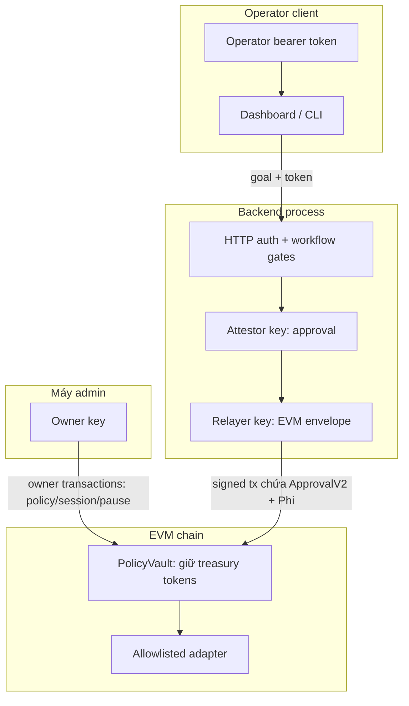

[Hình 3 — SVG](architecture/diagrams/03-trust.svg). Hai chữ ký có vai trò khác nhau. Attestor chứng nhận **nội dung được phép**; relayer ký **envelope giao dịch mạng**. Tài sản nằm trong vault, không nằm ở ví attestor hay relayer. Vì backend giữ cả hai khóa, compromise toàn process có thể ảnh hưởng cả hai vai trò; ba ví khác nhau chủ yếu phân biệt quyền và gas, không tự cung cấp hai bên ký độc lập.

Public RPC và oracle là external inputs được kiểm scope/freshness/identity nhưng không được biến thành trustless inputs chỉ bằng hash. Snapshot đúng hash có thể vẫn mang giá sai nếu producer bị compromise. Private journal chứa signed raw transaction cần được bảo vệ như dữ liệu nhạy cảm có thể broadcast lại trước deadline.

## 6. Luồng giao dịch V2.1

1. Operator gửi `POST /v1/workflows/start` với goal/mandate ID. LOCAL/FUJI từ chối `scenario` fixture. API kiểm auth, schema và giới hạn request.
2. Planner lấy Groq draft (hoặc explicit offline rules) trước khi mở TTL; strict schema + independent parser kiểm direction/amount/precision. Compiler lấy recipient/router/caps từ mandate tạo typed proposal. Alignment kiểm goal/amount, chain/vault, pair, router, recipient và injection. Mơ hồ/quota/provider lỗi → refuse/escalate; không fallback hoặc ký.
3. Builder đọc context/allowlists/balances tại source block, kiểm cap/TTL và quote adapter theo manifest. LFJ yêu cầu quoter, reserves và adapter khớp. Builder encode canonical `exactInput`, cấp vault approval nonce và lưu build/quote/context bất biến. Nonce này khác relayer transaction nonce.
4. Simulator tạo fork ở block build, đối chiếu hash/code/state, override attestor và gas balances **chỉ trong fork**, chạy cùng guarded vault entrypoint với fork-only test signer. V2 exploratory run dùng Phi ban đầu/minOut và zero-debit sentinel để đo effects, chưa phải approval thật.
5. Thu balances/allowances của cả hai registry assets, receipt/logs/trace và stress outcomes. Simulation/evidence manifest, từng artifact và effect evidence đều được bind/hash; thiếu/không khớp không được coi COMPLETE.
6. Workflow kiểm mode, hashes/build/fork context, chain facts và giá theo policy trước economic risk. Với LFJ, thiếu định giá độc lập cho faucet USDC trả `ORACLE_TOKEN_IDENTITY_MISMATCH` trước proof và ký. Fuji verifier kiểm chain/block/code qua verification RPC, cấu hình mặc định có thể dùng cùng provider.
7. Proof adapter tạo full configured independent price bands và gọi một `PGSProofEngine`. Chỉ VERIFIED với Check/Compile/RiskBound đều UNSAT, assumptions/region SAT mới đủ điều kiện cho SDE.
8. SDE kết hợp **tất cả** gate, không dùng proof thay alignment/risk. Lưu immutable decision, snapshot, effects/proof/Phi và audit. REPLAN tối đa hai lần: amount mới, intent/build/simulation/proof mới; không sửa calldata sau ký.
9. Attestor nhận decision ID, lấy lại record bất biến, đọc lại balances/policy/nonce/session/oracle, reprove/hash compare, chạy final compiled-Phi/debit preflight. Vừa trước submit còn revalidate lại. Giá trị/phi/versions drift hoặc hết TTL → no sign/expire.
10. Relayer nhận exact stored build + signed PDR; kiểm current attestor/domain/bindings, evidence/freshness/nonce, gọi live `estimate_gas`, ký envelope và ghi raw transaction journal **trước broadcast**. RPC không trả lời vẫn giữ hash/raw bytes để reconcile, không dựng trade mới.
11. Vault verify và enforce atomically; receipt có status/confirmations/canonical block mới đủ để monitor/reconcile. Timeline không chuyển CONFIRMED chỉ vì có tx hash.

**Final preflight có giới hạn rõ:** nó chạy exact compiled Phi/debit trên **pinned build block**, có cache theo build/proof/stress; không phải re-simulation toàn bộ tại latest block mỗi lần. Fresh context checks và live gas estimate là các bước riêng; vault mới là enforcement cuối tại inclusion.

### 6.1 Sequence của một giao dịch thành công

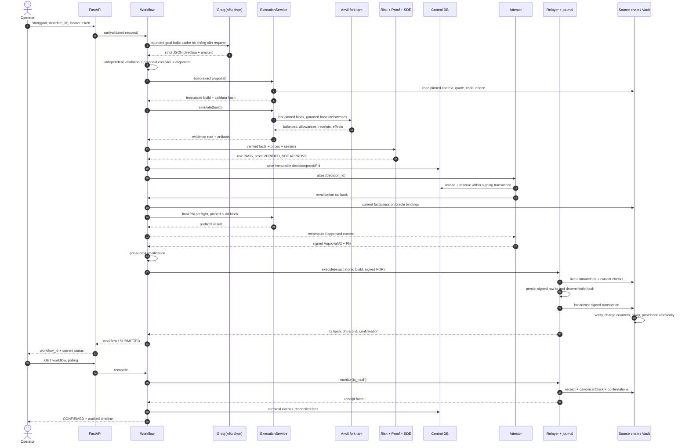

[Hình 4 — SVG](architecture/diagrams/04-workflow.svg). Đây là happy path khái quát. Source RPC được đọc nhiều lần; không chỉ một lần duy nhất tại build. Các bước phải lưu/check bindings nhưng không có transaction ACID bao trùm từ DB đến blockchain. Mọi gate trước ký có thể dừng luồng; không phải request start nào cũng đến broadcast.

### 6.2 Điều kiện dừng và replan

SDE ưu tiên hard reasons → REJECT; nếu còn reason không thuộc tập recoverable → ESCALATE; chỉ có recoverable reasons → REPLAN. APPROVE yêu cầu không có blocking reason và đủ alignment/build/evidence/risk/proof tương ứng mode. Đây là precedence theo code, không phải mô hình đánh điểm trung bình cho phép một gate tốt bù gate thất bại.

| Tình huống | Hành vi dự kiến | Có thể ký/gửi attempt đó? |
| --- | --- | --- |
| Sai recipient/router/token, unexpected transfer, replay | Hard reject | Không |
| Amount/exposure/slippage hoặc required stress có thể sửa bằng amount | REPLAN nếu reason set chỉ recoverable và còn lượt | Không; attempt mới phải build/simulate/prove lại |
| Thiếu RPC/evidence, stale price, UNKNOWN/timeout, input mơ hồ | Escalate/refuse theo stage; không mặc định APPROVE | Không |
| Chênh context/hash/session khi revalidation | Refuse/expire hoặc cần reevaluate | Không dùng lại approval cũ để đổi call |
| Inclusion state lệch nhưng signed Phi/budgets còn đúng | Vault có thể thực thi | Chỉ theo exact signed call |
| Inclusion vi phạm signed Phi hoặc hết budget | Vault revert, gas vẫn tốn | Không có token/counter update của transaction đó |

Reason codes và classification cụ thể do các module sở hữu; danh sách HARD/RECOVERABLE ở [decision/service.py](../backend/src/treasury_backend/modules/decision/service.py). Chưa có chức năng operator “force approve” trong dashboard để bỏ qua gate.

## 7. Proof, đơn vị và phạm vi bảo đảm

Token amounts/deltas dùng integer base units; USDC6 và WAVAX18. Giá/tiền dùng integer USD-e8 (`1 USD = 100000000`). JSON uint256 là decimal string; deltas là signed integer string. Python dùng exact `int`/`Fraction`; ABI giới hạn uint256/int256 và Solidity kiểm arithmetic. Registry đúng hai assets, sorted/unique, decimals được kiểm tại cấu hình chain.

Với `d[a] = afterBalance - beforeBalance`, giá USD-e8 `p[a]`, payment credit bằng 0:

```text
L_e8 = -Σ d[a] × p[a] / 10^decimals[a]
V_e8 =  Σ max(-d[a], 0) × p[a] / 10^decimals[a]
ValuePolicy: L_e8 <= (relativeLossBps / 10000) × V_e8 + fixedLossUsdE8
```

### Các nghĩa vụ trong engine

| Bước | Query / kết quả cần |
| --- | --- |
| Price assumptions | SAT: price band hợp lệ, dương, không vacuous |
| Check simulated effects | Không tồn tại price trong band làm vi phạm relative policy hoặc remaining session eligibility → UNSAT |
| Compile Phi | Outflow bound giữ nguyên; positive inflow floor theo tolerance, output không thấp hơn minOut; allowance caps bằng 0 |
| Feasible region | SAT cho vùng outcome có thể thực thi trong bounded arithmetic và exact-input constraint |
| Compile safety | Không tồn tại price làm lower-bound vector vi phạm policy → UNSAT; SAT có thể retry một lần tau=0, UNKNOWN không thành approve |
| Certified debit | Exact worst-corner loss, clamp >=0, **ceil** lên USD-e8; Z3 kiểm `L > debit` → UNSAT; kiểm session/global headroom |

MVP Phi chỉ gồm hai lower balance bounds và hai allowance caps sorted/unique. Không có maxDelta, receipt credits, ownership checks, payments hoặc runtime exposure được giả vờ enforce. Với price dương và `0 <= relativeLoss < 1`, policy residual giảm khi delta tăng; vì vậy lower-bound vector là worst case. Mở rộng policy vượt các giả định này cần proof mới.

`ProofArtifactV2` chứa verdicts, feasibility flags, exact call/effects/policy/config/registry/oracle/session hashes, Phi/debit, query hashes, encoder/solver versions, hash source `proof.py + v2.py`, fallback và sanitized witness. SMT-LIB nằm ở file content-addressed, không nhận SMT script từ goal/LLM. Z3 mặc định timeout 1000 ms mỗi query (constructor cho 1..5000), có process lock; không có hard OS memory sandbox cho solver.

`SAT` ở safety query là counterexample; `UNKNOWN`, timeout, invalid/missing data không cấp chữ ký. `SAT` của assumptions/feasible region lại là điều kiện chống proof rỗng. Không gộp hai ý nghĩa SAT này thành “pass”.

Vault không chạy Z3, không verify một cryptographic SMT proof. Nó tin attestor đã chứng nhận đúng debit và enforce Phi/counters đã ký. Attestor compromise có thể ký debit sai trong hard owner limits. Oracle truth, price containment ở inclusion, truthful tokens/registry/RPC và code vault đúng là assumptions. Exposure 25% **chỉ pre-sign**, không suy ra từ Phi. Gas, oracle compromise, token lies và mọi dạng MEV không nằm trong theorem.

### 7.1 Ví dụ số để kiểm chứng độc lập

Ví dụ buy 200 USDC, mô phỏng nhận 10 WAVAX, nominal prices 1 và 20 USD; owner policy relative loss 3%, fixed loss 0; oracle bands ±1%; tolerance 0,4%; giả sử minOut không cao hơn 9,96 WAVAX và các gate khác đã pass. Đây cũng là cấu hình tạo reservation $4,792 trong local browser evidence trước đó, không phải báo giá thị trường.

| Đại lượng | Giá trị |
| --- | --- |
| Input delta | `-200000000` USDC base units = -200 USDC |
| Simulated output delta | `10000000000000000000` = +10 WAVAX |
| Price bands | USDC [0,99; 1,01], WAVAX [19,80; 20,20] USD |
| Compiled lower output | `10 × (1 - 0,004) = 9,96 WAVAX` = `9960000000000000000` base units |
| Worst loss ở lower vector | `200 × 1,01 - 9,96 × 19,80 = 4,792 USD` |
| Relative allowance tại corner đó | `3% × 202 = 6,06 USD`; loss 4,792 không vượt 6,06 |
| Certified debit | `479200000 USD-e8`; các phân số không nguyên luôn được ceil khi charge |
| Session/global usage sau một tx thành công | Tăng 4,792 USD; không tăng nếu whole tx revert |

Theo ledger riêng, session $10 chỉ còn $5,208 sau giao dịch; global $20 còn $15,208. Đây chưa phải quyền chạy tiếp một trade giống hệt: exposure, spend, price freshness và mọi gate khác vẫn phải pass. Với vốn nominal $10.000 ban đầu, 115 WAVAX chiếm 23%; thêm 10 WAVAX đưa projected exposure lên 25%. Điều này giải thích tại sao proof pass không tự cho phép mọi giao dịch tiếp theo.

MinOut là ràng buộc swap cố định; Phi có thể chặt hơn minOut. Nếu output nằm trên minOut nhưng dưới 9,96, V1 minOut có thể pass trong khi V2 Phi sẽ revert. Giá thực tại inclusion nằm ngoài bands thì theorem dựa trên bands không còn bảo đảm market-valued loss, dù token delta vẫn thỏa Phi.

### 7.2 Tại sao proof và simulation đều cần?

Simulation cung cấp effects tại một state cụ thể và bounded stress; nó không chứng minh mọi state tương lai. Proof kiểm các outcome được Phi cho phép trong modeled price region; nó không chứng minh calldata/registry/oracle đầu vào là trung thực. Vault enforce Phi tại execution; nó không tự diễn giải goal, chạy Z3 hoặc đọc market USD oracle. Ba lớp có nhiệm vụ bổ sung nhau, cùng phụ thuộc các bindings ở mục 15.

## 8. ApprovalV2 và enforcement on-chain

EIP-712 domain `TreasuryPolicyVault` dùng version **"2"**, chain ID và vault thực. Wire schema **1.1**. SDK **1.3.0** bổ sung Circle route, round provenance và batch reads. Legacy Approval/Phi ABI và golden vectors giữ tương thích; oracle hash mở rộng khi có feed evidence.

Số `mandate.version` trên dashboard là phiên bản mandate, có thể bằng 1 trong deployment V2.1 mới. `rules-v1` và `mock-swap-v1` là version của parser/adapter, không có nghĩa workflow tự hạ cấp về vault V1. Cách xác nhận đường V2 là proof VERIFIED + Phi/session/debit + ApprovalV2 trên V2-enabled vault; MOCK fixture không có các thành phần này.

| Signed fields | Binding |
| --- | --- |
| `intentHash`, `calldataHash` | Intent và exact adapter bytes |
| `policyHash` | Active owner policy commitment, bao gồm version/config/chain/vault theo vault |
| `evidenceRoot` | Canonical JSON simulation manifest và artifacts |
| `proofContextHash` | ABI commitment của certificate, registry, oracle, effects, session snapshot, source/query/version |
| `postConditionsHash` | `keccak256(abi.encode(Phi))` mà vault kiểm trực tiếp |
| `sessionId`, `riskDebitUsdE8` | Session owner cấp và conservative reservation |
| `nonce`, `deadline` | Replay/temporal scope của approval |
| `adapter`, `tokenIn`, `tokenOut`, `amountIn`, `minAmountOut` | Exact restricted swap |

Simulation manifest root và proof context hash có nội dung khác nhau; một hash proof ID có thể remap trong DB không thay thế được các commitments này. Signed bytes/ABI/domain được đối chiếu Python, viem và Foundry bằng golden vectors.

Vault là một ordinary immutable contract, không có proxy upgrade. V2 activation **vĩnh viễn** khóa entrypoint V1 trên deployment đó; không thể thay ABI để nâng địa chỉ cũ thành contract mới. V1 compatibility chỉ còn trên deployment chưa bật V2.

### Một transaction trong vault

Kiểm pause/nonReentrant/current policy/expiry/current attestor/signature/domain/nonce; exact calldata, adapter/selector/pair/recipient/amount/minOut; session active/dates/policy và budget headroom; registry/Phi đúng toàn bộ hai assets/two allowance pairs. Sau đó snapshot balances, consume nonce và charge counters theo CEI, cấp allowance tạm, gọi adapter hạn chế, cleanup allowance, kiểm exact input delta + output/Phi bounds + residual allowances bằng 0 và emit events.

Bất kỳ revert nào rollback token state, nonce, session/global/daily counters và logs của **transaction đó**. Gas vẫn mất ở relayer. Không có arbitrary target call/delegatecall hoặc Agent tự gọi owner admin methods.

### Budget và session

- `dailySpentUsdc`: chỉ đếm USDC **input** theo UTC day; reverse không bị đánh tráo thành USDC notional.
- WAVAX→USDC có `max_wavax_per_swap` riêng; cấu hình hiện tại bằng 0 nên chiều bán bị khóa, UI hiển thị DISABLED.
- `riskUsedUsdE8`: tổng certified debit trong một session; không refund khi profit, không phải realized PnL.
- `globalDailyRiskUsedUsdE8`: tổng certified debit tất cả sessions theo `block.timestamp / 86400`.
- Owner tạo/revoke session. Session ID không recycle/reset usage; đổi session không reset global/day hoặc daily USDC spend. Owner đổi policy làm sessions cũ không khớp active hash.
- Session có thể kéo qua ngày; global cap reset theo UTC day, session usage vẫn giữ. Không claim một multi-day portfolio loss theorem.
- Owner withdrawal riêng chỉ khi paused, invalidate policy và có event; owner là trusted administrator.

### 8.1 Ranh giới nguyên tử của vault

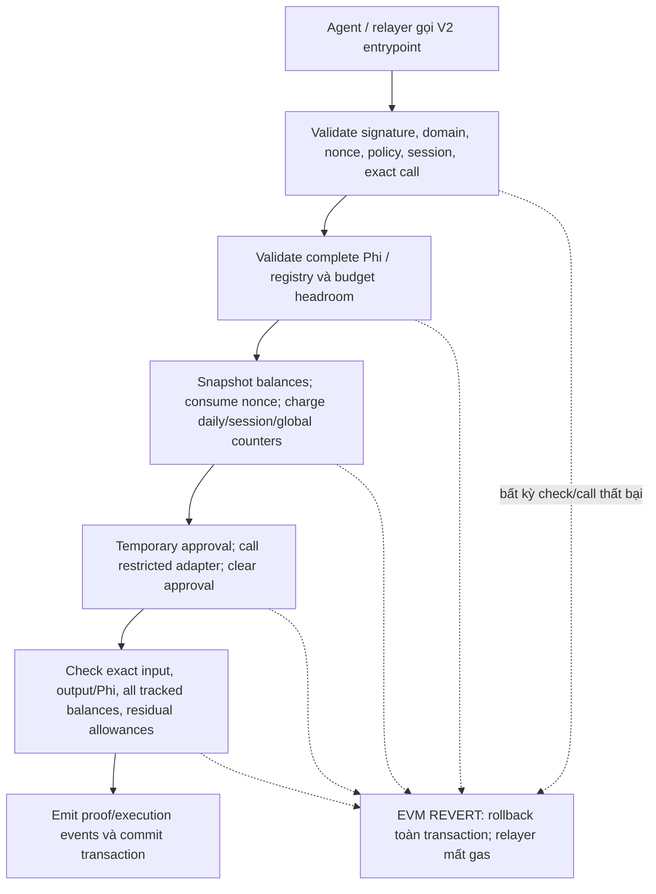

[Hình 5 — SVG](architecture/diagrams/05-vault.svg). Các budget updates trước external call nằm trong cùng EVM transaction; revert sẽ hoàn tác cả chúng. Đây là lý do SQL check hoặc hai off-chain processes cùng thấy “còn budget” không tự tạo double spend on-chain. Hai transactions cạnh tranh có thể một thành công, một revert; hệ thống không cam kết mọi approved transaction đều được thực thi thành công.

## 9. State machine, monitor và recovery

Luồng thực tế dùng `PROPOSED → ALIGNED → BUILT → SIMULATED → EVALUATED → PROVED → APPROVED → ATTESTED → SUBMITTING → SUBMITTED → CONFIRMED`. `PROVED` gộp các Check/Compile/RiskBound obligations, chi tiết từng verdict ở proof artifact; không tạo ba proof services riêng.

| Trạng thái | Ý nghĩa |
| --- | --- |
| MISALIGNED / UNCERTAIN | Alignment event; SDE quyết định reject/escalate |
| REPLAN_REQUIRED | Cần attempt mới; tối đa hai replans |
| PROOF_REJECTED / PROOF_INCONCLUSIVE | Proof event; không được tự hiểu là approved |
| REJECTED / ESCALATED / EXPIRED | Không đủ điều kiện ký/gửi tiếp |
| SUBMITTING | Submission chưa có kết quả chắc chắn; giữ reservation |
| SUBMITTED | Đã có hash, chưa đủ terminal receipt |
| CONFIRMED | Receipt success, confirmations/canonical block và facts đã reconcile |
| REVERTED + reason PROTECTED_REVERT | Rollback có guard reason xác định; gas là chi phí riêng |
| RECEIPT_MISMATCH | Facts/identity không đúng; giữ in-flight block để review |

`PENDING` là execution response khi chưa có receipt/canonical confirmations, workflow thường giữ SUBMITTED; không có status workflow `PROTECTED_REVERT` riêng. Reorg có thể đưa terminal workflow về SUBMITTED. Monitor revalidates receipt khi đọc workflow; hai protected reverts **khác attestation** liên tiếp cùng policy có thể quarantine signer. Receipt reconcile lặp không được đếm thành giao dịch mới.

Monitor được kích hoạt bởi API/CLI/dashboard polling, **chưa có background watcher/broker**. Dashboard poll tối đa khoảng 60 giây cho một lượt; giao dịch chậm hơn vẫn nằm trong storage và cần poll tiếp/điều tra. Chưa có auto fee-bump/replacement/cancel hoặc autonomous recovery daemon.

RPC gửi không rõ kết quả: giữ raw journal và hash; execution retry cùng idempotency/body dùng đúng signed raw bytes. Workflow không tự tạo trade mới. Nếu crash làm workflow còn SUBMITTING nhưng đã biết hash trong journal, dùng `POST /v1/workflows/{id}/recover` hoặc [recovery CLI](../tools/operations/README.md). Chỉ chấp nhận hash đã biết, khớp decision/build/chain; không ký/resend. Không xóa DB để gỡ pending/quarantine.

### 9.1 State machine dùng cho review

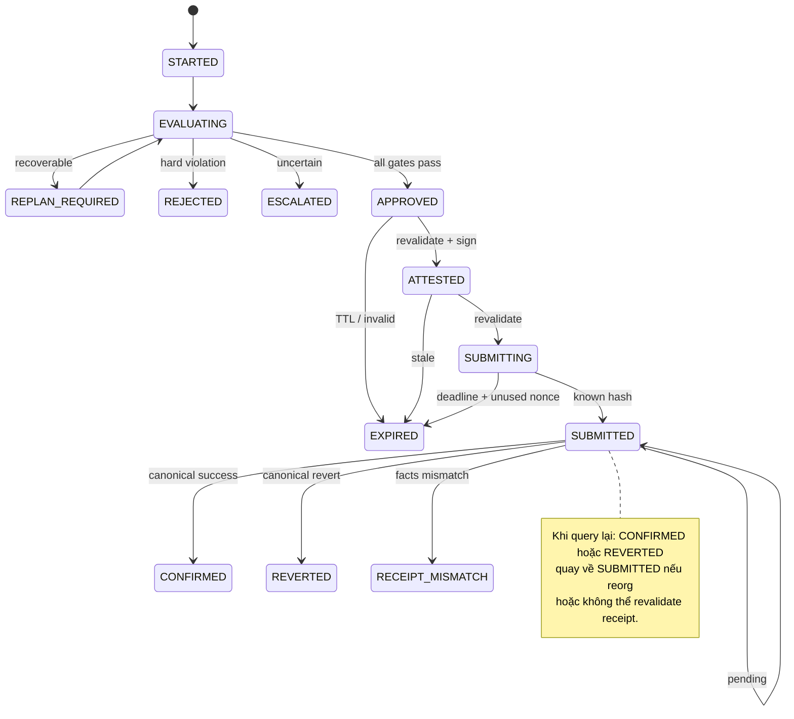

[Hình 6 — SVG](architecture/diagrams/06-states.svg) là sơ đồ logic rút gọn, **không phải enum workflow mới**: `EVALUATING` gom các events PROPOSED/ALIGNED/BUILT/SIMULATED/EVALUATED/PROVED, không phải stage lưu trong DB. Một số failure được facade ghi cùng reason codes thay vì chính xác một cạnh trong hình; source `authorization.py`/`monitoring.py` là nơi xác định transition thực. REPLAN_REQUIRED hết lượt không được vẽ thành approval tự động; workflow dừng ở verdict cuối.

### 9.2 Sequence khi broadcast mất response

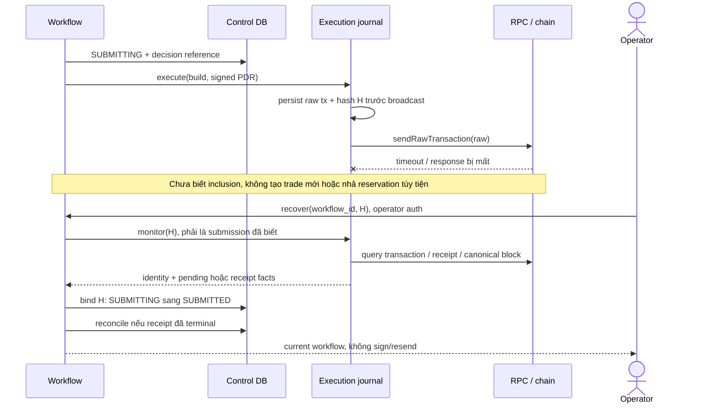

[Hình 7 — SVG](architecture/diagrams/07-recovery.svg). Đây là recovery thủ công của một hash đã biết; không phải automatic recovery daemon. Nếu chỉ biết workflow mà chưa biết hash, operator cần đối chiếu execution journal/logs theo build/decision; không nhập một hash bất kỳ ngoài hệ thống. Receipt chưa rõ vẫn phải giữ trạng thái pending, không dùng lỗi mạng làm bằng chứng transaction chưa xảy ra.

## 10. Persistence và observability

| Kho | Dữ liệu | Tính chất |
| --- | --- | --- |
| Control SQLite | workflows, ordered events, decisions, attestations, proof_artifacts, compiled_postconditions | WAL; immutable decisions/proofs/Phi; unique references; signing reservation trong write transaction |
| Control files | mandate/oracle snapshots, `.smt2` query files, private backend log, demo audit reports | Query filenames theo hash; JSON writer dùng atomic replace |
| Planner SQLite/lock | `planner.sqlite3`, `planner.lock` cạnh control DB: draft cache, rolling call/token reservations, cooldown | Durable per data path; không giữ approvals hoặc chain state; failed API calls vẫn giữ quota reservation |
| Execution SQLite | records, counters, idempotency, submissions | File lock + immutable records; journal có signed raw tx trước broadcast |
| Execution artifacts | Canonical JSON manifests, trace/receipt/context/quote/preflight facts | Content-addressed bằng keccak; authenticated artifact reads |
| Chain | Nonces, policy/session, token balances, daily/global risk usage | Authoritative; SQL không tạo competing budget ledger |

Container paths: `/var/data/control/fuji` và `/var/data/execution`. Local paths theo profile `.control-data-v2/local`, `.execution-data-v2`. Chain state Anvil là ephemeral nếu node bị dừng; audit files giữ lại không thể tự khôi phục source chain. MOCK client receipts/state nằm trong memory và không phải durable chain ledger.

Request correlation ID đi qua API, workflow và artifacts. Error bodies được sanitize, không echo key/PDR/request lạ. Proof introspection trả typed artifact/query hashes, không public toàn bộ SMT directory. Không có centralized log/metrics/alerting/backup scheduler; vận hành tự cấu hình ngoài hệ thống. Backup phải giữ control DB, execution DB/journal/artifacts nhất quán với chain; rollback code không đảo on-chain V2 activation.

Gas gate dùng estimated simulation gas + observed reconciled execution expenses, quy đổi bằng giá nominal. Đây là operational eligibility estimate, **không phải hard on-chain gas budget**; exploratory/final gas và network fee có thể khác. Các tx do bên khác gửi hoặc chưa reconcile không tự thành expense history của app.

### 10.1 Mô hình dữ liệu lưu trữ

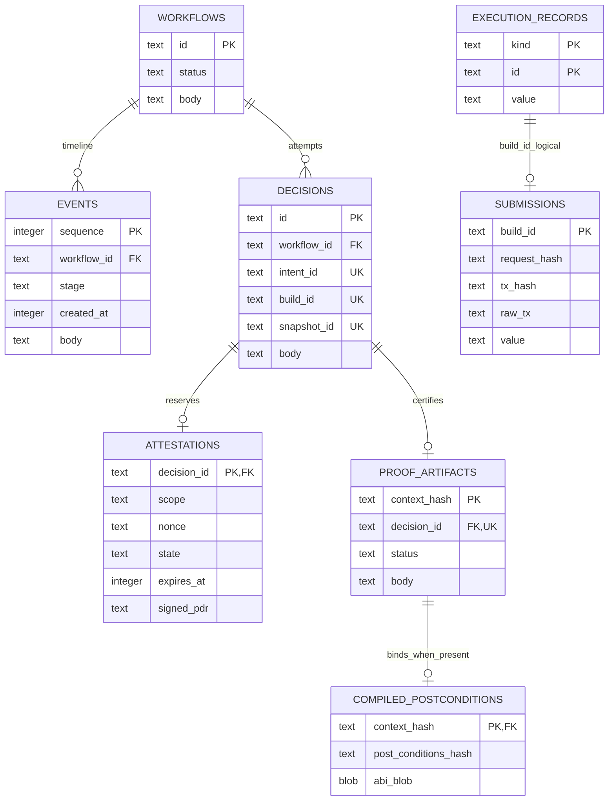

[Hình 8 — SVG](architecture/diagrams/08-storage.svg). Schema rút gọn của hai SQLite databases; `EXECUTION_RECORDS` là bảng `records(kind,id,value)`. Quan hệ records–submissions là **logical binding qua build ID**, không phải foreign key giữa hai DB. Bảng execution `counters` và `idempotency` không vẽ để hình dễ đọc. ATTESTATIONS còn có UNIQUE(scope, nonce); không suy từ sơ đồ rằng mỗi workflow chỉ có một decision.

Control decisions/proofs/Phi có SQLite triggers chặn update/delete; events được ghi tuần tự bởi app nhưng không có append-only tamper-proof ledger chống người quản trị sửa DB. Execution immutable records được app kiểm canonical bytes, không phải tất cả cùng dùng SQL triggers. Hash giúp phát hiện mismatch khi được kiểm tra với trusted commitment; hash và trigger không thay thế filesystem permissions hoặc external audit trail.

## 11. API hiện tại

Tất cả route dưới đây thuộc cùng origin; Swagger `/docs`, OpenAPI `/openapi.json` của running app là catalog chính xác.

Các route `/v1/...` giữ wire API version cho compatibility; chúng vẫn xử lý proof/ApprovalV2 khi mandate bật V2. Trong MOCK không cấu hình operator token, operator endpoints có thể dùng không auth để phát triển local; LOCAL/FUJI bắt buộc service credentials. Execution router không được mount trong MOCK.

| Route | Auth | Mục đích |
| --- | --- | --- |
| GET `/healthz`, `/health` | Public | Liveness/mode/transport; không bảo đảm oracle/session/RPC còn đủ điều kiện trade |
| GET `/v1/fuji/wallet/{address}` | Operator bearer, mọi mode | Số dư và quan sát oracle tại cùng block Fuji, tùy chọn vault và receipt |
| GET `/`, static `/assets`, `/src` | Public nếu bật bundled frontend | UI/config công khai, không nhúng keys/tokens |
| POST `/v1/workflows/start` | Operator bearer | Chạy pipeline |
| GET `/v1/workflows/{id}` | Operator bearer | Query và receipt reconciliation |
| POST `/v1/workflows/{id}/recover` | Operator bearer | Bind known journaled tx cho SUBMITTING workflow |
| GET `/v1/treasury` | Operator bearer | Mandate/portfolio/issues/session/balances |
| POST `/v1/agent/propose`, `/v1/alignment/check` | Operator bearer | Typed planning/alignment |
| POST `/v1/risk/evaluate`, `/v1/decisions` | Operator bearer | Read immutable saved assessment bằng bound references; không cho client tự approve |
| POST `/v1/approvals/attest` | Internal bearer | Chỉ nhận decision ID đã lưu, không arbitrary signed payload |
| GET `/v2/proofs/{context_hash}`, `/v2/treasury/sessions/{session_id}` | Operator bearer | Proof introspection/chain session |
| GET `/execution/health` | Public | Execution module liveness |
| GET `/execution/v1/chain/context`, `/execution/v1/portfolio/onchain-snapshot` | X-API-Key | Chain facts, không chứa oracle USD assertions |
| POST `/execution/v1/build`, `/execution/v1/simulations`, `/execution/v1/executions` | X-API-Key + Idempotency-Key | Exact execution module operations |
| POST `/execution/v2/simulations/preflight` | X-API-Key + Idempotency-Key | Isolated exact Phi preflight, không cấp production signature |
| GET `/execution/v1/executions/{tx_hash}`, `/execution/v1/artifacts/{hash}` | X-API-Key | Receipt facts / canonical artifact bytes |

MOCK không đăng ký execution router thật và có thể không yêu cầu operator token nếu không cấu hình token; chỉ dùng UI dev loopback. LOCAL/FUJI cần ba service credentials khác nhau, mỗi token ít nhất 24 ký tự. Body mutation tối đa **256 KiB** trước JSON parsing; response đọc qua client bound 1 MiB. Expensive simulation/preflight chung giới hạn 30 calls/60 giây/process, attestor 60 attempts/60 giây. Đây không phải rate limiter phân tán hoặc rate limit mọi endpoint.

CORS chỉ bật exact origin allowlist, không thay auth. Frontend token chỉ giữ trong bộ nhớ tab; không localStorage/cookie/private key. Cùng app giữ router/module boundaries nhưng không còn network isolation của API execution trước đây.

## 12. Cấu hình, triển khai và những thứ còn phải chuẩn bị

### Cấu hình máy hiện tại

Checkpoint audit ban đầu kiểm env read-only. Sau đó người dùng cấp ba cặp ví và Groq key, private env đã được cập nhật có ủy quyền; format/address đều khớp, template/init-env đồng bộ tên biến. Groq thật và Groq→LOCAL đã kiểm chứng; funding Fuji hiện tại, public RPC archive/trace, actual policy deployment và market oracle vẫn cần bước riêng.

| Nhóm | Biến / đầu vào |
| --- | --- |
| Admin deployment | `B_FUJI_OWNER_PRIVATE_KEY` hoặc alias owner cũ; chỉ máy quản trị |
| Serving keys | `PACEVANT_ATTESTOR_KEY`, `B_FUJI_RELAYER_PRIVATE_KEY` |
| Service credentials | `PACEVANT_OPERATOR_TOKEN`, `PACEVANT_INTERNAL_TOKEN`, `B_API_KEY` |
| Network | `B_FUJI_RPC_URL`, `PACEVANT_FUJI_VERIFICATION_RPC`, `FUJI_TEST_WALLETS_ONLY=true` |
| Owner risk approval | `TREASURY_OWNER_POLICY_APPROVED` và relative/fixed loss, oracle band, tolerance, session/global caps |
| Limits | Reverse cap, max oracle age, session duration, drift/confirmations |
| Storage/deployment | V2 manifest, control/execution data dirs; container persistent `/var/data` |
| Frontend | `PACEVANT_SERVE_FRONTEND`, `PACEVANT_CORS_ORIGINS`; public `assets/config.js` khi static host khác origin |
| Oracle | `TREASURY_ORACLE_MODE=chainlink`, `TREASURY_ORACLE_SOURCE_ID`, per-feed/source config cố định; TTL/state age riêng |
| Planner | `PACEVANT_PLANNER_PROVIDER`, `GROQ_API_KEY`, model/timeouts/token/request caps/cache TTL; key chỉ trong private env |

`TREASURY_A_PORT` còn là tên cấu hình cổng CLI để tương thích; container dùng `$PORT`. `TREASURY_B_PORT`, `PACEVANT_B_URL`, `PACEVANT_B_TOKEN` chỉ còn cho legacy tooling. Groq được cấu hình rõ trong [integration guide](integrations/GROQ_PLANNER_AND_ENV.md); chưa tự thêm market-feed credentials cho oracle chưa merge.

### Chạy local

```powershell
uv sync --locked
uv run --locked python tools/contracts/bootstrap.py
uv run --locked treasury init-env
uv run --locked treasury local --once
# Giữ dashboard:
uv run --locked treasury local
# Chỉ MOCK, không chain:
uv run --locked python -m treasury_backend.api.serve
```

Native Foundry v1.7.1 cần cho build/local. Solidity compile trong build stage, ABI/bytecode/storage layout nằm trong `out/`; backend runtime giữ Python + Anvil, không cần Node/npm/Forge/solc. Hợp đồng sau deploy chạy trên chain, không chạy trong Render/Python.

### Demo Fuji / hosted backend

Đã có manifest V2 Fuji trong `deployments/treasury-fuji-v2.json`, public receipt và report. `deploy/runtime.env`/Compose mount manifest vẫn cần chuẩn bị riêng cho host, không chứa owner keys. Khi triển khai một host hoặc vault mới:

1. Owner/relayer có test AVAX trên Fuji C-Chain; không kết luận 0,05 AVAX đủ cho mọi deployment chỉ từ một số dư cũ. Kiểm phí/funding khi thực hiện thật.
2. RPC phục vụ recent historical state cho fork; kiểm verification endpoint và trace support nếu cần phân loại revert.
3. Deploy vault mới bằng explicit owner command, ưu tiên `treasury fuji-demo --setup` cho live Circle profile; kiểm manifest/code/policy/session. Vault hiện tại đã deploy và receipt đã xác minh; không deploy lại chỉ để bật API.
4. Tạo runtime env riêng từ [template](../deploy/runtime.env.example), điền actual values, không `${...}` aliases hoặc owner key; cấp durable disk và mount manifest.
5. Một backend instance/worker; frontend Docker/Nginx hoặc static host riêng. Kiểm image startup, health, restart/persistence và normal/protected-revert Fuji receipts trước khi xác nhận hosted demo.

Docker Desktop Linux engine local không hoạt động, nên image/Compose/Render smoke chưa được kiểm chứng. CI có jobs build/test images nhưng chưa có kết quả CI từ working tree này. [Deploy guide](../deploy/README.md), [Render/VPS](deployment/PYTHON_BACKEND_RENDER_VPS.md), [demo runbook](demo/AVALANCHE_FUJI_DEMO.md).

### 12.1 Topology deploy đề xuất từ config hiện có

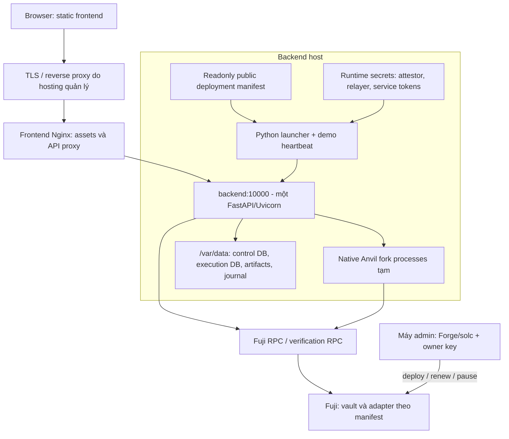

[Hình 9 — SVG](architecture/diagrams/09-deployment.svg). Topology dựa trên Dockerfiles/Compose, **chưa phải bằng chứng đã deploy**. Compose hiện publish frontend tại loopback `127.0.0.1:8080`; cần reverse proxy/TLS bên ngoài để public trên VPS. Static hosting riêng có thể bỏ Nginx ở giữa: browser gọi API URL public qua explicit CORS. Render/Docker runtime cần chạy native Anvil subprocess và durable disk; không dùng mô hình frontend-only/static service để chạy backend.

Build contract và deploy contract khác nhau: Forge/solc tạo ABI/bytecode trong image build hoặc máy admin; owner gửi deployment transaction riêng. Startup container chỉ xác minh deployment đã có và phục vụ API, không compile lại, tự deploy hoặc tự renew session đã hết hạn. Session mặc định một giờ nên một service còn healthy vẫn có thể từ chối trade vì session/policy/oracle hết hiệu lực.

### 12.2 Checklist vận hành cho reviewer

| Giai đoạn | Điều cần kiểm tra | Hiện đã tự động hóa đến đâu? |
| --- | --- | --- |
| Prepare/start | Chain ID, manifest/code, owner policy/session/config, role addresses, credentials, storage | Có prepare/doctor/startup checks; health endpoint riêng chỉ là liveness |
| Trước mỗi ký | Fresh prices/context, immutable bindings, reproof, session/headroom, final preflight | Có trong workflow; không có HSM/process isolation |
| Sau broadcast | Pending/confirmations/canonical receipt, mismatch/reorg, actual execution fee | Có khi poll/query; chưa có background scheduler/alerts |
| Hết session/policy | Owner renew từ máy quản trị, kiểm active hash và usage còn lại | Có explicit CLI; không tự nhả/reset global budget |
| Restart/recovery | Mount đúng DB/artifacts/journal, không xóa reservation, đối chiếu known tx | Có durable files và recovery endpoint; chưa test host restart thực tế |
| Backup/restore | SQLite-consistent snapshot/WAL handling, artifacts+journal, manifest và chain cross-check | Chưa có backup scheduler hoặc restore drill hoàn chỉnh |
| Incident | Stop new goals, owner pause/revoke nếu cần, bảo toàn evidence, đọc chain trước resume | Có primitive pause/revoke; chưa có incident automation/dashboard riêng |

Không đặt SLO/throughput mục tiêu từ các local timings. Simulation dùng process/RPC/trace và proof dùng serialized solver; benchmark trên máy không đại diện tài nguyên Render hoặc public RPC. Các bước xác định giới hạn CPU/RAM/disk, timeout toàn workflow và load shedding còn phải đo trên hosting cụ thể.

## 13. Trạng thái so với V2.1 và phần còn lại

| Hạng mục | Kết luận |
| --- | --- |
| Một authoritative SDE/proof/attestor/vault path | Có cho canonical V2 LOCAL/FUJI path; legacy V1 tools/test-only ablation được tách nhãn |
| Check/Compile/Phi/certified debit, strict bindings | Implemented và local-tested |
| Atomic spend/session/global caps, reverse hard cap | Implemented và local-tested; reverse bị disable theo config hiện tại |
| Immutable audit, receipt/reorg/idempotency/recovery | Implemented/local-tested; đã sửa dedup quarantine và recovery tool sau gộp |
| UI/proof/session display | Có ở LOCAL/FUJI; MOCK vẫn là V1 fixture, đã ghi rõ trong UI |
| Optional on-chain exposure | Chưa implement, không thuộc core bắt buộc; luôn PRE-SIGN ONLY |
| Fuji oracle và LFJ | Direct Chainlink → Circle/LFJ đã CONFIRMED; baseline/stress/final Phi, 14 public-chain checks và ba negative eth_calls pass; xem runbook/report live |
| HSM | Chưa tích hợp |
| Bounded Groq planner | Real strict-schema API + independent validation, cache/durable local budgets; real API và full LOCAL đạt. Chưa open-ended agent/semantic verifier |
| Fuji/hosting | Public Fuji workflow, receipt/checks/negative eth_calls đã pass; image/Compose/Render chưa smoke trên host | Không coi testnet receipt là xác nhận hosting/production |
| CI / clean container build | Cấu hình có; chưa xác nhận remote run/fresh image build |
| Quantitative evaluation | Có bounded local suites; không suy APR/BPR thực tế, không full-protocol B/C performance hoặc production throughput claim |

Các thay đổi có chủ đích so với pseudo-layout/process trong plan: một FastAPI theo yêu cầu người dùng, signer không isolated process; event PROVED gộp obligations; session view đọc trực tiếp chain thay vì một SQL ledger authoritative mới; `/execution` prefix trong unified API, SDK/legacy standalone contract được giữ riêng. Đây là các khác biệt phải được ghi nhận, không coi tự động là đáp ứng mọi giả định của bản design gốc chưa cung cấp.

Thứ tự phát triển tiếp: kiểm chứng image/host, demo nhiều lượt và adversarial coverage trên live profile; mở rộng oracle/DEX/HSM/HA theo scope riêng. Testnet reference USD và receipt Fuji không thay audit độc lập.

## 14. Kiểm chứng và tài liệu bảo trì

Lệnh kiểm tra chính:

```powershell
uv run --locked python -m pytest -q
uv run --locked python tools/contracts/foundry.py forge test -vv
npm run test:integration
node tools/quality/check_frontend.mjs
uv run --locked ruff check backend/src backend/tests tools
uv run --locked python tools/quality/scan_secrets.py
```

Lượt review này có 157 Python tests đạt, một LOCAL ablation opt-in skip trong default suite, 49 Forge tests đạt, V1/V2 viem vectors và JS syntax đạt. Ablation opt-in và 128-case proof sweep được chạy/lưu riêng; [báo cáo audit](audit/V2_1_READINESS_REVIEW.md) ghi kết quả và provenance, tách kết quả mới khỏi benchmark lịch sử. Tests dùng Anvil/fixtures, không dùng Fuji user funds. Kết quả local không phải audit bảo mật độc lập hoặc bằng chứng production readiness.

Các số test trên thuộc checkpoint audit trước Groq. Lượt mở rộng tài liệu chỉ kiểm diagrams/links; lượt tích hợp Groq sau đó thay planning/config/env và chạy suite mới, được ghi riêng tại [integration guide](integrations/GROQ_PLANNER_AND_ENV.md). Không trộn benchmark lịch sử với actual Groq/network latency mới.

Tài liệu này là nơi đọc tổng thể hiện trạng. README từng module là hợp đồng phát triển cục bộ; thay interface/env/units/proof/ABI phải cập nhật cả nơi sở hữu và bản thiết kế này. Các guide A/B, inventory/migration và PoC cũ được giữ như lịch sử, không dùng làm catalog runtime hiện tại.

## 15. Hợp đồng dữ liệu và bất biến xuyên module

### 15.1 Các đối tượng nghiệp vụ

| Đối tượng | Nguồn tạo / nơi sở hữu | Nội dung cốt lõi | Điều kiện để được tin |
| --- | --- | --- | --- |
| `Mandate` | Owner/operator prepare; `core/models.py` | Chain/vault/pair/router/recipient, limits, policy hash, registry, proof config, session ID | Phù hợp actual deployment và active on-chain config; file local không được tự thay owner policy |
| `TransactionProposal` | Planning; protocol DTO | Intent ID, mandate reference, pair, amount, recipient, slippage, deadline | Alignment + exact builder kiểm tra; output planner chưa phải calldata được phép |
| `BuiltTransaction` | Execution builder | Build/intent IDs, source block, exact bytes/hash, nonce, deadline, quote/snapshot refs | Immutable record, calldata decode/bindings, source code/context và policy khớp |
| `SimulationEvidence` + `EffectEvidenceV2` | Simulator/evidence | Baseline/stresses, full before/after effects, code/block identity, artifacts | COMPLETE + content hashes + exact call + tracked asset coverage; source phải phù hợp mode |
| `OraclePrice` / `OracleEvidence` | Oracle provider / proof adapter | Scope, source, observation time, prices/bands; block identity trong proof input | Source allowlist/hash, decimals, freshness, positive/full configured bands và scope khớp |
| `PortfolioSnapshot` | Portfolio | Balances, nominal value, prices, timestamps, snapshot/history references | Chain/oracle/history bindings đúng; không dùng snapshot cũ ghép build mới |
| `EconomicRiskAssessment` | Risk | PASS/FAIL/INCONCLUSIVE, violations, projected exposure và input refs | Khớp intent/build/snapshot; không nhận client-submitted PASS làm authoritative |
| `ProofArtifactV2` | Shared proof engine | Status, three obligations, feasibility, hashes, Phi/debit, source/solver/encoder/query versions | VERIFIED, strict bindings, SAT feasibility, three UNSAT, current session/config |
| `SecurityDecision` | SDE | Verdict/reasons, immutable input refs, policy/calldata/evidence/proof context, expiry | Chỉ saved decision ID được attestor reread và revalidate |
| `SignedPDRV2` | Attestor | Domain, ApprovalV2, Phi, signature và typed-data hash | Current authorized attestor, exact domain/bytes/hashes, chưa hết hạn/nonce chưa dùng |
| `ExecutionSubmission` / `ExecutionResult` | Relayer/monitor | Known tx hash, decision/build/chain identity, receipt/block/fees/deltas/session facts | Raw journal binding, canonical receipt/confirmations và workflow reconciliation |

Nơi định nghĩa chính: [application models](../backend/src/treasury_backend/core/models.py), [domain DTOs](../backend/src/treasury_backend/core/domain.py), [protocol models](../packages/contracts-api/treasury_contracts/models.py), [V2 protocol](../packages/contracts-api/treasury_contracts/v2.py), [oracle DTO](../backend/src/treasury_backend/modules/oracle/models.py). Các lớp cùng tên ở boundary có thể là imports/re-exports; không suy rằng mỗi module có một format độc lập.

### 15.2 Chuỗi commitments

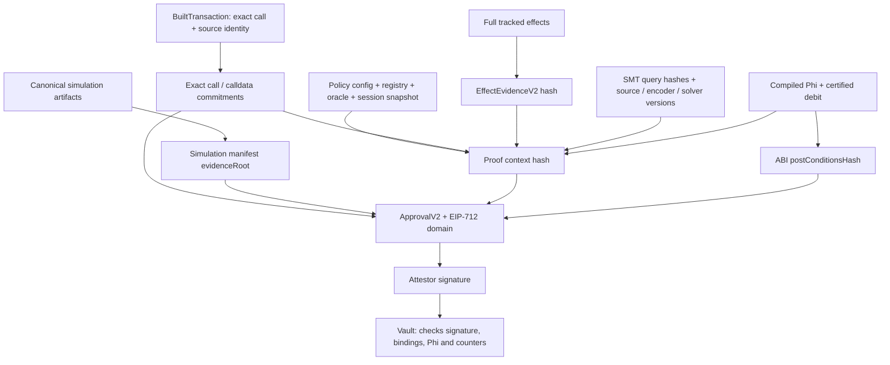

[Hình 10 — SVG](architecture/diagrams/10-commitments.svg) là quan hệ commitments ở mức khái niệm; encoding chính xác nằm trong shared SDK và golden vectors. `SimulationEvidence.evidence_root` là manifest commitment; field `ProofArtifactV2.evidence_root` bind **effects hash**. Hai field có tên giống nhau không được hoán đổi. `ApprovalV2.evidenceRoot` bind simulation root; `proofContextHash` mang proof context; `postConditionsHash` bind ABI Phi. Vault không tải files off-chain để reconstruct/verify tất cả commitments, nên signer vẫn là một trusted verifier.

Canonical JSON dùng cho các execution artifacts; V2 commitments và Phi dùng typed ABI/EIP-712 tương ứng. Không tự đổi `json.dumps` spacing, field order, case normalization hoặc packed encoding ở một bên mà không cập nhật protocol tests. Các off-chain IDs như `workflow_id`/`build_id` phục vụ lookup; identity đủ để authorize phải là exact signed/hash-bound context, không phải một ID do client tự khai.

### 15.3 Danh sách bất biến để code review

| ID | Bất biến | Nơi enforce / evidence chính |
| --- | --- | --- |
| I01 | Không ký nếu không có immutable APPROVE đúng attempt và current context | `authorization.py`, signing, control tests |
| I02 | V2 không approve khi thiếu proof hoặc bất kỳ safety query UNKNOWN/SAT | Decision/proof adapter/engine tests |
| I03 | Call/Phi/session/policy/nonce/chain/expiry không được sửa sau ký | SDK hashes, relayer checks, Solidity mutation/golden tests |
| I04 | Phi bao phủ đúng hai tracked assets và allowance pairs; không cho omission | Registry validation, full effects, vault checks |
| I05 | Mỗi successful vault approval nonce chỉ được dùng một lần | Builder counters + on-chain usedNonce; rollback/replay tests |
| I06 | Daily spend và risk caps enforce atomic trên chain, không dựa riêng SQL | Vault race/session/global/rollback tests |
| I07 | Certified debit không âm, ceil đúng đơn vị, không refund vì profit | Exact arithmetic/proof tests, vault counters |
| I08 | Chỉ confirmed canonical receipt với đúng facts mới thành CONFIRMED | Relayer monitor + workflow receipt/fee/reorg tests |
| I09 | Broadcast uncertainty không tự tạo trade mới hoặc tự nhả reservation | Journal-before-send, idempotency/recovery tests |
| I10 | Owner key không vào serving environment; attestor/relayer không phải owner | Operations/container role tests; không phải OS-level guarantee |
| I11 | Không dùng MOCK evidence như REAL_LOCAL_SIM/REAL_FUJI_SIM | Mode/provenance checks, consumer tests |
| I12 | Replan thay amount phải tạo intent/build/evidence/proof mới | Evaluation loop và workflow regression tests |

Các invariants được kiểm trong declared scope; đây không phải tuyên bố model checking toàn bộ Python/Solidity. Bảng giúp reviewer yêu cầu counterexample hoặc test cụ thể khi một invariant chưa thuyết phục.

### 15.4 Ví dụ tương tác API của người vận hành

```http
POST /v1/workflows/start
Authorization: Bearer <operator-token>
Content-Type: application/json

{"mandate_id":"mandate_demo","goal":"Buy WAVAX with 200 USDC"}
```

Sau response, dùng `workflow_id` để `GET /v1/workflows/{workflow_id}`; không suy từ HTTP 200 rằng swap đã CONFIRMED. UI cần đọc `status`, reason codes và timeline. `POST /v1/decisions`/`risk/evaluate` chỉ trả immutable saved assessments theo bound references, không tạo chữ ký bằng một `verdict` client gửi lên. `/approvals/attest` là internal-token endpoint với decision ID; execution submit vẫn kiểm signed PDR và exact stored build.

HTTP execution mutations dùng `Idempotency-Key`: cùng operation/key và body trả cùng result đã lưu; đổi body dưới cùng key bị từ chối. Không dùng key đó như capability vượt auth. Runtime OpenAPI là schema request/error chính xác; [SDK/OpenAPI compatibility](../packages/contracts-api/README.md) mô tả consumer standalone legacy. Danh sách API trong mục 11 áp dụng khi router được mount theo mode.

## 16. Tính nhất quán, concurrency và cửa sổ lỗi

### 16.1 Ba cơ chế không được đánh đồng

| Cơ chế | Bảo vệ cái gì | Không bảo đảm điều gì? |
| --- | --- | --- |
| Control signing reservation / unique scope+nonce | Tránh app cấp các approval xung đột và giữ in-flight state | Không tự chứng minh tx đã mined; không thay on-chain nonce |
| Execution lock / idempotency / raw journal | Serialize mutations trong deployment hiện tại, retry đúng operation/raw bytes | Không chống mọi duplicate user goal, không hỗ trợ HA/distributed locking |
| Vault nonce / CEI / budgets / postconditions | Exact signed call chỉ thành công nếu on-chain điều kiện còn đúng; charge/rollback atomic | Không bảo đảm liveness, giá oracle đúng, gas rẻ hoặc operator nhận được response |

Builder cấp **vault approval nonce** theo namespace và kiểm on-chain used state. Relayer dùng **EOA transaction nonce** của ví relayer theo chain. `Idempotency-Key` lại là identity của một operation ở service. Thay EOA nonce hoặc retry HTTP không được tùy tiện thay vault approval nonce/decision/call sau ký.

SQLite control dùng `BEGIN IMMEDIATE` cho write operations; signing reservation gọi verification/sign callback trong transaction bảo vệ reservation. Revalidation có thể gọi RPC/preflight trong khoảng giữ lock, nên network chậm có thể kéo dài writer contention. Execution dùng file lock và SQLite WAL; Z3 có process-level lock. Đây là tradeoff có chủ đích của single-instance demo, chưa có bằng chứng throughput khi nhiều operator cùng chạy.

### 16.2 Crash windows và cách phục hồi

| Cửa sổ lỗi | Durable state có thể còn | Hành vi an toàn / giới hạn hiện tại |
| --- | --- | --- |
| Trước lưu decision | Build/artifacts có thể đã có; workflow chưa có approved record | Không ký lại từ artifact rời; query workflow và tạo evaluation mới nếu cần. Chưa có automatic cleanup orphan artifacts |
| Sau lưu decision, trước ký | Immutable attempt/proof đã lưu | Attest phải reread/revalidate TTL/context; không tiếp tục bằng snapshot đã hết hạn |
| Sau ký, trước submit | Attestation/reservation đã lưu | Không tự ký thêm conflicting approval; operator cần inspect state. Chưa có general job-resume daemon |
| SUBMITTING nhưng chưa rõ execution result | Control reservation + có thể có submission journal | Query journal/chain, recover known hash; giữ uncertainty nếu RPC không đủ dữ liệu |
| Raw journal đã ghi, response broadcast mất | Raw bytes/hash đã tồn tại; tx có thể pending/mined | Retry exact operation/raw bytes hoặc bind known hash bằng recovery; không tạo trade thay thế |
| Chain đã mined, DB chưa ghi terminal | Receipt/public chain authoritative, workflow có thể SUBMITTED | Poll reconcile sau restart; actual fee được đọc lại. Không reset budgets từ DB |
| DB ghi CONFIRMED nhưng reorg/RPC revalidation lỗi | Terminal event lịch sử vẫn tồn tại | Khi query, đưa về SUBMITTED với reason phù hợp; không tiếp tục trình bày finality cũ như chắc chắn |
| Hết deadline nhưng submit không rõ | Raw journal có thể tồn tại | Chỉ expire unknown submission khi fresh chain timestamp qua deadline và nonce chưa dùng; thiếu RPC giữ pending |

Không có two-phase commit giữa control DB, execution DB và chain; events lưu lịch sử và on-chain enforcement đóng các cửa sổ gây token/counter inconsistency. Backup/restore một DB đơn lẻ không bảo đảm resume đúng. Không được dùng xóa DB hoặc tăng nonce thủ công làm quy trình recovery tiêu chuẩn.

### 16.3 Freshness có nhiều đồng hồ

| Đồng hồ / giới hạn | Vai trò | Điểm cần phản biện |
| --- | --- | --- |
| Host clock | TTL/price freshness/control evaluation | Host lệch giờ có thể gây refuse hoặc đánh giá sai tuổi dữ liệu; chưa có clock-monitor service |
| Oracle observation time | Original feed updatedAt, pinned observed_at riêng | Direct Chainlink kiểm round ở source block và latest; demo heartbeat chỉ dùng cho controlled profile |
| Source block number/hash/timestamp | Pin fork và xác minh context | Block drift là bound số block, không thay mọi wall-clock checks |
| Approval deadline: LOCAL 30s, owner Fuji profile 180s | Giới hạn inclusion của signed call | RPC chậm có thể làm expire; không tự tăng deadline sau ký |
| Session/policy expiry | Thẩm quyền owner cấp | Service health không đồng nghĩa session active |
| Chain UTC day | Reset global daily risk/USDC-day usage | Session usage không reset theo ngày; không dùng timezone máy cho counter on-chain |

Latest reads không atomic cùng nhau: balances/session/oracle có thể thay đổi giữa các calls. Workflow fail closed khi phát hiện drift; vault enforce counters/Phi tại inclusion. Đây là bounded stale-state design, không phải consistent snapshot toàn hệ thống với zero race windows.

## 17. Threat model và ma trận bảo vệ

Đối thủ trong phạm vi gồm đầu vào goal/tool text sai lệch, client API không có quyền, người sửa/tái sử dụng payload, state/quote thay đổi giữa simulation và inclusion, RPC tạm lỗi, transaction cạnh tranh budget và receipt reorg. Backend host, owner, attestor và oracle producer không được giả định Byzantine rồi vẫn hứa bảo vệ đầy đủ. Bảng này tách attack được kiểm với trusted component bị compromise.

| Đe dọa / failure | Kiểm soát hiện tại | Giới hạn / phản biện cần giữ |
| --- | --- | --- |
| Prompt injection/sai goal | Groq strict schema, independent goal/direction/amount parser, mandate/alignment, no arbitrary call signing | Không phải semantic verifier; free-form goals vẫn ngoài scope |
| Groq outage/auth/429/model drift | Durable local budgets/cache/cooldown, bounded output, timeout, reviewed model allowlist; không fallback | Quota theo organization ngoài local data path chưa thể bảo đảm; provider errors dừng plan |
| Public client gọi sign trực tiếp | Operator/internal credentials riêng, immutable decision ID, attestor revalidation | Token không phải user identity/RBAC; host compromise đọc được các credentials |
| Call/Phi bị thay sau approve | Canonical hashes, immutable record, signature bindings, exact relayer/vault checks | ABI/encoding implementation đúng vẫn là assumption; golden tests chỉ cover declared vectors/cases |
| Replay trên chain/vault khác | EIP-712 domain, chain ID, verifying contract, nonce/deadline/policy | Không có replay protection cho arbitrary new user goals tạo lại ý định kinh tế |
| Tracked asset bị bỏ sót | Exact two-asset registry và Phi/allowance coverage, restricted adapter | Mở thêm token/adapter không thể chỉ sửa UI; token có side effects lạ chưa thuộc model |
| Drift vượt điều kiện được ký | Pre-sign revalidation + Phi/budgets tại inclusion | Có thể mất gas do protected revert; không bảo vệ mọi MEV hoặc oracle price ngoài band |
| Race session/global/daily cap | Atomic on-chain budget charge và rollback | Off-chain approvals có thể mất liveness; không hứa mọi tx đã approve đều được mined |
| RPC unavailable/stale | Mode/chain/block/code/freshness checks, safe pending, fail closed | Cùng provider cho verification không chống provider Byzantine phối hợp |
| Oracle stale/outage/sai source | Strict DTO, scope/source hash/freshness, external timestamp giữ nguyên | Nguồn thật sai giá nhưng timestamp mới không tự bị phát hiện; chưa có deviation quorum |
| Malicious adapter/approval drain | Restricted selector/pair/recipient, temporary approvals, cleanup, postchecks | Owner allowlisting/token semantics vẫn trusted; mock tests chưa audit DEX thật |
| Reentrancy/callback | Vault ReentrancyGuard và CEI/postchecks | Không suy rộng sang adapter mới hoặc token độc hại chưa review |
| Solver DoS/UNKNOWN | Bounded model/arrays/query timeout/process lock, refusal | Chưa có hard OS memory sandbox; auth/rate limit không bao trùm mọi endpoint |
| Evidence/DB bị sửa | Content-addressed hashes, immutable decision/proof triggers, bind lại trước ký | DB admin/root có thể sửa triggers/code/keys; chưa có external tamper-evident log |
| Backend hoặc attestor key compromise | Owner hard restrictions, current attestor rotation/pause/revoke | Attestor có thể chứng nhận debit sai; cùng process relayer nên không có independent dual control |
| Owner key compromise | Owner actions có events/invalidation/paused withdrawal | Owner là trust root, không được claim chống hostile owner |
| Frontend script/token compromise | Token chỉ trong tab memory, text rendering, CSP ở bundled HTML, redirect refusal | XSS/hosted assets compromise có thể lấy token; không có hardware-backed operator authentication |
| Disk full/process kill/backup lỗi | Durable stores/journal, atomic artifact writes ở execution | Chưa có quota/retention/backup scheduler/load campaign; single instance là SPOF |

Invariant của chứng minh phải đọc theo dạng điều kiện: **nếu** registry/tokens/effects/oracle/model và signed bindings đáng tin, **và** actual outcomes/prices nằm trong phạm vi đã xét, **thì** Phi + certified debit bảo đảm policy được mô hình hóa. Không chuyển mệnh đề đó thành “không thể mất tiền” hoặc “toàn bộ agent an toàn” ngoài các điều kiện nêu trên.

## 18. Các quyết định thiết kế để nhóm phản biện

| Quyết định hiện tại | Lý do chọn | Chi phí / lựa chọn khác cần cân nhắc |
| --- | --- | --- |
| Modular monolith, một FastAPI | Đơn giản deploy/env, module ownership rõ, không internal HTTP | Cùng failure/key boundary. Signer service riêng/HSM là hướng tăng isolation, chưa triển khai |
| Python backend + native Anvil; Solidity on-chain | Dùng cùng Python orchestration/proof/SDK và EVM tooling | Vẫn cần native process/contract build; không phải pure Python runtime không binary |
| Browser ES modules/static assets | Không cần Node build/server cho backend/frontend demo | Chưa có framework routing/component ecosystem; UI lớn hơn có thể cần tooling riêng |
| Một pure proof engine trong SDK | Tránh công thức/encoding khác nhau giữa các caller | SDK không chỉ chứa HTTP client; đổi engine/source hash ảnh hưởng owner policy và versioning |
| Restricted two-token swap | Làm rõ effects coverage, exact arithmetic và vault guard | Chưa general-purpose treasury: không arbitrary payments, LP, lending, NFTs hoặc cross-chain |
| SMT off-chain, enforcement Phi on-chain | Không chạy solver trong EVM; ràng buộc outcome rẻ hơn on-chain proof verification | Cần tin attestor; chưa có independently verifiable SMT certificate trên chain |
| Price bands độc lập | Worst-case reasoning rõ và conservative | Có thể tạo corner không tương quan với thị trường và refuse nhiều; không tự thu hẹp bands theo observed correlation |
| Risk reservation tích lũy, không refund profit | Dễ kiểm bound/counters, tránh optimistic credit | Có thể giảm liveness dù realized PnL tốt; release/refund cần protocol chứng minh riêng |
| Immutable non-proxy vault | Deployment semantics rõ, không admin proxy upgrade | Sửa contract cần deploy/migrate mới; không rollback on-chain V2 activation |
| SQLite + files + locks | Ít hạ tầng, thuận tiện single instance/demo | Không HA/horizontal scale; writer contention/backup/retention phải quản lý |
| Polling monitor | Dễ theo dõi từ dashboard/CLI, không broker | Không poll thì không auto reconcile/alert; thêm worker cần durable ownership và idempotent recovery |
| Pinned/cached final preflight | So sánh exact build/proof/stress deterministically | Không fresh full-state replay; state lệch còn phụ thuộc latest checks và vault enforcement |

Đây là các quyết định **đang có**, không phải khẳng định luôn tối ưu. Ví dụ user gộp backend để đơn giản deploy là một product constraint hiện tại; nếu mục tiêu chuyển thành custody quỹ thật, cần review lại signer isolation thay vì chỉ mở rộng cùng process.

## 19. Kế hoạch mở rộng và tiêu chí chấp nhận

Các hạng mục dưới đây gồm kết quả đã hoàn thành ở live cutover và các hướng mở rộng còn lại. Circle/Chainlink/public receipt đã có bằng chứng; Oracle/DEX khác, hosting và production vẫn cần nghiệm thu riêng.

| Hạng mục | Nơi thay đổi chính | Điều kiện chấp nhận trước khi đổi trạng thái thành READY |
| --- | --- | --- |
| Fuji/hosted demo | Operations, manifests, deploy config/runbook | Actual deployment/code checks; normal + protected-revert hashes; restart/pending recovery, durable mount, TLS/proxy/CORS và smoke trên host |
| Oracle cộng tác viên | `modules/oracle`, config/provider composition; proof/source commitments | Source/asset/decimals/provenance đúng; observation time trung thực; stale/outage/negative/duplicate/scope tests; owner config/session hash migration |
| Public LFJ execution | Circle-USDC/WAVAX + Chainlink policy + deployed vault/session/funding | Đã có full public receipt và checks. LFJ faucet route vẫn cần nguồn định giá riêng |
| Open-ended LLM agent / semantic alignment | Planning ports/provider, alignment, workflow policy | Bounded Groq đã có; free-form intents cần independent semantics/owner confirmation design, tool isolation và ambiguity/injection tests; không bypass proof/SDE |
| Durable watcher | Workflows monitoring/operations/persistence | Restart-resume theo known hashes, leader ownership, bounded polling/backoff, canonical receipt/reorg/fee dedup và alerts; không tạo duplicate trades |
| HSM/KMS hoặc signer riêng | Signing port, authorization contract, deployment/auth | Exact decision/bindings reverified tại signer boundary, rotation/audit/availability, không arbitrary digest signing API |
| Multi-user/HA | API auth, persistence, execution locking/nonce manager, deploy | RBAC/audit identities; DB migration, distributed idempotency/locks, nonce coordination, worker ownership; failover/restore/load tests |
| Runtime exposure guard | Policy/Phi/contract/math/oracle model | Định nghĩa nguồn giá/thời điểm exposure, tăng registry coverage, proof + Solidity enforcement tests; không đổi nhãn PRE-SIGN ONLY trước đó |

Thay oracle source, proof engine source/encoder, registry hoặc policy semantics phải xem lại commitments/versioning/owner migration. Không áp dụng hot-swap library rồi dùng policy/session/signature cũ một cách mặc định. ABI/domain/version changes cần Python–viem–Solidity vectors mới và refusal tests giữa version cũ/mới.

## 20. Hướng dẫn phản biện và các câu hỏi còn mở

### 20.1 Cách ghi một nhận xét có thể xử lý được

Mỗi nhận xét nên có: mục/diagram/invariant liên quan → assumption hoặc claim chưa thuyết phục → tình huống/counterexample → ảnh hưởng security/liveness/operability → đề nghị test hoặc lựa chọn khác. Phân biệt **bug so với code hiện tại**, **thiếu bằng chứng**, **giới hạn scope đã chấp nhận** và **đề xuất feature mới**; tránh đánh giá một interface tồn tại như thể đã có real integration.

| Nhóm reviewer | Câu hỏi cần trả lời |
| --- | --- |
| Sản phẩm/treasury | Bounded Groq + template validation đã đủ chưa? Khi nào cần free-form agent/DEX/market oracle? Có chấp nhận reverse disabled và exposure chỉ pre-sign? |
| Backend/kiến trúc | Ownership module có rõ? Client port có quá phụ thuộc HTTP wire SDK? Synchronous request/SQLite lock có phù hợp tải kỳ vọng? Recovery còn cửa sổ nào cần durable job? |
| Formal/math | Từ lower bounds đến policy có dựa đúng monotonicity/positive prices? Exact-input constraint và rounding/bands có sound? Có non-vacuity hoặc counterexample bị thiếu? |
| Solidity/security | Hash/Phi/registry/approval checks đủ chưa? Budget CEI/rollback/replay/admin invalidation còn bypass nào? Trust attestor/owner/token có được chấp nhận? |
| Oracle/market | Timestamps/provenance/precision được đảm bảo ở producer thế nào? Independent bands quá rộng/hẹp? Outage/disagreement xử lý ở đâu? |
| DevOps | Hosting có chạy fork subprocess và giữ journal bền vững? Backup restore có cross-check chain? Ai renew/pause/rotate và quan sát pending? |
| Frontend/UX | Người xem phân biệt MOCK/LOCAL/FUJI, reserved risk/realized loss/gas, pending/protected revert rõ chưa? Có thể vô tình submit goal lặp khi timeout không? |

### 20.2 Các quyết định chưa chốt

1. **Mục tiêu phát hành:** chốt demo nghiên cứu với mock assets hay public market execution; hai mục tiêu có acceptance gates khác nhau.
2. **Risk model:** ai phê duyệt relative/fixed loss, bands/tolerance, session/global caps; có cần stress theo protocol thật thay fixed quotes không?
3. **Signer trust:** cùng-process attestor/relayer có được chấp nhận ngoài demo không; nếu tách, signer cần tự verify bao nhiêu context?
4. **Liveness:** có cần latest-block preflight, TTL dài hơn hoặc fee replacement; thay đổi đó ảnh hưởng freshness và replay model thế nào?
5. **Oracle merge contract:** producer/file/provider và source identity cụ thể của cộng tác viên là gì; bằng chứng observation time và outage behavior ở đâu?
6. **Persistence/ops:** cần bao nhiêu concurrent workflows, retention/quotas, background monitor, SLO và restore drill; khi nào SQLite không còn phù hợp?
7. **Policy upgrades:** khi engine/source/ABI thay đổi, ai review và thực hiện owner policy/session/vault migration; rollback off-chain có còn tương thích chain không?
8. **Evidence phát hành:** ai chạy/duyệt actual Fuji normal/revert, hosted restart và remote CI; lưu sanitized hashes/logs ở đâu?

Tài liệu cung cấp source, local/fork tests và public Fuji evidence để phản biện. Các deployment/feature chưa kiểm chứng khác tiếp tục giữ nhãn đó. Dùng invariant I01–I12 và hình 1–10 làm tham chiếu; xem runbook/report live để phân biệt dữ liệu thực với counterfactual stress.
