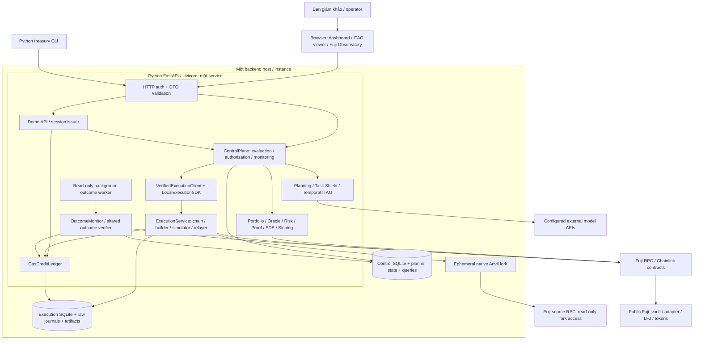
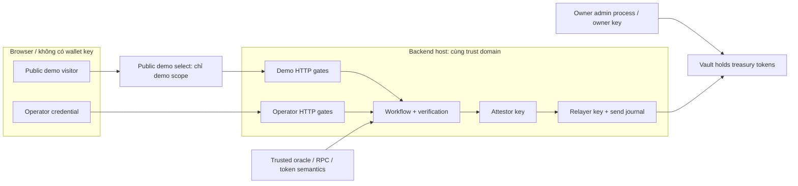
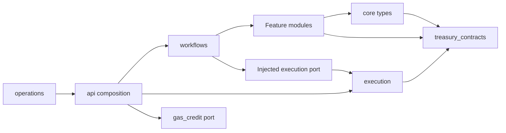
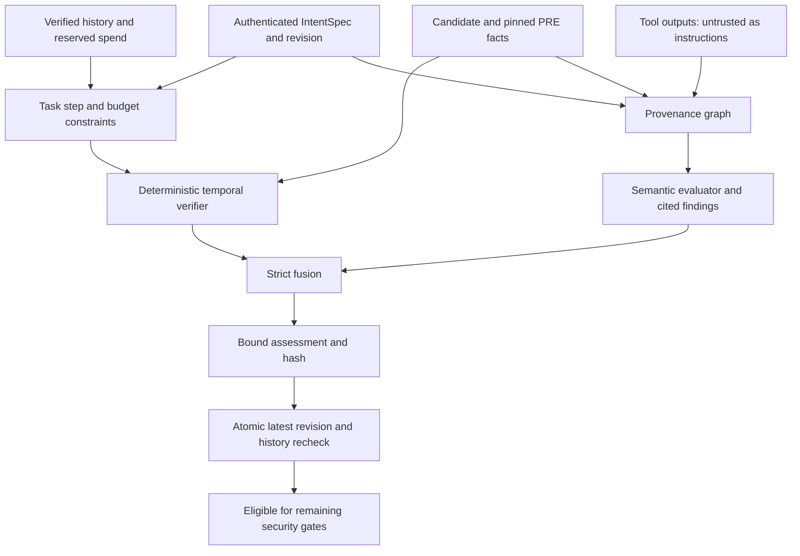
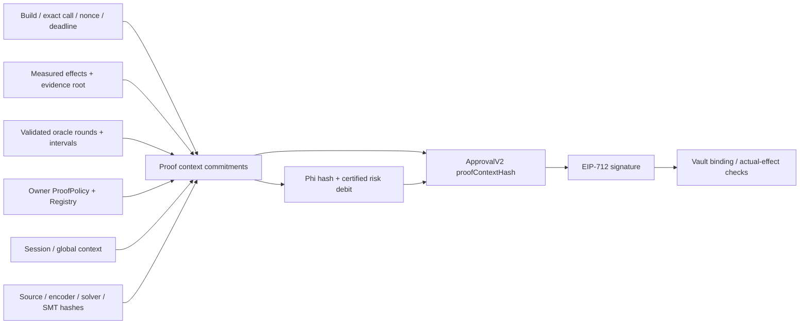
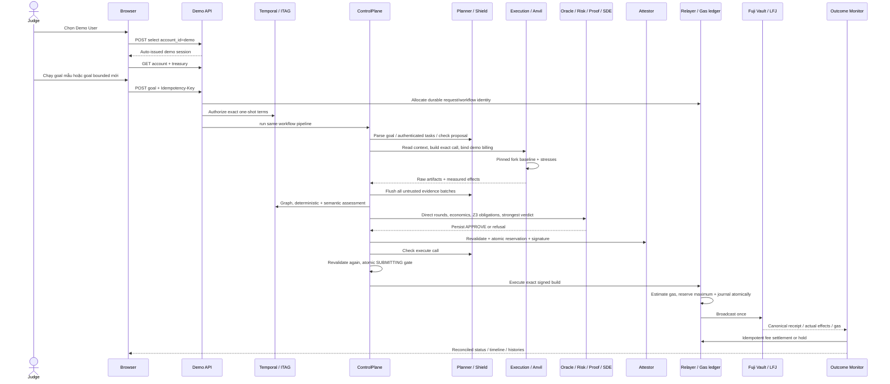
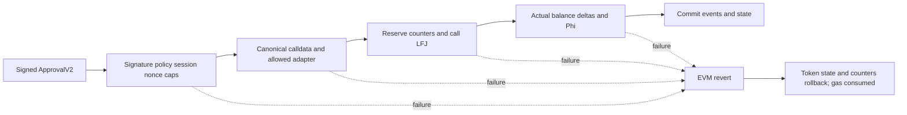
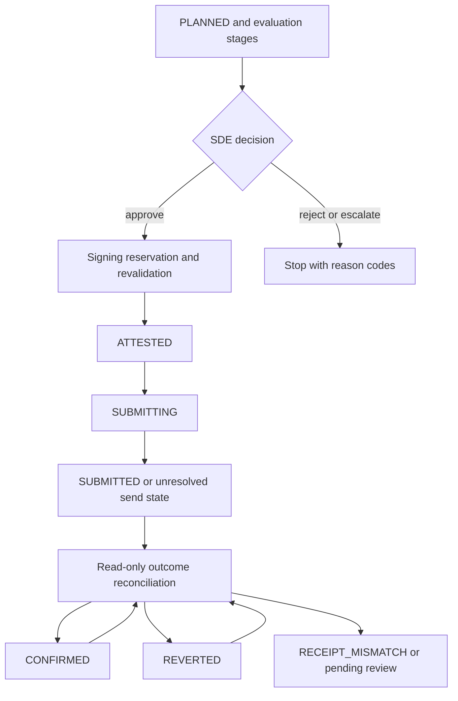

# PaceVant — System Design V2.1 hiện tại

> **Cập nhật live web 20/11/2026:** Fuji là mặc định; MOCK/LOCAL phải chọn riêng. Demo User đã có swap Fuji và actual gas debit, được ghi tại [live review](audit/WEB_DEMO_LIVE_REVIEW.md). Web có chế độ bình thường và kiểm thử bảo mật; xem [runbook mới](demo/LIVE_WEB_DEMO.md). Các nhận xét bên dưới về “chưa có Fuji billing/browser evidence” và “hosting template cũ” là trạng thái trước bổ sung này, đã được thay thế bởi live review/runbook; hosting thực tế vẫn chưa được nghiệm thu.

> **DOC STATUS: CURRENT_SYSTEM_DESIGN — nguồn mô tả hiện trạng chính thức của repository.**
> Source baseline: `3f9f9af91310040bd43eb3895d145a0fc46d776c`, ngày đối chiếu **20/11/2026**. Bao gồm modular backend, unified FastAPI, Chainlink/LFJ, Task Shield, ITAG, gas credit và thao tác chọn Demo User không nhập mã.
> Phạm vi kiểm tra tài liệu: source/config cục bộ và evidence đã lưu. Không gửi giao dịch, gọi model, renew policy/session hoặc xác nhận lại số dư/round giá trên chain trong đợt biên soạn này.

Đọc [chỉ mục docs](README.md), [hướng dẫn phản biện](REVIEWER_GUIDE.md), [inventory cấu hình/source](current-system-inventory.json) và [catalog API](current-api-catalog.json) cùng tài liệu này. [Documentation manifest](DOCUMENTATION_MANIFEST.json) phân loại mọi tài liệu; các file mang nhãn `HISTORICAL_*` không có thẩm quyền xác nhận trạng thái hiện tại. Bản design trước khi chuẩn hóa được giữ tại [archive](archive/AI_Treasury_Security_System_Design_v2.1.pre-review-3f9f9af.md).

Đây là **as-built design**, không phải tuyên bố đã hoàn tất mọi yêu cầu trong một design bên ngoài chưa được cung cấp, và không phải audit bảo mật độc lập. [Implementation plan gốc](IMPLEMENTATION_PLAN_V1_TO_V2_1.md) được giữ như yêu cầu lịch sử; không tự đánh dấu checkbox để hợp thức hóa kết luận.

## Mục lục

1. [Sản phẩm, phạm vi và kết luận hiện trạng](#1-sản-phẩm-phạm-vi-và-kết-luận-hiện-trạng)
2. [Kiến trúc, process và trust boundaries](#2-kiến-trúc-process-và-trust-boundaries)
3. [Cấu trúc source và quyền sở hữu module](#3-cấu-trúc-source-và-quyền-sở-hữu-module)
4. [Vai trò, tài sản, authentication và quyền](#4-vai-trò-tài-sản-authentication-và-quyền)
5. [Đặc tả từng module: chức năng, input, output, trạng thái](#5-đặc-tả-từng-module-chức-năng-input-output-trạng-thái)
6. [Data contracts, identity, đơn vị và commitments](#6-data-contracts-identity-đơn-vị-và-commitments)
7. [Nguồn dữ liệu và oracle](#7-nguồn-dữ-liệu-và-oracle)
8. [Luồng xử lý end-to-end hiện tại](#8-luồng-xử-lý-end-to-end-hiện-tại)
9. [Mô phỏng EVM, stress và final guarded preflight](#9-mô-phỏng-evm-stress-và-final-guarded-preflight)
10. [Risk, proof, Phi và phạm vi chứng minh](#10-risk-proof-phi-và-phạm-vi-chứng-minh)
11. [Ký, broadcast và enforcement trên Solidity](#11-ký-broadcast-và-enforcement-trên-solidity)
12. [Session, thời gian và các ngân sách](#12-session-thời-gian-và-các-ngân-sách)
13. [Gas credit: allocation, reserve, settlement và reorg](#13-gas-credit-allocation-reserve-settlement-và-reorg)
14. [Persistence, state machines và recovery](#14-persistence-state-machines-và-recovery)
15. [API, frontend và error contracts](#15-api-frontend-và-error-contracts)
16. [Cấu hình, startup và deployment](#16-cấu-hình-startup-và-deployment)
17. [Threat model, invariants và coverage](#17-threat-model-invariants-và-coverage)
18. [Mock, giả định, thiếu sót và vấn đề còn mở](#18-mock-giả-định-thiếu-sót-và-vấn-đề-còn-mở)
19. [Bằng chứng và mức kiểm chứng](#19-bằng-chứng-và-mức-kiểm-chứng)
20. [Vận hành demo và chuẩn bị phản biện](#20-vận-hành-demo-và-chuẩn-bị-phản-biện)
21. [Mở rộng và quy trình bảo trì thiết kế](#21-mở-rộng-và-quy-trình-bảo-trì-thiết-kế)

## 1. Sản phẩm, phạm vi và kết luận hiện trạng

### 1.1 Bài toán hệ thống xử lý

PaceVant nhận một yêu cầu swap có phạm vi hẹp, kiểm xem giao dịch có đúng mục tiêu/quyền hạn và đáp ứng policy không, rồi chỉ ký/gửi khi mọi gate bắt buộc đạt. Hệ thống lưu evidence để giải thích vì sao approve, reject, replan hoặc escalate, và đối soát kết quả trên chain.

Đường demo hiện tại:

```text
Chọn Demo User → tự cấp quyền demo → goal USDC→WAVAX
→ authenticated one-shot intent → planner + Task Shield
→ build → Anvil baseline/stress → verified facts + Chainlink
→ risk + Z3 + ITAG → SDE → revalidation → attestor
→ giữ chỗ gas + durable journal → relayer → Fuji vault/LFJ
→ canonical receipt reconciliation → actual gas debit + history/UI
```

Đây là treasury do hệ thống quản lý với một tài khoản thử nghiệm dùng chung. Tài sản swap ở **vault**, không ở ví Demo User. Relayer trả gas; gas credit là hạn mức sponsor **off-chain**, không phải khoản khách hàng đã nạp AVAX. AI không tự chọn arbitrary contract, không giữ ví ký và không tự cấp quyền giao dịch.

### 1.2 Ma trận trạng thái tổng thể

| Thành phần/capability | Code hiện có | Mức bằng chứng | Giới hạn cần công bố |
| --- | --- | --- | --- |
| Modular backend Python, một FastAPI | Có | Source + architecture/API tests | Single instance, cùng host/trust domain |
| Swap Circle test USDC → WAVAX qua LFJ Fuji | Có | Public Fuji receipt đã đối soát | Chỉ route/pair đã cho phép, không free-form DeFi |
| Direct Chainlink Fuji cho risk/proof | Có | Original rounds trong live evidence | Giá reference cho test token, không redeem USD |
| Planner DeepSeek và provider rotation | Có | Live DeepSeek trace ở pipeline trước gas-credit | Provider/quota/latency vẫn là phụ thuộc bên ngoài |
| Task Shield + ITAG | Có, live profile bắt buộc | Local regressions + public pipeline evidence | Chưa có bằng chứng chặn mọi prompt injection |
| PGS/Z3, Phi, certified risk debit | Có | SAT/UNSAT artifacts + guarded EVM tests | Bounded off-chain model, trusted attestor |
| On-chain policy/session/caps/replay/Phi | Có | Solidity regressions/fuzz + public checks | Không chạy solver hoặc verify ZK trên chain |
| Background outcome monitor | Có | Source + reconciliation/reorg tests | Read-only worker, không durable workflow orchestrator |
| Demo User gas credit | Có | Isolated Anvil integration + ledger/API tests | Chưa có public Fuji receipt chứng minh billing mới |
| Chọn Demo User không nhập mã/token | Có | Offline API/session tests | Cần process đang chạy nạp đúng bản code mới |
| UI gas/history/viewer | Có | Syntax/API tests | Browser visual verification chưa hoàn tất trong evidence mới |
| Multi-user, real customer deposits/billing | Chưa có | Không có nghiệm thu | Account và sponsor budget dùng chung |
| Mainnet, hosted Render/VPS, HSM/HA | Chưa nghiệm thu | Config/source có một phần | Không gọi testnet demo là production audit |

**Code chạy được trên Fuji** và **sẵn sàng gửi một giao dịch ngay bây giờ** là hai kết luận khác nhau. Quyền gửi còn phụ thuộc thời điểm: session/policy active, balances/exposure, risk/gas budgets, fresh rounds/state, RPC/model availability và version của backend process. Báo cáo cũ không xác nhận các điều kiện này ở hiện tại.

### 1.3 Thuật ngữ cần thống nhất khi phản biện

| Thuật ngữ | Ý nghĩa trong code |
| --- | --- |
| Mandate | Owner-bound phạm vi treasury: pair/router/vault/caps/stress/proof policy/session |
| IntentSpec | Quyền thực hiện task/budget/steps do API xác thực, có revision/deadline |
| Proposal / intent_id | Một candidate swap cụ thể; khác `spec_id` của quyền task |
| Build | Exact calldata, quote, nonce, minOut, deadline tại state đã pin |
| Simulation | Thực thi EVM trên fork để đo effects; chưa phải public swap |
| Proof | Kiểm quan hệ toán có điều kiện trong mô hình hữu hạn |
| Phi / Φ | Các lower bounds token deltas và residual allowance caps được vault enforce |
| SDE | Security Decision Engine tổng hợp các gate thành verdict |
| PDR V2 | Envelope phê duyệt có signature/commitments/Phi; không phải ZK proof |
| Certified risk debit | Rủi ro dự phòng theo mô hình, không phải realized loss hay gas |
| Reconciliation | Đối chiếu tx/receipt/canonical block/bindings/effects/history |
| Gas credit | Sponsor allowance tính bằng wei trong execution SQLite |

## 2. Kiến trúc, process và trust boundaries

### 2.1 Runtime topology



Control và execution là hai trách nhiệm logic, **không bắt buộc là hai API deployments**. Canonical composition inject `LocalExecutionSDK` và `VerifiedExecutionClient`, gọi execution trực tiếp trong process. `/execution/...` là HTTP facade cùng app cho consumer có backend API key; luồng nội bộ không vòng qua HTTP này.

Một service vẫn có nhiều OS/thread units: CLI launcher process, Uvicorn child, monitor thread và Anvil child processes. Anvil fork là compute tạm, không phải node Fuji production, không ghi vào source chain.

### 2.2 Vì sao có các ngôn ngữ/công cụ này?

| Công nghệ | Vai trò | Có cần trong backend serving? |
| --- | --- | --- |
| Python 3.12 | API, use cases, model adapters, risk/proof bridge, CLI, monitor | Có |
| Solidity | PolicyVault, LFJ adapter và interfaces | Contract đã deploy trên chain; artifacts cần cho ABI/code checks |
| Native Anvil | EVM fork baseline/stress/preflight | Có khi bật execution/mô phỏng |
| Native Forge / compiler | Build Solidity, local tests, deployment tooling | Build/development; không compile từng request |
| Z3 library | SMT reasoning qua Python | Có cho proof path |
| HTML/CSS/browser JavaScript | Frontend static ES modules | Chạy trong browser; không cần Node backend |
| Node/viem scripts | Một số developer syntax/golden checks tương thích | Không là runtime dependency của backend deployed |

Root Dockerfile compile Solidity ở build stage. Runtime Python/Anvil đọc ABI/artifacts đã build và gọi contract Fuji có sẵn; restart server không tự deploy, renew hoặc compile lại contract trên chain.

### 2.3 Trust boundaries thực tế



Module separation không tạo physical key isolation. Attestor và relayer trong cùng backend; owner/deployer key được loại khỏi môi trường serving child/canonical hosted entrypoint. Native compiler/Anvil child environment được allowlist OS/path/cache/certificate để hạn chế secret inheritance; đây không phải OS sandbox, HSM hoặc filesystem isolation.

## 3. Cấu trúc source và quyền sở hữu module

```text
backend/src/treasury_backend/
  api/                 HTTP adapters, demo session, unified composition
  config/              Control/execution/planning/demo settings
  core/                Shared application types/errors; không import business modules
  modules/
    planning/          Goal -> bounded validated plan/proposal
    alignment/         Wallet constraints + Task Shield
    temporal/          ITAG: authenticated intent, graph, order/budget/history
    portfolio/         Observed state và eligible decision snapshots
    oracle/            Authoritative provider + reference Observatory
    risk/              Economic checks
    proof/             Mapping to shared PGS engine
    decision/          SDE verdict fusion
    signing/           Attestor
    persistence/       Control DB, audit, reservations, projections
    workflows/         Use-case coordination và revalidation
    execution/         Chain / transaction / simulation / evidence / relaying
    monitoring/        Read-only outcome worker/API
    gas_credit/        Demo request identity + fee reservations/ledger
    experience/        Deterministic amount-retry guidance
  operations/          CLI, profiles, env/process wiring, deploy/prepare/renew/demo
frontend/src/          app, api, shared, features/{treasury,intents,workflows,demo}
packages/contracts-api/treasury_contracts/
                       Wire DTOs, ABI/hashes, pure proof engine, read-only verifiers
contracts/src/         PolicyVault.sol, adapters, interfaces, local mocks
deployments/           Public manifest và owner renewal receipts
deploy/                Hosting examples; không chứa private runtime env
docs/                  Current design/index + labeled historical references/evidence
```



Dependency rules: feature modules không import ngược workflow coordinator; `core` không import features; control features không import execution internals; SDK không import backend. `api` là composition root để nối các port; `operations` quản lý process/deploy, không bị execution runtime import ngược. [Module map](../backend/MODULES.md) và `backend/tests/architecture` mô tả/enforce một phần các ranh giới này.

Feature mới thường nằm trong một module. Thay signed field/ABI/hash/schema phải review đồng thời SDK/backend/contracts/tests; không thể giữ an toàn bằng cách chỉ sửa UI hoặc một folder riêng.

## 4. Vai trò, tài sản, authentication và quyền

### 4.1 Vai trò và nguồn chi phí

| Role | Trách nhiệm | Giữ gì / trả gì? | Không được suy ra |
| --- | --- | --- | --- |
| Owner | Deploy/configure allowlists, policy/attestor, create/revoke session, pause/unpause, withdraw khi paused | Owner key ở admin CLI; gas cho admin writes | Không phải actor mà hệ thống bảo vệ chống lại nếu key bị compromise |
| Operator | Tạo goals/intents, đọc treasury/history/graph, recovery theo hash | Operator Bearer; không cần wallet extension | Không tự force approve bằng JSON verdict |
| Demo User | Một shared identity, yêu cầu bounded swaps và xem history của demo | Auto-issued demo Bearer; sponsor gas allowance | Không chứng minh ownership theo ví; không swap từ số dư ví Demo User |
| Attestor | Ký immutable APPROVE sau revalidation/reservation | Private attestor key; offline signing không cần gas | Không phải solver được thực thi on-chain |
| Relayer | Kiểm PDR/build và broadcast exact signed call | Private relayer key; AVAX thật để trả gas | Credit off-chain không thay thế relayer balance |
| Vault | Giữ treasury tokens, enforce effects/caps atomically | Circle test USDC/WAVAX tại contract | Không giữ các SQL intent/task ledgers |

Ba ví owner/attestor/relayer khác address và khác key. Gas revert vẫn do relayer trả. Demo User private key có thể tồn tại trong private `.env` nhưng **không dùng** cho đăng nhập/ký/trả gas và không forward vào canonical serving environment.

### 4.2 Auth matrix

| Surface | Credential | Quyền |
| --- | --- | --- |
| `/health`, `/healthz`, static assets, `/v1/demo/config` | Public | Liveness/config public, không cấp quyền quản trị |
| `POST /v1/demo/select` | Public khi demo enabled | Tự cấp session **chỉ account demo** |
| Các `/v1/demo/*` protected routes | Session Bearer được cấp tự động | Bounded request, demo treasury view, account/history/workflows của demo |
| Operator/control/ITAG/Shield/history APIs | `PACEVANT_OPERATOR_TOKEN` | Các use cases được route cho phép |
| `/v1/approvals/attest` | `PACEVANT_INTERNAL_TOKEN` | Ký theo persisted decision ID, vẫn phải kiểm lại toàn bộ |
| `/execution/...` protected routes | `B_API_KEY` qua `X-API-Key` | SDK facade, POST cần Idempotency-Key; vẫn cần valid signed PDR để execute |

Một app không có nghĩa một credential dùng được mọi quyền. Live startup yêu cầu ba service credentials khác nhau, tối thiểu 24 ký tự. Demo signing secret tối thiểu 32 ký tự và không trùng ba service credentials.

### 4.3 Chọn Demo User không nhập gì

Browser gửi `POST /v1/demo/select` với `{"account_id":"demo"}`. Backend tạo payload `{account_id, expires_at, nonce}` và HMAC-SHA256 với domain `pacevant-demo-session-v1:`. Response gồm `access_token`, `expires_at`, `scope:"demo"`, `token_type:"Bearer"`. Đây là token được cấp tự động; người dùng không nhập hoặc nhìn thấy key.

`PACEVANT_DEMO_ACCESS_TOKEN` giữ tên tương thích nhưng nay là **server-only session signing secret**. Giá trị env này không được trả cho browser, không được dùng trực tiếp làm Bearer demo. Session tự cấp sống 86.400 giây; hết hạn/reload có thể chọn lại. Chọn lại không reset credit, không tạo IntentSpec/workflow và không tự gửi swap.

Token chỉ ở memory của tab; sessionStorage chỉ lưu random request ID để resume bằng GET. Không có session ownership DB, per-person revocation hoặc nhiều tài khoản. Khi demo enabled, bất kỳ visitor truy cập được API có thể chọn shared demo và cùng sử dụng finite allowance; đây là chủ đích của chế độ trình diễn, không phải production customer authentication.

## 5. Đặc tả từng module: chức năng, input, output, trạng thái

Trong mục này, **Implemented** nói về code tại baseline. **Local-tested**, **Fuji-evidenced** và **Not-yet-live-verified** chỉ nói về phạm vi evidence, không bảo đảm mọi request hiện tại pass. Nguồn test/evidence cụ thể ở mục 19.

### 5.1 `api`, `config`, `core` và composition

| Thành phần | Input | Function | Output / side effect | Trạng thái |
| --- | --- | --- | --- | --- |
| `api/app.py:create_app` | Control/Execution/Demo settings, optional injected service | Kiểm mode/RPC/credential alignment, create one app, wire SDK/monitor/ledger | FastAPI app, lifecycle, routes | Implemented; composition/local tests |
| `api/control/` | JSON + Bearer, request ID | Auth, typed validation, sanitized error mapping; gọi use cases | DTOs/error envelope; no arbitrary signing | Implemented |
| `api/demo.py` | Public selection; session + goal + request key | Scope demo, exact one-shot intent, stable workflow identity | Demo session/account/workflow views; DB request row | Local-tested; selection chưa có live swap evidence |
| `api/demo_auth.py` | Secret + time; supplied session | Issue/verify HMAC, expiry/account/nonce bounds | Valid/invalid demo credential; no DB/chain write | Offline-tested |
| `api/local_execution.py` | SDK method/payload + trusted workflow ID | Direct dispatch, schema/size/error contract; billing build binding | SDK response without internal HTTP hop | Local-tested; canonical path |
| `config/` | Process env/profile | Validate modes, endpoints, model choices, budgets/flags | Typed settings hoặc startup refusal | Implemented |
| `core/` | Shared application values | Address/hash/ID/UInt/DTO constraints, errors | Validated cross-module records | Implemented |

Source: [composition](../backend/src/treasury_backend/api/app.py), [core types](../backend/src/treasury_backend/core/models.py), [domain snapshots](../backend/src/treasury_backend/core/domain.py).

### 5.2 Planning — từ goal thành candidate swap

**Source:** [module](../backend/src/treasury_backend/modules/planning/README.md), `provider.py`, `service.py`, `remote.py`, `rotation.py`; settings ở `config/planning.py`.

- **Input:** bounded goal, ví dụ `Buy WAVAX with 0.000001 USDC`; mandate; chain-approved deadline; optional revised amount.
- **Process:** remote parser trả direction/decimal amount; independent parser kiểm grammar, exact amount, direction và precision. Deterministic compiler lấy vault/router/tokens/recipient từ mandate.
- **Output:** validated plan và `TransactionProposal` có intent ID, action, mandate version, chain/vault/router/token pair, amount, slippage, recipient, deadline, rationale có đơn vị.
- **Persistence:** planner cache/quota/cooldown SQLite và file lock cạnh control data. Cache draft không chứa authorization/proof/signature.
- **Failure:** unsupported/ambiguous goal, wrong amount/direction, invalid schema/provider unavailable đều fail closed; không sinh fixture plan.

Current order là **DeepSeek → Groq → Gemini → Xingchi**. Mỗi configured provider tối đa một attempt trong planner request; local rolling quotas/cache/cooldowns được tách theo provider. Availability/auth/rate/quota/schema có thể chuyển provider; semantic amount/direction mismatch không được “thử đến khi model đồng ý”. Model actual được ghi trong PLANNED event; configured `rotate` không có nghĩa bốn API đều đã được gọi.

**Trạng thái:** real provider adapters và live DeepSeek traces đã có. Goal grammar vẫn hẹp; không phải autonomous free-form agent tự chọn tools/strategies/assets. `rules` chỉ là offline option được cấu hình rõ, không fallback ngầm khi live model lỗi.

### 5.3 Alignment / Task Shield

**Source:** [module](../backend/src/treasury_backend/modules/alignment/README.md), `service.py`, `engine.py`, `runtime.py`, `state.py`, `serialization.py`.

- **Input:** mandate/proposal/goal, authenticated user objectives, candidate assistant instruction/tool call, semantic view của tool output.
- **Deterministic function:** kiểm amount/direction/pair/router/recipient/chain/vault và các vi phạm wallet constraints độc lập model.
- **Semantic function:** extract authenticated objectives, đánh giá instruction có đóng góp cho task hay goal drift/injection, lưu config/revision/provider trace.
- **Output:** `Alignment`; reports/check IDs, feedback, `task_shield_proof{session_id,revision,config_hash,check_ids,proposal,unresolved_feedback}`.
- **Persistence:** `shield_sessions/messages/tasks/context/checks/events` trong control DB.

Fuji dùng `wallet_pipeline`: proposal và build arguments được kiểm; fixed read/build/fork operations được gom output thành bounded batches và kiểm trước SDE/ký; execute call được kiểm riêng trước submission. `paper`/`wallet_hardened` giữ cách intercept từng tool. Unavailable trong live path không thành ALIGNED. Pending output chưa kiểm ngăn tạo approval proof; batch lỗi không xóa mất evidence. Successful output checks được bind và revalidate.

Semantic view giữ natural-language strings/unknown trace keys; opaque hex/machine bytes dùng length/hash. Full raw artifacts vẫn được verify qua SDK/effects/proof. Không tuyên bố AI đã hiểu từng byte VM trace. User-task updates phải qua authenticated path; tool text không được trở thành user authorization.

**Trạng thái:** implemented, scripted adversarial regressions và real-provider Fuji checks ở pipeline trước billing. Không có kết quả attack-detection accuracy thực tế cho model chỉ từ fixture tests. AI positive không ghi đè deterministic reject.

### 5.4 Temporal / ITAG

**Source:** [module](../backend/src/treasury_backend/modules/temporal/README.md), `intent_spec.py`, `verifier.py`, `graph_builder.py`, `semantic_evaluator.py`, `fusion.py`, `storage.py`, `explainer.py`.

- **Input:** authenticated `IntentTerms`, mandate/scope hash, candidate/build, selected `spec_id/revision/step_id`, PRE snapshot, Shield reports và canonical history/reservations.
- **Output:** `IntentSpec`, provenance Graph, deterministic ConstraintAssessment, semantic finding, HybridTemporalAssessment/hash, recovery explanation.
- **State:** `PROPOSED/AUTHENTICATED/CANCELLED/SUPERSEDED`, revision history, workflow links và assessments trong control DB.
- **Gates:** active revision/deadline, exact chain/vault/pair/router/recipient, per-step min/max, total budget/spent/reserved, completion replay, prerequisites/order, outcome verification.

API hỗ trợ `ONE_SHOT_SWAP`, `BOUNDED_SWAP`, `ORDERED_TASK`; tối đa 12 steps và 8 prerequisites/step. Current Demo adapter tự tạo exact-amount one-shot. Hỗ trợ DTO/API nhiều steps không đồng nghĩa đã public-live test mọi hình thức plan.

Graph tách node trust `AUTHENTICATED`, `VERIFIED_RECORD`, `UNTRUSTED`, `MODEL_JUDGMENT`, `UNVERIFIED`. Semantic evaluator dùng active Shield provider để nhận xét task contribution/goal drift, không tự cấp quyền. Citation repair bị giới hạn cho refs đã tồn tại thiếu node link; không được đổi core verdict/source/drift/task relationships để biến veto thành pass.



Assessment bind intent/graph/history/candidate/build/task revision/PRE links. Attestor reservation và transition sang SUBMITTING kiểm lại trong SQLite write transaction. Không gọi LLM bên trong write transaction; các bước chain/proof revalidation vẫn có thể giữ lock lâu.

**Trạng thái:** implemented; local budget/order/cancellation/replay tests và one-shot public Fuji history evidence. Ledger authorization là off-chain, không phải graph/intent state machine chạy trong vault.

### 5.5 Portfolio

**Source:** [module](../backend/src/treasury_backend/modules/portfolio/README.md), `observations.py`, `service.py`.

- **Input quan sát:** chain/vault, token identities/decimals, explicit block/hash, balances/context, history version, optional display oracle observations.
- **Output quan sát:** immutable content-hashed `ObservedPortfolioSnapshot`; `authorization_eligible` luôn false.
- **Input cấp quyền:** observation hợp lệ + exact build + owner policy + trusted price evidence.
- **Output cấp quyền:** `VerifiedDecisionSnapshot` bind observation/hash/build/policy, raw oracle feeds và authorization scope.
- **Failure:** missing identity/decimals/data, balance mismatch, invalid hash, stale state/history/source làm snapshot không đủ điều kiện ký.

PRE/REVALIDATION không cần fetch thêm oracle chỉ để hiển thị dashboard. Authoritative Chainlink vẫn đọc riêng trong risk/proof. Exposure dùng projected balances và USD reference, là PRE-SIGN gate, không phải atomic on-chain allocation limit.

**Trạng thái:** actual RPC observations/history/reconciliation implemented. Cached `/portfolio/current` là observation view, không phải authorization snapshot. Portfolio module có khả năng tính reverse trong controlled tests; route Fuji hiện vẫn chặn reverse.

### 5.6 Oracle

**Source:** [module](../backend/src/treasury_backend/modules/oracle/README.md), `chainlink.py`, SDK `oracle.py`; observational adapters trong `oracle/fuji/`.

- **Input authoritative:** chain 43113 RPC, vault scope, pinned block hoặc latest, owner-bound source/feed config.
- **Output:** `OraclePrice`, integer USD-e8, original `FeedObservation[]`, block/hash/time/source; không tự rewrite original timestamps.
- **Validation:** exact token/feed/description/decimals/code, positive answer, round identity/answeredInRound, source hash, per-feed age, block/hash consistency.
- **Observatory output:** provider observations với freshness/availability/eligibility flags; không thay authoritative source chỉ vì endpoint trả một con số.
- **Fallback:** LOCAL/research có controlled writer/json interface; canonical live signing không lấy nominal 1/20 hoặc pool quote làm trusted USD oracle.

**Trạng thái:** direct original Chainlink Fuji rounds có live evidence. Witnet/Pyth/CoinGecko là observational/reference adapters; không cam kết mọi provider đang online. Chi tiết source ở mục 7.

### 5.7 Risk

**Source:** [module](../backend/src/treasury_backend/modules/risk/README.md), `service.py:evaluate`.

**Input:** mandate, proposal/build, verified simulation, decision snapshot, ChainBalances/ChainContext, clock. **Output:** `Evaluation(risk, suggested_amount)`; risk bind intent/build/snapshot và trả `PASS/FAIL/INCONCLUSIVE`, projected exposure, violations.

Kiểm scope/hash, freshness/day, source/token identity, available balance, swap/daily spend, fair minimum output/slippage, loss policy, exposure và execution-cost budget. Dùng exact integer/Fraction; exposure làm tròn bảo thủ. Missing facts không thành PASS. Suggested amount là planning hint cho attempt mới; phải rebuild/simulate/prove lại và vẫn bị exact ITAG budget constraints giới hạn.

**Trạng thái:** implemented + local boundary/rejection tests + live core evidence. Các trần economic off-chain khác với caps Solidity; xem coverage mục 17.

### 5.8 Proof bridge / shared PGS engine

**Source:** [bridge](../backend/src/treasury_backend/modules/proof/README.md), [pure engine](../packages/contracts-api/treasury_contracts/proof.py), [V2 encodings](../packages/contracts-api/treasury_contracts/v2.py).

**Input:** exact build, measured effects, owner ProofPolicy, two-token Registry, validated OracleEvidence/intervals, SessionContext, time và optional query sink. **Output:** ProofArtifactV2 với feasibility/obligation verdicts, Phi/debit, SMT hashes, solver/encoder/source versions và call/effects/policy/registry/oracle/session commitments.

Bridge chỉ map application facts; công thức/hash nằm ở shared SDK. Engine dùng Z3 Real + exact rationals, bounded integer deltas cho Phi feasibility, timeout mặc định 1000ms/query, cho cấu hình constructor đến 5000ms, process lock vì native default context không thread-safe. UNKNOWN/error/timeout/invalid inputs không tạo VERIFIED.

**Trạng thái:** implemented; raw SMT queries và independent re-solving cho public core workflow đã lưu. Đây là off-chain bounded proof, không ZK và không full Solidity/DEX program verification; mục 10 nêu theorem/assumptions.

### 5.9 Decision / SDE

**Source:** [module](../backend/src/treasury_backend/modules/decision/README.md), `service.py:decide/simulation_issues`.

**Input:** bound alignment, context/build/simulation/risk/proof/temporal assessment và clock. **Output:** immutable SecurityDecision với verdict, reason codes, expiry và các binding IDs/hashes. **Không giữ key.**

Hard violations dẫn đến REJECT. Recoverable economic reasons có thể REPLAN. Unverified/missing/stale/inconclusive facts thường ESCALATE. APPROVE chỉ khi đủ mọi prerequisites và không còn blocking reason. Temporal verdict được fuse theo độ nghiêm ngặt, không lấy trung bình score để bù một gate fail bằng gate pass.

| Nhóm kết quả | Ví dụ reason codes trong SDE | Hành động tiếp theo |
| --- | --- | --- |
| REJECT | `TASK_MISALIGNED`, `TOKEN_NOT_ALLOWED`, `ROUTER_NOT_ALLOWED`, `BAD_RECIPIENT`, `POLICY_REVOKED`, `UNEXPECTED_TRANSFER`, `UNAUTHORIZED_APPROVAL`, `UNSAFE_EXECUTION`, `NONCE_REPLAY` | Không ký/gửi; sửa yêu cầu hoặc điều tra nguyên nhân |
| REPLAN nếu chỉ có recoverable reasons | `TOKEN_EXPOSURE_LIMIT`, `TRADE_SIZE_LIMIT`, `BAD_PRICE_OR_SLIPPAGE`, `REQUIRED_STRESS_NOT_SATISFIED` | Candidate mới chỉ khi còn quyền task và replan allowance; toàn bộ gate chạy lại |
| ESCALATE khi reason ngoài recoverable hoặc thiếu bằng chứng | Ví dụ `SIMULATION_INCOMPLETE`, `HASH_MISMATCH`, `TASK_UNCERTAIN`, `RISK_INCONCLUSIVE`, `PROOF_REQUIRED`, stale/source failures | Dừng để có evidence mới/operator review; không tự approve |
| APPROVE | Không còn blocking reasons; alignment ALIGNED, risk PASS, build/evidence/proof đủ và temporal không veto | Chỉ đủ điều kiện đi vào reservation/revalidation/attest, chưa là success transaction |

Temporal có thể nâng mức nghiêm ngặt theo `APPROVE < REPLAN < ESCALATE < REJECT`. Ví dụ API key lỗi dẫn unavailable không thuộc nhóm “giảm amount để thử lại”. Danh sách trên phản ánh mapping SDE; module khác có thể từ chối trước khi tới SDE và trả code riêng.

**Trạng thái:** implemented; source reason-code sets là thẩm quyền, không có UI force-approve để bỏ gate.

### 5.10 Signing / Attestor

**Source:** [module](../backend/src/treasury_backend/modules/signing/README.md), `service.py`, `typed.py`; workflow authorization thực hiện revalidation.

**Input:** persisted APPROVE/bound bundle, revalidated proof/session/context, attestor key và atomic reservation scope. **Output:** SignedPDRV2 gồm domain, ApprovalV2, Phi, signature, typed-data hash và decision/build refs.

Kiểm exact approved data, live policy/session/nonce, freshness, proof recomputation/final Phi preflight, Shield/ITAG revisions/history/PRE links và local in-flight reservation. Không ký request tự đưa `verdict=APPROVE`, không có arbitrary-bytes sign endpoint. Signature không thay deadline/build để “cứu” một attempt cũ.

**Trạng thái:** local mutation/race/replay tests + Fuji signer evidence; key separation logic có, process isolation/HSM chưa có.

### 5.11 Persistence

**Source:** [module](../backend/src/treasury_backend/modules/persistence/README.md), `service.py`, `portfolio.py`; Shield/Temporal sở hữu additive tables của mình.

**Input:** validated application records, state transition/reservation requests. **Output:** immutable workflow attempt/decision/proof/snapshot/outcome audit và current projections/jobs/history versions. **Side effects:** control SQLite WAL và content-addressed SMT query files.

`BEGIN IMMEDIATE` linearize signing reservation, task/intent checks và SUBMITTING transition. Triggers bảo vệ một số evidence tables khỏi UPDATE/DELETE; projections và attestation states có thể cập nhật theo state machine. Database root/admin vẫn là trusted boundary; triggers không chống compromise host.

**Trạng thái:** implemented + additive/idempotent migration/concurrency/reorg tests. Không có distributed transaction giữa control DB, execution DB và blockchain; xem mục 14.

### 5.12 Workflows

**Source:** [module](../backend/src/treasury_backend/modules/workflows/README.md), `service.py`, `evaluation.py`, `authorization.py`, `monitoring.py`, `client.py`, `evidence.py`, `fuji.py`.

**Input:** WorkflowRequest hoặc trusted demo adapter cùng allocated workflow ID. **Output:** stable workflow ID/status, timeline/attempts/decision/submission/outcome. **Composition:** injected verified execution port; missing live client/fixture client trong LOCAL/FUJI bị chặn.

`run` phối hợp plan → assessment → attest → submit → reconcile. Request start chạy đồng bộ phần lớn pipeline, không được mô tả như durable queue tự resume mọi bước. Demo wrapper thêm request idempotency; generic operator start không tự có exactly-once semantics. Scenario fixture chỉ ở MOCK.

**Trạng thái:** core Fuji pipeline từng CONFIRMED; demo adapter mới có offline/Anvil evidence, chưa public-live billing receipt.

### 5.13 Execution và từng submodule

**Source:** [module](../backend/src/treasury_backend/modules/execution/README.md).

| Thành phần | Input | Function | Output / persistence | Trạng thái |
| --- | --- | --- | --- | --- |
| `ExecutionService` | Typed request + Idempotency-Key | File lock/idempotent mutations, expensive request limit | Stable result/error; build binding cho demo | Implemented; one instance |
| `chain/Chain` | RPC + settings + manifest | Chain/code/token/decimals/policy/session reads | Wire context/on-chain balances; mismatch blocks | Real Fuji verified in core evidence |
| `transaction/Builder` | Proposal + pinned chain state | Allowlist/caps/recipient/deadline/route, exact quote/calldata/nonce | BuiltTransaction + immutable context/quote | USDC→WAVAX LFJ live-evidenced |
| `simulation/Simulator` | Build ID/expected policy; preflight thêm proof/Phi/debit/session | Isolated Anvil exploratory effects, baseline/stress, final guarded checks | SimulationEvidence, raw artifacts, preflight ref | Concrete EVM; hypothetical fork scenarios |
| `evidence/` | Receipts/logs/traces/pre-post state | Parse token facts, unauthorized approvals/transfers, bind completeness | Manifest/evidence root/effects V2 | Local regressions + public outcome verifiers |
| `relaying/Relayer` | Stored build/evidence + SignedPDR | Exact signature/domain/call/current-state preflight; durable send | tx hash/status/raw journal; demo hold in same DB tx | Core Fuji evidenced; billing local-tested |
| `storage.py` | Records/artifacts/idempotency/submissions | SQLite WAL/file lock, immutable records, hash-addressed artifacts | Execution DB + private raw bytes | Implemented; preserve on restart |

Expensive simulation/preflight facade giới hạn 30 requests/60s trong process; đây không phải toàn hệ thống rate limit/WAF. Native RPC/header wrapper chấp nhận extended Avalanche extraData nhưng giữ block hash/number/timestamp checks. Runtime execution không nhận owner key và không tự deploy.

Fuji LFJ reverse builder bị chặn rõ (`LFJ_UNSUPPORTED_ROUTE`). LOCAL/mock adapter reverse có test và cap riêng; không suy thành live reverse support.

### 5.14 Monitoring / outcome reconciliation

**Source:** [module](../backend/src/treasury_backend/modules/monitoring/README.md), `service.py:OutcomeMonitor`, `worker.py`, `api.py`; pure verifier ở SDK `outcomes*.py`.

**Input:** durable job, saved build/PDR/evidence/PRE snapshot, known tx hash hoặc submission lookup, chain facts. **Output:** verified receipt/outcome, pre/post snapshots, attributed/residual deltas, gas expense, reason codes/history projection. **Side effect:** read-only chain calls và local DB updates, không ký/gửi lại.

Worker bootstrap jobs từ durable submissions, claim SQLite lease và tick tối đa 5 jobs rồi chờ 5s. Delay sau poll được điều chỉnh; confirmed/reverted vẫn có thể được đối soát lại để phát hiện reorg. API/CLI/dashboard cũng có thể poll. Unavailable giữ uncertainty; mismatch không tự credit một outcome hợp lệ. Gas được dedup theo canonical transaction, không theo số poll.

`fee_observer` callback đưa cùng verified report/invalidation sang gas ledger. Gas settlement độc lập với việc token-effects attribution cần review. Monitor không là fee-bump/cancel/rebroadcast daemon hoặc system tự tái khởi động workflow.

**Trạng thái:** implemented/local-tested; canonical core receipt evidence có; hosting background/restart behavior chưa được nghiệm thu trên host thật.

### 5.15 Gas credit

**Source:** [module](../backend/src/treasury_backend/modules/gas_credit/README.md), `service.py:GasCreditLedger`.

**Input:** fixed demo identity/scope, request key/goal, trusted workflow/build binding, signed transaction maximum fee, relayer balance và verified receipt report. **Output:** allocated/spent/reserved/available wei, request/transaction/history DTOs, refusal hoặc idempotent debit/reversal.

Năm bảng `demo_*` nằm trong execution DB hiện tại. Reserve và raw send journal commit trong cùng DB transaction trước broadcast. Không có on-chain credit top-up hoặc token transfer để ghi phí. Actual fee success/revert là `gasUsed × effectiveGasPrice`; pending/unavailable giữ hold; reorg reverse charge và giữ maximum đến khi outcome được xác lập lại.

**Trạng thái:** implemented; concurrency/receipt/reorg/restart tests + Anvil full-pipeline success/late-cap-refusal. Sponsor allowance không là chứng từ user deposit, không tự refill khi chọn account/restart/env initial credit đổi. Mục 13 mô tả kế toán và crash constraints.

### 5.16 Experience / retry guidance

**Source:** [module](../backend/src/treasury_backend/modules/experience/README.md), `service.py:next_amount`.

**Input:** latest REPLAN, suggested amount, amount hiện tại và các amount đã thử. **Output:** amount nhỏ hơn hoặc `None`; với một số slippage/stress reasons giảm tối đa còn nửa amount. Không tạo giao dịch, không ký và không mutate build cũ.

**Trạng thái:** deterministic rule, không RL hoặc học từ profit. Một attempt mới vẫn phải phù hợp exact one-shot ITAG terms; không được giảm amount để vượt quyền task đã xác thực. Mandate giới hạn tối đa hai economic replans; Shield replans là knob riêng, current demo đặt 0.

### 5.17 Operations và shared SDK

| Thành phần | Input → output | Trách nhiệm / trạng thái |
| --- | --- | --- |
| `operations/cli.py` | Explicit CLI command + profile → ready/blocked/report | doctor/prepare/serve/demo/deploy/renew/evidence; admin writes chỉ theo lệnh rõ |
| `profiles.py/environments.py` | Root env + network → validated per-role runtime env | Canonical Fuji override modes/paths; exclude owner/demo-user key khỏi serving |
| `contracts.py/owner_transactions.py` | Owner-approved config → receipts/manifest/session | Durable raw renewal journal, stable resume scope, no extra write after confirmed read failure |
| `processes.py/services.py` | Settings/native tools → managed backend/Anvil processes | Lifecycle/logs, optional oracle writer cho controlled profile; live Chainlink reads trực tiếp |
| `container.py` | Actual process env + mounted manifest/durable disk → one hosted service | Reject owner key, ignore root private env; no compile/deploy/renew at serving startup |
| `treasury_contracts` SDK | Wire facts/RPC/evidence → models/hashes/proof/verified outcome | Version 1.3.1 package; v1 compatibility + ApprovalV2 domain version 2; không import backend |

Sources: [operations](../backend/src/treasury_backend/operations/README.md), [SDK](../packages/contracts-api/README.md). SDK/package version, system V2.1, wire compatibility V1 và EIP-712 V2 là các version khác nhau, không được dùng thay thế nhau.

## 6. Data contracts, identity, đơn vị và commitments

### 6.1 Hợp đồng dữ liệu xuyên module

| Record | Trường chính / input | Producer → consumer | Invariant |
| --- | --- | --- | --- |
| WorkflowRequest | `goal`, `mandate_id`, optional `scenario`, `temporal_intent{spec_id,revision,step_id}` | Operator API → coordinator | Scenario chỉ MOCK; required ITAG cần selection |
| DemoGoal / DemoSelection | Chỉ `goal` hoặc literal `account_id=demo` | Browser → scoped adapter | Không nhận router/recipient/PDR hoặc arbitrary account |
| Mandate | Version, addresses, policy/caps/stress/proof/registry/session | prepare từ owner config + chain → gates | Scope hiện tại, đúng active policy/hash/version |
| IntentTerms | Kind, objective, mandate ID, deadline, total budget, steps | Authenticated API → Temporal | Positive budget, reachable completion, legal dependencies |
| IntentSpec | Terms + spec ID/revision/status, chain/vault/pair/router, mandate/policy hash | Temporal → graph/verifier/signer | Authorization provenance và revision không tự đổi |
| TransactionProposal | Action, intent ID, mandate version, addresses, exact amount/slippage/recipient/deadline | Compiler → alignment/builder | Recipient=vault và scope lấy từ trusted mandate |
| BuiltTransaction | Build/intent IDs, nonce, calldata/hash, minOut, deadline, quote ref, adapter version | Builder → simulator/proof/relayer | Immutable exact candidate; đổi field phải rebuild |
| SimulationEvidence | Baseline, stresses, fork/source/mode, COMPLETE status, refs/root, effects V2 | Simulator + verification → risk/proof/SDE | Hash/bindings/fork/code/token facts khớp |
| ObservedPortfolioSnapshot | Chain/vault/block/hash/time, identities/balances, policy, history/content hash | Reader → history/UI | `authorization_eligible=false` |
| VerifiedDecisionSnapshot | Observation ID/hash + price/source/feed rounds, build/policy bindings | Portfolio → risk/proof | Có authorization scope đúng mode/source; không tự promote từ cached display |
| EconomicRiskAssessment | Bound IDs, result, projected exposure/max, violations | Risk → SDE | PASS cần đủ facts, không thiếu source/freshness |
| Shield reports/proof | Status, source/message/tool/check IDs, revision/config, provider trace | Shield → graph/authorization | Pending evidence hoặc unresolved feedback chặn approval |
| HybridTemporalAssessment | Semantic+deterministic results, graph/intent/history/candidate/build hashes, revisions/evidence refs | ITAG → SDE/storage/viewer | Current revision/history/task/PRE linkage khi reserve/submit |
| ProofArtifactV2 | Status/three obligations/feasibility, Phi/debit, query/source/solver/version/hash bindings | PGS → SDE/attestor | VERIFIED không chỉ là một bool do client gửi |
| SecurityDecision | Decision/intent/build/snapshot IDs, verdict/reasons, hashes, created/expires | SDE → immutable store/signing | Không sửa saved attempt thành approved |
| SignedPDRV2 | Domain, ApprovalV2, Phi, signature, typed-data hash, decision/build refs | Attestor → relayer/vault | Exact signed call, same domain/chain/vault |
| ExecutionSubmission | Known tx hash và pending/submitted status | Relayer → coordinator/monitor | Response success chưa chứng minh receipt success |
| ExecutionReconciliation | Canonicality/verification/receipt status, tx/build/decision identity, gas, deltas/logs/allowances | Shared verifier → monitor/ledger | Unknown khác zero; signed intent/effects attribution phải được kiểm |

Schema nguồn: [core models](../backend/src/treasury_backend/core/models.py), [domain](../backend/src/treasury_backend/core/domain.py), [temporal models](../backend/src/treasury_backend/modules/temporal/models.py), [shared wire models](../packages/contracts-api/treasury_contracts/models.py), [V2 models](../packages/contracts-api/treasury_contracts/v2.py). Bảng này là định nghĩa semantic, không thay schema khi encode calldata/signature.

### 6.2 ID và hash không được đánh đồng

| Identity | Định danh gì? |
| --- | --- |
| `spec_id` + revision + step_id | Quyền thực hiện task/step, có thể liên quan nhiều workflows |
| `workflow_id` | Một lần coordinator xử lý request |
| `intent_id` | Một proposal/candidate trong attempt, không phải IntentSpec |
| `build_id` | Exact built swap; nonce/deadline/calldata thay thì build khác |
| `decision_id` | Immutable đánh giá của một bound attempt |
| `session_id` on-chain | Policy-bound authority/risk budget window của vault |
| `session_id` Shield | Objective/check state off-chain; khác session vault |
| Demo HMAC session | Browser access scope tự cấp; không là quyền on-chain |
| Idempotency-Key demo | Một accepted goal → một workflow ID; different body conflicts |
| Vault approval nonce | Replay guard cho ApprovalV2 |
| Relayer account nonce | Transaction sequencing của ví relayer trên EVM |
| tx hash | Hash signed EVM envelope, có thể đã biết trước broadcast |
| evidence root / proof context / Phi hash / graph hash | Commitments cho từng loại dữ liệu; không dùng tráo nhau |

### 6.3 Đơn vị và rounding

| Dữ liệu | Quy ước |
| --- | --- |
| USDC | 6 decimals; `"1"` base unit = `0.000001 USDC` |
| WAVAX | 18 decimals |
| AVAX gas / credit | Integer wei, `10^18 wei = 1 AVAX` |
| Reference USD, risk debit/limits | Integer USD-e8, `10^8 = 1 USD reference` |
| Basis points | `10000 = 100%`; exposure `2500 = 25%` |
| Amounts/uint256 qua JSON | Decimal strings; không float/JS Number cho tiền |
| Token deltas | Signed integer base units; input âm, output dương |
| Prices/proof | Exact int/Fraction/Z3 rationals; certified debit ceil nonnegative |
| UTC day | Unix seconds `// 86400`; deadline không vượt day boundary trong current planner |

USDC reference value là `balance × price_e8 / 10^6`; WAVAX value là `balance × price_e8 / 10^18`. Risk dùng common integer scale để so sánh exposure và làm tròn bảo thủ. Hiển thị UI có thể rút gọn số; giá trị trong DTO/ledger không lấy lại từ số đã format.

### 6.4 Commitments và ApprovalV2



ApprovalV2 fields: `intentHash`, `calldataHash`, `policyHash`, `evidenceRoot`, `proofContextHash`, `postConditionsHash`, `sessionId`, `riskDebitUsdE8`, `nonce`, `deadline`, `adapter`, `tokenIn`, `tokenOut`, `amountIn`, `minAmountOut`. Domain: name `TreasuryPolicyVault`, version `2`, chainId và verifyingContract.

Task Shield check IDs/ITAG assessment bind trong persisted approval bundle và revalidate off-chain. Không tự suy rằng contract có thêm field ITAG/gas-user identity hoặc execute lại semantic evaluator. Gas credit không thay ApprovalV2 ABI/Phi hoặc proof source hash.

## 7. Nguồn dữ liệu và oracle

### 7.1 Sổ nguồn dữ liệu trong từng mode

| Data | MOCK | LOCAL | Current FUJI profile |
| --- | --- | --- | --- |
| Context/balances | Python fixture client | RPC thật tới local Anvil | Public Fuji RPC với address/ABI/code/pinned block checks |
| Tokens/adapter | Receipt và amounts giả lập V1 | MockERC20/MockSwapAdapter trên EVM thật | Circle test USDC/WAVAX + deployed LFJSwapAdapter |
| USD prices | Nominal fixture 1/20 | Controlled demo/source theo local policy | Direct original Chainlink rounds trên Fuji |
| Swap execution | Fixture state update | Signed EVM tx trên Anvil | Signed relayer tx trên chain 43113 |
| Proof | MOCK V1 không chứng minh full V2/Phi/session | Z3 V2 + EVM/Phi thật với local assumptions | Cùng engine + Chainlink reference policy/effects live fork |
| Stress | Fixture statuses | Counterfactual quote/state trên fork | Counterfactual external-actor LFJ reserve shifts trên fork |
| Receipt/hash/gas | Giả lập có nhãn MOCK | EVM local receipt | Public receipt/hash/logs/gas |
| AI | Rules/fixtures hoặc real provider theo cấu hình | Fixture semantic tests hoặc real API tùy run | Configured real API; report trace mới là chứng cứ |

Real AI + MOCK không làm receipt trở thành on-chain. Real EVM local không làm mock token thành token thị trường. Stress trên fork không phải sự kiện đã xảy ra trên public chain. Các nguồn/ý nghĩa này phải đi cùng hình demo và report.

### 7.2 Exact authoritative oracle mapping

Nguồn cấp quyền là `CHAINLINK_FUJI_CIRCLE_USDC_AVAX_V1`, defined trong [SDK oracle policy](../packages/contracts-api/treasury_contracts/oracle.py). RPC đọc feed contracts ở **Fuji chain 43113**, không gọi mainnet aggregator để cấp quyền trong path này.

| Policy asset | Feed contract Fuji | Pair / max age |
| --- | --- | --- |
| Circle test USDC `0x5425890298aed601595a70AB815c96711a31Bc65` | `0x97fe42a7e96640d932bbc0e1580c73e705a8eb73` | USDC/USD, 86.400s |
| Fuji WAVAX `0xd00ae08403B9bbb9124bB305C09058E32C39A48c` | `0x5498bb86bc934c8d34fda08e81d444153d0d06ad` | AVAX/USD, 600s |

Validation giữ original round ID/answeredInRound/answer/startedAt/updatedAt, description/8 decimals/code/source identity, positive values, per-feed age và pinned observation block/time/hash. `oracle_source_hash` owner-bound cam kết exact mapping/heartbeat và semantics `TESTNET_REFERENCE_USD_NOT_REDEEMABLE`.

**Feed contract trên Fuji** là network/provenance của read. **Giá tham chiếu USD** là semantics policy áp cho token testnet. Điều đó không làm token testnet redeem 1 USD hay khiến tỷ giá LFJ bằng Chainlink. Pool quote dùng reserves/thanh khoản, oracle là nguồn định giá độc lập theo policy; chênh lệch có thể lớn ở pool testnet nhỏ. Lợi nhuận theo reference USD không chứng minh profit có thể rút tiền thật.

### 7.3 Oracle observations không phải authorization

Fuji Observatory/wallet page đọc các nguồn Chainlink/Witnet/Pyth và reference HTTP adapter theo implementation. Output có availability/freshness và eligibility; source không đủ điều kiện không được thay vào proof chỉ vì giá hiển thị hợp lý. LFJ faucet USDC `0xB6076C93701D6a07266c31066B298AeC6dd65c2d` khác Circle test USDC, không được map cùng giá dựa vào symbol.

`oracle.json` là file/cache hỗ trợ. Chỉ với exact live Chainlink source/token/policy đã xác minh, startup cache unavailable có thể được báo UNAVAILABLE để API vẫn trả trạng thái; không restamp giá cũ và signing vẫn direct-read fresh rounds. Source/scope/policy mismatch vẫn chặn prepare. Controlled nominal writer không được chạy đè live source.

### 7.4 RPC, fork và giới hạn độc lập

Profile cục bộ dùng PublicNode cho chain/control và verification RPC; chúng là hai code paths kiểm tra nhưng **không phải hai nhà vận hành RPC độc lập**. Anvil fork-source dùng `https://api.avax-test.network/ext/bc/C/rpc`. Snapshot/source hash, archive reads và bytecode checks là defense-in-depth, không thay light-client consensus verification hoặc chống coordinated Byzantine RPC.

`rpc.evm_web3` dùng middleware chuẩn để hỗ trợ extended Avalanche extraData. Không sửa block hash/number/timestamp và không mở quyền write cho read-only transport. Fork mutations chỉ đi loopback Anvil; không gửi impersonation/mint/stress methods tới public source RPC.

## 8. Luồng xử lý end-to-end hiện tại

### 8.1 Trước khi người dùng vào

Admin đã deploy vault/adapter, allowlist assets/router, approve policy và create session bằng owner transactions riêng. Public manifest/artifacts lưu code/address/receipt refs. `treasury serve --network fuji` kiểm profile/key roles/deployment/policy/session và viết mandate/config local; nó không tự deploy/renew/fund.

Live startup có thể từ chối nếu session/policy hết hạn hoặc env owner config khác chain. `/health` OK chỉ là liveness/composition, không chứng minh mọi request đủ balances/exposure/budgets/freshness.

### 8.2 Sequence của người dùng demo



### 8.3 Các bước và output có thể kiểm tra

| Bước | Input | Output quan sát được | Đã có public write? |
| --- | --- | --- | --- |
| Select | Literal demo account | Session credential, expiry/scope | Không |
| Read account/treasury | Demo session | Wallet balance riêng, credit, mandate/observation | Không |
| Accept request | Goal + request key | Stable workflow ID, RUNNING request row | Không |
| Authorize intent | Exact amount + mandate | Authenticated IntentSpec/step/budget/revision | Không |
| Plan | Goal | PLANNED runtime provider trace; Proposal | Không |
| Align | Proposal + task set | ALIGNED hoặc feedback/reject/escalate | Không |
| Build | Proposal + chain context | BUILT, exact calldata/hash/minOut/nonce/quote artifact | Không |
| Simulate | Bound build | Baseline/stress receipts/effects; SIMULATED | Chỉ Anvil writes |
| Assess | Evidence + direct oracle + history | ITAG_ASSESSED, risk, proof, SDE decision | Không |
| Attest | APPROVE + revalidated bundle | ATTESTED, signature hash/nonce/expiry; private PDR record | Không |
| Pre-submit | Execute-call check + current facts | SUBMITTING hoặc EXPIRED/refusal | Không |
| Gas/journal | Signed call, estimate/credit/balance | Maximum hold + raw tx journal/hash | Chưa, cho đến khi commit xong |
| Broadcast | Same signed envelope | SUBMITTED/PENDING/unknown hash state | Có, public write đầu tiên của workflow |
| Reconcile | Receipt/tx/block/logs | CONFIRMED/REVERTED/mismatch/unavailable; fee debit | Đọc chain, ghi DB local |

Planner remote resolution diễn ra trước mở approval deadline. Sau đó state/fork/model/revalidation có thể tốn đáng kể cửa sổ 300s. Không tự dời deadline của build đã ký hoặc kéo age policy để ép pass.

### 8.4 Dừng, replan và sai lệch

| Trigger | Hành vi |
| --- | --- |
| Goal không đúng grammar/exact amount | Refuse; không tạo plan giả |
| Token/router/recipient/nonce/policy sai | Deterministic hard reject hoặc refusal tương ứng |
| Tool injection/uninspected evidence | Shield blocks/escalates; không cấp approval proof |
| Step hoàn tất/sai order/vượt intent budget | ITAG rejects; AI positive không sửa ledger |
| Missing/stale/changed rounds, fork/code/hash mismatch | Escalate/re-evaluation, không ký bằng giá cache giả |
| Risk/proof không pass | SDE không APPROVE; recoverable attempt phải rebuild/prove lại |
| Expiry/cancellation sau ký trước gửi | Final deterministic/atomic gate chặn submission |
| Thiếu gas credit/relayer funds hoặc vượt fee cap | FAILED_TO_SUBMIT trước journal/broadcast, không charge gas |
| Public tx revert | Token/nonce/counters của tx rollback; relayer vẫn tốn gas |
| Receipt/outcome chưa rõ | Giữ pending/hold/reservation; không tạo swap mới để chữa timeout |

Demo exact one-shot có thể làm economic amount-reduction không phù hợp terms; hệ thống phải giữ quyền đã cấp, không xem replan là cách tự đổi user authorization.

## 9. Mô phỏng EVM, stress và final guarded preflight

### 9.1 Hai giai đoạn, không có vòng chứng minh giả

V2 simulator chạy exploratory guarded call với fork-only signer, Phi ban đầu dựa trên restricted exact input/minOut và debit sentinel để đo effects. Sau đó proof engine từ effects tạo Phi/debit được chứng nhận. Final guarded preflight chạy lại exact signed conditions đó trên fork và required stresses trước khi ký/gửi.

Exploratory call không phải final attestor authorization và không được đưa thẳng lên public Fuji. Final preflight không thay expected Phi/debit để làm success; nếu guard cuối fail thì không có approved executable envelope.

### 9.2 Fork setup và kiểm state

Simulator pin block number/hash, kiểm bytecode/token balances/policy/quote khớp build context. Anvil là loopback process riêng. Override attestor storage dùng compiler layout, tạo ephemeral signer/relayer và cấp gas **trong fork**. Mỗi scenario restore snapshot rồi mới stress, tránh scenario sau kế thừa state thay đổi của scenario trước.

Các thuật ngữ “real simulation” nghĩa EVM chạy thật trên state fork, không nghĩa mọi setup transaction từng tồn tại trên public chain. Raw evidence ghi source/fork/overrides và `source_writes=false` cho public source.

### 9.3 Baseline và stress policy

| Scenario | Thao tác | Điều kiện kỳ vọng hiện tại |
| --- | --- | --- |
| Baseline | Exact intended call trên pinned state | SUCCESS, exact input delta, output ≥ minOut, no unexpected transfer/approval |
| Mild reserve shift | Khoảng 20 bps bất lợi theo bounded scenario | SUCCESS_REQUIRED |
| Adverse reserve shift | Khoảng 200 bps bất lợi | Safe success hoặc protected min-output revert theo requirement |
| LOCAL mock stress | Owner quote multiplier bị chỉnh trong isolated fork | Controlled fixture economics, không AMM thị trường |
| Fuji LFJ stress | Hypothetical external actor được cấp token/funds trên fork rồi swap qua LFJ để thay reserves | Measured shift/route phải đạt; không đạt → INCONCLUSIVE |

Circle mint/impersonation trong stress chỉ cho actor giả định ở Anvil, không mint vào vault và không thay actual public treasury balance/feed/policy. Đây là stress scenario design, không lịch sử MEV/mempool đầy đủ hoặc lợi nhuận giao dịch có thật.

### 9.4 Evidence và completeness

Evidence gồm receipt/logs/trace/facts, exact before/after balances/allowances, scenario/config hashes, fork/code identity, manifest và artifact refs. Execution tạo content-addressed bytes; verified client kiểm canonical hashes/build/effects/report consistency độc lập với việc LLM nói ALIGNED.

`COMPLETE` yêu cầu đủ baseline/stresses/facts; timeout, malformed/incomplete traces, unsupported effects, không đạt reserve impact hoặc facts bất nhất không được đổi thành successful fixture. Raw artifacts có thể lớn; semantic view để LLM đọc không thay full artifact verification.

**Giới hạn:** bounded scenarios, adapter/token assumptions, RPC archive/trace availability, compute/latency, gas estimation tại thời điểm khác inclusion. Không mô phỏng toàn bộ hành vi thị trường, mọi token/DEX hoặc adversarial ordering có thể có.

## 10. Risk, proof, Phi và phạm vi chứng minh

### 10.1 Risk economics trước ký

Với two-token portfolio, risk kiểm: available input, per-swap/daily spend, projected WAVAX reference exposure, fair min output từ independent reference price, value-loss policy và daily execution-cost budget. Actual fork output là input của projected balances; pool quote không được tự đóng vai USD valuation.

Execution gas cost là relayer expense, không trừ token balances để giả thành swap loss. Gas credit là một check riêng trước broadcast. Exposure 25% được đo **PRE-SIGN**, không có oracle exposure ratio được vault tái tính atomically ở inclusion.

### 10.2 Toán trong PGS engine

Cho token `i` có decimals `d_i`, signed delta `Δ_i` theo base units và giá `p_i` theo USD-e8:

```text
L(p) = - Σ (Δ_i * p_i / 10^d_i)               # reference value loss, USD-e8
V(p) = - Σ min(Δ_i * p_i / 10^d_i, 0)        # outgoing value, USD-e8
ValuePolicy: L(p) <= rho * V(p) + epsilon
rho = max_relative_loss_bps / 10000
epsilon = fixed_loss_usd_e8
price assumptions: 0 < low_i <= p_i <= high_i
```

Positive independent price intervals được tạo theo owner oracle band từ validated nominal rounds. Hai token registry phải sorted/unique và decimals đúng; payment credit bằng zero trong swap-only model. Khẳng định là có điều kiện với intervals, không dự đoán giá thực tương lai luôn nằm trong band.

### 10.3 Query obligations

| Query | Điều kiện được hỏi | Kết quả cần |
| --- | --- | --- |
| Assumptions feasibility | Price assumptions có nghiệm | SAT; tránh vacuous proof |
| Check mode | Tồn tại price trong bands làm measured effects vi phạm ValuePolicy hoặc remaining session room? | UNSAT |
| Compiled-region feasibility | Integer post-state region của Phi có khả thi, exact input/uint/int bounds đúng? | SAT |
| Compile mode | Tồn tại price trong bands khiến lower-bound region vi phạm ValuePolicy? | UNSAT |
| Risk bound | Tồn tại price trong bands làm lower-bound loss vượt debit đã tính? | UNSAT |

Chuỗi năm query thường là SAT/UNSAT/SAT/UNSAT/UNSAT; thử tolerance rồi fallback τ=0 có thể làm query list dài hơn. Không hardcode “luôn năm query” làm hợp đồng mọi attempt. UNKNOWN/error không thành pass.

Phi lower bounds giữ negative input delta exact, giảm positive output theo tolerance nhưng không thấp hơn minOut; allowance caps bằng zero. Engine thử configured tolerance rồi τ=0 nếu cần, không nới policy. Worst-case risk debit là ceil của nonnegative worst reference loss tại interval corners theo dấu delta; phải nằm trong remaining session/global risk room.

Chi tiết implementation để reviewer không suy quá rộng: compiled-region query kiểm **tồn tại** integer deltas khả thi theo lower bounds/balances; CompileMode query sau đó dùng vector lower bounds, không nhét toàn bộ EVM vào solver. Suy rộng từ lower corner sang allowed actual effects dựa trên swap-only two-token structure: input delta cố định exact, output chỉ tăng so với lower bound, mọi giá dương nên tăng output không làm value loss xấu hơn. Nếu mở rộng assets, allowance semantics, fee-on-transfer hoặc nhiều chiều tự do khác, phải kiểm lại lập luận đơn điệu và model; không tự coi engine hiện tại đã bao phủ.

### 10.4 Ví dụ toán để reviewer kiểm độc lập

Đây là **ví dụ giải thích**, không phải balance/quote/live evidence:

```text
Δ_USDC = -100 USDC; Δ_WAVAX = +5 WAVAX
reference bands: USDC [0.99,1.01], WAVAX [19.8,20.2] USD
worst loss = 100*1.01 - 5*19.8 = 2 USD reference
relative cap 3%, fixed cap 0: outgoing worst-case 101 USD, cap = 3.03 USD
```

Measured effects có thể thỏa policy, nhưng compiled output tolerance tạo lower bound ít WAVAX hơn; Compile phải kiểm lại bound region. Kết quả nào thực tế được approve phải đọc exact integer effects/price bands/Phi/query hashes trong report của attempt đó, không thay bằng ví dụ.

### 10.5 Theorem không bao phủ gì?

- Không verify toàn bộ Solidity/DEX source hoặc mọi execution path bằng SMT.
- Không chứng minh oracle truth, RPC consensus, token không nói dối hoặc giá inclusion luôn trong bands.
- Không chứng minh lợi nhuận, khả năng redeem USD, APR/BPR thật hay full MEV coverage.
- Không biến LLM semantic correctness thành theorem; signer/owner/token/registry/source vẫn trusted.
- Không enforce on-chain ITAG task graph, demo identity, off-chain exposure hoặc customer billing.
- Không loại gas/revert/resource/hosting failure bằng proof giá trị token.

Vault tin attestor đã làm đúng off-chain checks, rồi enforce chữ ký/bindings/Phi/caps trên actual balances. Attestor key compromise là rủi ro thật; theorem phải luôn được trình bày cùng assumptions này.

## 11. Ký, broadcast và enforcement trên Solidity

### 11.1 Từ decision đến signed approval

`APPROVE` là kết quả đánh giá, chưa phải chữ ký và chưa phải giao dịch. Attestor chỉ ký decision đã lưu, còn hợp lệ và chưa tiêu thụ. Endpoint attest không nhận một payload tự khai rằng proof đã pass để ký trực tiếp.

1. Đọc decision, proposal, exact build, PRE snapshot, simulation evidence, compiled Phi, proof và ITAG context đã lưu.
2. Đọc lại chain scope, deployed code, policy/session, nonce, số dư và oracle; đối chiếu với commitments. Chạy lại các kiểm tra proof/freshness/final guarded preflight tương ứng.
3. Giữ reservation chống hai approval cùng dùng nonce/risk headroom. Revision intent thay đổi hoặc PRE không còn đúng thì từ chối và đánh giá lại, không sửa âm thầm signed payload.
4. Tạo EIP-712 ApprovalV2 đúng chain/vault/domain. Persist attestation và trạng thái trước khi trả signed PDR.
5. Trước `SUBMITTING`, kiểm tra lại execute Shield, deadline và các gate cuối. Signed approval hết hạn không được kéo dài bằng cách sửa timestamp rồi dùng chữ ký cũ.

Trong deploy hiện tại, attestor và relayer cùng backend; tách module giúp quản lý code nhưng không tạo ranh giới bảo mật cấp máy hoặc cấp tổ chức.

### 11.2 Relayer xử lý gì?

Input là build đã biết và signed PDR đã bind đúng build/calldata/chain/vault/nonce. Relayer xác minh payload, freshness, signature và trạng thái trước khi tạo giao dịch. Với demo, build còn phải liên kết được về workflow/request đã tiếp nhận. `estimateGas` dùng chính giao dịch dự kiến; estimate thất bại thì không gửi với một gas limit tùy ý.

Current demo margin là `ceil(estimate * 110 / 100) + 5000`; operator path thường dùng `floor(estimate * 120 / 100) + 10000`. Đây là công thức chọn limit, **phí thực tế vẫn theo gasUsed**. Limit cao làm reserve lớn hơn nhưng không đồng nghĩa đốt toàn bộ limit. Mức limit thấp hơn cũng có nguy cơ out-of-gas; không tự hạ dưới estimate để đẹp số.

Signed raw transaction và hash được journal bền vững trước lần broadcast đầu. Gửi RPC bị timeout sau khi đã có signed bytes là tình huống **chưa biết đã gửi hay chưa**, không phải bằng chứng chưa gửi. Demo chỉ theo dõi cùng hash, không tự tạo giao dịch khác hoặc tự retry broadcast. Operator compatibility path vẫn có cơ chế recovery/rebroadcast cùng bytes; không áp dụng semantics đó cho nút demo.

### 11.3 Vault V2 kiểm tra trước và sau external call

| Thời điểm | Điều kiện enforce | Khi sai |
| --- | --- | --- |
| Nhận approval | Domain/chain/vault, approved attestor, chữ ký, policy hash, session, deadline/TTL, nonce | Revert trước external swap |
| Parse swap | Exact selector/ABI/call size, token/router được phép, đúng adapter, exact amount, minOut, recipient là vault | Revert |
| Trước external call | Session hoạt động, amount/risk/daily caps, Phi cấu trúc hợp lệ; reserve/cập nhật counters trong cùng transaction | Revert nếu vượt cap |
| External swap | Cấp allowance cần thiết, gọi adapter/LFJ; adapter không cho tùy ý recipient/path | Revert nếu swap thất bại |
| Sau swap | Đọc actual balances, kiểm exact input delta và Phi output bounds; dọn allowance | Revert nếu postcondition sai |
| Commit EVM | Chỉ commit token effects, nonce/counters và event khi toàn transaction thành công | Receipt status success |



“Revert transaction khi vi phạm policy” nghĩa là EVM rollback trong chính transaction đó. Không phải hệ thống có thể hoàn tác một transaction đã success bằng giao dịch bù sau này. Off-chain rejection trước broadcast không tạo transaction để revert và không tốn gas public chain. Fork revert chỉ là bằng chứng mô phỏng, không phải receipt revert Fuji.

### 11.4 Phần Solidity không kiểm độc lập

Vault không chạy Z3, không gọi LLM, không truy vấn Chainlink và không đọc ITAG database. Phi, oracle commitment và risk debit được attestor chứng thực; vault enforce phần payload/caps/postcondition đã ký. Exposure portfolio và ý nghĩa tự nhiên của goal là gate off-chain. Không trình bày các kiểm tra này như một trustless on-chain verifier.

## 12. Session, thời gian và các ngân sách

### 12.1 Bốn đối tượng thường bị gọi chung là session

| Đối tượng | Nơi quản lý | Hết hạn có tác dụng gì? | Cách tiếp tục |
| --- | --- | --- | --- |
| Demo web session | HMAC credential do API cấp, browser memory; 24 giờ | Request demo bị từ chối auth | Chọn lại account; không reset credit |
| On-chain proof session | PolicyVault, owner tạo; cấu hình duration 86400 giây | Approval không thể thực thi với session hết hạn/revoked | Owner renew-session; có giao dịch và phí |
| Temporal intent / task | Control SQLite, deadline/steps/budget/revision | Task không được cấp quyền cho bước mới | Tạo task hợp lệ mới, không bypass task cũ |
| Approval | Signed payload, TTL tối đa 300 giây hiện tại | Không được ký/gửi/thực thi sau deadline | Đánh giá lại bằng evidence mới |

Các con số là **cấu hình/profile đã đọc**, không khẳng định session trên chain vẫn đang active tại thời điểm người đọc mở tài liệu. Thay env không gia hạn session đã tạo hoặc sửa policy trên chain. Browser reload/chọn account không tạo session Solidity.

Deadline thực tế là min của `now + TTL`, `chain block time + TTL`, expiry mandate/policy/session và cuối ngày UTC trừ một giây. Vì vậy session 24 giờ không biến approval thành 24 giờ. Chuỗi model/RPC/fork kéo dài vẫn có thể khiến approval hết hạn; code kiểm tra lại sau preflight và trước submit.

### 12.2 Các hạn mức độc lập

| Hạn mức | Đơn vị | Nơi enforce | Profile/snapshot đang có |
| --- | --- | --- | --- |
| Mandate max swap / daily spend | USDC base units, hiển thị USDC | Planner validation, risk và vault theo policy tương ứng | 500 / 1000 USDC |
| Portfolio exposure | bps | PRE-sign risk; chưa on-chain | 2500 bps = 25% |
| Relative loss cap | bps của outgoing notional | Proof + Phi/risk attestation | 300 bps |
| Fixed loss cap | USD | Proof policy | 0 USD |
| Session risk debit | Certified USD loss, fixed-point | Vault session counters + off-chain reservation | Limit 10 USD |
| Global daily risk debit | Certified USD loss, fixed-point; ngày UTC | Vault global counter + off-chain reservation | Limit 20 USD |
| Intent total budget | Exact token units của task | ITAG transaction/reservation/history | Demo one-shot bằng exact requested amount |
| Gas reference budget | USD tham chiếu | Economic risk, khác với receipt billing | 50 USD/ngày trong mandate |
| Demo gas credit / per-tx cap | Integer wei | Execution SQLite + relayer trước broadcast | 0.001 / 0.0001 AVAX |
| Relayer spendability | Native AVAX on-chain | Pending balance check + EVM | Phải đọc RPC lúc chuẩn bị gửi |

Risk debit không phải tổng vốn swap và không phải phí gas. Có 10 USD session risk không có nghĩa chỉ swap được 10 USD. Không xóa DB hoặc reset intent để làm biến mất chi tiêu đã thực thi. Hai protected reverts khác nhau trong scope policy có thể kích hoạt quarantine; cần owner/operator kiểm tra nguyên nhân, không tự tắt guard.

## 13. Gas credit: allocation, reserve, settlement và reorg

### 13.1 Mô hình tiền

Gas credit demo là **hạn mức sponsor được cấp nội bộ**, chưa có tiền khách nạp hoặc quyền rút AVAX. Relayer trả AVAX thật trên chain. Demo wallet AVAX chỉ hiển thị số dư riêng; swap sử dụng token trong vault. Không phát sinh transfer AVAX/ERC20 phụ khi chọn account, giữ chỗ hay trừ phí.

```text
maximum_hold_wei = signed_transaction.gasLimit * signed_transaction.gasPrice
actual_fee_wei   = receipt.gasUsed * receipt.effectiveGasPrice
available_wei    = allocated_wei - settled_fees_wei - active_holds_wei
```

Scope account bao gồm chain, vault, relayer và demo address. Allocation được insert một lần trong DB, không được cộng lại khi restart, đổi initial-credit env hoặc chọn lại account. Tất cả tiền là số nguyên wei, không dùng float để settlement.

### 13.2 Giao dịch kế toán nguyên tử

`bind_build` nhận workflow identity đáng tin từ adapter nội bộ. Trong cùng execution SQLite transaction, relayer reserve maximum cost và persist raw transaction journal. Một lỗi giữa hai insert rollback cả hai. Check credit, per-tx fee cap và relayer pending AVAX trước broadcast. Thiếu ngân sách trả lỗi submit đã biết; không tạo hold dở dang rồi giả như đang pending.

```mermaid
stateDiagram-v2
    [*] --> BoundBuild
    BoundBuild --> Refused: Insufficient credit or fee cap or balance
    BoundBuild --> Reserved: Atomic hold and send journal
    Reserved --> Pending: Broadcast or unknown send outcome
    Pending --> Settled: Canonical verified receipt with confirmations
    Pending --> Pending: RPC unavailable or not yet confirmed
    Settled --> Settled: Same receipt polled again
    Settled --> ReorgHold: Old receipt invalidated; append reversal
    ReorgHold --> Settled: Verified re-inclusion
    ReorgHold --> ReorgHold: No verified replacement receipt
```



### 13.3 Quy tắc settlement

| Kết quả quan sát | Kế toán | Workflow/security |
| --- | --- | --- |
| Reject trước broadcast | Không tính phí public gas | Giữ reason code |
| Pending, unavailable hoặc unknown send | Giữ maximum hold | Không báo success/zero fee |
| Success đủ confirmations, gas identity verified | Trừ actual fee một lần; nhả phần hold dư | Chỉ CONFIRMED nếu outcome checks cũng pass |
| Revert đủ confirmations | Cũng trừ actual gas một lần | REVERTED; token effects rollback |
| Effects MISMATCH nhưng gas verified | Có thể ghi phí thực đã trả | Không biến thành success |
| Receipt/block bị reorg | Append reversal và giữ maximum trong REORG_HOLD | Projection cũ không còn authoritative |
| Deep reorg sau khi credit dư đã dùng | Available có thể âm, chặn gửi mới | Cần review, không xóa lịch sử |

Charge yêu cầu đúng chain/vault/build/relayer/hash, receipt canonical, gas verified và confirmation threshold hiện tại 2. Tx/build uniqueness và append-only ledger events chống trừ trùng. Fee observer chạy trước control projection; hai DB không có distributed transaction, nên reconciliation phải idempotent để replay an toàn sau crash.

Chưa có payment, top-up/refund API, auto-cancel dropped transaction hoặc tự nhả hold khi “đợi lâu”. Không có cam kết 0.05 AVAX chạy được số lượt cố định: số lượt còn phụ thuộc estimate/actual gas, gas price, nguồn vốn vault, session, pool và latency. Phần allocation 0.001 AVAX là giới hạn demo đang cấu hình, không phải toàn bộ AVAX vật lý của hệ thống.

## 14. Persistence, state machines và recovery

### 14.1 Storage map

| Storage | Nội dung chính | Vai trò authoritative / nhạy cảm |
| --- | --- | --- |
| `.control-data-v2/fuji/control.sqlite3` | Workflows/events, decisions, attestations, proof/Phi, ITAG graph/revisions/reservations, portfolio/monitor projections | Quyền đã xét/ký, lịch sử điều phối; không thay thế chain state |
| Control profile planner/cache directories | Provider request budgets, cache/cooldown, audit-safe records | Availability/quota; cache không thay live revalidation |
| Control proof/query files | Exact SMT queries và commitments | Bằng chứng tái kiểm; giữ cùng decision |
| `.execution-data-fuji-v2/state.sqlite3` | Records/counters/idempotency, submissions/raw tx, demo request/build/account/hold/ledger | Signed send identity và billing; raw signed tx là dữ liệu nhạy cảm |
| Execution artifacts directory | Content-addressed build/simulation/preflight data | Chống sửa nội dung bằng hash; không phải proof rằng nguồn RPC đúng |
| Deployment/mandate/policy manifests của profile | Addresses, session, policy, owner-operation journal | Cấu hình/snapshot, cần đối chiếu chain khi vận hành |
| Public Fuji | Code, owner/policy/session/counters/nonces, balances, tx/receipt/logs | Kết quả EVM; canonicality có thể đổi khi reorg |

Execution tables gốc là `records`, `counters`, `idempotency`, `submissions`; gas credit thêm `demo_account`, `demo_requests`, `demo_builds`, `demo_gas_reservations`, `demo_gas_events` trong cùng DB. Control có `workflows`, `events`, `decisions`, `attestations`, `proof_artifacts`, `compiled_postconditions`; portfolio thêm snapshot/link/status/version/monitor/outcome tables. Xem source schema thay vì tự viết SQL theo tài liệu này khi migration.

### 14.2 State và các điểm không được suy diễn success



Sơ đồ trên là nhóm giai đoạn để đọc luồng, không phải exhaustive enum cho mọi event. `ATTESTED` không có nghĩa đã broadcast, `SUBMITTED` không có nghĩa mined, receipt success không đủ nếu effects/bindings không khớp. Reorg có thể làm outcome projection trước đó mất hiệu lực.

### 14.3 Concurrency và crash windows

| Cửa sổ | Hành vi an toàn hiện tại | Giới hạn vận hành |
| --- | --- | --- |
| Hai request demo cùng key | Durable mapping về cùng workflow; khác body bị conflict | Giữ key sau HTTP timeout |
| Hai request demo khác key đang chạy | Shared-account in-flight guard chặn chồng luồng | Không phải scheduler multi-user |
| Hai signer cùng scope/nonce | `BEGIN IMMEDIATE`, unique reservation, kiểm latest intent/PRE/headroom | SQLite write lock có thể giữ lâu khi revalidation chain/proof/preflight; không mở rộng bằng nhiều workers tùy ý |
| Crash sau nhận demo request nhưng trước control workflow | STARTING_OR_REVIEW_REQUIRED; không tự tạo workflow mới | Cần operator kiểm tra state/journal |
| Crash sau journal trước/sau RPC send | Có exact hash/raw bytes để tra cùng giao dịch | Demo không tự rebroadcast; giữ hold nếu chưa xác minh |
| Crash sau fee settlement trước projection control | Idempotent observer + outcome replay | Không có atomic commit liên DB |
| Receipt sau restart/reorg | Durable monitor jobs, canonical receipt verification | Không chứng minh finality tuyệt đối ở depth 2 |
| Owner renew RPC timeout | Persist owner operation identity trước send; recovery theo journal | Không tạo session mới liên tiếp để “thử lại” mù |

Background monitor là một thread read-only: tick tối đa 5 job rồi chờ khoảng 5 giây; job backoff/state bền vững. Không phải durable queue để tiếp tục toàn bộ một workflow bị dừng giữa model/proof/signing. Code bắt lỗi tick để worker còn sống; cần theo dõi durable job/error state, không chỉ nhìn thread/health alive.

Back up cả control DB, execution DB, manifests, artifacts và proof files nhất quán. Không commit chúng vào Git hoặc chỉ backup một DB rồi reset DB kia. Chưa có hosted backup/restore drill, multi-instance HA hoặc automatic schema rollback được chứng minh trong evidence hiện có.

## 15. API, frontend và error contracts

### 15.1 API surface hiện tại

Danh mục route/method/auth/source trích từ source: [current-api-catalog.json](current-api-catalog.json). Đây là inventory, không thay runtime `/openapi.json` và Pydantic schemas. API paths còn `/v1` để compatibility không có nghĩa workflow đang chạy thiết kế V1; proof/domain V2 và hệ thống V2.1 có version độc lập.

| Nhóm | Route chính | Auth | Ý nghĩa input → output |
| --- | --- | --- | --- |
| Liveness / UI | `/health`, `/healthz`, `/`, `/assets`, `/src` | Public | Process/config summary hoặc static dashboard; không chứng nhận funding/readiness |
| Demo bootstrap | `GET /v1/demo/config`, `POST /v1/demo/select` | Public khi enabled | Fixed account → public metadata / expiring demo-only session |
| Demo usage | `/v1/demo/account`, `/treasury`, `/workflows`, `/requests/{key}` | Minted demo Bearer | Goal/request identity → same gated workflow, scoped state/billing |
| Operator workflow | `POST /v1/workflows/start`, `GET /v1/workflows/{id}`, `POST .../{id}/recover` | Operator Bearer; intent origin có thêm kiểm tra | WorkflowRequest / known tx hash → persisted workflow hoặc recovery |
| Evaluation | `/v1/agent/propose`, `/v1/alignment/check`, `/v1/risk/evaluate`, `/v1/decisions` | Operator | Typed candidate/evidence IDs → proposal/alignment/risk/decision; không tự cho quyền execution |
| Attest | `POST /v1/approvals/attest` | Internal Bearer | Saved decision ID → revalidated signed PDR |
| Shield management | `/v1/task-shield/sessions/...` | Operator Bearer | Authenticated objective updates, inspect/tool checks, audit; không cấp ví/quyền owner |
| ITAG management/viewer | `/v1/itag/intents/...`, `/v1/itag/assessments/...`, static `/itag` | Operator Bearer cho data; static page public | Terms/revision/cancel → persisted intent; graph/findings/history giải thích assessment |
| Dashboard/query | `/v1/treasury`, portfolio/history/outcomes, `/v1/fuji/wallet/{address}` | Operator | Scope/page/address → observed portfolio, Chainlink/DEX information và histories |
| Proof/session | `/v2/proofs/{context_hash}`, `/v2/treasury/sessions/{session_id}` | Operator | Known scope/hash → saved proof / on-chain session observation |
| Execution | `/execution/v1/chain/context`, `/portfolio/onchain-snapshot`, `/build`, `/simulations`, `/executions`, `/artifacts/{hash}`, `/execution/v2/simulations/preflight` | X-API-Key, trừ execution health | Exact typed request → build/evidence/journal/receipt/reconciliation/artifact |

Trong bảng, execution portfolio/build/simulation/execution suffix đều nằm dưới `/execution/v1`; xem catalog cho full path. Internal workflow dùng in-process SDK; API execution còn đó cho compatibility/admin. Demo credential không được đổi thành operator/internal/X-API-Key.

### 15.2 Request, response và lỗi

Demo start nhận `{ "goal": "Buy WAVAX with 0.000001 USDC" }` và `Idempotency-Key`; không nhận arbitrary calldata, router, private key, recipient hay mandate thay thế. Response có workflow identity/status/timeline và dữ liệu liên quan; transaction hash có thể chưa có nếu bị chặn trước submit. POST start là synchronous pipeline nên HTTP timeout không đủ để suy ra workflow thất bại.

Lỗi API có envelope `error` với code, message đã kiểm soát, retryability/correlation metadata tùy handler. Không tự retry mọi lỗi có retryable=true bằng một POST goal mới. Validation/auth/scope failures là client errors; unavailable provider/RPC là hạ tầng hoặc insufficient evidence, không được biến thành APPROVE. Business rejection phải đọc reason codes/timeline; HTTP 200 không tự đồng nghĩa transaction success.

### 15.3 Frontend hiện có

Frontend ES modules chia `api`, `shared`, `features/demo`, `features/workflows`, `features/treasury`, `features/intents`. Canonical backend có thể serve trực tiếp dashboard/static assets cùng origin. Trang demo chọn account tự lấy credential trong memory, goal mẫu điền sẵn, request ID trong sessionStorage để GET-resume; token/private key không nằm trong bundle hoặc localStorage.

UI phân biệt demo wallet AVAX, allocated/spent/reserved/available gas credit, receipt fee equation, ledger history và transaction/explorer links. Các màn operator vẫn cần operator token; ban giám khảo sử dụng demo view không cần nhập token. Đổi tab/operator không được tự nâng demo quyền. Frontend rendering không phải một security gate; quyết định nằm server/vault.

Có CSP và headers theo source API; cross-origin hosting cần CORS origins cụ thể và cho phép `Authorization`, `Content-Type`, `Idempotency-Key`. CORS không thay authentication, rate limiting hoặc firewall. Chưa có bằng chứng visual browser end-to-end cho bản chọn account một nút; có offline API và JavaScript syntax checks.

## 16. Cấu hình, startup và deployment

### 16.1 Nguồn cấu hình và độ ưu tiên

`.env` là cấu hình private tại máy operator; `.env.example` mô tả tên biến và giá trị khởi tạo an toàn. Hai file có **104 tên biến trùng tập hợp** trong lần rà soát. Không sao chép private `.env` cho reviewer. [Inventory đã lọc](current-system-inventory.json) chỉ ghi giá trị không bí mật, booleans presence và fingerprint source; không chứa private key/API credential.

CLI `Profile.load` + `backend_environment` dựng effective configuration theo `--network`, chọn manifest/data dir, đồng bộ mode/control-execution RPC và chỉ forward biến cần thiết. Vì vậy không đọc một biến `B_MODE` hoặc `PACEVANT_MODE` riêng trong `.env.example` rồi kết luận effective Fuji runtime. Direct Uvicorn không qua CLI có defaults khác; đường chạy canonical là `treasury serve --network fuji`.

| Nhóm env | Tên quan trọng | Cách dùng và lưu ý |
| --- | --- | --- |
| Identity/keys | `B_FUJI_OWNER_PRIVATE_KEY`, `PACEVANT_ATTESTOR_KEY`, `B_FUJI_RELAYER_PRIVATE_KEY`, `TREASURY_*_ADDRESS` | Owner chỉ ở operator tools; attestor/relayer cho backend cần thiết; địa chỉ phải khớp key/manifest |
| Legacy aliases | `DEPLOYER_PRIVATE_KEY`, `AGENT_PRIVATE_KEY`, `AGENT_ADDRESS`, `PACEVANT_B_URL`, `PACEVANT_B_TOKEN`, `TREASURY_B_PORT` | Còn để compatibility; B port/URL không có nghĩa đang deploy hai backend |
| Service auth | `PACEVANT_OPERATOR_TOKEN`, `PACEVANT_INTERNAL_TOKEN`, `B_API_KEY` | Ba credential khác nhau, mỗi cái ít nhất 24 ký tự; không frontend-hardcode |
| Demo auth/billing | `PACEVANT_DEMO_ENABLED`, `PACEVANT_DEMO_ACCESS_TOKEN`, `PACEVANT_DEMO_INITIAL_CREDIT_WEI`, `PACEVANT_DEMO_MAX_TX_FEE_WEI`, `TREASURY_DEMO_USER_ADDRESS` | Secret demo ≥32 ký tự, chỉ server ký session; allocation không auto top-up |
| Demo reserved key | `TREASURY_DEMO_USER_PRIVATE_KEY` | Có thể được giữ private để dùng sau; không cần cho demo hiện tại, không forward vào runtime |
| RPC/fork | `FUJI_RPC_URL`, `B_FUJI_RPC_URL`, `PACEVANT_CHAIN_RPC_URL`, `PACEVANT_FUJI_VERIFICATION_RPC`, `TREASURY_FUJI_FORK_RPC_URL` | Scope phải cùng chain, fork archive/read khả dụng; kiểm freshness/hash |
| Manifests/data | `TREASURY_FUJI_DEPLOYMENT_FILE`, `TREASURY_FUJI_DATA_DIR`, `TREASURY_CONTROL_DATA_DIR`, `PACEVANT_MANDATE_FILE`, `PACEVANT_ORACLE_FILE` | Profile chọn đường dẫn đúng; không mount read-only DB đang cần ghi |
| Policy/session | `TREASURY_OWNER_POLICY_APPROVED`, `TREASURY_SESSION_DURATION_SECONDS`, `TREASURY_APPROVAL_TTL_SECONDS`, `TREASURY_MAX_*`, `TREASURY_ORACLE_*`, `TREASURY_POSTCONDITION_TOLERANCE_BPS`, `TREASURY_SESSION_RISK_LIMIT_USD`, `TREASURY_GLOBAL_DAILY_RISK_LIMIT_USD` | Owner tools tạo policy/session; đổi env không tự đổi on-chain policy |
| Chain validation | `TREASURY_FUJI_MAX_BLOCK_DRIFT`, `TREASURY_FUJI_CONFIRMATIONS`, effective `B_MAX_BLOCK_DRIFT`, `B_MAX_TTL`, `B_FRESHNESS_SECONDS` | Profile hiện 200 blocks, 2 confirmations, 300s TTL/age; drift validator có upper bound |
| AI planner | `PACEVANT_PLANNER_PROVIDER`, `PACEVANT_AI_ROTATION_ORDER`, `DEEPSEEK_*`, `GROQ_*`, `GEMINI_*`, `XINGCHI_*` | Real HTTP adapters, durable quotas/cache/cooldown; không guarantee provider free quota/latency |
| Shield/ITAG | `PACEVANT_SHIELD_*`, `PACEVANT_REQUIRE_ITAG` | Bật required ITAG và wallet_pipeline hiện tại; không dùng legacy_fixture trong live demo |
| Web | `PACEVANT_SERVE_FRONTEND`, `PACEVANT_CORS_ORIGINS`, `TREASURY_A_PORT` | Same-origin đơn giản nhất; hosted entrypoint có PORT riêng |

Tất cả tên đầy đủ xem `.env.example`; không suy rằng các effective `B_*` bổ sung phải xuất hiện thành biến private mới vì composition có thể tự tính chúng. Chưa phát hiện thiếu **tên biến** trong cặp env hiện có; presence không chứng minh API key còn hạn, RPC còn phục vụ, số dư đủ hoặc session chưa hết hạn. Lần làm docs này không điền/đổi secret.

### 16.2 Startup và lifecycle

```mermaid
sequenceDiagram
    participant O as Operator CLI
    participant P as Profile and prepare
    participant A as Unified FastAPI
    participant E as Execution runtime
    participant C as Control and stores
    participant M as Read-only monitor
    O->>P: serve --network fuji
    P->>P: Validate manifests/config; prepare local metadata
    P->>A: Spawn owner-free environment
    A->>E: Start chain/build/simulation/relay dependencies
    A->>C: Open control lifecycle
    A->>E: Attach shared gas ledger when enabled
    A->>M: Start durable outcome polling
    A-->>O: Liveness ready
    Note over A,M: Ready endpoint does not imply session/funding/provider readiness
```

Readiness có nhiều lớp: imports/config → manifest/code/chain scope → session/policy/funds/oracle → model availability → full security evaluation → inclusion/outcome. `/health` chỉ là lớp đầu. Process có thể healthy nhưng swap bị từ chối đúng vì exposure/caps/oracle/staleness.

### 16.3 Deploy sau này

Backend cần Python, native Anvil, compiled Solidity artifacts, network RPC/model access và persistent disk. Dockerfile root dùng build stage Foundry để compile, Python dependency lock để cài; runtime không cần Node backend hoặc compile Solidity mỗi lần có request. Solidity được deploy lên Avalanche; Render/VPS chạy backend, không thay blockchain bằng server.

Frontend có thể serve chung backend hoặc static/Nginx riêng. Mô hình đơn giản hiện phù hợp **một backend instance + persistent volume**. Không scale nhiều replicas dùng SQLite local và nonce journal riêng. `serve-container` là hosted entrypoint; secret runtime không có owner/deployer key. Native child environment allowlist không ngăn process đọc filesystem, do đó không coi nó là secret vault/HSM.

**Known deployment documentation gap:** `deploy/runtime.env.example` là template hosting cũ, có TTL/session/provider defaults và thiếu các flag demo/ITAG/Shield mới. File được đánh dấu `HISTORICAL_TEMPLATE`; không copy nguyên để chạy profile Fuji hiện tại. Không có Docker/Render/VPS end-to-end hosting smoke evidence trong bộ bằng chứng được rà soát. Xem [deploy README](../deploy/README.md) cho phạm vi và điều kiện phải đối chiếu trước khi host.

## 17. Threat model, invariants và coverage

### 17.1 Tài sản và giả định tin cậy

Tài sản bảo vệ là token trong vault, ngân sách session/daily/intent, native AVAX của relayer, signing keys, tính đúng đắn của ledger và lịch sử quyết định. Đối thủ có thể đưa goal/tool text độc hại, replay request/approval, sửa calldata/evidence, gây concurrent request, cung cấp stale RPC/model output hoặc lợi dụng state đổi giữa simulation và inclusion.

Owner quản trị policy và session nên là trusted authority. Attestor là trusted policy/proof bridge. Token/adapter được allowlist; không có tuyên bố hỗ trợ fee-on-transfer/rebasing/malicious ERC20 bất kỳ. Chainlink/RPC providers và model endpoints là dependencies bên ngoài; cross-check giúp phát hiện một số sai lệch nhưng không loại hết provider compromise.

### 17.2 Invariant → vị trí enforce → giới hạn

| Invariant | Enforcement | Giới hạn còn lại |
| --- | --- | --- |
| Goal không cấp quyền tùy ý cho recipient/router | Trusted mandate/compiler, bounded planner validation, canonical ABI, vault checks | Owner/attestor/allowlist compromise vẫn quan trọng |
| Tool output không trở thành user authorization | ITAG trust class + Shield interception + deterministic gates | Semantic model có thể sai; LLM judge không phải theorem |
| Approval bind đúng exact effect envelope | Build/calldata/evidence/proof commitments + signed Phi + on-chain balance checks | SMT chỉ chứng minh bounded abstraction |
| Approval không replay | Vault nonce/domain/session/deadline; DB unique reservations | Chữ ký chưa dùng còn có hiệu lực đến deadline nếu mọi guard vẫn hợp lệ |
| Không vượt budget do request đồng thời | SQLite immediate transaction + reserved headroom + vault atomic counters | Một process/trust domain, lock contention và conservative stuck state |
| Không ký trên stale/mutated evidence | Pin block/hash, live revalidation, round checks, preflight, freshness after expensive work | State vẫn có thể đổi sau ký; final Phi/caps bảo vệ phần on-chain |
| Không broadcast demo thiếu gas credit | Atomic reserve+journal, actual estimate/gasPrice/cap/balance | Sau send-unknown phải giữ hold; chưa có auto cleanup |
| Không charge receipt hai lần | Unique tx/build + idempotent ledger + canonical gas validation | Deep reorg có thể đưa credit âm; chặn tiếp và review |
| Success chỉ dựa vào verified outcome | Receipt/tx/log/state/effect/bindings + canonical block + confirmations | Depth 2 không phải finality tuyệt đối |
| Private keys không ở frontend | Server env boundary, scoped session, allowlisted child env | Chưa HSM, cùng máy có quyền filesystem vẫn nhạy cảm |
| Policy violation không giữ swap effects | Atomic Solidity revert | Gas vẫn trả; không đảo được transaction success đã final |

### 17.3 Những phản biện hợp lý

Hệ thống không trustless hoàn toàn vì attestor chứng thực oracle/proof. Một LLM thứ hai không tự chứng minh model thứ nhất đúng. Hai RPC URL cùng nhà cung cấp không tương đương hai nguồn độc lập. Full pipeline chậm có thể thường xuyên hết 300 giây. Budget guard giảm tổn thất theo mô hình/policy, không bảo đảm strategy có lời. Public demo là shared sponsor account nên người ngoài có thể tiêu quota/credit đã cấp; chưa có rate-limit/auth user production hoàn chỉnh. Các điểm này cần nêu cùng kết quả demo, không giấu dưới cụm “100% dữ liệu thật”.

## 18. Mock, giả định, thiếu sót và vấn đề còn mở

### 18.1 Phân loại đúng từng phần

| Phần | Trạng thái hiện tại | Có thể nói gì / không thể nói gì? |
| --- | --- | --- |
| Fuji token balances, LFJ route/quote/reserves, Chainlink rounds | Real on-chain đọc ở pinned block trong live path | Có provenance; không khẳng định test token đổi được USD thật |
| Fuji swap receipt của core | Có historical transaction kiểm được | Chứng minh phiên bản/checkpoint đó đã thực thi; không chứng minh mọi request tương lai |
| Planner/Shield/ITAG semantic | Real model HTTP adapters trong live profile | Có model traces ở lần chạy core; không guarantee endpoint/key/quota hiện tại |
| Risk/SMT/signature/vault | Real deterministic computation/solver/crypto/EVM | Không phải số pass dựng sẵn trong Fuji path |
| Baseline/adverse stress | Real EVM execution trên **fork với hypothetical perturbation** | Scenario mô phỏng, không phải MEV quan sát trên Fuji |
| LOCAL mode | Real Anvil EVM, demo token/adapter/prices và có thể test semantic fixtures | Useful integration test, không phải public Fuji evidence |
| MOCK mode, test fixtures, evaluation corpus | Còn có chủ đích cho offline tests/research | Không dùng chúng để kể là live data |
| Prepaid-style gas credit | Real DB accounting of verified fees, sponsor allocation | Chưa có customer-funded deposit/payment service |
| Demo wallet | Real public address, identity hiển thị | Không có wallet ownership login; private key chưa tham gia |
| USD valuation | Real feed observation + policy asset mapping/bands | Reference assumption cho test asset, không phải redeemability/pool spot guarantee |
| Reverse swap | Schema/local tests có phần liên quan; **Fuji route bị chặn** | Không demo như live feature |
| Multi-user/strategy yield/DeFi adapters ngoài current route | Chưa có production implementation trong scope này | Không coi account selector một user là multi-user service |

### 18.2 Các việc chưa được xác nhận hoặc chưa hoàn thiện

| Mức / mục | Tác động | Cần làm khi thực sự demo/deploy, không thực hiện trong đợt docs |
| --- | --- | --- |
| Runtime freshness | Process cũ có thể chưa load one-click auth ở HEAD | Restart canonical backend rồi kiểm version/routes; không suy code trên đĩa = process đang chạy |
| Session/policy current state | Session snapshot có expiry hữu hạn | Read chain; renew bằng owner nếu cần và được phép |
| Treasury funding/exposure | Lượt audit trước vault rất ít Circle USDC, WAVAX chiếm tỷ trọng lớn | Top-up đúng Circle USDC hoặc điều chỉnh policy có lý do; không tắt exposure guard để ép pass |
| Demo public Fuji billing | Chưa có full demo-user transaction Fuji trong evidence | Khi được phép, chạy một lượt nhỏ để kiểm request→receipt→ledger; hiện chỉ offline/Anvil |
| Browser UX | Chưa hoàn thành visual end-to-end cho one-click | Kiểm chọn account, resume, fee display, lỗi pending trên browser |
| Provider availability/latency | Free quotas/fallbacks có thể làm lâu hoặc reject | Health/readiness riêng, quota thực tế; không fallback sang fabricated approval |
| Gas hold recovery | Unknown/dropped tx có thể giữ hạn mức lâu | Operator đối chiếu journal/chain, cần thiết kế cancel/release có bằng chứng trước khi mở production |
| Single instance/SQLite | Lock contention và crash windows | Monitoring/backup/restore drill; chưa HA |
| Hosting template | Env mẫu deploy cũ chưa đủ current flags | Tạo runtime env owner-free từ canonical config; hosted smoke trước khi công bố |
| Security assurance | Tests nội bộ, chưa independent audit | Audit contract/key handling/threat assumptions nếu giữ tài sản có giá trị |

Không tìm thấy lý do để thay thế live gates bằng mock nhằm làm demo dễ hơn. Cũng không kết luận “không còn bất kỳ mock code nào”: code test/offline có mock là bình thường; điều quan trọng là mode/entrypoint và provenance của **lượt đang demo**.

## 19. Bằng chứng và mức kiểm chứng

### 19.1 Ledger bằng chứng theo checkpoint

| Checkpoint | Bằng chứng có | Phạm vi không chứng minh |
| --- | --- | --- |
| Core Fuji security / `3fba479` | [Live validation JSON](audit/system-security-live-validation.json), [review](audit/SYSTEM_SECURITY_REAL_DATA_REVIEW.md), [SMT queries/verifier](audit/system-security-live-proof/README.md) | Không bao gồm implementation gas credit/one-click về sau |
| Demo gas ledger / `e5668bd` | [Validation JSON](audit/demo-user-gas-credit-validation.json): 457 passed, 4 skipped trong full Python suite; ledger 17; Anvil pipeline hai case; JS syntax | Không có public Fuji write, không visual browser demo |
| One-click selection / `3f9f9af` | [Validation JSON](audit/demo-account-selection-validation.json): 30 offline checks, 11 JS syntax files, lint/secret scan tại checkpoint | Không swap Fuji, không chứng nhận runtime đã restart |
| Lần chuẩn hóa docs này | Static source/config inventory, route catalog, doc links/classification và artifact preservation | Không RPC readiness/model call/full workflow mới |

Số focused tests có thể là tập con hoặc lượt lặp của full suite; không cộng để quảng bá thành tổng test độc lập. `skipped` không phải `passed`. Dependency compatibility checks không phải dependency CVE audit.

### 19.2 Một transaction core Fuji đã được ghi nhận

- Workflow: `workflow_b813ce97ad0542e9b1b667e4e5e07788`.
- Transaction: [`0xf975361607032ec0709140d32c6d5e98a266f8df6917226e1d6ecb6cf6361b10`](https://testnet.snowtrace.io/tx/0xf975361607032ec0709140d32c6d5e98a266f8df6917226e1d6ecb6cf6361b10).
- Block `61371323`, gas used `356377`, recorded inclusion timestamp `1795164309`, signed deadline `1795164349`: còn 40 giây ở inclusion.
- Timeline PLANNED→CONFIRMED khoảng 271 giây theo persisted events; không phải HTTP stopwatch hay latency SLA.
- Báo cáo lưu 14 public-chain checks và ba negative `eth_call` kiểm replay, altered calldata, unauthorized signer. Negative eth_call là read-only, không phải ba transaction revert đã trả gas.
- Exact SMT artifacts được rehash/resolve độc lập thành SAT/UNSAT/SAT/UNSAT/UNSAT ở lượt này; không phải mọi trường hợp đều có đúng năm queries.
- Có actual ITAG-history rejection cho reuse/completed step hoặc vượt budget. Semantic traces thuộc real provider tại checkpoint; scripted semantic outputs của Anvil tests là loại bằng chứng khác.

Đây là reference tới artifact đã lưu, không tuyên bố đã browse explorer hoặc kiểm lại canonical chain trong lần viết docs này. Receipt độc lập với narrative: reviewer có thể tự đọc transaction/block/logs và re-run SMT khi muốn.

### 19.3 Giữ nguyên bằng chứng

JSON/SMT/SVG lịch sử được giữ nguyên bytes. Classification nằm trong [DOCUMENTATION_MANIFEST.json](DOCUMENTATION_MANIFEST.json) và banner Markdown, không sửa một receipt/query cũ để làm nó trông mới hơn. Mỗi artifact có SHA-256 để phát hiện thay đổi; hash toàn vẹn không tự xác nhận tính đúng của nội dung.

Inventory source lưu hash runtime files tại baseline. Docs-only commit tiếp theo có thể khác hash commit mà không thay code; cần nhìn source fingerprint và Git diff. Không dùng ngày commit docs làm ngày chạy Fuji mới.

### 19.4 Public deployment/address snapshot để reviewer tra cứu

Các địa chỉ dưới đây lấy từ cấu hình/manifest đã lưu ở baseline; không phải kết quả kiểm chain lại trong đợt docs. Trường `router` trong treasury build/manifest là **adapter được vault gọi**, khác LFJ router mà adapter gọi tiếp.

| Đối tượng | Địa chỉ / identifier |
| --- | --- |
| Network | Avalanche Fuji C-Chain, chain ID `43113` |
| PolicyVault | `0xd8EC86820709505C3779a4Fe5D828e8ADE663E1D` |
| Approved LFJ adapter / treasury router | `0x497d967d003717FA49ce16ac6FFf73a399aFe5D4` |
| LFJ router V2.2 | `0x18556DA13313f3532c54711497A8FedAC273220E` |
| LFJ quoter | `0x9A550a522BBaDFB69019b0432800Ed17855A51C3` |
| Pair đang dùng | `0x8436B8c75ed2F015a80b8472526dd1A79BF54E38` |
| Factory | `0xF5c7d9733e5f53abCC1695820c4818C59B457C2C` |
| Pair semantics | LFJ V1, route version `0`, `bin_step=0`; không phải Liquidity Book bin pool |
| Owner | `0x607bd883bd3621378812CF5B4B8dDcCFAeBbab1b` |
| Attestor | `0x5704fA0FF7CBEd213F622c99aC6F9d6E5cbF2989` |
| Relayer | `0x761B1FFB7AA70C7A946D3970A25F5a3859dA328C` |
| Demo User | `0xf23bE4A69B162DdC0F7D5456172212d294b233c7` |
| Session snapshot | `0x9eb4d7b5afe9e3e516d0b31efa451f0823fbc97bf13a63e81361106c0eed9098` |
| Session creation transaction | `0x1b3886be791ed08ee97aaf80f2bdbb0fba74c0fa540cd8da66e9ca09b589c5e1`, block `61370413` |
| Policy commitment snapshot | `0xdf3de5be39b1aa60185dc7c165cd0779d3d5f7e922bf9333265cc4e87b0c895c` |

Token/feed addresses nằm ở mục 7. Session/policy/address snapshot giúp tra cứu, không khẳng định expiry/funding/permissions còn hợp lệ lúc đọc. Đừng lấy LFJ router làm approved adapter hoặc dùng faucet USDC khác địa chỉ để nạp vault.

## 20. Vận hành demo và chuẩn bị phản biện

### 20.1 Đọc/kiểm trước, không gửi transaction

Trình tự đề xuất cho operator khi chuẩn bị, **các lệnh dưới đây không được chạy trong lần làm docs này**:

```powershell
# Validate local config/manifest; no public transaction
uv run --locked treasury doctor --network fuji

# Additional read-only RPC/session/funding checks
uv run --locked treasury doctor --network fuji --live

# Read-only LFJ/Chainlink preflight; does not run a swap
uv run --locked treasury lfj-preflight
```

Doctor/live/preflight không thay full pipeline. Nếu báo thiếu vốn/session/oracle stale thì giải quyết nguyên nhân trước khi demo. Không dùng các lệnh `deploy`, `renew-session`, `renew-policy`, `demo`, `fuji-demo` hoặc `fuji-demo --setup` như liveness checks: chúng có thể ký/gửi transaction; `--setup` còn có owner setup/funding writes.

### 20.2 Cách demo cho ban giám khảo

1. Operator chuẩn bị runtime/profile/funds/session, chạy `uv run --locked treasury serve --network fuji`. Lệnh serve chuẩn bị metadata và khởi động API/monitor, không tự chạy goal swap; browser thao tác mới khởi chạy workflow.
2. Mở dashboard tại `http://127.0.0.1:8000` nếu dùng default port. Chọn **PaceVant - Demo User**. Không nhập key/token, không Connect Wallet.
3. Xem wallet AVAX và sponsor gas credit là hai con số khác nhau; kiểm remaining credit và trạng thái pending cũ.
4. Khi được phép thực hiện demo thật, bấm goal nhỏ đã điền sẵn. UI gửi request identity một lần, toàn bộ Shield/ITAG/oracle/risk/proof/attest/preflight vẫn hoạt động.
5. Đọc timeline và reason codes. Nếu timeout, dùng resume/GET theo request ID; không bấm tạo nhiều request mới để “thử”.
6. Khi receipt verified đủ confirmations, xem transaction, token outcome, actual fee, hold release và ledger. Nếu bị policy chặn, trình bày đó là từ chối trước broadcast, không gán tx hash giả.

Goal mẫu cực nhỏ không bảo đảm pass với mọi portfolio/pool hiện tại. Decimals, minimum quote, exposure và gas economics đều có thể làm reject hợp lý. Owner thay policy hoặc thêm token là hành động riêng; không để AI judge tự thay để ép thành công.

### 20.3 Những case có thể giải thích và bằng chứng cần có

| Case phản biện | Quan sát đúng | Cách demo ít tốn phí |
| --- | --- | --- |
| Happy path swap | Full timeline + signed commitments + Fuji receipt + verified effects | Một lượt swap nhỏ khi sẵn sàng |
| Sai recipient/token/router hoặc malformed input | Server/vault reject, không arbitrary transfer | Offline/API validation hoặc eth_call có scope |
| Vượt intent budget/reuse completed step | ITAG deterministic reject trước ký | Dùng test/historical history evidence; không tiêu gas để gây lỗi |
| Stale oracle/session hết hạn | Refuse signing/execution | Read-only state + test; không sửa dữ liệu thật giả stale |
| Vi phạm Phi ở inclusion | EVM revert rollback token effects, gas vẫn mất | Anvil/eth_call trước; chỉ public revert nếu có lý do và cho phép |
| Double click/HTTP timeout/pending | Cùng request/workflow/tx, không debit trùng | Test offline/Anvil + GET resume |
| Fee cap không đủ | FAILED_TO_SUBMIT trước broadcast | Existing negative Anvil evidence, không cố gửi đắt |
| Reorg | Invalidate outcome, reverse charge, retain hold | Local controlled test; không giả nhận đã tạo reorg Fuji |

### 20.4 Câu trả lời ngắn nên thống nhất

- **“Có thật trên testnet không?”** Có core Fuji transaction/evidence; model/oracle/DEX live path dùng dependencies thật. Demo-user billing/one-click có offline/Anvil validation, chưa có Fuji end-to-end riêng.
- **“Giá có thật không?”** Chainlink round là dữ liệu thật trên Fuji; áp USD cho test assets là policy reference. Không chứng minh test asset redeem bằng USD hoặc pool giá phải trùng feed.
- **“Có lời không?”** Không suy profitability kinh tế từ faucet token/testnet liquidity. Demo tập trung vào kiểm soát quyền, rủi ro, proof/enforcement và accounting.
- **“Ai giữ tiền/ai trả gas?”** Token ở vault, relayer trả native gas, demo chỉ dùng sponsor allowance nội bộ; Demo User không ký bằng private key.
- **“Vì sao vẫn có Node?”** Không cần Node để chạy backend; frontend là JavaScript browser, Node chỉ optional tooling kiểm syntax/cross-language compatibility.
- **“Production-ready chưa?”** Có implementation và bằng chứng chạy lõi; chưa multi-user/payment/HA/hosting smoke/independent audit. Không dùng bản demo để cam kết production custody.

## 21. Mở rộng và quy trình bảo trì thiết kế

### 21.1 Ranh giới phát triển

Đổi planner/provider làm trong planning/alignment adapters, giữ output schema và independent amount/direction validation. Thêm DEX làm trong execution/dex và adapter contract tương ứng, cập nhật registry/source/Phi mapping/tests; không cho model tự cung cấp router. Thêm oracle cần định nghĩa asset identity, decimals, round/freshness/provenance và policy trust trước khi mở signing. Thêm multi-user cần ownership/auth, vault scope, budget isolation, request namespace và payment semantics; không chỉ thêm nhiều lựa chọn vào account selector.

Đổi proof model/Phi/domain/ABI phải phối hợp shared SDK, Solidity, execution và control. Chạy meaningful compatibility/hash/negative tests tương ứng. Không sửa riêng một README để tuyên bố hỗ trợ đường reverse hoặc asset mới. Xem [backend module map](../backend/MODULES.md), [contribution rules](../CONTRIBUTING.md) và README tại module cần sửa.

### 21.2 Quy tắc tài liệu

1. Duy trì một canonical as-built design tại file này. Cập nhật baseline, scope và evidence sau mỗi thay đổi ảnh hưởng luồng/trust/input-output.
2. Mọi runbook hiện hành phải link design và nói rõ thao tác nào đọc, thao tác nào gửi transaction. Evidence luôn kèm checkpoint/mode/tx scope.
3. Design/guide cũ giữ banner `HISTORICAL_*`, không mở đầu bằng câu tự nhận hiện hành. Tài liệu research/spec tương lai không chứng nhận implementation.
4. Không sửa bytes của receipt/query để đổi narrative. Thêm artifact mới và manifest classification thay vì tái dùng tên cũ cho lượt chạy khác.
5. Module README mô tả local interfaces; design là nơi tổng hợp trust/flows. Khi mâu thuẫn, source/config thực và scoped evidence quyết định, sau đó sửa docs.
6. Không commit private env, raw signed tx, private DB/log hoặc keys để làm “bằng chứng minh bạch”. Dùng sanitized inventory với allowlist.

Phần còn mở được công khai ở mục 18; quyết định một demo đang sẵn sàng phải dựa trên readiness của lần chạy đó, không dựa duy nhất vào một câu kết luận trong tài liệu.
