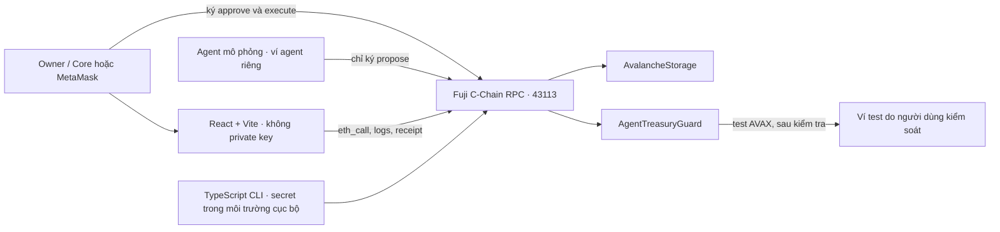
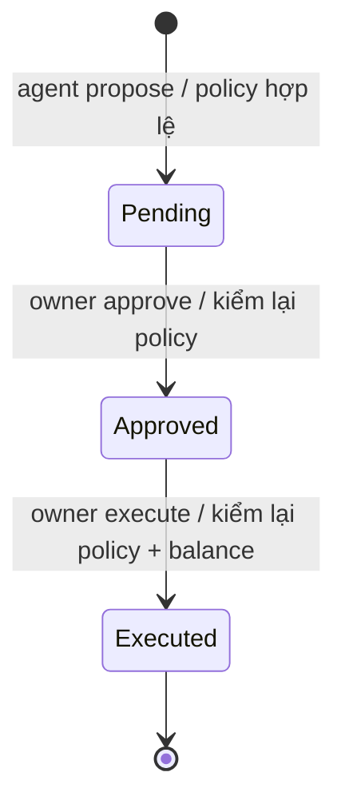

# Kiến trúc Avalanche UniHack Integration PoC

## Lớp smart account bổ sung

Hệ thống có hai luồng song song: demo EOA ban đầu ở dưới và smart account ERC-4337 mới. `UniHackSmartAccount` (OpenZeppelin Account + SignerECDSA + ERC-7821) xác thực UserOperation EIP-712 qua EntryPoint v0.8. Treasury/storage mới có owner là account. Agent chỉ propose; owner ký batch approve+execute, gửi qua relay loopback và EntryPoint. Frontend đối chiếu UserOperationEvent từ RPC, không chỉ outer receipt. [Chi tiết kiến trúc, lệnh chạy và giới hạn](SMART_ACCOUNTS.md).

Relay chỉ nhận owner-signed operation cho account/EntryPoint đã cấu hình, có giới hạn body/gas/fee và hàng đợi gửi. Chưa có public mempool/paymaster/session keys/recovery. Account trả phí qua deposit; outer transaction fee thực đo có thể lớn hơn khoản EntryPoint hoàn cho relayer, nên PoC không cam kết gasless hoặc hoàn đủ phí.

## Hai môi trường tách biệt

- Fuji: public RPC chính thức, chain 43113; mọi lệnh ký xác nhận chain trước và ký với chain đó. Không có cấu hình mainnet trong ứng dụng.
- Local: Hardhat EDR `pocLocal`, hardfork Cancun, chain 31337, chỉ bind loopback. Dùng tài khoản unlocked của node, không nhúng khóa vào frontend. UI phải khởi động với `VITE_NETWORK=local`; mặc định Fuji.
- Deployment manifests và receipts có chain ID. Manifest local không được dùng làm bằng chứng Fuji. Node local lưu trong RAM; khởi động lại phải deploy lại.

## Trạng thái và quyền

`AvalancheStorage`: owner, số `uint256`, `ValueChanged(previous,new,actor)`. Chỉ owner sửa được.

`AgentTreasuryGuard`: owner của OpenZeppelin Ownable; một agent khác owner; mapping allowlist; hạn mức tính bằng wei; `proposalCount`; mapping ID tăng dần đến struct `{ proposer, recipient, amount, status }`.

ID bắt đầu từ 0. ID ngoài `proposalCount` bị từ chối; không dùng trạng thái mặc định của mapping làm đề xuất có thật. Nội dung đề xuất không thể sửa. Chỉ owner approve và execute; agent không có quyền chuyển tiền. `transferOwnership` không được chuyển quyền owner cho agent hiện tại; `setAgent` cũng không nhận owner hiện tại.

Kiểm tra lại recipient còn được cho phép, amount > 0 và trong limit, proposer còn là agent hiện tại ở cả approve và execute. Policy là giá trị hiện tại, không snapshot theo version: nếu owner khôi phục policy cũ thì đề xuất cũ có thể hợp lệ lại. Owner vẫn phải chủ động execute. Không có hủy/hết hạn trong PoC.

Khi execute: kiểm quyền và policy → kiểm balance → đánh dấu Executed → call gửi native test AVAX → event. ReentrancyGuard ngăn gọi lồng; transfer thất bại revert toàn bộ, trạng thái Approved và tiền được giữ nguyên. Không có arbitrary calldata, token approval, delegatecall hay API LLM.

## UI và dữ liệu

UI dùng viem PublicClient cho RPC và EIP-1193/EIP-6963 WalletClient cho Core/MetaMask. PublicClient Fuji đi qua route cùng origin `/fuji-rpc` ở Vite dev/preview, chuyển tiếp cố định đến RPC Fuji thật để xử lý lỗi CORS đã gặp trong trình duyệt. Proxy không giữ khóa và không mô phỏng RPC; hosting khác phải cấu hình cùng route. Đổi account/chain sẽ bỏ kết nối cũ; mỗi lần ký kiểm lại account và chain thực tế. Simulate trước khi ký để hiển thị lỗi custom. Sau gửi phải chờ receipt rồi đọc lại; hash vừa gửi chưa đủ để thông báo thành công.

Allowlist được dựng từ toàn bộ RecipientUpdated kể từ block deploy, quét từng 100 block theo giới hạn thực tế của public Fuji RPC. Proposal đọc trực tiếp mapping (50 mới nhất); history hiển thị 30 events mới nhất của guard và storage trong 2.000 block gần nhất, bắt đầu không sớm hơn block deploy và cũng chia lô 100 block. Đây là cách đơn giản cho PoC mới deploy; cần indexer/pagination/cache cho thời gian hoạt động dài. Revert không có event: CLI E2E lưu receipt thực của từng trường hợp.

UI giữ cache event trong bộ nhớ và lần sau chỉ lấy block mới; batch tối đa 20 RPC call thông thường, chỉ có một lượt refresh đang chạy và polling mỗi 30 giây. Log query dùng transport riêng không batch vì giới hạn 100 block của Fuji áp dụng cho tổng range trong cả batch. Local cho hai request đồng thời; Fuji đọc tuần tự và nghỉ ít nhất 500 ms giữa các request log để tránh rate limit. Khi gặp HTTP 429, không retry ngay và chờ Retry-After (mặc định 60 giây). Cache chỉ chứa dữ liệu đã đọc thật từ RPC; không giả lập kết quả khi bị rate limit. Panel AA đọc state mỗi 60 giây và không quét lịch sử log toàn mạng.

Để tránh quét lại lịch sử dài khi cold start, `history:checkpoint` đọc log RPC thật và tạo `frontend/public/history.fuji.json` kèm chain/address/through/blockHash. UI kiểm block hash qua RPC trước khi dùng checkpoint, rồi lấy các block mới; storage, balance, nonce và policy state vẫn đọc RPC hiện tại. Checkpoint là cache lịch sử có nguồn gốc RPC, không phải dữ liệu mô phỏng. Cần cập nhật checkpoint khi chạy lâu hoặc thêm indexer production.

CLI ký bằng biến môi trường cục bộ `.env` (dotenv); không có backend web nhận secret. Frontend chỉ có ABI và manifest công khai, không import thư viện scripts. Không có server agent ký thay owner.

## Giới hạn tin cậy

Owner có toàn quyền chính sách, có thể tăng limit hoặc thay agent. Phí test AVAX do ví người gửi thanh toán. Native transfer là bề mặt external call; đã có test recipient độc hại. Chưa audit độc lập. Ownable vẫn có renounce/transfer; làm mất owner có thể khóa quỹ vĩnh viễn. Hackathon tiếp theo nên dùng multisig + chuyển quyền hai bước, hạn mức tổng theo ngày, pause, cancel/expiry và quản lý khóa agent ngoài tiến trình ứng dụng.
