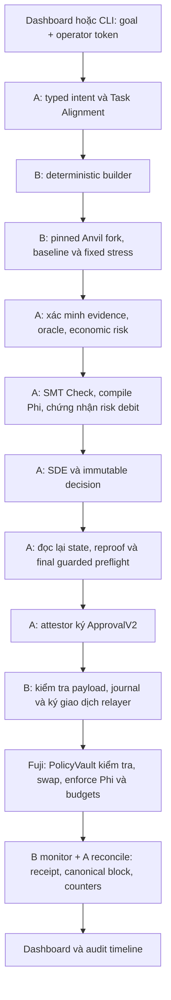

# Hệ thống hiện tại: ví, luồng xử lý và vai trò Python/Node.js

Tài liệu bám theo mã V2.1 đang có trong repository. Hướng dẫn thao tác: [local/Fuji demo](demo/AVALANCHE_FUJI_DEMO.md). Cấu hình đã chuẩn bị trên máy hiện tại: [environment status](demo/ENVIRONMENT_STATUS.md). Đây là demo treasury với hai token mock, một adapter allowlist và một PolicyVault; chưa tích hợp DEX hay oracle giá thị trường thật.

Để phân biệt đầy đủ thành phần với đã tích hợp thực tế, xem [bảng đối chiếu V2.1 và checklist merge oracle](migration/v2_1_readiness_review.md).

## 1. “Test thực” nghĩa là gì?

| Chế độ | Phần thực thi | Cần ví hoặc tài khoản ngoài? |
|---|---|---|
| MOCK | Dữ liệu/receipt fixture để xem giao diện và logic | Không |
| LOCAL | Hai API Python, proof, chữ ký và giao dịch EVM thật trên Anvil riêng | Không; công cụ sinh khóa và cấp balance trên node local |
| FUJI | Hai API Python, proof, chữ ký và giao dịch được public Avalanche Fuji ghi nhận | Cần các ví test có private key và test AVAX trả gas; không cần nối ví vào dashboard |

LOCAL kiểm tra hệ thống chạy thật nhưng không có public-network inclusion. FUJI bổ sung public RPC, gas, confirmation và tx hash tra explorer. Cả hai hiện dùng **MockUSDC/MockWAVAX/MockSwapAdapter** và giá controlled demo; chạy trên Fuji không biến mock swap thành giao dịch DEX/tài sản thật.

Fuji C-Chain là chain **43113**; mainnet C-Chain là **43114**. RPC mặc định `https://api.avax-test.network/ext/bc/C/rpc`. Tham số chính thức: [Avalanche Primary Network](https://build.avax.network/docs/primary-network). Không cần tự chạy Avalanche validator/node; hệ thống dùng public RPC và Anvil fork cục bộ để mô phỏng.

## 2. Có phải gắn ví thật không?

**Không cần kết nối MetaMask/Core/WalletConnect vào ứng dụng.** Dashboard dùng operator token, không có flow “Connect Wallet”. Backend ký bằng các private key đã cấu hình cục bộ. Địa chỉ công khai một mình không đủ để ký; hệ thống cần private key của các ví test cho đúng vai trò.

Tạo một địa chỉ blockchain không yêu cầu đăng ký tài khoản với Avalanche hoặc tạo tài khoản ở sàn. Có thể sinh cặp khóa/địa chỉ cục bộ. Faucet/RPC provider có thể có điều kiện truy cập riêng; đó là dịch vụ cấp gas/kết nối, không phải tài khoản blockchain bắt buộc.

| Vai trò | Khóa cấu hình | Việc ký | Cần test AVAX? |
|---|---|---|---|
| Owner/deployer | `B_FUJI_OWNER_PRIVATE_KEY` (hiện tham chiếu `DEPLOYER_PRIVATE_KEY`) | Deploy, cấu hình policy, tạo/gia hạn session, quyền quản trị vault | Có, cho giao dịch quản trị |
| Attestor | `PACEVANT_ATTESTOR_KEY` | EIP-712 ApprovalV2 sau SDE/proof/revalidation | Không, việc ký này diễn ra offline |
| Relayer | `B_FUJI_RELAYER_PRIVATE_KEY` (hiện tham chiếu `AGENT_PRIVATE_KEY`) | Giao dịch EVM gửi vào PolicyVault, mang theo ApprovalV2/Phi | Có, cho swap/revert |

Ba ví phải khác nhau. Công cụ hiện kiểm tra điều này. Khóa owner không được truyền vào API A/B đang chạy; A có khóa attestor, B có khóa relayer. Attestor/Python library thuộc cùng control-plane process trong MVP này, chưa phải dịch vụ HSM hay một trust boundary phần cứng.

Owner là ví quản trị, **vault contract mới là nơi giữ token treasury**. Relayer không cần sở hữu USDC/WAVAX của treasury, và chữ ký attestor không phải chữ ký giao dịch trả gas. Đây là hai lớp chữ ký khác nhau:

1. Attestor ký quyền thực thi có giới hạn: exact swap, proof/Phi, nonce, deadline, policy, session và debit.
2. Relayer ký envelope giao dịch EVM và trả gas để nộp quyền đó vào vault.

Nếu không đủ test AVAX, người vận hành cần nhận/chuyển test AVAX tới địa chỉ owner/relayer. Dùng [Avalanche faucet chính thức](https://build.avax.network/console/primary-network/faucet); yêu cầu đăng nhập/xác minh nếu có phụ thuộc faucet. Không có bước nạp AVAX cho attestor chỉ để ký.

## 3. Các thành phần và ngôn ngữ

| Thành phần | Công nghệ | Mã chính |
|---|---|---|
| Control plane A | Python, FastAPI, SQLite | [apps/control-plane/app](../apps/control-plane/app/) |
| Execution plane B | Python, FastAPI, Web3.py, eth-account, SQLite | [apps/execution-plane/app](../apps/execution-plane/app/) |
| Proof engine dùng chung | Python encoder/exact arithmetic, Z3 solver | [proof.py](../packages/contracts-api/treasury_contracts/proof.py) |
| Guard và token/adapter mock | Solidity, thực thi trên EVM | [contracts/src](../contracts/src/) |
| Dashboard | HTML/CSS/JavaScript chạy trong trình duyệt, A phục vụ static assets | [apps/dashboard](../apps/dashboard/) |
| Compiler/test/node fork | solc, Forge và Anvil; Forge/Anvil là native binaries | [foundry.toml](../foundry.toml) |
| Tooling điều phối | Python/native Foundry; npm/viem tùy chọn cho development | [foundry.py](../scripts/foundry.py), [treasury.py](../scripts/treasury.py) |

**Backend nghiệp vụ vẫn là Python. Không có Express/NestJS hoặc Node.js API server trong kiến trúc hiện tại.** A và B đều chạy Uvicorn/FastAPI. Planner hiện là deterministic typed planner cho các câu lệnh swap hỗ trợ, không gọi một LLM provider; vì thế không cần OpenAI API key cho demo hiện tại.

## 4. Backend hiện đã bỏ yêu cầu Node.js

Các đường build/chạy backend gọi native Foundry trực tiếp qua Python:

- `scripts/foundry.py`, operator CLI và B local bootstrap gọi binary Forge trực tiếp.
- `scripts/bootstrap.py` cài OpenZeppelin 5.6.1 từ commit/archive hash cố định vào `lib/`; không dùng npm để resolve Solidity imports.
- Docker build stage compile bằng Forge/solc; runtime giữ Python, Anvil và `out/`, không có Node/npm/Forge/solc.
- Hợp đồng sau deploy thực thi trên Fuji EVM. Không compile Solidity trong mỗi request API.

Chạy bằng Python:

```powershell
uv sync --locked
uv sync --project apps/execution-plane --locked
uv run --locked python scripts/bootstrap.py
uv run --locked python scripts/treasury.py local
```

Máy development cần native Foundry v1.7.1 trên PATH hoặc `.tools/foundry/`, hoặc dùng Docker. npm aliases và viem golden tests vẫn là tooling development tùy chọn. Máy đã cài npm trước đây có fallback dùng executable Foundry native sẵn trong node_modules mà không chạy Node; có thể chuyển binary sang PATH để bỏ cả thư mục đó.

JavaScript dashboard chạy trong trình duyệt, không yêu cầu Node trên server. Native Anvil khác Node.js. Xem [runbook Render/VPS không Node.js](deployment/PYTHON_BACKEND_RENDER_VPS.md) cho Dockerfile, persistent disk và runtime env không có owner key.

## 5. Luồng bootstrap trước khi giao dịch

`scripts/treasury.py` đọc root `.env` qua `treasury_ops.Profile`; `--network` chọn rõ LOCAL hoặc FUJI. Với các lệnh `treasury:*`, mode truyền cho process con có ưu tiên; giữ `PACEVANT_MODE=MOCK` trong file không ngăn lệnh `--network fuji` chạy đúng FUJI.

1. `init-env`: thêm biến thiếu, sinh token dịch vụ; tùy chọn sinh attestor cục bộ. Không deploy.
2. `doctor --live`: chỉ đọc RPC, kiểm tra chain ID, định dạng/tách vai trò, owner config, balance gas và historical read. `configuration_ready=true` không có nghĩa đã deploy hoặc đã đủ phí cho mọi giao dịch tương lai.
3. `deploy --network fuji`: owner gửi giao dịch tạo MockUSDC, MockWAVAX, MockSwapAdapter và PolicyVault mới; bật V2, đặt policy/session và mint token demo. Đây là lần đầu bước này thay đổi trạng thái Fuji.
4. `prepare`: đối chiếu code hashes, signer, registry, policy và session từ chain; tạo mandate và controlled oracle file cho đúng vault. Manifest V2 riêng với V1.
5. `serve`: khởi động A tại 8000, B tại 8001 và heartbeat controlled oracle. Trên Fuji, heartbeat chỉ đọc chain rồi cập nhật file oracle cục bộ; không gửi giao dịch oracle lên chain. Giá nominal mặc định mock USDC=$1, mock WAVAX=$20; không lấy quote của adapter làm oracle tin cậy.

Các giới hạn trong `.env` chỉ có hiệu lực on-chain sau giao dịch owner cấu hình vault. `TREASURY_OWNER_POLICY_APPROVED=true` không tự deploy, tự ký swap hoặc tự chuyển tài sản.

## 6. Luồng một workflow từ goal đến receipt



Các bước có thể dừng sớm, không phải yêu cầu nào cũng đi đến chữ ký:

1. **Nhận goal.** CLI/dashboard gọi `POST /v1/workflows/start` vào A, kèm operator bearer token. A tạo workflow ID. Ví dụ hỗ trợ: `Buy WAVAX with 200 USDC`; reverse chỉ được phép khi cap WAVAX lớn hơn 0.
2. **Planner và Alignment.** Tạo typed proposal từ mandate; kiểm tra ý nghĩa goal, token, router, chain, recipient=vault và các điều kiện. Mơ hồ hoặc lệch mục tiêu bị từ chối/escalate.
3. **Build tại B.** A gọi B `/v1/build`. B chọn đúng adapter/function, amount, minOut, nonce/deadline, encode calldata và lưu immutable build. Không có arbitrary target call do LLM quyết định.
4. **Mô phỏng tại B.** `/v1/simulations` chạy exact guarded path trên Anvil fork tại block xác định. Thu số dư/allowance trước-sau cho hai asset, logs/traces, baseline và mild/adverse stress cố định. Test signer trong fork chỉ phục vụ mô phỏng, không có quyền ký Fuji. Source chain không nhận giao dịch simulation.
5. **A kiểm tra evidence và economic risk.** Đối chiếu manifest/hash/block/code từ B với RPC, freshness, balances, oracle nguồn cho phép, spend/size/slippage, chi phí gas và projected WAVAX exposure. A tự đọc verification RPC thay vì chỉ tin B; cấu hình mặc định có thể dùng cùng public provider, nên không đồng nghĩa độc lập nhà cung cấp. Không coi response của B tự động là bằng chứng đáng tin.
6. **Proof.** Shared `PGSProofEngine` chạy assumptions SAT, Check UNSAT, compile signed Phi, kiểm tra vùng khả thi và Compile UNSAT; tính upper bound lỗ bằng exact arithmetic và chứng nhận bằng solver. `SAT` counterexample, `UNKNOWN`, timeout hoặc thiếu dữ liệu không tạo quyền ký. Phi gồm lower bounds tracked token delta và allowance caps; risk debit là reservation bảo thủ, không phải realized PnL.
7. **SDE duy nhất.** Kết hợp alignment, V1 gates và proof để quyết định `APPROVE`, `REPLAN`, `REJECT`, `ESCALATE`. Decision/proof/Phi lưu bất biến. REPLAN tối đa hai lần, tạo proposal/build/evidence/proof mới; không dùng lại quyền cũ cho calldata mới.
8. **Trước khi ký.** Attestor lấy immutable decision ID, đọc lại policy/balances/nonce/session/oracle, reproof, đối chiếu hashes và chạy exact compiled Phi/debit qua final guarded fork preflight gồm baseline và fixed stresses. Thay đổi có ý nghĩa hoặc hết deadline làm từ chối.
9. **Hai chữ ký.** Attestor ký ApprovalV2 EIP-712 domain version 2, gắn chain/vault, call, evidence/proof/Phi, policy, session, debit, nonce/deadline và thông số swap. B `/v1/executions` đối chiếu build/PDR và state, lưu signed raw transaction vào durable journal trước broadcast; relayer ký envelope EVM để trả gas. Retry dùng cùng raw bytes, không tự tạo trade khác.
10. **Vault quyết định cuối cùng.** Kiểm tra pause/policy/attestor/domain/signature, nonce/deadline, allowlists, calldata bindings, session/day/global headroom và caps theo chiều. Snapshot token/allowance, cập nhật nonce/budgets trước lời gọi ngoài theo CEI, cấp allowance tạm, gọi adapter, dọn allowance và kiểm tra actual deltas với Phi. Accounting chỉ commit khi toàn bộ giao dịch thành công. Mọi thay đổi nằm trong một giao dịch atomic; lỗi làm revert token state, nonce và counters, nhưng người gửi vẫn chịu gas.
11. **Monitor/reconcile.** B đọc receipt/canonical block/confirmations/actual deltas và counters; A đối chiếu outcome rồi cập nhật timeline. CLI/dashboard poll workflow API để A gọi B monitor và reconcile; không có Node.js worker/message broker riêng. Tx hash một mình chưa phải `CONFIRMED`. Pending/reorg/receipt mismatch giữ trạng thái tương ứng và tránh ký thêm trong lúc chưa rõ kết quả. Hai protected reverts liên tiếp cùng policy có thể quarantine attestation để tránh gas grief.

SDE/attestor là điều kiện trước khi gửi; **vault on-chain là nơi enforce tại inclusion** khi state có thể đã đổi. Vault kiểm tra trusted attestor signature/debit, không tự chạy Z3 hoặc xác minh SMT proof trên chain.

## 7. Ví dụ số với cấu hình demo hiện tại

Vault mới có 7.700 mock USDC và 115 mock WAVAX. Tại giá nominal 1/20, tổng giá trị mô hình là $10.000, WAVAX chiếm 23%.

- Buy 200 USDC, nominal quote 10 WAVAX; legacy slippage 1% cho minOut 9,9 WAVAX.
- Tolerance Phi 40 bps cho lower output khoảng 9,96 WAVAX; input exact 200 USDC và allowance còn lại phải bằng 0.
- Trong band 1%, worst-corner giá input 1,01 và output 19,8: loss bound = `200 × 1,01 − 9,96 × 19,8 = 4,792 USD`.
- Với relative loss 3%, fixed loss 0, giới hạn relative tại outgoing $202 là $6,06; bound này đạt yêu cầu. Debit `479200000` USD-e8 được reserve vào session/global, kể cả nominal actual loss bằng 0.
- Khi swap thành công, daily USDC spend tăng 200 và projected nominal WAVAX exposure lên 25%. Lần mua sau có thể bị chặn vì exposure dù còn risk budget. Đây là các gate độc lập.

Các số này giải thích modeled demo, không phải giá AVAX thị trường hay hứa mọi swap sẽ pass. Proof/Phi thực tế phải tính lại từ build/evidence hiện tại. Default reverse cap vẫn 0; user phải chọn cap dương nếu muốn demo chiều bán. Exposure 25% hiện là **pre-sign check**, không có on-chain oracle allocation guard.

## 8. API, lưu trữ và trạng thái để theo dõi

| Nơi | Dữ liệu / API |
|---|---|
| A, operator auth | `/v1/workflows/start`, `/v1/workflows/{id}`, `/v1/treasury`, `/v2/proofs/{context_hash}`, `/v2/treasury/sessions/{session_id}` |
| A, internal auth | `/v1/approvals/attest` chỉ nhận immutable decision ID; không nhận một payload tùy ý để ký |
| B, service API key | `/v1/build`, `/v1/simulations`, `/v2/simulations/preflight`, `/v1/executions`, `/v1/executions/{tx_hash}`, chain context/snapshots/artifacts |
| `.control-data-v2/fuji/` | SQLite workflow/events/decisions/attestations/proof/Phi, content-addressed SMT query files, mandate/oracle, reports/logs |
| `.execution-data-fuji-v2/` | Immutable build/evidence/artifacts, idempotency records và durable raw-tx journal |
| `deployments/treasury-fuji-v2.json` | Manifest public: chain/vault/token/adapter, code hashes, policy/session, deployment block/transaction metadata |
| Chain | Số dư, nonce đã dùng, session/global risk, USDC day spend và event/receipt authoritative |

Các service token khác nhau: `PACEVANT_OPERATOR_TOKEN` cho operator/dashboard, `PACEVANT_INTERNAL_TOKEN` cho signer endpoint, `B_API_KEY` cho A gọi B. Token không thay thế private key. Dashboard không nhận các khóa ví. DB không phải một budget ledger cạnh tranh với chain.

Timeline thường thấy: `PROPOSED → ALIGNED → BUILT → SIMULATED → EVALUATED → PROVED → APPROVED → ATTESTED → SUBMITTING → SUBMITTED → CONFIRMED`. Các nhánh: `REPLAN_REQUIRED`, `REJECTED`, `ESCALATED`, `REVERTED`, `PROOF_REJECTED`, `PROOF_INCONCLUSIVE`, `EXPIRED`, `FAILED_TO_SUBMIT` hoặc `RECEIPT_MISMATCH`. Receipt pending giữ workflow ở `SUBMITTED`; reorg đưa workflow về `SUBMITTED` với reason `REORG_RECONCILIATION` để đối chiếu tiếp. `PROVED` chứa các verdict Check/Compile/risk; code không phát ba event giả riêng để làm đẹp timeline. Protected revert được đánh dấu reason code trong outcome khi nhận diện được nguyên nhân.

Hệ thống chưa audit; bảo đảm proof phụ thuộc token mock truthful, oracle band/source đáng tin, registry đầy đủ, RPC nhất quán, owner/attestor và vault không bị compromise. Xem [proof assumptions](security/proof_assumptions_v2_1.md), [policy coverage](security/policy_coverage_v2_1.md), [test/evaluation evidence](migration/v2_1_progress.md).
