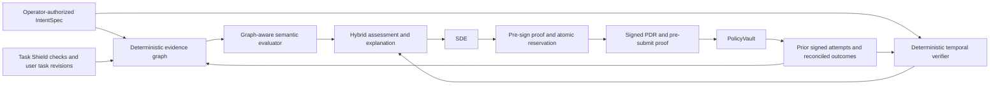

# Intent-Aware Temporal Action Graph

ITAG layers per-intent authorization over the existing Task Shield, simulation, portfolio observation, Economic Risk, SDE and EIP-712 signing flow. The PolicyVault contract and PDR wire format are unchanged.



## Intent lifecycle

The authenticated operator registers an intent with `POST /v1/itag/intents` and supplies `temporal_intent` containing `spec_id`, `revision` and `step_id` when starting a workflow. Authentication uses the existing operator bearer token. This also applies in MOCK. Clients need to configure an active Task Shield profile. Set `PACEVANT_REQUIRE_ITAG=1` to require a structured intent for every new workflow and gate signing of older approvals. The compatibility default also accepts legacy workflows through their existing checks.

| Kind | Authorized action | Completion |
| --- | --- | --- |
| `ONE_SHOT_SWAP` | Exact input amount for one swap | One verified successful outcome |
| `BOUNDED_SWAP` | Repeated swaps with per-action min/max and one shared budget | Verified spend reaches the total budget |
| `ORDERED_TASK` | A sequence of identified swaps with per-step amounts and prerequisites | Every step has a verified successful outcome |

Amounts are integer strings in token base units. An intent binds the configured mandate digest, policy hash, chain, vault, router and token pair. `objective` optionally records the operator's natural-language purpose on the stable intent. The numeric and address constraints always govern spending. Separate Task Shield task extraction remains scoped to the workflow and contributes semantic evidence. A workflow's goal text has no write path to the IntentSpec.

A proposed intent is inert until the operator authenticates a revision. Replacing an authenticated intent preserves its kind, step identities and mandate scope. A revision retains history under the stable ID. Cancellation blocks new work and invalidates unsubmitted approval proofs. Historical revisions are read-only and surfaced as superseded. A separate, explicit new intent establishes a separate budget.

For a local demo, submit these terms with a future Unix deadline within the active mandate. The example authorizes a single 100-USDC swap using six-decimal base units.

```json
{
  "kind": "ONE_SHOT_SWAP",
  "mandate_id": "mandate_demo",
  "objective": "Buy WAVAX with 100 USDC once for the treasury vault.",
  "deadline": 2000000600,
  "total_budget": "100000000",
  "steps": [{"step_id": "swap", "min_amount": "100000000", "max_amount": "100000000"}]
}
```

Send `POST /v1/workflows/start` with the same `mandate_id`, `goal` set to `Buy WAVAX with 100 USDC`, and `temporal_intent` using the returned `spec_id` and `revision` with `step_id: swap`. Use the intent history endpoint to retrieve the assessment hash.

## Evaluation and signing

The verifier checks revision and cancellation, precise proposal/build scope, cumulative confirmed spend, reservations, task completion, prerequisites, outcome integrity and cross-workflow scope. Ordered tasks protect the minimum required for later steps. A confirmed action requires matching decision/build/transaction IDs, chain/vault/policy, a canonical verified receipt, matching input delta, output at least the signed minimum and persisted pre/post observations. A similarly verified revert grants no completion credit and releases that reservation. An unresolved signature, unknown submission or inconsistent receipt keeps the reservation and escalates. Snapshot invalidations and revised outcome projections change the history read by ITAG.

The trajectory model reads the structured intent, selected step, candidate, scoped earlier proposals, verified outcomes and Task Shield context. It returns a validated, bounded report. Explicit drift or contradiction vetoes. Missing or ambiguous semantic evidence escalates. SDE applies the strongest of its existing verdict and the temporal verdict. A recoverable budget violation can replan to a smaller amount, and the new candidate repeats all checks.

SQLite stores intent revisions, workflow bindings and assessment graphs immutably. The Attestor checks the assessment digest, graph digest, active intent and deadline, Task Shield revision, current history version and ledger digest, candidate/build hashes, simulation root and pre-snapshot binding inside the transaction that reserves a PDR. The pre-submit transaction checks the same inputs while excluding the candidate's own reservation from the prior ledger. Existing wallet, simulation, portfolio and risk checks remain in the approval path. Model calls run outside SQLite write transactions and there is no semantic cache. The approval TTL remains 30 seconds.

`ITAG_ASSESSED` records graph, verifier, semantic, SDE and workflow wall time through SDE, including extraction and replans when applicable. Its wall clock ends before attestation. Provider latency can consume the candidate deadline. The safe result is to withhold approval and obtain fresh evidence for another attempt.

## Operating limits

ITAG supports the existing swap shape and operator trust model. Enforce the gate on all signing instances sharing the vault if intent limits are a deployment requirement. The SQLite reservation coordinates writers sharing a database. Independent signer instances with independent databases would need a shared authoritative ledger. The unmodified Vault still enforces its own mandate-level caps.

The monitor establishes and invalidates the receipt history against chain data. ITAG reads that durable history and its version during approval. An older reorg can only affect ITAG once reflected by the monitor or an invalidation. Keep reconciliation running for on-chain deployments. Ambiguous past outcomes are intentionally held for review. The history scan fails closed above 256 signed attempts. A long-lived intent or heavily instrumented workflow may exceed the bounded semantic context. These limits need load testing before production use.
