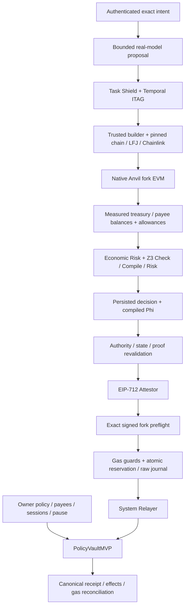

# PaceVant — Hiện trạng MVP hai nghiệp vụ và khả năng chạy Avalanche Fuji

> **Cập nhật giao diện và deployment mới nhất:** React/TypeScript/Vite + Tailwind + Radix/shadcn + Motion/Lucide/TanStack Query thay entrypoint judge cũ. Website có đúng ba tab, anonymous fixed-preset Judge API, isolated Fuji forks, durable quota/idempotency và verified replay có nhãn. Native Ubuntu/systemd/Nginx là đường triển khai hiện hành, không Docker. Xem [implementation summary](../IMPLEMENTATION_SUMMARY.md), [judge guide](../JUDGE_DEMO_GUIDE.md), [VPS deployment](../VPS_DEPLOYMENT.md). Nội dung operator/vanilla/container ở các checkpoint bên dưới giữ tham chiếu lịch sử; public MVP migration vẫn chưa được thực hiện.

### Lớp mới không thay core security

`api/judge.py` chỉ nhận scenario payment/swap/guard cố định, không nhận token/recipient/calldata tùy ý. `modules/workflows/judge.py` quản lý anonymous jobs/quota và một subprocess group, dùng SQLite riêng. `operations/judge_worker.py` gọi shared `operations/fork_treasury.py`, sau đó **TreasuryWorkflows/MvpExecution cũ** thực hiện model → Shield/ITAG → builder/oracle/EVM → Risk/Z3/SDE → attestation/Phi → exact preflight/relay/receipt. CLI verifier cũng dùng shared preparation, không copy một engine PACE/PGS thứ hai.

Default service không có public Owner/Attestor/Relayer keys, không tự deploy hoặc chuyển public assets. Temporary fork keys được tạo trong memory; copied-state funding/role setup chỉ trên native loopback Anvil. Progress callback là stage chạy thật; completion lấy persisted evidence. Public errors không trả raw provider exceptions/secrets.

Giới hạn mặc định: một heavy job, 6 visitor runs/ngày, 6 starts/IP/giờ, global 30/ngày, 240 giây/job, service memory 2.8 GB/CPU 180%/192 tasks. Nginx chặn admin/execution/debug/docs và thêm IP/body rate limits. Timeout dọn owned process group; restart đánh dấu job interrupted, không tự resend. Evidence replay pin SHA-256, label VERIFIED_REPLAY, không explorer public.

Judge controller đã chạy real-provider payment CONFIRMED, kể cả browser mất POST response/reload không tạo duplicate. Guard mới bị chặn tại builder: `LFJ_UNSUPPORTED_ROUTE`. Lần swap API mới qua PROOF VERIFIED và exact preflight nhưng dừng trước relay: UNKNOWN / SIGNED_REQUIRES_RECOVERY, `TREASURY_WORKFLOW_FAILED`, chưa có receipt và chưa xác định exception gốc. Các lần chẩn đoán tiếp không vào được fresh Chainlink window; đã bổ sung exception class an toàn vào recovery evidence. Không tự resend hay nới economic/oracle policy. Cả ba scenario có replay thật, ghi rõ checkpoint; positive recorded swap cũ không bị gọi là live API success mới. Xem [acceptance](audit/judge-api-acceptance.json), [test report](../MVP_TEST_REPORT.md), [deployment report](audit/judge-deployment-report.json). Linux đã kiểm là Ubuntu 24.04 WSL; chưa có SSH/domain Ubuntu 22.04 VPS nên chưa claim deployment accepted hay multi-day soak pass.

> **DOC STATUS: CURRENT_MVP_REVIEW_PACK** — cập nhật **21/11/2026, Asia/Saigon**, theo source phát hành và bằng chứng thực thi. Dùng SHA mới nhất trên `origin/develop` để xác định release; các commit/checkpoint lịch sử bên dưới không đại diện cho toàn bộ frontend/judge hiện tại.
>
> Bản này thay thế review cũ. Demo User/HMAC/sponsor billing không còn là luồng sản phẩm hiện hành. Phân biệt rõ **public Fuji**, **Anvil fork từ Fuji thật** và **local fixtures**. Không chứa private key/API key/service token.

## 1. Hệ thống hiện chạy được đến đâu?

**Backend đã thực thi thành công cả hai loại giao dịch qua toàn bộ pipeline với model thật, Circle USDC của Fuji, LFJ và Chainlink thật trên fork EVM cô lập của Fuji.** Economic risk, Z3, chữ ký, Solidity, receipt và đối soát gas chạy thực; không dùng balance/quote/proof/receipt hardcode để cho pass.

**MVP mới chưa được deploy lên public Fuji.** Contract công khai vẫn là V2: hỗ trợ forward swap, adapter không reverse, vault chưa có payment receipt-checked. Cần Owner triển khai/configure vault và adapter mới, cấp vốn, ký manifest rồi kích hoạt runtime. Thay env không bổ sung chức năng vào immutable contract cũ.

| Câu hỏi | Trạng thái có căn cứ |
|---|---|
| Có từng chạy giao dịch public Fuji? | Có. Receipt V2 forward swap `0x315a9bff8ba111487d295903ebd0f6389b1baefd40ea9526fc33bc014a9656ba`, block `61375517`, đã kiểm tra lại canonical và status 1. Đây là evidence lịch sử. |
| Hai loại giao dịch MVP có code hoàn chỉnh? | Có: `SWAP_EXACT_IN`, `USDC_PAYMENT`, qua các gate và contract mới. |
| Hai loại đã chạy với dữ liệu/token/DEX/oracle Fuji thật? | Có trên **ANVIL_FORK**, source block `61388824`, model thật; cả hai CONFIRMED, proof VERIFIED, exact signed preflight không sửa storage. |
| Payment MVP mới đã settle public Fuji? | **Chưa**, chưa deploy/fund/activate vault MVP công khai. |
| Swap hai chiều có executable EVM route? | Adapter mới direct V1 đã thực thi cả hai chiều trên fork. |
| Reverse có thể được approve với pool hiện tại? | Đang bị chặn: official quoter chọn route ngoài V1; V1 còn lệch reference khoảng 98,86%. Không nới policy để ép pass. |
| Chỉ cần lấy ví rồi bấm demo public? | Sau bước Owner migration và runtime readiness. Operator gửi intent; Attestor ký PDR, Relayer trả gas. Frontend không nhận private key. |
| Attack Lab có phải điều kiện chạy MVP? | Không. Giữ negative/security tests và gates; hoãn mở rộng kịch bản/UI tấn công. |

## 2. Phạm vi hiện hành

Single-tenant treasury của hệ thống, ba EOA **OWNER / ATTESTOR / RELAYER**. PolicyVault là contract giữ tài sản, không phải EOA thứ tư. Không onboarding/custody nhiều user, SaaS hay customer gas billing.

| Nghiệp vụ | Hành vi được phép |
|---|---|
| `SWAP_EXACT_IN` | Circle test USDC ↔ Fuji WAVAX; exact input; direct approved LFJ V1 pool; output về PolicyVault; quote, Chainlink, simulation, risk/proof/Phi bắt buộc. |
| `USDC_PAYMENT` | Circle USDC từ PolicyVault đến EOA Owner duyệt; exact amount; cap per-payment/payee/session/day; đo đủ số USDC người nhận thực nhận. |

Rebalance chỉ điều phối swap, không là nghiệp vụ thứ ba; có local tests nhưng không cần bật autonomy cho demo thủ công.

Lending/borrow/repay, investment-vault deposit/redeem, staking, LP, bridge, multihop, LB-bin routing, native AVAX/WAVAX payments, arbitrary ERC-20 transfer/approval/call đều **DISABLED** trong live MVP. Research V3 được giữ ngoài live registry, không mở rộng protocol trong đợt này.

## 3. Kiến trúc và luồng xử lý



Core là modular monolith Python 3.12/FastAPI/Uvicorn; control và execution cùng process, khác trách nhiệm/module. Public judge service là adapter riêng, chỉ gọi fixed isolated-fork workflow qua subprocess giới hạn tài nguyên. Frontend hiện tại React/TypeScript/Vite build static qua Nginx; vanilla modules giữ compatibility/research. Node chỉ build/developer tooling. Solidity enforce trên EVM; model/Z3 chạy off-chain.

Attestor và Relayer cùng trust domain/process, không phải HSM/physical key isolation. Serving không cần Owner signer. Owner quản trị bằng ví riêng; AI treasury không có Owner key/admin selector. Native subprocess nhận environment lọc, nhưng host/operator vẫn là trusted computing base.

Model chỉ đề xuất/giải thích exact operator-authorized terms. Không được sửa token, amount, recipient, operation, policy, target hoặc calldata. Provider lỗi không tự chuyển sang mock trong live path.

## 4. Ma trận module/source hiện tại

Backend paths tính từ `backend/src/treasury_backend/`. “Full fork” nghĩa là dữ liệu source từ Fuji và local EVM execution; không đồng nghĩa public deployment đã nghiệm thu.

| Module / source | Trách nhiệm và tình trạng |
|---|---|
| `api/app.py`, `api/control/`, `api/mvp.py` | Composition/auth/lifecycle/monitor; API typed hai operation. MVP active chặn legacy execution mutations và old start/propose/attest, giữ read/history/recovery. |
| `config/control.py`, `config/execution.py`, `core/` | Typed settings/DTO/errors; signed manifest + explicit live-enable, same chain/RPC, gas ceilings. Không lấy authority từ model. |
| `modules/planning/treasury.py` | Structured real proposal, exact operation/tokens/recipient/amount. Đã chạy model thật local/full fork. Legacy GoalPlanner giữ compatibility; free-form text không tự cấp quyền. |
| `modules/planning/rebalance.py` | Integer target/deviation/amount/cooldown, only swaps; optional, không bắt buộc demo thủ công. |
| `modules/alignment/` | Task Shield, authenticated objective/provenance, tool/result interception; `create_operation` nhận registry MVP. Shared semantic/deterministic vetoes được giữ; đã qua full fork. |
| `modules/temporal/operations.py` / ITAG | Exact intent/build/session/scope, history/pending/cooldown, graph/citations/semantic verdict. Fail/unknown/sai terms không ký. |
| `modules/portfolio/` | Giữ legacy readers. MVP dùng balances/prices/authority của pinned `MvpChain.context`; không dùng frontend cache làm authorization. |
| `modules/oracle/chainlink.py` | Real exact-asset feeds, round/answer/decimals/code/freshness; MVP thêm Owner signing window. Không rewrite updatedAt để làm mới giả. |
| `modules/risk/operations.py` | Operation-specific measured effects/receipt, oracle window, allowances và gas economics. Payment principal tách trading loss. Hai nghiệp vụ full fork PASS. |
| `modules/proof/`, SDK proof engines | Giữ legacy wrapper/engine; thêm receipt-credit/fixed-operation proof, rational units, stable query serialization, shared solver lock. MVP dùng shared Z3 engine, không certificate hardcode. |
| `modules/decision/service.py` | SDE conjunctive gates, bind intent/build/effects/risk/proof/ITAG hashes. Không force-approve arbitrary JSON. |
| `modules/signing/service.py` | Revalidate, re-solve proof, verify persisted bindings, durable sign-once, EIP-712. Không ký admin Owner. |
| `modules/persistence/`, `persistence/v3.py` | Additive SQLite migrations, immutable evidence, idempotency/pending claims/signing reservation/history; không reset DB/nonces/budgets cũ. |
| `modules/workflows/treasury.py` | Full coordinator hai operation; lưu stages/reject reason; exact final preflight, relay và reconcile. Hai full-fork workflows CONFIRMED. |
| `modules/workflows/autonomy.py` | Explicit enable và owner scopes/action/cooldown; stop khi reject/uncertain. Read-only observer vẫn chạy khi autonomy off. |
| `modules/workflows/readiness.py` | Read-only checks cho từng preset/route, oracle window, policy/session/startsAt/actions, balances/payee/day/gas/pending. Không build/allocate nonce/sign/send. |
| `modules/execution/mvp.py` | Signed registry, exact assets/roles/code/session/payees/budgets/oracle/physical gas balances. REAL_FUJI buộc ba public roles hiện có; local/fork buộc loopback Anvil. |
| `modules/execution/v3/builder.py` | Shared fixed-call builder thu hẹp bởi MVP; canonical call/amount/min-output/hash/nonce, route/quoter/reserves/impact/reference checks. Research branches không đến được qua MVP schema. |
| `modules/execution/v3/simulation.py` | Native fork EVM; actual pre/post balances/payee receipt/allowances/gas. Exploratory attestor sentinel có override ghi nhãn; final signed preflight không storage override. |
| `modules/execution/dex/lfj.py` | Official quoter + registry/reserves/997 arithmetic, cả hai chiều. Reject wrong pair/version/bin route, không âm thầm dùng LB. |
| `modules/execution/v3/relay.py`, legacy `relaying/` | Verify signatures/domain/identities/state, gas estimate, durable raw journal trước send, idempotency/canonical effect checks. System gas guards không cần Demo User ledger. |
| `modules/monitoring/` | Legacy read-only durable reconciliation/history; MVP observer bổ sung trong autonomy. Unknown/reorg/replacement không biến thành success. |
| `modules/gas_credit/system.py` | System expense ledger, physical AVAX/gas/fee/day limits, atomic reservation+journal, actual fee settlement một lần. Customer-credit code/records cũ ARCHIVE. |
| `modules/experience/` | Legacy retry guidance giữ lại; không cấp thêm authority hay nâng deadline sau ký. Không là dependency bắt buộc của MVP mới. |
| `modules/workflows/attack_lab.py` | Fixed offline Foundry cases, operator-only, lock/rate/timeout, zero public gas/admin. Hoãn mở rộng kịch bản. |
| `operations/profiles.py`, `environments.py`, `services.py`, `container.py` | Operator startup/filtered credentials. MVP serving không cần session V2 đã retire còn active; ưu tiên public Owner identity; container từ chối Owner key. Không auto-deploy/renew/fund. |
| `operations/mvp_local.py`, `mvp_demo.py`, `mvp_protocol_fixture.py` | Disposable LOCAL_TEST, generated local roles. Scripted semantic fixture là explicit opt-in, khác real-provider mode. Không dùng làm public receipt evidence. |

### SDK, contracts, frontend và packaging

| Thành phần | Hiện trạng |
|---|---|
| SDK `mvp.py` | Public schema chỉ hai operation, owner-signed code-hash manifest/ba EOA; internal tags TOKEN_SWAP/TOKEN_PAYMENT. |
| SDK `v3.py`, `proof_v3.py` | Fixed ABI/call/Phi/domain hashing và operation-specific proof; reserved zero balance slot không đưa investment asset vào MVP. |
| `PolicyVaultMVP.sol` | Hai kinds duy nhất; USDC full receipt; separate session/day/recipient spending. Inherited legacy execution và generic research configuration bị vô hiệu hóa. Owner native recovery khi paused không phải AI payment. |
| `PolicyVaultV3.sol` | Shared fixed-operation guard: signature/nonce/session/policy/before balances/Phi/receipt/allowance/risk debit. Research kinds bị MVP override reject. |
| `LFJSwapAdapterV3.sol` | Adapter mới direct V1 hai chiều, immutable vault/router/pair/token identities; đã chạy trên fork, chưa deploy public. |
| `PolicyVault.sol`, `LFJSwapAdapter.sol` | Public V2/source compatibility giữ lại; thêm virtual hooks cần thiết. Public adapter cũ forward-only. |
| `DemoERC4626`, `api/treasury.py`, research V3 UI/tests | Giữ nghiên cứu, không live MVP registry; setting V3 cũ bị canonical startup từ chối. |
| `frontend/treasury-mvp.html`, `src/features/mvp/index.js` | Default single-tenant dashboard/console/security; no Demo User/HMAC/private keys trong bundle. Local Chromium E2E pass. |
| `frontend/src/features/mvp/requests.js`, `terms.js` | Persist exact request trước POST, same-key recovery sau timeout/reload, single-flight, deadline clamp theo oracle/session/policy. Không persist credentials hay tự broadcast từ polling. |
| Backend/frontend Dockerfiles và Nginx | Native Anvil/Forge/compiler cache/public role manifest; MVP landing page và `/mvp/` proxy. Source cập nhật; image/hosting chưa chạy vì Docker Linux engine unavailable. |

## 5. Dữ liệu/thực thi thật và phần mô phỏng

| Thành phần | Nguồn và giới hạn |
|---|---|
| State/identity | Real RPC block/hash, code, policy/session, balances, nonce; không lấy số liệu từ LLM/JS. |
| Assets | Exact Circle USDC 6 decimals/WAVAX 18 decimals. Full fork dùng code/storage từ Fuji, không mock token hay mint Circle. Funding là copied-state transfer trên fork. |
| DEX | LFJ official quoter + adapter quote + independently recomputed reserve math cùng block. |
| USD reference | Chainlink Fuji; underlying AVAX áp WAVAX với wrap 1:1 assumption. Không chứng minh test asset redeemability hay mainnet value. |
| AI | External configured model trong local real-provider run và full-fork hai nghiệp vụ. Scripted fixtures vẫn giữ riêng cho regression. Hai positive runs không là benchmark mọi prompt attack. |
| Simulation | Native Anvil EVM, fork đúng block. Exploratory attestor sentinel và simulation sender gas funding có nhãn; không tiêu public AVAX. |
| Formal proof | Actual Z3 queries, rational/integer arithmetic; không phải ZK proof/full verification Solidity và mọi dependency. |
| Final preflight | Exact operation/Phi/signature; full fork ghi `exact_signed_preflight=true`, `simulation_overrides=[]` cho storage. Không bỏ nhãn fork. |
| Execution/receipt | Relayer signed raw tx và measured effects. Historical V2 receipt public; MVP receipts mới hiện ANVIL_FORK/LOCAL_TEST, public flag false. |
| Gas | Actual gasUsed × effectiveGasPrice và system ledger; phí fork không tiêu AVAX công khai. |

Một số read helpers dùng ABI artifact tên `MockUSDC`/`MockWAVAX` để gọi ERC-20 interface chung. Live addresses và code hashes vẫn là Circle USDC/WAVAX đã xác minh ở bảng dưới; tên ABI không có nghĩa đã thay token bằng mock. Controlled mock contracts chỉ được deploy trong isolated LOCAL_TEST fixtures.

### Public registry đã đối chiếu

| Đối tượng | Address |
|---|---|
| Circle USDC | `0x5425890298aed601595a70AB815c96711a31Bc65` |
| Fuji WAVAX | `0xd00ae08403B9bbb9124bB305C09058E32C39A48c` |
| LFJ V1 pair | `0x8436B8c75ed2F015a80b8472526dd1A79BF54E38` |
| Factory | `0xF5c7d9733e5f53abCC1695820c4818C59B457C2C` |
| Router | `0x18556DA13313f3532c54711497A8FedAC273220E` |
| Quoter | `0x9A550a522BBaDFB69019b0432800Ed17855A51C3` |
| USDC/USD feed | `0x97fe42a7e96640d932bbc0e1580c73e705a8eb73` |
| AVAX/USD feed | `0x5498bb86bc934c8d34fda08e81d444153d0d06ad` |
| Public V2 vault | `0xd8EC86820709505C3779a4Fe5D828e8ADE663E1D` |
| Public V2 adapter | `0x497d967d003717FA49ce16ac6FFf73a399aFe5D4` |

## 6. Economic risk — điều kiện bắt buộc

### Swap

Exact authorized input/token/recipient/route, executable quote, bounded impact/slippage, independent Chainlink/bands, minimum actual output/Phi, exposure, session/day spend, cumulative economic loss, zero residual allowance và gas budget đều được kiểm. Pool drift chỉ được chấp nhận nếu actual effects trong signed Phi; ngoài Phi phải atomic revert.

Policy public đã quan sát: relative loss **300 bps**, fixed floor **0**, oracle band **100 bps**, Phi tolerance **40 bps**, session risk **10 USD**, global daily risk **20 USD**, max signing oracle age **300 giây**. USD là reference accounting, raw units USD-e8, không phải testnet redeemable value.

Pool snapshot có **0,279989 USDC** và **3,725677119596704727 WAVAX**. Reverse input `10^15` WAVAX units quote khoảng **74 USDC units**, trong khi Chainlink fair-output floor khoảng **6497** ở lần đọc đầu đợt: loss **9886 bps**, vượt 300. Official quoter còn chọn pair `0xf3b3ad0c0ef783d45c70fcdd6e50cb9bffa887e4`, version 3 ngoài approved V1. Không thêm LB route hay tăng loss threshold để ép success.

Forward **1 USDC base unit = 0,000001 USDC** đã pass full pipeline trên fork, output **13266545691051 WAVAX units**. Pool rất mỏng; không suy ra swap 1–5 USDC sẽ pass. Sau payment giảm treasury denominator cũng cần kiểm lại exposure.

### USDC payment và PGS credit

Với token-unit balance deltas `Δ`, positive prices `p`, authorized actual-receipt credit `π`:

```text
L(Δ,p) = -Σ Δ[a]·p[a] - Σ π[a]·p[a]
V(Δ,p) =  Σ max(-Δ[a],0)·p[a] - Σ π[a]·p[a]
Policy: L <= relative_loss * V + fixed_floor
```

Credit không vượt authorized amount hoặc actual received; không tin log riêng lẻ hay lời model. MVP yêu cầu **đủ 100% authorized receipt**. Debit/receipt đúng 1 USDC thì economic risk debit 0, payment spending vẫn tăng 1 USDC. Fee-on-transfer/redirection/extra outflow phải fail/revert. Payment không tiêu swap budget và không hoàn risk budget.

Z3 assumptions phải SAT để tránh vacuous proof; CheckMode/CompileMode/risk-bound chỉ pass UNSAT. SAT witness/UNKNOWN/timeout/missing evidence không đủ để ký. USDC 6/WAVAX 18 decimals, rational math, outward price bands, output rounding xuống và debit rounding lên. Signed lower-corner Phi bảo vệ value policy với các giả định positive prices/relative loss < 1; contract enforce actual deltas và exact pre-state atomically.

S1 payee/caps, S2 allowance structure, S3 owner separation, S4 tracked/priced effects có checks cụ thể. Không tuyên bố chặn mọi unsolicited unknown-token transfer. Circle proxy governance, token balance semantics, RPC/host, oracle mapping/bands, trusted Owner/Attestor vẫn là assumptions ngoài chứng minh SMT.

### Bốn ngân sách độc lập

| Budget | Cách áp dụng |
|---|---|
| Swap notional | USD-e8 session/day, exact input và per-operation caps. |
| Payment principal | USDC units per-payment/payee/session/day, không ăn swap spending. |
| Economic loss | Certified nonnegative worst-case loss, session/global daily risk; authorized payment không là trading loss. |
| Gas | Relayer native AVAX, fee/gas/day ceilings và system expense; không customer billing. |

Relay defaults mới: max gas/tx `1500000`, max gas price `5000000000 wei`, max fee/tx `1000000000000000 wei`, daily gas expense `5000000000000000 wei`. Đây là operation relay guards, không phải deploy gas limit. Gas USD reference kiểm riêng theo signed manifest.

### Oracle freshness và khả dụng

Feed-specific original round limits: USDC/USD 86400 giây, AVAX/USD 600 giây. Owner signing window chặt hơn: AVAX round tối đa 300 giây, đồng thời phải thỏa feed validity. Snapshot readiness `61388774` có AVAX round age **577 giây**: đọc feed được nhưng không đủ để ký MVP. Full-fork run sau đó ở `61388824` dùng round mới hợp lệ và cả hai operation pass. Không nói oracle luôn hỏng hoặc luôn fresh; phải đọc lại trước từng workflow.

## 7. Session, signing và recovery

Owner configure registry/payees/caps/session, revoke/pause/unpause/emergency recovery. Attestor không có Owner authority; Relayer không bỏ được chữ ký/Phi. Contract bind nonce/chain/domain/verifying contract/deadline/policy/session. Revocation/pause có hiệu lực sau inclusion và chặn signed-but-not-yet-executed operations.

MVP dùng **EIP-712 domain version 3 và contract mới**; PDRV1/PDRV2/vectors/deployment cũ giữ compatibility. V3 là shared ABI/guard, không có nghĩa bật investment features. Owner ký registry manifest; Attestor ký operation/evidence/proof/Phi/risk/nonce/deadline. Sign-once và idempotency ngăn retry/concurrent requests thành payment phụ.

EVM revert rollback counters/nonce/token effects nhưng vẫn tốn gas. Unknown broadcast giữ reservation và query cùng hash. Reorg/replacement không giả thành success, không auto-bump fee/tạo chữ ký mới. Read-only observer chạy khi autonomy off; không reset DB để làm mới cap hay chữa pending.

## 8. Ví, số dư và phương án vốn

Public snapshot **block `61388774`**, hash `0xe2507af9a2fb7e5522a9bf8bff29295f25af6a7f39e469d2567447c0a6a43520`, **00:31:12 ngày 21/11/2026, Asia/Saigon**. Số dư cần đọc lại trước chuyển tiền.

| Ví | Address | Circle USDC | Native AVAX |
|---|---|---:|---:|
| Owner | `0x607bd883bd3621378812CF5B4B8dDcCFAeBbab1b` | 20,000004 | 0,027873064882675760 |
| Attestor | `0x5704fA0FF7CBEd213F622c99aC6F9d6E5cbF2989` | 20 | 0,000499999924946240 |
| Relayer | `0x761B1FFB7AA70C7A946D3970A25F5a3859dA328C` | 20 | 0,001999999706328263 |
| V2 vault | `0xd8EC86820709505C3779a4Fe5D828e8ADE663E1D` | 0,001378 | 0 |
| Retired Demo User, trước consolidation | `0xf23bE4A69B162DdC0F7D5456172212d294b233c7` | **20** | **0,05** |

V2 vault còn **0,000066137381683518 WAVAX**. Ba roles là distinct EOAs, owner/attestor khớp on-chain; code hashes vault/adapter/tokens khớp manifest. Bỏ Demo User product flow không làm mất tài sản trong ví đó.

**Đã thực hiện consolidation công khai theo yêu cầu tiếp theo của chủ dự án.** Ba giao dịch Fuji đều canonical success, đủ ít nhất hai confirmations khi kiểm tra. Đây là operator housekeeping từ ví Demo User, không phải evidence nghiệm thu hai operation AI qua PolicyVaultMVP.

| Giao dịch đã xác nhận | Amount | Transaction hash / block |
|---|---:|---|
| Demo User → Owner, Circle USDC | **20 USDC** | `0x4869417e5154ee99421889e7c56d79d64542fe48abd12b33b4806c746a9dd49b`, block `61389421` |
| Demo User → Owner, native AVAX | **0,02 AVAX** | `0xaf13537b84faa5d82bcab3de32207af24600740d68c98ce073a3251bf70dcb75`, block `61389430` |
| Demo User → Relayer, toàn bộ AVAX còn lại sau phí | **0,029999999986070560 AVAX** | `0xf821ee0db5898e6f2d0e9a38b93e1bb126897d0cabf436f6864956b57565a0be`, block `61389436` |

Số dư sau giao dịch, đọc lại ở **block `61389438`**:

| Ví | Circle USDC | Native AVAX |
|---|---:|---:|
| Owner | **40,000004** | **0,047873064882675760** |
| Relayer | **20** | **0,031999999692398823** |
| Retired Demo User | **0** | **0** |

Demo User WAVAX cũng bằng 0. Tổng actual gas fee ba giao dịch là **13929440 wei = 0,000000000013929440 AVAX**. Không cần chừa native dust vì giao dịch cuối là EOA transfer 21000 gas với cùng gas price đã dùng tính drain. Không đụng Owner/Attestor/Relayer private keys; chỉ source Demo User signer được operator helper sử dụng. Raw-send journal được lưu trong ignored `data/`; public evidence không chứa key/raw transaction.

Plan vault funding vẫn là **5 USDC Owner → vault MVP sau khi xác minh deploy**, khi đó Owner còn **35,000004 USDC** reserve. Owner AVAX dành deploy/admin/kill switch, Relayer AVAX dành execution gas. USDC nằm ở Attestor/Relayer không tự thành treasury funds. Chưa chuyển token vào predicted vault chưa deploy.

Fork đo **0,007238152063870586 AVAX** cho 10 transactions deploy/configure mới, chưa gồm revoke/pause cũ và funding transfer; payment/swap lần lượt tốn **0,000356172002849376** / **0,000418694003349552 AVAX** ở fee của fork. Không cam kết phí public; phải estimate lại và chừa emergency reserve trước ký.

Consolidation dùng `tools/operations/consolidate_demo_funds.py`: mặc định read-only, chỉ Fuji/source Demo User/Owner/Relayer đã biết, token identity và gas limits, journal-before-broadcast, nonce/pending checks, actual receipt/balance verification. Theo yêu cầu mới, `--broadcast` đã được chạy một lần. Rerun dùng cùng journal không tạo transfers trùng. Demo User không còn là nguồn vốn/dependency cần giữ để chạy MVP.

## 9. Từ source đến public MVP hoạt động

### Owner migration còn bắt buộc

Các address trong unsigned plan khi Owner nonce 46 chỉ là **predictions**, đã kiểm public code hiện chưa tồn tại:

| Contract dự đoán | Address | Trạng thái |
|---|---|---|
| PolicyVaultMVP | `0x40236dFb2CB5DB1880410bD5Dd313f41F798AA4F` | Chưa deploy; không là active treasury. |
| Adapter mới | `0x570dca616ADCcf623C34CD12d775bfa4526DC290` | Chưa deploy. |

Plan có **13 unsigned Owner transactions**: revoke session cũ; pause vault cũ; deploy MVP vault; deploy bidirectional adapter; allow adapter; proof policy; TTL; separate budgets; Owner payee; policy; session; session authority; fund 5 USDC. Optional old token recovery tách riêng. Không có Owner key/broadcast; config còn `owner_reviewed=false`.

Owner review/ký admin transactions ngoài serving. Reverse cap zero → nonzero là proposed policy change được chỉ rõ; loss/band/tolerance không bị nới. Regenerate nếu nonce/config/expiry đổi. Sau inclusion kiểm code/roles/scopes/session/balances, Owner ký manifest rồi mới active. Không overwrite deployment file cũ hay database/journal cũ.

### Kiểm tra không tiêu public AVAX

```powershell
# Read-only public readiness: Demo User funds, historical receipt, routes/oracle window.
uv run --locked python tools/operations/inspect_mvp_readiness.py

# Real model + Fuji state/token/DEX/oracle, writes chỉ trên isolated Anvil fork.
# model-env chỉ import model/Shield fields, không wallet/service credentials.
uv run --locked python tools/operations/verify_mvp_fuji_fork.py --model-env .env --wait-fresh-seconds 300

# Unsigned migration, không ký/gửi.
uv run --locked python tools/operations/prepare_mvp_migration.py
```

Verifier có thể chờ real fresh round, không sửa feed/timestamp/price để hợp thức hóa. Ba ephemeral test roles nhận copied gas balances; copied source holder bị impersonate để transfer Circle USDC **chỉ trên fork**. Không thay public roles và không nạp existing Owner key.

### Sau Owner deployment

1. Chạy `tools/operations/seal_mvp_manifest.py` để inspect/lấy signing message; Owner ký bên ngoài, cung cấp public signature để seal manifest.
2. Cấu hình signed `PACEVANT_MVP_MANIFEST_FILE`, `PACEVANT_MVP_LIVE_ENABLED=1`, exact Fuji chain/RPC/roles và real Shield provider; giữ `PACEVANT_REQUIRE_ITAG=1`.
3. Chạy `uv run --locked treasury serve --network fuji`. MVP startup không phụ thuộc session V2 đã revoke. Owner key không được forward vào serving.
4. Kết nối bằng operator credential trong treasury UI. Preset hiện tại là payment **0,01 USDC** đến Owner payee và forward swap **0,000001 USDC**, trong fresh oracle window và đủ funds/caps/gas. Cấu hình draft dài ngày giới hạn payment mỗi lần 0,1 USDC; evidence 1 USDC ở các đợt trước là checkpoint dùng caps cũ.
5. Kiểm `REAL_FUJI_EXECUTION`, canonical success, actual debit/output/payee receipt và actual gas. Chỉ receipt public mới có Fuji explorer link; forward success không biến reverse rejection thành pass.

Không yêu cầu public visitor nhập system private keys. Connect Owner wallet dành cho admin; execution bình thường là operator → attestor → relayer. `/healthz` chỉ liveness, không là readiness/can-spend certification.

## 10. API/UI hiện hành

| Surface | Auth / hành vi |
|---|---|
| `GET /mvp/capabilities`, `/mvp/status` | Public read-only; báo migration pending/unverified, không balance giả. |
| `GET /mvp/readiness`, `/readyz` | Read-only per-operation readiness, cache ngắn/single-flight; `/readyz` 503 khi không có preset sẵn sàng, tách process `/healthz`. |
| `GET /mvp/requests/{key}` | Operator lookup/reconcile theo key đã persist trước gửi; không trả private signed approval hay tạo giao dịch mới. |
| `GET /mvp/treasury/{session_id}` | Operator, pinned context/balances/authority/budgets/history/expenses. |
| `POST /mvp/workflows` | Operator + typed intent + Idempotency-Key; hai operation, không arbitrary calldata. |
| `GET /mvp/workflows/{id}` | Operator, reconcile record cũ, không tạo payment mới. |
| `/mvp/rebalance`, `/mvp/autonomy` | Optional operator orchestration trong Owner scope, only swaps. |
| `/mvp/admin/prepare` | Fixed unsigned pause/unpause/revoke; chỉ Owner wallet thực hiện on-chain. |
| `/mvp/attack-lab/{case}` | Fixed local tests/operator-only; mở rộng hoãn sau. |
| Legacy `/execution/...`, old start/propose/attest | Khi MVP active chặn mutations, giữ reads/history/reconciliation; không dùng bypass MVP. |
| Demo User APIs | Canonical runtime disabled bất kể stale flag; legacy billing chỉ explicit isolated LOCAL fixtures. |

Frontend Treasury Dashboard/Agent Console/Security Center đọc real data, Attack Lab phụ. Credentials giữ trong memory tab, không phát public visitors. Frontend Nginx mở `treasury-mvp.html` và proxy `/mvp/`; labels phân biệt local/fork/public/reject/revert/confirmed.

## 11. Tests và evidence

| Checkpoint | Kết quả và phạm vi |
|---|---|
| Baseline | 542 Python passed, 5 skipped; Foundry baseline passed. |
| Full post-MVP regression | **586 Python passed, 10 skipped**, 0 failed. Skips gồm opt-in public fork/read và quantitative ablation. |
| Final startup/workflow compatibility | **40 passed** sau cleanup; overlap full suite, không cộng thành tổng mới. |
| Foundry | **109 passed, 0 failed, 0 skipped**, fuzz 256 runs/case theo config. |
| Cross-language | V1/V2/MVP Python ↔ viem call/Phi/domain/signature vectors pass. |
| Route-only fork + LFJ units | **17 passed, 1 skipped**: 4 fork + 13 unit; economic-reference case lúc đó thiếu fresh oracle nên skip. |
| Real-provider LOCAL payment | CONFIRMED, full 1 USDC receipt/risk debit 0, real model/solver/signature/EVM; tokens/prices của đợt này là controlled local fixtures. |
| **Real-provider full Fuji fork mới** | **2/2 CONFIRMED**, source block `61388824`: Circle payment 1 USDC và LFJ forward swap 1 base unit; real Chainlink, VERIFIED proofs/risk debit 0, exact signed preflight không storage override. |
| Readiness-tool safety mới | **5 passed**: reject public/non-Anvil/wrong-chain mutation targets và không import wallet/service credentials vào model settings. |
| Frontend signing-window fix | **4 focused cases PASS**: oracle hết hạn trước TTL, session ngắn hơn, expired window và missing oracle evidence; syntax module gọi hàm cũng pass. |
| User-authorized public consolidation | **3/3 CONFIRMED**; exact 20 USDC Owner receipt, 0,02 AVAX Owner, AVAX còn lại Relayer, source USDC/WAVAX/AVAX đều zero. Không phải AI-vault operation tests. |
| Web/VPS resilience, lượt hoàn thiện | **26 focused Python cases PASS**; request lookup/no duplicate payment, busy-vault fast reject, paused/readiness/liveness, real-reference age limit, unsigned renewal, single-worker profile/watchdog giữ journal. Không chạy lại full suite. |
| Browser recovery mới | PASS trên local EVM: deliberately lost successful POST response → reload/login → recover CONFIRMED, chỉ một POST/payment debit **10000 USDC units**; unpriced dashboard vẫn hiện balances, stale disables execution, mobile layout. Semantics fixture có nhãn, không public writes. |
| Browser local Chromium | PASS: operator/payment/timeline/proof/fee, đúng hai choices, no fake explorer, mobile width. |
| Quality | Checkpoint trước có Ruff/14 JS syntax/secret scan pass. Cuối lượt chỉ kiểm lại Python tools và hai frontend modules vừa sửa, 4 deadline cases, secret scan và whitespace; không chạy lại full regression. |
| Docker/hosting | Chưa build/start; Linux engine pipe unavailable. Native backend không phụ thuộc Docker, hosting còn cần smoke. |

PolicyVaultMVP runtime **21.152 bytes**, adapter **4.825 bytes**, dưới EIP-170 24.576. `forge build --sizes` từng báo script artifact Deploy cũ quá lớn; không phải hai deployable runtimes mới. Ordinary build/tests pass.

Negative tests giữ wrong token/pair/router/recipient, amount/slippage/drift/oracle mismatch, SAT/UNKNOWN, fee-on-transfer/receipt shortfall, domain/calldata/Phi tampering, replay/pause/revoke/expiry/version, concurrent/cumulative spend, gas insufficiency/unknown/reorg/replacement/sign-once. Hoãn Attack Lab không bỏ những tests/gates này.

### Artifacts

| File | Nội dung |
|---|---|
| [mvp-readiness-public-state.json](audit/mvp-readiness-public-state.json) | Public snapshot gồm Demo User balances, routes/oracle window, historical receipt và MVP contract absence. |
| [mvp-demo-funds-consolidation.json](audit/mvp-demo-funds-consolidation.json) | Public transfers được yêu cầu sau snapshot: actual receipts/fees và before/after balances; Demo User đã zero. |
| [mvp-full-fuji-fork.json](audit/mvp-full-fuji-fork.json) | Hai full workflows real model/Fuji state, actual fork effects/fees và setup costs; **không public receipts**. |
| [mvp-python-results.json](audit/mvp-python-results.json) | Full counts/skip reasons và final focused summary. |
| [mvp-foundry-results.json](audit/mvp-foundry-results.json) | 109 cases/runtime sizes/source hashes. |
| [mvp-real-provider-results.json](audit/mvp-real-provider-results.json) | Real-model local payment trước full fork. |
| [mvp-fork-route-results.json](audit/mvp-fork-route-results.json) | Direct V1 two-direction experiments và reverse rejection. |
| [mvp-browser-check.json](audit/mvp-browser-check.json) | Local headless browser; screenshot cùng thư mục. |
| [mvp-unsigned-migration-plan.json](audit/mvp-unsigned-migration-plan.json) | 13 unsigned Owner actions, nonce-dependent predictions, chưa broadcast. |

## 12. Còn gì để nghiệm thu public MVP?

1. **Owner migration/funding/manifest signature:** thực hiện mục 9, verify code/policy/session/budgets, giữ database/journals. Đây là phần thiếu để public payment hoạt động.
2. **Public acceptance:** sau Owner activation, gửi payment và forward swap nhỏ trong fresh Chainlink window, xác nhận actual effects/receipt/gas. Đã chuyển tiền giữa ví theo yêu cầu; chưa public deploy MVP hay chạy AI-vault payment mới.
3. **Reverse availability:** implemented, hiện blocked route/economics; không cần thêm protocol mới cho demo hai loại giao dịch, không quảng bá reverse success chưa có.
4. **Hosting nếu dùng:** image/native binary/proxy/persistence smoke; local browser evidence không thay hosting evidence.

### Điểm bất thường phát hiện trong lượt này

| Vấn đề | Tình trạng / hướng xử lý |
|---|---|
| UI deadline chưa clamp oracle window | **Đã sửa.** `frontend/src/features/mvp/terms.js` lấy min TTL/oracle/session/policy, từ chối missing/expired evidence; console dùng helper này. Trước sửa, round còn fresh nhưng deadline lớn hơn `oracle_valid_until` có thể bị builder reject. Bốn case trực tiếp đã pass; không thay freshness/risk policy. |
| UI retry sau lỗi mạng có thể tạo idempotency key mới | **Đã sửa và kiểm browser.** Persist key/exact body/deadline trước POST trong sessionStorage; reload/login tìm request theo key, poll GET, Resume giữ nguyên key/body. Single-flight chặn double click; chưa có kết quả cuối thì không cho submit payment khác. Không lưu credentials; storage failure hoặc thiếu HTTPS làm dừng gửi. |
| Dashboard biến mất khi oracle stale | **Đã sửa.** Read-only display vẫn kiểm identity và hiển thị actual balances; prices/allocation thành unverified/unavailable. Signing context vẫn reject stale feed hoặc Owner window hết hạn, không dùng fallback price. |
| HTTP worker bị giữ bởi requests chờ vault | **Đã sửa.** API acquire vault lock không chờ, trả 429 có mã Resume; health endpoints async. Readiness refresh cũng không xếp hàng vô hạn. |
| Session mẫu chỉ một giờ/8 actions | **Draft đã chỉnh**, chưa public apply: policy/session 7 ngày, 500 actions, payment 0,01 USDC preset, max 0,1/lần, 1/ngày và 5/session. Owner phải review/sign; loss/oracle/Phi guards không bị nới. Renewal tool tạo 3 unsigned admin calls, không auto Owner signing. |
| VPS restart/log/IP/TLS | **Đã thêm source/config**: singleton worker/lock, stdout log rotation, liveness watchdog, grace period, persistent volume, Docker DNS refresh, no proxy POST retry, Caddy HTTPS overlay. Compose config validation pass; image/actual VPS chưa smoke vì Docker engine unavailable và chưa có deployment host. |
| Public MVP contract chưa deploy | **Owner action còn thiếu**, không phải dữ liệu mock. Source vault/adapter mới đã chạy full fork; V2 public chưa thực hiện được payment mới. |
| Oracle window / reverse pool state | Fresh round có lúc chưa đáp ứng Owner window; chờ round thật. Reverse ngoài approved route và severe loss phải reject. Không nới policy hay thêm protocol khác. |

Các số full-suite/Foundry ở trên là checkpoint trước. Lượt hoàn thiện web/VPS chỉ chạy focused tests của phần thay đổi, client recovery/deadline checks và local Chromium; không mở rộng attack scenarios, không public deploy/spend mới. [Browser evidence](audit/mvp-resilience-browser.json), [focused results](audit/mvp-resilience-tests.json).

### Khả dụng liên tục và giới hạn thực tế

Đọc [VPS runbook](../MVP_VPS_RUNBOOK.md) cho compose overlays, HTTPS, persistent data, Owner renewal và smoke checklist. Web có thể phục hồi và luôn giải thích readiness; không hứa một public transaction luôn success khi testnet/oracle/model/provider gián đoạn, pool sai giá, session hết hạn hoặc vốn/budget cạn. Không tự chuyển sang mock, cấp thêm quyền Owner hay xóa counters để làm nút demo trông thành công. Sau migration, readiness đủ điều kiện vẫn chỉ là sơ bộ; workflow mới luôn chạy lại toàn bộ security pipeline.

Không bổ sung financial primitive/protocol/SaaS/billing/onboarding khác. Không lấy public read hoặc fork execution làm bằng chứng contract MVP đã deploy. Không bỏ economic gate để trình diễn thành công.

## 13. Tham chiếu và giới hạn

[MVP source audit](../MVP_CURRENT_STATE_AUDIT.md), [architecture](../MVP_FINAL_ARCHITECTURE.md), [economic risk audit](../MVP_ECONOMIC_RISK_AUDIT.md), [test report](../MVP_TEST_REPORT.md), [runbook](../MVP_DEMO_RUNBOOK.md), [PACE paper](paper/PACE_Policy_Attested_Contract_Execution.md). PGS reference `Proof-Gated-Signing/paper/main.tex` được đọc local, giữ nguyên/gitignored; không phải dependency live.

V2.1 design/Demo User live review/receipts cũ là historical checkpoints, không mô tả default product flow hiện tại. Đây là testnet/research MVP có enforcement thật; chưa independent audit hay mainnet/production custody certification. Owner/Attestor compromise, dishonest host/RPC, oracle ngoài assumed band và token governance không nằm trong bảo đảm SMT đã kiểm chứng.
