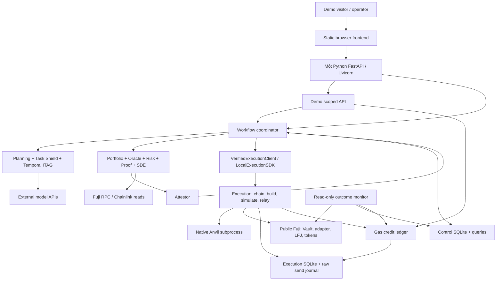

# PaceVant — Hồ sơ hiện trạng, thiết kế và phản biện hệ thống

> **DOC STATUS: CURRENT_REVIEW_PACK** — bản Markdown tự chứa để gửi cho AI/reviewer.
> Ngày tổng hợp: **20/11/2026**. Runtime source baseline: **`3f9f9af91310040bd43eb3895d145a0fc46d776c`**. Commit chuẩn hóa design trước báo cáo: `4aa7a30`.
> Phạm vi: implementation/configuration đã kiểm kê và bằng chứng đã lưu trong repository. Không chạy model, kiểm lại chain state, gửi transaction, gia hạn session hoặc kiểm browser trong lần tạo file này. Không chứa private key/API key/service token.

Tài liệu này giải thích đủ ngữ cảnh để phản biện **chỉ từ một file**. Người chỉ nhận file này có thể phân tích thiết kế và những giới hạn được công bố, nhưng chưa thể tự xác minh source/receipt/test artifacts nếu chưa được cung cấp chúng. “Đã có code”, “đã được test”, “đã từng chạy Fuji” và “đang sẵn sàng chạy ngay” là bốn kết luận khác nhau.

## 1. Kết luận hiện trạng

PaceVant đã có lõi treasury security chạy giao dịch thật trên Avalanche Fuji: AI đề xuất swap, hệ thống kiểm quyền và rủi ro, mô phỏng EVM fork, tạo proof có điều kiện bằng Z3, ký approval, gọi Solidity vault và đối soát receipt/effects. Live path dùng Chainlink Fuji và LFJ, không thay bằng số dư, quote, proof hoặc receipt giả để cho pipeline pass.

Phần Demo User được bổ sung sau: chọn account có sẵn trên website, đi qua cùng pipeline, relayer trả gas, hệ thống ghi phí thực vào sponsor gas credit. Phần này có implementation và offline/Anvil tests; **chưa có public Fuji end-to-end riêng chứng minh cả luồng Demo User mới cùng gas billing**. Không được lấy receipt lõi trước đó để gọi là receipt nghiệm thu phần bổ sung này.

Đây là bản demo/research có enforcement thực, chưa phải sản phẩm custody production đã nghiệm thu. Chưa có multi-user ownership, customer payment/deposit, nhiều vault/chiến lược tùy ý, mainnet, HA, hosted smoke test hoặc independent security audit.

| Câu hỏi | Trả lời có căn cứ |
| --- | --- |
| Có code thực thi public Fuji thật không? | Có, với core pipeline và route được cho phép |
| Toàn bộ source đã bỏ mock chưa? | Không; MOCK/LOCAL/fixtures còn phục vụ tests, tách với live path |
| Dữ liệu live có thật không? | Có chain state/rounds/DEX/effects; USD valuation và stress vẫn có giả định phải công bố |
| Demo User có bypass security không? | Thiết kế/implementation gọi cùng pipeline, bắt buộc Shield + ITAG; không mở arbitrary signing |
| Có thể khẳng định bấm demo ngay sẽ success không? | Chưa; phụ thuộc runtime đã load code, session/funds/exposure/budgets/oracle/RPC/AI |
| Có revert khi vi phạm policy không? | Có phần Solidity enforce trong chính transaction; reject trước gửi là loại khác |
| Testnet có chứng minh sinh lời không? | Không chứng minh lợi nhuận kinh tế/redeemability của test assets |

## 2. Bài toán và phạm vi sản phẩm

Người dùng muốn AI thực hiện thao tác treasury nhưng không trao cho model toàn quyền chuyển tiền. Model chỉ đề xuất candidate trong phạm vi hẹp. Quyền thực thi đến từ authenticated intent, owner policy, evidence, các gate deterministic, attestor và kiểm tra cuối trong vault.

Luồng hiện được hỗ trợ trên Fuji là **Circle test USDC → Fuji WAVAX**, exact-input, recipient là vault, qua adapter/pair LFJ được allowlist. Goal mẫu: `Buy WAVAX with 0.000001 USDC`. Đây là 1 base unit USDC; goal nhỏ không bảo đảm luôn pass minimum output/exposure/gas economics tại mọi thời điểm.

Hệ thống không phải autonomous trader tự chọn mọi token/router/strategy. Chưa triển khai live reverse WAVAX → USDC, multihop, Liquidity Book bin routing, lending, yield farming hay tối ưu lợi nhuận.

## 3. Kiến trúc runtime và các ngôn ngữ



Backend là **một modular monolith Python 3.12**, có 15 business modules. Control API và Execution API là hai trách nhiệm logic trong cùng FastAPI, không phải hai service bắt buộc. Workflow gọi execution qua adapter trực tiếp trong process; `/execution/...` vẫn tồn tại cho authenticated HTTP consumers/compatibility.

Frontend là HTML/CSS/JavaScript ES modules chạy trong browser. Node.js chỉ dùng tùy chọn để kiểm syntax/cross-language tooling, không có Node backend bắt buộc. Solidity giữ nguyên vai trò enforce trên EVM. Native Forge/solc dùng build/deploy/test; Anvil dùng runtime fork simulation. Restart backend không tự compile/deploy contract lên chain.

Attestor và relayer cùng process/trust domain. Module boundaries giúp phát triển và kiểm dependency, **không phải physical key isolation**. Owner key bị loại khỏi canonical serving environment. Allowlist environment của native subprocess giảm secret inheritance nhưng không tạo OS/filesystem sandbox hay HSM.

## 4. Vai trò, tài sản và quyền truy cập

| Vai trò/thành phần | Quyền và tài sản liên quan | Giới hạn |
| --- | --- | --- |
| Owner | Deploy, configure policy/allowlists/attestor, tạo/revoke session, pause/unpause, withdraw khi paused | Trusted admin; owner compromise không nằm trong bảo đảm “AI không chuyển sai” |
| Operator | Tạo goals/intents, đọc dashboard/evidence/history, recovery theo hash | Không có force-approve bằng một JSON tùy ý |
| Demo User | Shared account yêu cầu bounded swap, xem scoped workflows/fees | Không chứng minh wallet ownership; không multi-user isolation |
| Attestor | Ký APPROVE đã persist sau revalidation/reservation | Trusted bridge từ off-chain proof/oracle/task checks sang signed approval |
| Relayer | Broadcast exact signed transaction; trả native gas | Phải có AVAX thật, gas credit DB không thay balance on-chain |
| Vault | Giữ treasury tokens và enforce call/caps/Phi atomically | Không chạy LLM/Z3/ITAG hoặc đọc database |
| Demo wallet | Public identity, hiển thị AVAX balance riêng | Private key không dùng trong flow hiện tại |

Token swap nằm ở **treasury vault**, không lấy từ ví Demo User. Relayer trả gas. Gas credit Demo User chỉ là phân bổ sponsor off-chain, không phải AVAX nằm trong demo wallet và chưa phải khoản khách đã nạp.

Operator Bearer, internal attestation Bearer và execution `X-API-Key` là ba credential khác nhau. Demo nhận session Bearer riêng có phạm vi hẹp; không thể dùng session này để gọi operator/internal/execution APIs.

## 5. Luồng sử dụng Demo User hiện tại

1. Operator chuẩn bị backend, deployment, active session/policy, vault funds và relayer AVAX. Ban giám khảo không làm các bước quản trị này.
2. Ban giám khảo mở website và chọn **PaceVant - Demo User**. Không nhập code/token, không Connect Wallet.
3. Browser gọi `POST /v1/demo/select` với `{ "account_id": "demo" }`; API cấp HMAC-SHA256 signed demo session, expiry 24 giờ. Session chỉ giữ trong memory của tab.
4. Browser đọc demo account/treasury: public wallet address, AVAX balance riêng, allocated/spent/reserved/available gas credit và history.
5. Người dùng bấm goal mẫu hoặc nhập goal đúng grammar; gửi `{ "goal": "..." }` cùng `Idempotency-Key`. Request ID giữ trong sessionStorage để GET-resume.
6. Adapter xác nhận exact USDC input, không reverse; tạo authenticated `ONE_SHOT_SWAP` intent có min=max=exact amount, total budget bằng amount; gọi cùng `ControlPlane.run`.
7. Pipeline chạy đầy đủ planning, Shield, ITAG, build, simulation, oracle/risk/proof, SDE, revalidation, signing và pre-submit checks.
8. Relayer estimate gas, kiểm credit/fee cap/AVAX, persist maximum hold cùng raw tx journal trong một DB transaction rồi mới broadcast.
9. Monitor đối soát receipt/effects/canonical block/confirmations; tính phí thực một lần, cập nhật timeline và ledger.

Select account không tạo swap/hold, không nạp lại credit, không tạo Solidity session. Credential server `PACEVANT_DEMO_ACCESS_TOKEN` là HMAC signing secret, **không trả về browser và không còn được chấp nhận trực tiếp như demo Bearer**. Private key Demo User không forward vào frontend/runtime.

Đây là shared public demo: ai truy cập enabled demo cũng có thể chọn account và tiêu finite sponsor allowance/quota. Chưa có user identity verification, payment hoặc chống lạm dụng ở cấp sản phẩm production.

## 6. Ma trận implementation và loại dữ liệu của từng module

Các nhãn dưới đây có nghĩa riêng:

- **Chain data thật:** dữ liệu đọc từ Fuji/contracts, có block/hash/round/receipt provenance.
- **Tính toán thật:** logic/solver/signature/database thực sự chạy; không có khái niệm cần “API data thật” cho mọi phép tính.
- **Mô phỏng có điều kiện:** EVM thực thi thật trên fork nhưng scenario/actor/perturbation được dựng để stress.
- **Test/mock:** fixtures, controlled prices, mock assets hoặc scripted model replies ở offline/LOCAL tests.
- **Chưa kiểm chứng live:** có implementation/tests nhưng chưa có evidence public Fuji riêng cho tính năng đó.

### 6.1 Planning

**Chức năng:** chuyển bounded goal thành direction/amount rồi compile proposal từ trusted mandate.

**Input → output:** goal + mandate + chain deadline → validated plan và `TransactionProposal` gồm exact tokens/router/vault/recipient/amount/slippage/deadline/intent ID.

**Dữ liệu/logic:** real HTTP model adapters. Current order DeepSeek → Groq → Gemini → Xingchi; configured models lần lượt `deepseek-flash`, `openai/gpt-oss-20b`, `gemini-3.1-flash-lite`, `gpt-6.1-sol`. Đây là cấu hình đã kiểm kê, không khẳng định API/key/model còn available lúc đọc.

**Bảo vệ:** independent grammar/direction/precision/exact amount validation; model không cấp arbitrary router/recipient. Availability/rate/auth/schema errors có thể chuyển provider; amount/direction mismatch dừng, không hỏi tới khi model đồng ý. Quotas/cache/cooldowns bền vững theo provider; không bảo đảm tránh mọi quota do shared organization activity.

**Trạng thái:** implemented; real DeepSeek traces ở core Fuji evidence. `rules`/fixtures còn cho offline mode, không live fallback ngầm. Goal language hẹp, chưa free-form autonomous agent.

### 6.2 Alignment / Task Shield

**Chức năng:** deterministic wallet constraints và semantic checks chống goal drift/instruction injection.

**Input → output:** authenticated objectives + proposal/tool arguments/tool outputs → alignment verdict, check IDs, feedback, objective revision và approval-bound Shield proof.

**Dữ liệu/logic:** deterministic checks thực + real LLM judge trong live profile. `wallet_pipeline` kiểm proposal/build arguments, gom fixed read/build/fork outputs thành bounded batches trước SDE/signing, kiểm execute call riêng. Raw artifacts vẫn được hash/verify đầy đủ; semantic view dùng length/hash cho opaque hex, không có tuyên bố LLM hiểu từng byte trace.

**State:** objective/session/check/event records trong control SQLite. Chưa kiểm xong output hoặc semantic unavailable không được coi ALIGNED. Tool text không được biến thành authenticated user instruction.

**Trạng thái:** implemented, local adversarial regressions + core live traces. Scripted replies trong tests chỉ kiểm flow/guards, không chứng minh attack-detection accuracy thực tế hoặc chặn mọi prompt injection.

### 6.3 Temporal / ITAG

**Chức năng:** authorization có lịch sử: task, steps, prerequisites, deadlines, exact bounds, spent/reserved budget và chống reuse bước đã hoàn tất.

**Input → output:** authenticated IntentTerms + selected spec/revision/step + candidate/build/PRE/history/Shield evidence → IntentSpec, provenance graph, deterministic/semantic assessments và combined verdict/hash.

**Dữ liệu/logic:** graph/history/reservations thực trong DB; semantic evaluator dùng real configured Shield provider. Graph phân biệt AUTHENTICATED, VERIFIED_RECORD, UNTRUSTED, MODEL_JUDGMENT, UNVERIFIED. AI nhận xét quan hệ goal/task; quyền và budget deterministic không được model cấp lại.

**Khả năng:** ONE_SHOT_SWAP, BOUNDED_SWAP, ORDERED_TASK, tối đa 12 steps và 8 prerequisites/step trong schema. Demo dùng exact one-shot. Reserve và pre-submit kiểm lại current revision/history/PRE trong SQLite write transaction.

**Trạng thái:** implemented; one-shot có core Fuji evidence, local tests cho budget/order/cancel/replay. Không có public-live coverage cho mọi kiểu multi-step; graph/budget task là off-chain, không được vault tự hiểu.

### 6.4 Portfolio

**Input → output:** pinned chain state/token identities/balances → immutable `ObservedPortfolioSnapshot`; kết hợp build/policy/trusted prices → authorization-bound decision snapshot.

**Dữ liệu:** real RPC balances, block/hash, token metadata và reconciled history. Cached dashboard observation có `authorization_eligible=false`; không tự dùng cached display làm quyền ký.

**Logic:** projected reference exposure sau swap dựa measured effects; current exposure guard là **PRE-SIGN ONLY**, không có atomic allocation ratio guard on-chain.

**Trạng thái:** implemented/live core observations. Một portfolio/cached view tồn tại không chứng minh đủ vốn/đủ freshness cho request mới. Local reverse calculations không đồng nghĩa live Fuji reverse được hỗ trợ.

### 6.5 Oracle

**Input → output:** exact chain/token/feed mapping + pinned/latest block reads → `OraclePrice`/integer USD-e8 cùng original round observations, timestamps, block/hash/source.

**Dữ liệu:** live signing dùng direct Chainlink Fuji, không nominal file price. Kiểm feed identity/code/description/decimals, positive/completed rounds, answeredInRound, original updatedAt, source/age và block consistency.

**Phần phụ:** Observatory có Chainlink/Witnet/Pyth/optional CoinGecko reference adapters; không phải mọi observation đều authoritative hoặc luôn online. Controlled JSON oracle/demo writer còn cho MOCK/LOCAL; không được giả tên Chainlink để ký live.

**Trạng thái:** direct rounds có core live evidence. USD mapping cho test token vẫn là **policy reference assumption**; giải thích riêng ở mục 8.

### 6.6 Risk

**Input → output:** mandate/proposal/build/verified simulation/decision snapshot/balances/context/time → PASS/FAIL/INCONCLUSIVE, violations, projected exposure, suggested smaller amount.

**Logic thật:** scope/freshness/day/source/identity, available balance, per-swap/daily spend, slippage/fair output, value-loss cap, exposure và execution-cost reference budget; exact integer/Fraction, rounding bảo thủ.

**Trạng thái:** implemented + boundary tests + core live use. Missing facts không PASS. Suggested amount chỉ là hint cho candidate mới; vẫn phải có quyền ITAG đúng amount và rebuild/simulate/prove lại. USD/gas economics dựa policy reference, khác receipt billing.

### 6.7 Proof

**Input → output:** exact build + measured token effects + ProofPolicy + two-token Registry + OracleEvidence/bands + SessionContext/time → ProofArtifactV2, Phi, certified risk debit, SMT queries/hashes và source/solver commitments.

**Logic thật:** shared Python Z3 engine chạy feasibility, CheckMode, compiled-region feasibility, CompileMode và risk-bound queries. UNKNOWN/timeout/error không được trả VERIFIED. Có process lock cho native Z3 default context.

**Trạng thái:** implemented; core transaction có raw queries được rehash/re-solve. Là **bounded off-chain proof có assumptions**, không ZK hoặc full formal verification Solidity/DEX. Chi tiết công thức/phạm vi ở mục 9.

### 6.8 Decision / SDE

**Input → output:** bound alignment/context/build/evidence/risk/proof/temporal/time → persisted `SecurityDecision` với APPROVE/REJECT/REPLAN/ESCALATE và reasons/expiry/bindings.

**Logic thật:** hard failures reject; chỉ recoverable economic failures mới replan; thiếu/stale/unverified facts escalate. APPROVE cần đủ gates, không averaging các score để bù fail bằng pass. Temporal veto có thể tăng mức nghiêm ngặt.

**Trạng thái:** implemented/core live use. Decision không giữ signing key. APPROVE chưa có nghĩa đã ký/gửi/mined/success. Không UI force-approve.

### 6.9 Signing / Attestor

**Input → output:** persisted APPROVE/bundle + latest revalidated state/proof/session/Shield/ITAG + key → EIP-712 SignedPDRV2 bind exact call/Phi/debit/domain/nonce/deadline.

**Logic thật:** kiểm lại code/policy/session/nonce/balances/original/latest rounds, proof recomputation, final guarded preflight, freshness sau bước đắt, revision/history/PRE và reserved headroom. Không arbitrary-bytes signing endpoint. Không sửa deadline sau ký để cứu request cũ.

**Trạng thái:** core Fuji signature có evidence; mutation/replay/concurrency tests local. Attestor trusted; cùng process với relayer, chưa HSM hay độc lập tổ chức. Một số chain/proof/preflight work có thể giữ SQLite write lock lâu; không có LLM call trong write transaction.

### 6.10 Persistence

**Input → output:** validated records, reservations, transitions → immutable evidence/attempt records, events và mutable current projections/jobs.

**Logic thật:** SQLite WAL, immediate transactions/uniqueness, triggers cho một số immutable tables, content-addressed artifacts/SMT files. Không phải hardcoded history UI.

**Trạng thái:** implemented + concurrency/restart/reorg regressions. DB admin/host vẫn trusted. Không có distributed transaction giữa control DB, execution DB và blockchain; recovery phải idempotent/conservative.

### 6.11 Workflows

**Input → output:** authenticated WorkflowRequest hoặc trusted demo wrapper → workflow ID/status/timeline/attempts/decision/submission/outcome.

**Logic thật:** điều phối toàn bộ pipeline; canonical live dùng injected verified execution client, không fixture client. Demo thêm durable request key → workflow mapping; generic operator start không có đúng cùng exactly-once semantics.

**Trạng thái:** core từng CONFIRMED Fuji. Phần lớn start pipeline chạy synchronous; không có durable workflow queue tự resume mọi bước sau crash. HTTP timeout không chứng minh không có transaction.

### 6.12 Execution và các subcomponents

| Thành phần | Input → output | Data/logic và trạng thái |
| --- | --- | --- |
| Chain | RPC/config/manifest → verified context/snapshot | Real code/policy/session/nonces/token balances/metadata; fail khi mismatch |
| DEX | Exact pair/token identity + pinned state → route/quote artifact | Real LFJ quoter/reserves, independently recomputed V1 quote; khác USD oracle |
| Builder | Proposal/context → immutable BuiltTransaction | Trusted allowed adapter, exact calldata/hash/amount/minOut/nonce/deadline; Fuji một chiều |
| Simulator | Build → measured baseline/stress evidence; thêm Phi/debit → final preflight | Native Anvil EVM thật; scenarios/fork-only overrides giả định có nhãn |
| Evidence extractor | Receipts/logs/traces/pre-post balances → facts/root/completeness | Kiểm unexpected transfers/approvals, identities và hash bindings thực |
| Relayer | Stored build/evidence + signed PDR → journal/hash/submission | Real signature/domain/live-state checks, estimateGas, gasPrice, send_raw_transaction trên Fuji khi được gọi |
| Storage/facade | Idempotency key/body/records/artifacts → stable records/results | Durable SQLite/file locks, immutable build/evidence identity; expensive-call bounds |

Core build/simulate/relay có Fuji evidence. Demo billing hooks trong relayer có offline/Anvil coverage, chưa public Fuji riêng. Operator compatibility retry có thể rebroadcast cùng signed bytes; **billed demo retry chỉ đọc lại cùng hash, không tự rebroadcast**.

### 6.13 Monitoring / outcome reconciliation

**Input → output:** durable monitor job + saved build/PDR/evidence/PRE + known hash/receipt/block/logs/state → canonical verified outcome, attributed/residual deltas, gas facts, snapshots/history projection.

**Dữ liệu thật:** public transaction/receipt/canonical block/effects. Không dựng receipt success để đóng workflow. PENDING/UNAVAILABLE/MISMATCH không được gộp thành CONFIRMED.

**Vận hành:** read-only worker tick tối đa 5 jobs rồi chờ khoảng 5 giây, durable retry/backoff/leases; poll lại outcomes để phát hiện reorg. Callback fee observer dùng cùng verified report/invalidation.

**Trạng thái:** implemented/local regressions + core receipt đối soát. Không ký/rebroadcast/fee-bump/cancel, không tự restart toàn bộ workflow. Hai confirmations chưa phải finality tuyệt đối; hosted worker/persistence chưa nghiệm thu trên hosting.

### 6.14 Gas credit

**Input → output:** fixed account/scope, accepted request/build, signed maximum fee và verified receipt → reservations, actual debit/reversal, allocated/spent/reserved/available wei và history.

**Logic thật:** DB ledger, không mock receipt fee. Credit ban đầu là sponsor allocation nội bộ; không có payment receipt từ khách. Reserve và raw send journal cùng execution DB transaction trước broadcast; settlement chống charge trùng và xử lý reorg.

**Trạng thái:** implementation + ledger concurrency/restart/receipt/reorg tests + Anvil full-pipeline success/late-fee-cap-refusal. Chưa live Fuji billing evidence. Chưa top-up/refund/payment/cancel-release service.

### 6.15 Experience / retry guidance

**Input → output:** recoverable reason + current/suggested/tried amounts → smaller amount hoặc không có gợi ý.

**Logic thật:** deterministic rules, không reinforcement learning/học từ lợi nhuận. Không tự ký hoặc gửi transaction. Candidate mới phải đi lại full pipeline và còn phù hợp exact task authorization.

**Trạng thái:** implemented/local tests. Mandate cho tối đa hai economic replans; Shield replans là knob khác, current profile đặt 0. Không được dùng retry để vượt completed step/budget/deadline.

## 7. Các thành phần ngoài business modules

| Thành phần | Trách nhiệm/IO | Hiện trạng và giới hạn |
| --- | --- | --- |
| API/composition | HTTP/auth/DTOs → injected services và error envelopes | Một app; demo startup yêu cầu non-MOCK execution + required ITAG + hardened/pipeline Shield |
| Config/core | Env/profile → validated typed settings/DTOs/errors | Effective network profile quan trọng hơn defaults của template; không in secrets |
| Operations | CLI/profile → prepare/serve/doctor/deploy/renew/evidence reports | Serving không auto-deploy/renew/swap; owner commands riêng có phí và journal |
| Shared SDK 1.3.1 | Wire types/hashes/proof/read-only verifiers/client | Pure/shared logic, không import backend; system V2.1, SDK 1.3.1 và domain V2 là version khác nhau |
| Frontend | Account/goal + API DTOs → timeline, balances/credit/fees/history/explorer | No key in bundle; one-click API và JS syntax tested, browser visual E2E chưa hoàn tất |
| PolicyVault | Signed approval + calldata/Phi → guarded swap hoặc atomic revert | Real Solidity; code/policy/session constraints; trusted attestor bridge |
| LFJSwapAdapter | Vault exact-input call → approved one-pair LFJ swap | Real deployed adapter; reverse/multihop/LB-bin không được hỗ trợ |
| Hosting packaging | Docker/config/persistent disk → Python/Anvil + static frontend | Có source/config; chưa Docker/Render/VPS end-to-end smoke evidence; hosting env template cũ chưa đủ current flags |

## 8. Chainlink, LFJ và ý nghĩa của “data thật”

### 8.1 Authoritative sources hiện tại

Chain ID `43113`, source ID `CHAINLINK_FUJI_CIRCLE_USDC_AVAX_V1`.

| Test asset | Decimals | Feed Fuji | Max original round age |
| --- | --- | --- | --- |
| Circle USDC `0x5425890298aed601595a70AB815c96711a31Bc65` | 6 | USDC/USD `0x97fe42a7e96640d932bbc0e1580c73e705a8eb73` | 86400 giây |
| WAVAX `0xd00ae08403B9bbb9124bB305C09058E32C39A48c` | 18 | AVAX/USD `0x5498bb86bc934c8d34fda08e81d444153d0d06ad` | 600 giây |

Round ID/answer/startedAt/updatedAt/answeredInRound là original chain observations, không stamp timestamp mới lên giá cũ. Freshness snapshot/session/approval 300 giây là một ràng buộc khác với tuổi feed theo asset. WAVAX dùng AVAX price theo policy mapping.

### 8.2 Vì sao pool và oracle có thể khác giá?

Feed cho reference USD của underlying symbols theo owner-approved mapping; pool price phản ánh reserve/liquidity của test assets trong pool cụ thể. Test USDC không có bảo đảm redeem 1 USD, test WAVAX không mang giá trị kinh tế của mainnet AVAX. Pool thanh khoản mỏng hoặc tỉ lệ khởi tạo khác có thể lệch nhiều với reference.

Đây không tự động là lỗi tích hợp; cũng không được lấy lý do “testnet bình thường” để bỏ qua lỗi token identity/decimals/router/quote. Implementation phải dùng đúng assets, kiểm exact quote và giữ risk/value/slippage policy. Chênh lệch lớn có thể khiến reject đúng. Không đổi nominal feed cho khớp pool để ép proof pass mà vẫn kể là independent oracle.

### 8.3 LFJ route và RPC trust

LFJ router/quoter là V2.2 tooling nhưng pair đang dùng là **V1, version=0, bin_step=0**. Không phải Liquidity Book bin pool. Faucet USDC `0xB6076C93701D6a07266c31066B298AeC6dd65c2d` khác Circle USDC; đường đó chỉ diagnostics/reference và bị chặn định giá/signing hiện tại.

Control/execution và verification RPC đang cùng PublicNode operator; hai URL/config role không tạo independent consensus. Fork source cấu hình RPC Avalanche official. Block/hash/round checks phát hiện một số inconsistency, không loại provider compromise.

## 9. Mô phỏng, proof và phạm vi bảo đảm

### 9.1 Simulation không phải transaction public

Simulator pin Fuji block/hash, fork sang Anvil, kiểm code/balances/policy/quote. Fork-only ephemeral signer/attestor override/gas funding phục vụ isolated execution. Exploratory call đo effects; proof compile Phi/debit; final guarded preflight chạy exact approved conditions trước khi ký/gửi.

Baseline chạy intended call. Mild reserve shift khoảng 20 bps yêu cầu success; adverse khoảng 200 bps cho phép safe success hoặc protected min-output revert theo mandate. LFJ stress dùng hypothetical actor được cấp token trên fork rồi thực hiện swap thật trong fork để thay reserves. Không mint vào public vault, không sửa public Chainlink, không gửi setup stress lên Fuji.

Do đó EVM execution/effects là thật trong môi trường mô phỏng, còn actor/perturbation là giả định. Không phải historical MEV replay, không chứng minh mọi ordering/market path. Thiếu impact/evidence hoặc scenario inconclusive thì fail closed.

### 9.2 Công thức value policy

Với delta token base units `delta_i`, decimals `d_i` và giá USD-e8 `p_i`:

```text
loss(p)     = -sum(delta_i * p_i / 10^d_i)
outgoing(p) = -sum(min(delta_i * p_i / 10^d_i, 0))
policy      : loss(p) <= rho * outgoing(p) + epsilon
rho         = max_relative_loss_bps / 10000
epsilon     = fixed_loss_usd_e8
assumption  : 0 < low_i <= p_i <= high_i
```

Tính bằng integer/Fraction/Z3 rationals. Assumptions feasibility phải SAT để không chứng minh rỗng; CheckMode, CompileMode, risk-bound counterexample queries phải UNSAT; compiled integer region cũng phải có nghiệm SAT. Một SAT bất kỳ không đồng nghĩa “safe”. UNKNOWN/timeout không pass.

Phi giữ exact negative input delta, positive output lower bound theo tolerance/minOut và residual allowance caps bằng 0. Worst-case reference loss ở price-interval corners được ceil không âm thành certified risk debit, phải đủ session/global headroom. Engine có thể thử tolerance rồi fallback tau=0, nên không phải attempt nào cũng đúng năm queries.

CompileMode query kiểm lower vector; suy ra allowed actual output an toàn dựa input cố định, output chỉ tăng, positive prices và two-token swap-only structure. Không có EVM/DEX toàn bộ trong SMT. Thay token behavior/asset set/multiple flows phải xét lại model và lập luận đơn điệu.

### 9.3 Proof không bảo đảm gì?

Không chứng minh oracle/RPC nói thật, giá inclusion luôn trong bands, token tùy ý không malicious, model hiểu đúng mọi goal hoặc treasury sẽ có lời. Không bao phủ gas, hosting, payment/customer auth và mọi MEV. Không phải ZK proof hoặc trustless on-chain solver. Vault tin attestor đã kiểm các assumptions/bindings đúng, rồi enforce signed envelope/Phi/caps bằng actual balances.

## 10. Enforcement và revert

| Kiểm tra | Nơi enforce | Còn tin ai/điều gì? |
| --- | --- | --- |
| Goal semantics / prompt injection | Shield + independent validation off-chain | Model có sai số; deterministic constraints vẫn cần |
| Intent revision/budget/step/order/completion | ITAG/DB + atomic recheck | DB/host và current history đúng |
| Reference valuation/exposure/SMT | Off-chain risk/proof/revalidation | Source mapping, positive price bands, attestor |
| Chain/vault/domain/attestor/signature/nonce/deadline | Relayer và Solidity | Owner-approved keys/policy |
| Allowed adapter/token, exact canonical calldata/amount/recipient | Builder/relayer/vault/adapter | Allowlisted token/adapter semantics |
| Session/global risk caps và daily/per-swap limits | Solidity + off-chain reservation | Certified debit được attestor chứng thực |
| Actual input/output bounds, zero residual allowance | Solidity sau external call | ERC20 balance/allowance semantics |
| Actual fee và double charge | Verified outcome + DB ledger | Canonical verified receipt đủ confirmations |

Vault nhận exact canonical selector/164-byte swap calldata và signed ApprovalV2/Phi; kiểm signature/policy/session/caps trước call, kiểm actual deltas sau call. Nonce/counters cập nhật cùng EVM transaction. Nếu postcondition hoặc external call fail, **swap token effects và counters của transaction rollback**, relayer vẫn mất gas.

Off-chain reject xảy ra trước broadcast nên không có public transaction/gas để revert. Không có tính năng đảo ngược một transaction success đã final bằng phép “undo”. Receipt success cũng phải đối soát bindings/effects trước khi báo business success.

## 11. Session, deadlines và budgets

| Đối tượng | Giá trị/profile đã kiểm kê | Ý nghĩa |
| --- | --- | --- |
| Demo browser session | 24 giờ | Hết auth thì chọn lại account; không refill credit |
| On-chain proof session | Duration owner profile 86400 giây | Authority/risk window; hết hạn cần owner renewal transaction |
| Temporal intent | Demo deadline min(now+1800, mandate expiry), exact budget | Không phải Solidity session; completed task không tự chạy lại |
| Approval TTL / state snapshot age | Tối đa 300 giây current profile | Expensive work vẫn có thể làm hết cửa sổ; không nâng deadline sau ký |
| Max block drift | 200 blocks | Đồng thời vẫn phải pass wall-clock/round/hash checks |
| Confirmations Fuji | 2 | Receipt acceptance threshold, không absolute finality |
| Mandate swap/daily spend | 500 / 1000 USDC | Khác budget gas và certified loss |
| Exposure | 2500 bps = 25% | Off-chain pre-sign guard |
| Relative loss / fixed allowance | 300 bps / 0 USD | Bounded reference value policy |
| Oracle band / Phi tolerance | 100 / 40 bps | Giả định price interval / output lower-bound compilation |
| Session risk / global daily risk | 10 / 20 USD reference | Certified loss headroom, không phải tổng vốn swap |
| Gas reference budget | 50 USD/ngày trong mandate | Economic gate, khác actual native fee ledger |
| Sponsor allocation / max fee mỗi tx | 0.001 / 0.0001 AVAX | Off-chain credit và maximum reservation cap |

Các giá trị là config/snapshot, không khẳng định chain policy/session còn active hoặc budgets còn nguyên lúc đọc. Đổi `.env` không thay session/policy đã tạo, không nạp credit DB đã cấp. Approval deadline còn bị chặn bởi chain time, mandate/policy/session expiry và cuối ngày UTC.

## 12. Gas credit, pending, revert và reorg

```text
maximum_reserved_wei = signed_tx.gasLimit * signed_tx.gasPrice
actual_fee_wei       = receipt.gasUsed * receipt.effectiveGasPrice
available_credit    = allocation - current_settled_fees - active_holds
```

Tiền lưu integer wei dưới dạng decimal strings; AVAX có 18 decimals. Demo gas limit dùng `ceil(estimateGas * 110 / 100) + 5000`; actual fee không mặc định bằng toàn gas limit. Không tạo credit/payment transfer phụ để demo.

| Tình huống | Hành vi kế toán và gửi |
| --- | --- |
| Không có available credit | Refuse sớm trước expensive model/fork |
| Max fee vượt cap, credit không đủ reserve, relayer thiếu AVAX | Refuse trước broadcast; reserve/journal không commit dở dang |
| Send timeout/unknown hoặc pending | Giữ maximum hold; query cùng hash; demo không auto retry broadcast |
| Success đủ confirmations và gas verified | Charge actual fee một lần, release phần hold dư |
| Revert đủ confirmations | Cũng charge actual gas; token effects rollback |
| Effects mismatch nhưng gas identity verified | Có thể charge phí thực, không chuyển security mismatch thành success |
| Poll lặp/restart | Dedup theo tx/build/receipt; không charge lại hoặc tự refill allocation |
| Reorg | Append reversal event, giữ maximum REORG_HOLD; verified re-inclusion mới settle |
| Deep reorg sau headroom đã dùng | Credit có thể âm, chặn gửi mới và cần review |

Account scope gắn chain/vault/relayer/demo address; allocation insert một lần. Accepted request key + goal map về stable workflow; same key khác goal conflict. Khi shared request đang running, chặn chạy chồng request khác. Crash trước khi có control workflow có thể cần STARTING_OR_REVIEW_REQUIRED; không tự khởi chạy lại mù.

Không có auto timeout refund, top-up/payment/refund API hoặc dropped-transaction release đủ bằng chứng. 0.05 AVAX không cho số lượt demo cố định: còn phụ thuộc gas price/actual gas/funds/exposure/latency; current allowance cũng chỉ cấp 0.001 AVAX, không mặc định dùng toàn số tiền hệ thống có.

## 13. API, dữ liệu lưu và recovery

| Surface | Input/output chính | Auth |
| --- | --- | --- |
| `/health`, `/healthz`, static UI | Liveness/config/static page | Public, không phải readiness full pipeline |
| `GET /v1/demo/config`, `POST /v1/demo/select` | Fixed account metadata/session | Public khi demo enabled; config báo disabled khi tắt |
| Demo account/treasury/workflows/requests | Scoped balance/credit/history; goal + Idempotency-Key → workflow | Demo session Bearer |
| `/v1/workflows/start`, treasury/history/portfolio | Operator workflow/evidence/query | Operator Bearer |
| `/v1/task-shield/...`, `/v1/itag/...` | Authenticated objectives/intents/revisions/graphs/checks | Operator Bearer |
| `/v1/approvals/attest` | Persisted decision ID → revalidated signed PDR | Internal Bearer |
| `/execution/v1/...`, `/execution/v2/...` | Chain/build/simulate/preflight/execute/receipt/artifact | Execution X-API-Key, trừ health |

Runtime route inventory có 57 explicit routes; không phải 57 end-user capabilities. Pydantic DTOs và SDK giữ amounts/uint256 dạng decimal strings, hashes/bindings theo canonical encodings, timestamps Unix seconds; không dùng UI-formatted numbers để settlement.

Control profile `.control-data-v2/fuji/` giữ control SQLite, workflows/events/decisions/attestations, ITAG/Shield state, portfolio/jobs/outcomes, planner quota/cache và SMT queries. Execution profile `.execution-data-fuji-v2/` giữ state SQLite, artifacts, raw submission journals cùng demo request/account/build/hold/event tables.

Raw signed transaction là nhạy cảm, không gửi kèm báo cáo. Cần preserve/back up cả hai DB cùng manifests/artifacts/queries/journals; không xóa DB để gỡ pending. Fee settlement và control outcome projection nằm hai DB, không có atomic cross-DB commit; idempotent reconciliation xử lý crash/replay. Chưa backup/restore hosted drill hoặc HA; dùng một backend instance/worker với persistent storage.

## 14. Public addresses để kiểm độc lập

Đây là snapshot public config/deployment ở baseline, không phải live chain check trong lần viết file.

| Đối tượng | Địa chỉ |
| --- | --- |
| PolicyVault | `0xd8EC86820709505C3779a4Fe5D828e8ADE663E1D` |
| Approved adapter / treasury build router | `0x497d967d003717FA49ce16ac6FFf73a399aFe5D4` |
| LFJ router V2.2 | `0x18556DA13313f3532c54711497A8FedAC273220E` |
| LFJ quoter | `0x9A550a522BBaDFB69019b0432800Ed17855A51C3` |
| LFJ V1 pair | `0x8436B8c75ed2F015a80b8472526dd1A79BF54E38` |
| Factory | `0xF5c7d9733e5f53abCC1695820c4818C59B457C2C` |
| Owner | `0x607bd883bd3621378812CF5B4B8dDcCFAeBbab1b` |
| Attestor | `0x5704fA0FF7CBEd213F622c99aC6F9d6E5cbF2989` |
| Relayer | `0x761B1FFB7AA70C7A946D3970A25F5a3859dA328C` |
| Demo User | `0xf23bE4A69B162DdC0F7D5456172212d294b233c7` |

“Router” trong signed treasury build là adapter, khác LFJ router bên dưới. Token/feed addresses ở mục 8. Không dùng một token khác chỉ vì cùng symbol/decimals.

## 15. Bằng chứng thực tế đã có

### 15.1 Core Fuji trước phần Demo User mới

Recorded checkpoint `3fba479`, workflow `workflow_b813ce97ad0542e9b1b667e4e5e07788`.

```text
Network: Avalanche Fuji, chain ID 43113
Transaction: 0xf975361607032ec0709140d32c6d5e98a266f8df6917226e1d6ecb6cf6361b10
Block: 61371323
Gas used: 356377
Recorded inclusion time: 1795164309
Approval deadline: 1795164349
Recorded token deltas: -1 USDC base unit; +13242376866418 WAVAX base units
```

Đã lưu 14 chain checks, ba negative eth_calls (replay, tampered calldata, unauthorized signer), proof queries rehash/re-solve SAT/UNSAT/SAT/UNSAT/UNSAT, real DeepSeek traces và ITAG history rejections. Ba negative eth_calls **không phải** ba public revert transactions có trả gas. PLANNED→CONFIRMED khoảng 271 giây theo events, không phải latency SLA.

Receipt chứng minh core hoạt động ở checkpoint đó. Không chứng minh session hiện tại chưa hết hạn, vault còn vốn, provider còn quota hoặc bổ sung Demo User billing đã được chạy Fuji.

### 15.2 Demo gas credit và one-click selection

| Checkpoint | Evidence đã lưu | Chưa chứng minh |
| --- | --- | --- |
| `e5668bd` gas credit | Full Python suite 457 passed/4 skipped; isolated Anvil full pipeline success và late-fee-cap refusal; ledger/concurrency/reorg/restart/API tests | Public Fuji billing và browser visual E2E |
| `3f9f9af` one-click | 30 offline auth/API/ledger/architecture checks, syntax 11 JS files; không tạo swap khi chọn account | Public Fuji run, browser rendering, runtime process đã restart |
| Docs review `4aa7a30` | Static source/config fingerprints, route inventory, links/classification, preserved evidence và secret scan | Không có RPC/model/transaction validation mới |

Anvil integration dùng EVM thật chain 31337 nhưng semantic model replies scripted có nhãn test. Không gán chúng thành real-provider accuracy evidence. Counts có thể chứa focused runs lặp/tập con; không cộng để quảng cáo số tests độc lập, skipped không phải passed.

## 16. Mock inventory và điều chưa làm

| Phần | Có mock/giả định ở đâu? | Cách trình bày đúng |
| --- | --- | --- |
| MOCK mode/scenario/evaluation corpus | Fixture balances/prices/outputs dùng offline | Test data, không live Fuji |
| LOCAL assets/adapter/oracle | Mock ERC20/controlled pricing/local adapter | Real EVM với demo economics, không public market |
| Model test doubles | Scripted replies trong selected tests | Kiểm flow/invariants, không AI effectiveness |
| Fork stress | Actor/funding/mint/perturbation chỉ Anvil | Hypothetical scenario chạy concrete EVM |
| USD value | Policy mapping/bands cho test assets | Real feed, reference valuation assumption |
| Sponsor gas credit | Allocation nội bộ, chưa tiền khách nạp | Ledger thực, chưa payment product |
| Demo identity | Shared predefined public address | Không wallet ownership auth/multi-user |
| Reverse/multihop/extra DeFi | Không live route hỗ trợ | Chưa có capability, không “mock implementation đã đủ” |
| Hosted deployment/HA/mainnet | Source/config có phần chuẩn bị | Chưa nghiệm thu thực tế |

Code live thiếu data/provider/evidence phải refuse/escalate, không chuyển về fixture để hoàn thành. Tuy nhiên việc thiết kế fail-closed không chứng minh toàn bộ codebase không còn bug; vẫn cần phản biện source và coverage.

## 17. Điểm yếu, giới hạn và điều cần kiểm trước demo

1. **Chưa có full Fuji evidence cho demo mới:** cần một request Demo User có tx/receipt/effects/fee ledger nếu muốn tuyên bố end-to-end mới đã verified. Không thực hiện trong lần làm tài liệu này.
2. **Runtime version chưa được xác nhận:** code mới trên đĩa không bảo đảm backend process đang chạy đã restart/load one-click code.
3. **Session/funding không phải trạng thái bất biến:** session có expiry; snapshot funding audit trước cho thấy ít Circle USDC và WAVAX exposure lớn. Cần read chain trước demo, không giả còn đủ funds hoặc nới guard để ép pass.
4. **Latency:** core run đã gần giới hạn 300s; RPC/fork/model/fallback có thể làm timeout/stale. Có freshness rechecks nhưng không SLA success.
5. **Trusted signing boundary:** attestor/relayer cùng host, không HSM/process isolation; compromise host/key là rủi ro lớn. Owner cũng trusted.
6. **Oracle trust:** source mapping và bands là assumptions; cùng RPC operator không có independence đầy đủ, pool/reference mismatch có thể reject hợp lý.
7. **Public shared demo abuse:** người ngoài có thể tiêu shared budget/model quota. Không ownership/payment/rate-limiting sản phẩm hoàn chỉnh.
8. **Conservative stuck state:** unknown send/dropped transaction/crash có thể giữ hold hoặc request review state lâu; chưa automatic safe release/cancel.
9. **Concurrency/storage:** SQLite locks và cross-DB crash windows; không durable whole-workflow queue/HA. Nhiều worker/replica tùy ý có thể làm sai giả định vận hành.
10. **Browser/hosting:** chưa visual browser E2E cho one-click; hosting template cũ thiếu current flags/defaults, chưa hosted smoke/persistence drill.
11. **Bounded security coverage:** proof/scenarios/token assumptions hẹp, exposure off-chain; tests nội bộ không thay independent audit.

## 18. Những case demo có ý nghĩa

| Case | Điều chứng minh được nếu quan sát đúng | Giới hạn |
| --- | --- | --- |
| Happy path exact swap | Full gates, signed approval, Fuji inclusion và actual outcome | Không chứng minh profit hoặc mọi future request |
| Bad token/router/recipient/amount | Deterministic auth/call constraints reject | Ưu tiên offline/eth_call, không cần phí public |
| Reuse step/vượt intent budget | ITAG lịch sử chặn trước signing | Không nói vault tự đọc ITAG |
| Stale oracle/session/deadline | Fail closed hoặc on-chain expiry enforcement | Không dùng fabricated timestamp làm live evidence |
| Phi violation/revert | Atomic rollback token effects/counters | Gas vẫn tốn; Anvil/eth_call khác public receipt |
| Double-click/HTTP timeout | Durable same request/workflow/hash, GET-resume | Không auto tạo tx mới |
| Low fee cap/credit | No broadcast và không debit giả | Existing Anvil negative test khác Fuji test |
| Reorg | Outcome invalidation, reversal/hold | Local controlled test, không giả đã gây reorg Fuji |

## 19. Cách yêu cầu AI phản biện file này

Có thể gửi nguyên file và prompt sau:

> Hãy phản biện PaceVant theo hồ sơ này. Tách rõ vấn đề xác nhận được từ mô tả, rủi ro thiết kế, giả định cần source kiểm tra và phần thiếu bằng chứng; không coi thiếu evidence đồng nghĩa chắc chắn bug. Với mỗi nhận xét, nêu severity, invariant bị ảnh hưởng, một failure/attack sequence cụ thể, điều kiện khai thác, evidence còn cần và sửa tối thiểu. Tập trung trusted attestor, oracle test-asset mapping, bounded SMT/Phi monotonicity, time-of-check-to-use, ITAG/reservation concurrency, cross-DB crash, gas reserve/settlement/reorg và public shared demo authorization. Không suy mainnet profitability từ testnet; không yêu cầu private keys hoặc chạy public transactions để review.

Các câu hỏi cần được trả lời:

- Chữ ký đúng nhưng attestor chứng thực sai proof/oracle thì vault còn chặn được phần nào?
- Các signed hashes có bind đủ exact call, policy, registry, source, session và Phi? Có phần chỉ off-chain cần công bố rõ không?
- Lower-bound proof có còn đúng nếu actual token behavior thay đổi? Positive-price/two-token/exact-input assumptions có đủ và được enforce không?
- State đổi sau final preflight nhưng trước inclusion: Phi/caps bảo vệ gì, exposure/reference valuation còn rủi ro gì?
- Hai requests, process crash hoặc stale intent revision có thể dùng chung headroom/nonce không? Lease/reservation recovery có thể stuck ở đâu?
- Receipt mismatch/reorg có thể double-charge hoặc nhả credit sớm không? Two-confirmation policy chấp nhận rủi ro nào?
- Bật public demo cho visitor tự cấp session có phù hợp mục tiêu sponsor demo không? Cần bảo vệ nào trước production?
- Phần nào cần một Fuji evidence mới, phần nào chỉ cần source/offline regression, phần nào cần independent audit?

## 20. Tài liệu/source đối chiếu nếu reviewer được cấp repository

File này là hồ sơ tự chứa phục vụ thảo luận; [canonical System Design V2.1](AI_Treasury_Security_System_Design_v2.1.md) vẫn là bản thiết kế chi tiết chính. Không tạo một nguồn runtime truth độc lập: khi source/config đổi phải cập nhật cả hai, không dùng snapshot này để phủ nhận code mới.

| Nguồn | Giá trị đối chiếu |
| --- | --- |
| [Sanitized inventory](current-system-inventory.json) | Effective config/addresses/modules/source fingerprints, không có secret |
| [API catalog](current-api-catalog.json) | Methods/auth/annotations/source locations của canonical app |
| [Core Fuji evidence](audit/system-security-live-validation.json) | Tx/receipt/checks/bindings ở checkpoint trước demo billing |
| [Core SMT verifier](audit/system-security-live-proof/verification.json) | Query hashes và independent solver results |
| [Demo billing evidence](audit/demo-user-gas-credit-validation.json) | Offline/Anvil tests và stated limits |
| [One-click evidence](audit/demo-account-selection-validation.json) | Offline auth/account-selection coverage |
| [Documentation manifest](DOCUMENTATION_MANIFEST.json) | CURRENT/HISTORICAL classification; raw evidence scope |

Source entrypoints: `api/app.py`, `api/demo.py`, `api/demo_auth.py`; các module dưới `backend/src/treasury_backend/modules/`; shared engine `packages/contracts-api/treasury_contracts/proof.py` và `v2.py`; Solidity `contracts/src/PolicyVault.sol` và `contracts/src/adapters/LFJSwapAdapter.sol`; UI `frontend/src/features/demo/`; env/process wiring `backend/src/treasury_backend/operations/`.

Không cần và không nên gửi `.env`, private DB/log, raw signed transactions hay bất kỳ private/API key nào cho AI bên ngoài. Nếu chỉ gửi file Markdown này, yêu cầu AI phản biện mô hình/assumptions và ghi rõ phần nào cần source để xác minh, thay vì kết luận đã audit implementation.
