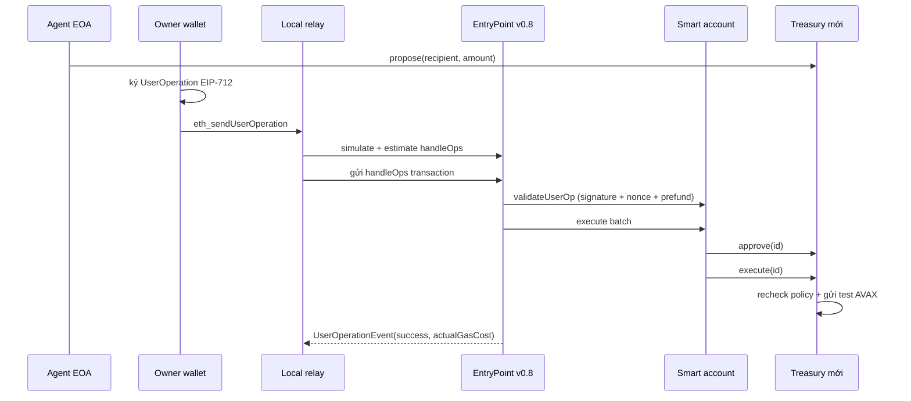

# Smart account ERC-4337 — Avalanche UniHack PoC

> **DOC STATUS: HISTORICAL_REFERENCE - OLD / SUPERSEDED.** Retained checkpoint/reference only; not current system state, readiness or operating instructions.
> Use the [current system design](AI_Treasury_Security_System_Design_v2.1.md) and [documentation index](README.md). Addresses, defaults, test counts and limitations below belong to their original checkpoint. Raw evidence keeps its original scope.

> Historical / compatibility document. For the current runtime use [V2.1 system design](AI_Treasury_Security_System_Design_v2.1.md) and [readiness audit](audit/V2_1_READINESS_REVIEW.md). Old A/B layouts, PoC evidence and removed pre-refactor paths describe their original checkpoint; they are not current deployment instructions or new validation evidence. References to removed artifacts are retained as plain code text.

Tích hợp ngày 12/11/2026. Chỉ dùng local EVM và Fuji test AVAX. Phần demo EOA cũ vẫn hoạt động; phần smart account có manifest và treasury riêng.

## Thành phần đã triển khai

- `UniHackSmartAccount`: kế thừa OpenZeppelin 5.6.1 `Account`, `SignerECDSA` và ERC-7821. Owner ký bằng EIP-712. Chỉ EntryPoint hoặc self-call được thực thi batch; owner EOA và agent không thể gọi execute trực tiếp để bỏ qua validation.
- EntryPoint v0.8: local chạy implementation tham chiếu từ `@account-abstraction/contracts@0.8.0`; Fuji dùng địa chỉ canonical `0x4337084D9E255Ff0702461CF8895CE9E3b5Ff108`. Account override EntryPoint mặc định v0.9 của OpenZeppelin để khớp v0.8 đã chọn. Không dùng EIP-7702.
- Storage và treasury mới có owner là địa chỉ smart account. Signer owner vẫn là EOA test đã cấu hình. Agent vẫn là EOA riêng và chỉ propose.
- Relay HTTP tối giản chạy loopback, nhận UserOperation đã ký, simulate/estimate bằng EntryPoint thật, rồi gửi `handleOps`. Relay không tạo chữ ký owner từ nội dung nhận ở API. CLI demo ký cục bộ từ môi trường; frontend ký qua wallet.
- UI có phần **ERC-4337 SMART ACCOUNT**: xem signer/account/EntryPoint, nonce, gas deposit, treasury balance, storage; cập nhật storage/hạn mức; agent tạo đề xuất; owner approve + execute trong một UserOperation batch; xem cả UserOperation hash và transaction hash.



## Địa chỉ Fuji

Nguồn cấu hình công khai: `smart-account-fuji.json`.

| Thành phần | Địa chỉ |
|---|---|
| Smart account | [0x12a399c202d4090e7cbcda3aa9e281ea5a47930f](https://explorer-test.avax.network/c-chain/address/0x12a399c202d4090e7cbcda3aa9e281ea5a47930f) |
| Storage thuộc account | [0xa3ed358087891cc31d257bbcf145c1442cfbae3c](https://explorer-test.avax.network/c-chain/address/0xa3ed358087891cc31d257bbcf145c1442cfbae3c) |
| Treasury thuộc account | [0xb0929efaa3b407fcf748408e2ba97b8bc2ab720e](https://explorer-test.avax.network/c-chain/address/0xb0929efaa3b407fcf748408e2ba97b8bc2ab720e) |
| EntryPoint v0.8 | [0x4337084D9E255Ff0702461CF8895CE9E3b5Ff108](https://explorer-test.avax.network/c-chain/address/0x4337084D9E255Ff0702461CF8895CE9E3b5Ff108) |

Runtime code hash EntryPoint được ghi nhận trực tiếp trên Fuji và pin để phát hiện thay cấu hình: `0xc5949575d6999ff5283f3331a24342c74c6fa891ac38ffe2e4f181af5c15f40b`. Đây là fingerprint của deployment đã kiểm tra, không phải tuyên bố đã tái lập build source của EntryPoint. Runtime account/storage/treasury mới được so khớp đầy đủ với artifact của PoC khi deploy.

## Chạy local

Terminal 1 (nếu chưa chạy):

```powershell
npm run node
```

Terminal 2:

```powershell
npm run compile
npm test
npm run aa:deploy:local
npm run aa:bundler:local
```

Terminal 3:

```powershell
npm run aa:demo:local
$env:VITE_NETWORK='local'
npm run dev
```

Relay local ở port 8788. Local EntryPoint có phí gas khác Fuji; prefund ban đầu local 0.01 token native, Fuji 0.001 test AVAX. Nếu chạy demo nhiều lần:

```powershell
npm run aa:fund:local
```

Lệnh fund chỉ bổ sung đến target deposit và treasury đã cấu hình, không chuyển đến địa chỉ nhận từ API.

## Chạy Fuji

Giữ `.env` với hai ví test đang dùng. Không gửi khóa qua chat, không dùng mainnet.

```powershell
npm run aa:deploy:fuji
npm run aa:bundler:fuji
```

Ở terminal khác:

```powershell
npm run aa:demo:fuji
npm run aa:verify:fuji
npm run aa:report
```

Không cần deploy lại nếu đã có manifest Fuji ở trên. Sau khi restart máy chỉ cần chạy lại `aa:bundler:fuji` và frontend. Nếu deposit thấp, dùng `aa:fund:fuji` để bổ sung đến 0.001 test AVAX và treasury đến 0.0002. Deploy có cap gas budget; hoạt động relay có cap 0.002 test AVAX mỗi UserOperation/outer transaction.

Vite dev/preview proxy `/bundler/fuji` tới port 8787 và `/bundler/local` tới 8788, cùng với proxy đọc Fuji `/fuji-rpc`. Frontend không có private key. Muốn hosting bên ngoài cần thiết kế backend/auth/custody phù hợp; không expose relay PoC ra internet.

Sau build, `npm run test:production` kiểm UI tại port 4173 với storage/nonce đọc trực tiếp từ Fuji và kiểm tra relay. `npm run scan:secrets` đối chiếu hai khóa cục bộ với source/evidence không bị ignore và bundle để phát hiện rò rỉ, không in khóa.

## Kiểm chứng và gas

Unit tests bổ sung kiểm chữ ký owner, agent không được ký owner op, nonce/replay, sửa calldata, domain chain/EntryPoint, validation chỉ từ EntryPoint, không đủ prefund, batch approve+execute và batch rollback. **Receipt transaction success không đủ**: phải kiểm `UserOperationEvent.success`. Một batch gọi sai có thể có outer transaction thành công nhưng operation thất bại, mất phí và nonce vẫn tăng.

CLI demo AA1–AA7 dùng JSON-RPC HTTP thật tới relay; kết quả ở `evidence/aa-e2e-local.json` và `evidence/aa-e2e-fuji.json`. Replay/chữ ký sai/calldata sửa được EntryPoint từ chối qua eth_call simulation trước khi gửi transaction; không bịa receipt cho các trường hợp này. Bài failed batch có transaction thực và `success=false`, với storage rollback được kiểm tra.

Mỗi operation lưu `UserOperation hash`, transaction hash, receipt, `actualGasUsed`, `actualGasCost`, nonce và success trong `evidence/aa-<network>-<hash>.json`. `actualGasCost` là khoản account trả cho bundler qua EntryPoint; outer transaction fee là khoản EOA relayer trả mạng. Hai đại lượng không cộng lại thành phí mạng vì có khoản hoàn trả giữa account và relayer. Lần đo Fuji cho thấy outer fee cao hơn khoản EntryPoint hoàn: relayer phải bù chênh lệch. Không giả định hoàn đủ chi phí mạng Avalanche hoặc gọi luồng này là gasless.

Không có paymaster: account tự trả phí từ deposit. Trong PoC signer owner và relay beneficiary dùng cùng EOA test; khi kiểm balance người nhận owner phải tính cả tiền nhận và reimbursement từ EntryPoint, trừ outer fee.

## Phạm vi relay

Relay chỉ phục vụ một account và EntryPoint trong manifest; body tối đa 64 KiB, giới hạn gas/fee, bind 127.0.0.1, kiểm Origin cho UI local, serialize thao tác gửi để tránh đua nonce. Các method:

- `eth_chainId`
- `eth_supportedEntryPoints`
- `eth_sendUserOperation`
- `eth_getUserOperationReceipt`

Relay đợi receipt trước khi trả hash để đơn giản hóa PoC. Không có public alt-mempool, ERC-7562 validation/tracing, chống DoS production, paymaster/factory/7702, hay `eth_estimateUserOperationGas`. Gas limits UserOperation hiện là giới hạn bảo thủ cấu hình rõ, không giả là số đo estimate chuẩn. Outer transaction được estimate bằng RPC thực. Đây không phải implementation đầy đủ để thay thế bundler production.

## Chưa có

Session key/hạn mức theo ngày cho agent, passkey, social recovery, multisig, factory/counterfactual deployment, ERC-1271 và paymaster chưa triển khai. Signer và EntryPoint cố định từ constructor; không có cơ chế nâng cấp/đổi signer. Các kiểm soát recipient/limit nằm trong treasury và được kiểm lại khi execute. Owner signer có quyền authorise account, nên cần signer/khóa mới và thiết kế recovery trước dùng tài sản thật.

## Nguồn chính thức

Implementation EntryPoint tham chiếu dùng cho local giữ license GPL-3.0 của upstream; `UniHackSmartAccount` và thư viện OpenZeppelin dùng MIT theo SPDX tương ứng.

- [OpenZeppelin Account Abstraction](https://docs.openzeppelin.com/contracts/5.x/account-abstraction), code version 5.6.1 trong node_modules.
- [ERC-4337](https://eips.ethereum.org/EIPS/eip-4337).
- [EntryPoint reference releases](https://github.com/eth-infinitism/account-abstraction/releases), npm contracts 0.8.0.
- [Viem UserOperation typed data](https://viem.sh/account-abstraction/utilities/getUserOperationTypedData).
- [Avalanche JAW integration](https://build.avax.network/integrations/jaw): có lựa chọn SDK managed với API key; PoC này chọn tự vận hành relay để không phụ thuộc tài khoản dịch vụ/phí. Không dùng hoặc khẳng định đã kiểm thử JAW.
