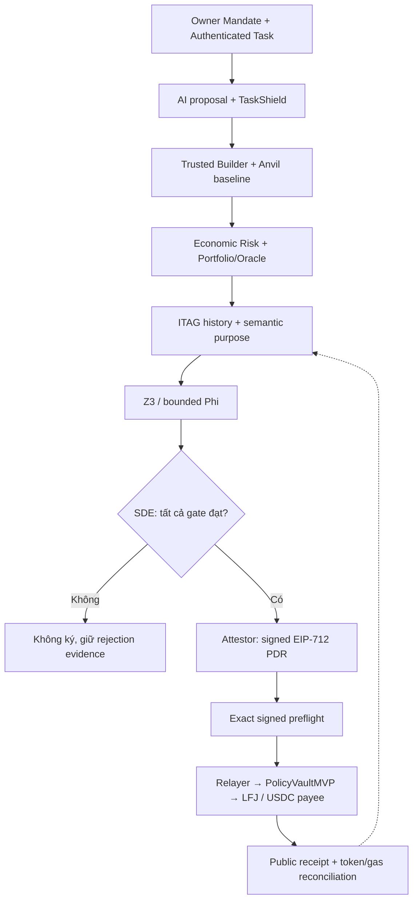

# Kiến trúc PaceVant — Tại sao mỗi lớp bảo mật tồn tại?

> **Tài liệu giải thích sâu · Tiếng Việt.** Đây là kiến trúc có source đối chiếu ở nhánh `main` và public Fuji acceptance checkpoint 21/11/2026. Các mô tả ngoài hai operation của MVP được ghi rõ là thí nghiệm/minh họa. Không phải báo cáo audit độc lập. [Về README chính](../../README.md) · [Source workflow](https://github.com/ursuswh-metamorphic/PaceVant/blob/main/backend/src/treasury_backend/modules/workflows/treasury.py).

## Bắt đầu bằng ba câu hỏi

**1. AI có đang làm đúng việc người dùng giao?** Intent/mandate, Hybrid TaskShield và ITAG phân biệt proposal với quyền được cấp, kiểm action hiện tại và lịch sử mục tiêu.

**2. Làm đúng việc nhưng có mất tiền hoặc vượt rủi ro?** Trusted Builder, Anvil simulation, Chainlink/portfolio, Economic Risk và Z3 kiểm kết quả đo được và giới hạn kinh tế có điều kiện.

**3. Nếu kết quả kiểm tra đúng, ai buộc blockchain phải tuân theo?** Attestor chỉ ký khi các gate cho phép; PolicyVaultMVP xác thực chữ ký, session/caps và postconditions. Relayer chỉ gửi transaction/trả AVAX gas; receipt monitor không dùng UI tự nhận thành công.

Ví dụ xuyên suốt: người dùng cho phép **swap một lượng Circle test USDC sang WAVAX** trong treasury; public demo là *fixed amount, fixed asset/route*, không cho AI tự do chọn arbitrary protocol. Một hành động có thể đúng mục tiêu nhưng sai giá; đúng giá nhưng vượt ngân sách; hoặc đúng mọi ràng buộc định lượng nhưng lý do thực hiện lại khác mục tiêu được giao. Vì vậy phải có nhiều loại kiểm tra độc lập.

## Kiến trúc và ranh giới tin cậy

**Ranh giới 1 — AI và dữ liệu không đáng tin:** LLM và tool outputs có thể đề xuất/miêu tả; không thể thay đổi task authority hoặc ký chuyển tiền. **Ranh giới 2 — quyết định có điều kiện:** Simulation và Z3 chỉ đúng trong giới hạn dữ liệu/giả định đã kiểm. **Ranh giới 3 — execution:** PolicyVault kiểm những điều mã hóa được trong Solidity, không tự hiểu mục tiêu ngôn ngữ tự nhiên.

## Giải thích đầy đủ 16 bước

Các phần dưới giữ nguyên ý nghĩa kỹ thuật của bản README ban đầu, được trình bày lại thành nhiều dòng để dễ đọc. Với mỗi bước, xem **Input → Mục đích → Cách làm → Output → Chặn → Giới hạn**.

### Đi từng bước: Input → Mục đích → Cách làm → Output → Nguy cơ ngăn chặn → Giới hạn

Ví dụ xuyên suốt là **AI được phép swap USDC → WAVAX cho một nhiệm vụ treasury**, trong public MVP amount được cố định theo scenario; payment là operation được cấp riêng. Những ví dụ ngoài phạm vi public luôn được ghi là minh họa hoặc LOCAL.

### 01. Treasury Mandate & Authenticated User Intent

**Input:** Owner policy, contract/session, authenticated task (`IntentSpec`), operation, token/amount/recipient, deadline và budget.

**Mục đích:** phân biệt *quyền Owner cấp* với *nhiệm vụ người dùng thực sự muốn*.

**Cách làm:** backend kiểm user/task provenance và policy/session được ký hoặc cấu hình, ghi task ID/revision.

**Output:** typed authority và phạm vi có thể thực hiện.

**Chặn:** tool output tự xưng là yêu cầu mới, chuyển token hoặc người nhận ngoài phạm vi.

**Giới hạn:** Owner/key compromise không nằm trong lời bảo đảm “Agent không tự ý dùng tiền”.

### 02. AI Treasury Planner

**Input:** mục tiêu đã xác thực cùng fixed operation registry.

**Mục đích:** biến ngôn ngữ tự nhiên thành một đề xuất có thể đánh giá.

**Cách làm:** model đưa structured proposal và rationale; backend giữ operation/token/amount/recipient trong scope đã cấp.

**Output:** candidate plan; **không phải authorization**.

**Chặn:** proposal vượt domain được phép sẽ không tự trở thành giao dịch hợp lệ.

**Giới hạn:** AI vẫn có thể hiểu sai ý nghĩa và trả output không hợp lệ; public demo không phải autonomous trader đa giao thức.

### 03. Hybrid Task Alignment Shield

**Input:** original user message, task binding/revision, candidate action và source provenance.

**Mục đích:** kiểm *AI có làm đúng việc được giao không*.

**Cách làm:** deterministic checks so exact fields (token, amount, recipient, chain, deadline...), model semantic xem goal drift/tool injection, strict fusion không cho positive score bù mandatory FAIL.

**Output:** ALIGNED / MISALIGNED / UNCERTAIN + typed evidence.

**Chặn:** đổi token đích, địa chỉ, task hoặc ý định khi không có quyền.

**Giới hạn:** ngôn ngữ mơ hồ có thể làm yêu cầu hợp lệ thành UNCERTAIN; semantic model chưa được chứng minh tổng quát trên mọi kiểu tấn công.

### 04. Trusted Transaction Builder

**Input:** typed authorized intent, chain registry, token/DEX address, router, quote, deadline và nonce.

**Mục đích:** ngăn model tự đặt calldata hoặc target tùy ý.

**Cách làm:** backend chuẩn hóa đơn vị/decimals và tạo exact operation/call cho loại nghiệp vụ được hỗ trợ.

**Output:** built operation và commitment.

**Chặn:** arbitrary calldata/router, sai token, sai amount hoặc recipient.

**Giới hạn:** builder chỉ an toàn trong phạm vi registry và adapter đã kiểm; không tự hiểu động cơ của transaction.

### 05. Baseline EVM Simulation

**Input:** exact built transaction và chain state tại pinned fork block.

**Mục đích:** biết điều gì sẽ xảy ra **trước khi gửi**.

**Cách làm:** chạy guarded call trên Anvil fork, thu status, traces/logs, balance/allowance deltas.

**Output:** simulation effects.

**Chặn:** nhiều lỗi execution, revert hoặc effect sai kỳ vọng.

**Giới hạn:** đây là một trạng thái đã pin, không phải lời hứa rằng liquidity và block state sẽ y nguyên khi inclusion.

### 06. Deterministic Evidence Extractor

**Input:** receipts, logs, traces, balances và allowances từ simulation.

**Mục đích:** đưa quyết định sau này dựa trên dữ liệu đo được, không dựa vào câu AI khẳng định “an toàn”.

**Cách làm:** chuẩn hóa before/after deltas, operation effects, block/hash provenance và evidence commitments.

**Output:** typed effect report và source references.

**Chặn:** mô tả sai sự thật hoặc sửa evidence không khớp dữ liệu đã pin.

**Giới hạn:** chất lượng phụ thuộc EVM adapter, token semantics và dữ liệu nguồn có thể quan sát.

### 07. Portfolio & Oracle Context

**Input:** Vault balances, exposure, policy/session, Chainlink price rounds và timestamp.

**Mục đích:** một swap hợp lệ riêng lẻ vẫn có thể làm treasury quá tập trung vào một tài sản.

**Cách làm:** đọc chain state và oracle provenance, ràng buộc giá, freshness và token identities.

**Output:** economic context có nguồn gốc.

**Chặn:** dùng giá cũ, sai asset, exposure vượt giới hạn.

**Giới hạn:** giới hạn exposure **25%** là cấu hình MVP, không phải một khuyến nghị tài chính chung; testnet price reference không chứng minh redeemability.

### 08. Economic Risk Evaluator

**Input:** candidate, measured effects, portfolio/oracle context, spend/gas/risk caps.

**Mục đích:** kiểm *hậu quả kinh tế* khác với TaskShield chỉ kiểm *đúng yêu cầu*.

**Cách làm:** so loss/exposure, slip/quote, payee receipt, allowances và phí gas trong phạm vi policy.

**Output:** PASS/FAIL kèm risk/economic findings.

**Chặn:** giao dịch chạy thành công nhưng gây lỗ hoặc vượt ngân sách được phép.

**Giới hạn:** chỉ lượng hóa những token, giá và risk dimensions được cấu hình, không tự đánh giá mọi thị trường và chiến lược.

### 09. MEV, Slippage & State Drift — Nhánh nghiên cứu và bảo vệ lúc thực thi

**Input:** price/quote, reserve conditions và các kịch bản local reserve perturbations.

**Mục đích:** đánh giá rủi ro do chênh lệch giữa *thời điểm kiểm tra* và *thời điểm được đưa vào block*.

**Cách làm:** nghiên cứu MEV stress bằng hypothetical actor trên Anvil fork; trong **public MVP**, baseline simulation, slippage/quote, policy, revalidation, preflight và Phi là những kiểm soát đang được gọi trong runtime.

**Output:** local stress evidence (khi chạy thí nghiệm) hoặc các giới hạn thực thi đã gắn trong operation.

**Chặn:** một số thiệt hại vượt guard khi chain state đổi.

**Giới hạn:** **không có độc lập MEV sandwich stress engine mặc định trong public `run()`**, không thể bảo đảm ngăn mọi MEV attack.

### 10. Hybrid ITAG — Kiểm tra nhiệm vụ qua nhiều hành động

**Input:** authenticated IntentSpec, candidate/rationale, task history, reservations, graph nodes/edges và evidence catalog.

**Mục đích:** phát hiện vấn đề chỉ xuất hiện khi *xem cả chuỗi*, không chỉ current transaction.

**Cách làm:** deterministic verifier kiểm budget/order/history; graph-aware model đánh giá purpose mismatch trên **những source anchors thực sự tồn tại**, strict fusion không cho model tạo authority.

**Output:** temporal/semantic verdict, intervention reason và evidence.

**Chặn:** vượt ngân sách nhiều lần; task drift dù vẫn nằm trong các giới hạn số học.

**Giới hạn:** graph chỉ chứa loại node/edge implementation tạo ra; không nhìn thấy động cơ ẩn không được biểu lộ, và model có thể bị escalated do invalid evidence.

**Vì sao cần graph chứ không chỉ “10 + 10 + 10”?** Cộng budget là phần **deterministic** và cố ý không giao cho LLM. Graph giúp kết nối mục tiêu gốc, hành động, rationale, lịch sử, outcome và nguồn evidence để kiểm **mối quan hệ mục đích**. [ITAG methodology](docs/evaluation/itag-final/FINAL_VALIDATION.md) · [semantic reliability](docs/evaluation/itag-semantic-reliability/FINAL_REPORT.md).

### 11. Z3 Formal Verification & Φ (Phi)

**Input:** operation, measured effects, oracle bounds, tracked assets, risk policy.

**Mục đích:** simulation cho biết một kịch bản; solver kiểm xem trong **khoảng bất định đã mô hình hóa**, điều kiện giá trị/an toàn vẫn được duy trì hay không.

**Cách làm:** Z3 SMT giải các nghĩa vụ `Check/Compile/Risk` hữu hạn; biên dịch giới hạn token deltas/receipt/allowance thành **Φ postconditions**.

**Output:** conditional proof artifact và giới hạn enforce được.

**Chặn:** execution có hậu quả nằm ngoài bound được duyệt.

**Giới hạn:** Z3 **chạy off-chain, không phải zero-knowledge proof**; chứng minh có điều kiện theo price bands, token semantics và tài sản được theo dõi.

### 12. Security Decision Engine (SDE)

**Input:** TaskShield/ITAG, risk, proof và dữ liệu policy/operation.

**Mục đích:** tránh tình trạng một lớp PASS làm “xóa” lỗi từ lớp khác.

**Cách làm:** các mandatory gates có quyền veto; verdict cuối có thể APPROVE, REJECT, REPLAN hoặc ESCALATE.

**Output:** security decision có reason/evidence hashes.

**Chặn:** ký một giao dịch sai intent hoặc risk chỉ vì simulation chạy thành công.

**Giới hạn:** SDE không tự sửa dữ liệu sai từ một trusted input; quyết định cũng phải được ràng buộc với đúng action sau đó.

### 13. Attestor & Signed Policy Decision Record

**Input:** SDE approval, exact operation, policy/session, task revision, Phi và evidence commitments.

**Mục đích:** tách khả năng AI đề xuất khỏi quyền chi tiền.

**Cách làm:** Attestor revalidate rồi ký structured authorization theo **EIP-712** (domain version 3 của MVP), chỉ một lần cho operation cụ thể.

**Output:** signed PDR và signed constraints.

**Chặn:** đổi calldata hoặc chi tiền bằng một proposal chưa được duyệt.

**Giới hạn:** Attestor vẫn là trusted signer (cần bảo vệ key); PDR **khác** transaction hash và receipt.

### 14. Exact Signed Preflight & Relayer

**Input:** signed operation/Phi, current state và gas/session context.

**Mục đích:** tránh sử dụng một approval cũ cho trạng thái hoặc giao dịch khác.

**Cách làm:** kiểm revalidation/final preflight, durable nonce/raw-tx journal và relay bounded gas; relayer trả **AVAX gas**.

**Output:** transaction được gửi hoặc trạng thái từ chối/không rõ (không blind resubmit).

**Chặn:** stale binding, duplicate broadcast, replay do recovery sai.

**Giới hạn:** RPC có thể chậm hoặc trả kết quả chưa hội tụ; preflight không đảm bảo future state luôn giống state đã kiểm.

### 15. PolicyVaultMVP — On-chain Enforcement

**Input:** EIP-712 approval, signed operation, policy/session/caps, call, Φ và state tại EVM inclusion.

**Mục đích:** nếu off-chain APPROVE thì vẫn phải kiểm **giới hạn khi thực thi**, trong cùng transaction.

**Cách làm:** Solidity xác minh chữ ký, nonce, deadline, allowed operation, contract/token identities, spend/risk caps, min output/receipt, deltas/allowance postconditions; vi phạm thì **atomic revert**.

**Output:** thực thi swap/payment được phép hoặc revert.

**Chặn:** calldata sửa, replay, vượt policy và effect không đạt giới hạn ký.

**Giới hạn:** vault không chạy AI/ITAG/Z3, không tự hiểu ngôn ngữ tự nhiên; bảo đảm phụ thuộc các tracked effects và trusted authority.

### 16. Outcome Monitor, Reconciliation & Feedback

**Input:** transaction hash, public receipts/logs, canonical block, token balances và gas.

**Mục đích:** chỉ nói “thành công” sau khi có **bằng chứng chain**.

**Cách làm:** reconcile status, token/recipient deltas, relayer `gasUsed × effectiveGasPrice`, pending/reorg/recovery; lưu history cho các lần xét tiếp theo.

**Output:** outcome có thể truy vết và persisted history.

**Chặn:** fake success từ UI, charge hai lần, retry không xác thực hoặc quên chi tiêu trước.

**Giới hạn:** không thể đảo ngược một giao dịch đã settle nếu chính sách cho phép nhầm; autonomous experience-replanning chưa được chứng minh đầy đủ trên public MVP.

## Vì sao không thể bỏ bớt một lớp?

| Nếu chỉ dùng | Vẫn còn nguy cơ | Lớp bù đắp |
| --- | --- | --- |
| LLM Planner | Có thể đề xuất sai token/người nhận | TaskShield + authenticated task |
| TaskShield | Giao dịch đúng nhiệm vụ nhưng gây thiệt hại kinh tế | Simulation + Economic Risk |
| Per-tx policy | Nhiều giao dịch riêng hợp lệ nhưng tổng vượt task budget hoặc sai mục đích | ITAG deterministic + semantic |
| Simulation | Đúng tại pinned block, không đảm bảo khi inclusion | Phi, revalidation, PolicyVault atomic checks |
| Semantic LLM | Nhận xét có thể sai, không có quyền tự chuyển tiền | SDE fail-closed, Attestor, PDR |
| Signed PDR | Chỉ có chữ ký, chưa kiểm hậu quả cuối trên chain | Solidity postconditions + receipt reconciliation |

## Ranh giới triển khai và bài toán còn mở

**Đang vận hành trên Fuji:** USDC_PAYMENT và USDC→WAVAX SWAP_EXACT_IN, bounded policy/session, actual receipts. **Chưa có trong public operation:** arbitrary payment/approval, lending, LP, bridge, ERC-4337 và đa người dùng. MEV reserve perturbation là nhánh lab/research, không phải engine riêng mặc định trong public workflow.

**ITAG graph ≠ bằng chứng hình thức của mọi quan hệ nhân quả:** public MVP's `temporal/operations.py` có authenticated intent, candidate, mandate, recent outcomes và cạnh `AUTHORIZES`; không tự nhận đã xây dựng đầy đủ causal/action dependency edges. LLM semantic hiện nhận diện các **declared purpose conflicts** trên benchmark nhỏ; chưa chứng minh phát hiện hidden motives. Câu hỏi *graph-aware vs plain history+LLM* vẫn cần ablation độc lập.

**Outcome Monitor** đo kết quả sau execution, không thay thế security decision trước ký và không hoàn tác được giao dịch đã settle.

## Đối chiếu mã nguồn và bằng chứng

- [Full runtime coordinator](https://github.com/ursuswh-metamorphic/PaceVant/blob/main/backend/src/treasury_backend/modules/workflows/treasury.py) — thứ tự thực hiện stage.
- [ITAG public operation graph](https://github.com/ursuswh-metamorphic/PaceVant/blob/main/backend/src/treasury_backend/modules/temporal/operations.py) — node/edge và semantic call.
- [PolicyVaultMVP](https://github.com/ursuswh-metamorphic/PaceVant/blob/main/contracts/src/PolicyVaultMVP.sol) và [PolicyVaultV3](https://github.com/ursuswh-metamorphic/PaceVant/blob/main/contracts/src/PolicyVaultV3.sol) — limits và on-chain enforcement.
- [Fuji current system review](https://github.com/ursuswh-metamorphic/PaceVant/blob/main/docs/PACEVANT_CURRENT_SYSTEM_REVIEW.md) — scope và report release-specific.
- [Một workflow từ verdict đến receipt](../evidence/FUJI_WORKFLOW_EVIDENCE.md) — minh họa bằng job và hashes thật từ public acceptance.

**Quay lại [README](../../README.md)** để xem câu chuyện sản phẩm, demo và nghiên cứu.
