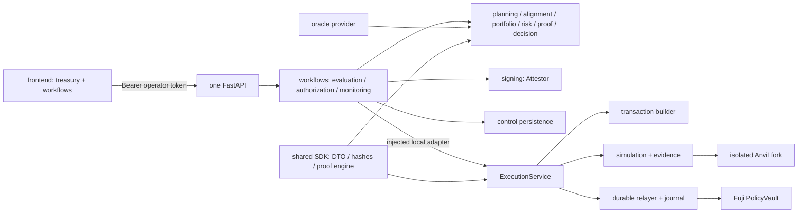

# Kiến trúc module sau refactor

> **DOC STATUS: HISTORICAL_DESIGN - OLD / SUPERSEDED.** Retained checkpoint/reference only; not current system state, readiness or operating instructions.
> Use the [current system design](../AI_Treasury_Security_System_Design_v2.1.md) and [documentation index](../README.md). Addresses, defaults, test counts and limitations below belong to their original checkpoint. Raw evidence keeps its original scope.

Checkpoint trước thay đổi: `19aa935`. Refactor diễn ra trên nhánh `refactor/modular-backend-frontend`. Mục tiêu là rõ ownership và đơn giản cài/deploy, đồng thời giữ wire contract và các gate ký/thực thi.

## Quyết định kiến trúc

**Cập nhật:** hai API đã được gộp theo yêu cầu người dùng. Đọc [kiến trúc runtime hiện tại](UNIFIED_BACKEND.md). Đây là modular monolith: một package `treasury_backend`, một môi trường Python, một FastAPI/Uvicorn. Không chia microservice theo từng module vì tăng cấu hình vận hành mà chưa cần thiết. Giữ module boundary: signing quản lý attestor, execution quản lý relayer; cả hai cùng process và máy quản trị giữ owner ngoài runtime.

Các file workflow lớn được tách theo pha: `service.py` facade/query/composition; `evaluation.py` tạo attempt và chạy gate; `authorization.py` revalidation/attest/submit; `monitoring.py` reconcile/expiry/recovery; `context.py` DTO attempt đã duyệt. Operator cũ được tách env/profile/process/deployment/service/CLI. Tách folder có đi kèm tách trách nhiệm, không tạo bản sao proof engine.

## Tìm code ở đâu?

| Trước | Sau |
| --- | --- |
| `apps/control-plane/app/planner/__init__.py` | `backend/src/treasury_backend/modules/planning/service.py` |
| `apps/control-plane/app/{alignment,portfolio,economic_risk,proof,sde,attestor,storage,experience}/` | các module `{alignment,portfolio,risk,proof,decision,signing,persistence,experience}` |
| Control service/evidence/client | `modules/workflows/` |
| Control models/domain/config/API | `core/`, `config/control.py`, `api/control/` |
| `apps/execution-plane/app/{chain,transaction,simulation,evidence,execution}/` | `modules/execution/{chain,transaction,simulation,evidence,relaying}` |
| B CLI/config generators | `operations/{execution,configuration,vectors,samples}.py` |
| `apps/dashboard/` | `frontend/` với API/shared/features |
| `scripts/treasury_ops.py` | `operations/{env,profiles,environments,processes,contracts,services}.py` |
| `tests/integration/`, A/B tests | `backend/tests/{integration,control,execution}` |
| Developer scripts | `tools/{contracts,quality,evaluation,operations}`; scripts cũ là shim |

Đường dẫn module ở bảng tương đối với `backend/src/treasury_backend`. [MODULES.md](../../backend/MODULES.md) và README từng module là hướng dẫn phát triển hiện tại. [CONTRIBUTING](../../CONTRIBUTING.md) giải thích nơi đặt feature, interface review và test. Shared protocol vẫn ở `packages/contracts-api`; Solidity ở `contracts`.

## Luồng và mở rộng

Goal -> proposal -> alignment -> build/fork simulation -> verified evidence + portfolio/oracle -> risk + proof -> immutable decision -> đọc lại state/reproof/final preflight -> attestor -> durable relayer -> atomic vault enforcement -> receipt reconciliation. Chi tiết tại [CURRENT_SYSTEM_FLOW](../CURRENT_SYSTEM_FLOW.md).

Oracle có `PriceProvider` và strict snapshot DTO riêng. `TREASURY_ORACLE_MODE=external` tắt demo writes và giữ nguyên timestamp producer. Nguồn thực vẫn cần review nguồn, scope, freshness, precision và đồng bộ source hash với owner policy; xem [hướng dẫn merge oracle](../../backend/src/treasury_backend/modules/oracle/README.md).

Thay ABI, EIP-712 fields, proof formulas, policy/session semantics cần phối hợp SDK/contract/backend/vectors. Thay UI/risk parser/thêm nguồn adapter thường ở module tương ứng nhưng vẫn phải đăng ký config/composition nếu cần. Không tuyên bố mọi tính năng có thể chỉ sửa đúng một folder.

## Triển khai và trạng thái

Root Dockerfile build backend; `frontend/Dockerfile` build frontend; `compose.yaml` nối chúng với volume bền vững. Frontend có thể deploy static riêng qua public API URL + exact CORS. Backend runtime Python/Anvil; Forge/solc chỉ ở build. Một instance vì SQLite/journal chưa hỗ trợ HA. [Hướng dẫn deploy](../../deploy/README.md).

Checkpoint refactor giữ env nguyên; sau đó người dùng cấp ba ví/Groq key và đã cập nhật private env có ủy quyền. [Bounded Groq planner](../integrations/GROQ_PLANNER_AND_ENV.md) đã tích hợp và chạy LOCAL; real oracle/DEX và open-ended agent chưa có. Không gửi Fuji hoặc deploy hosting trong bước này. Docker image/Render smoke cần hạ tầng thật; không coi config check là deployment evidence.

Kết quả kiểm tra cụ thể sau refactor được ghi trong [báo cáo xác minh](REFACTOR_VALIDATION.md). Kết quả benchmark lịch sử giữ nguyên và không tự coi là benchmark lại sau refactor.
