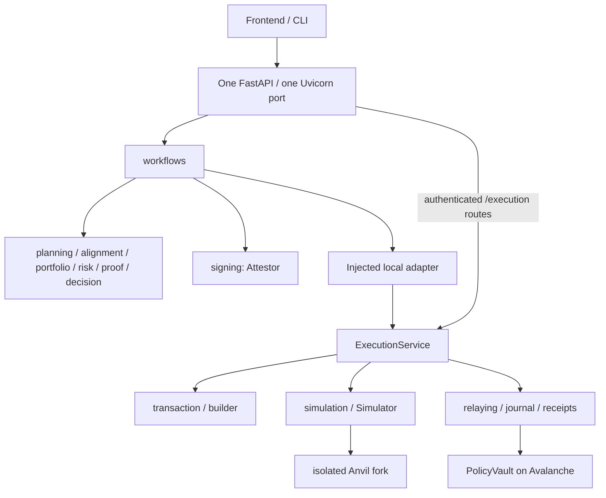

# Backend FastAPI thống nhất

> **DOC STATUS: HISTORICAL_REFERENCE - OLD / SUPERSEDED.** Retained checkpoint/reference only; not current system state, readiness or operating instructions.
> Use the [current system design](../AI_Treasury_Security_System_Design_v2.1.md) and [documentation index](../README.md). Addresses, defaults, test counts and limitations below belong to their original checkpoint. Raw evidence keeps its original scope.

Control và Execution hiện chạy trong **một ứng dụng FastAPI, một process Uvicorn và một cổng HTTP**. Đây là kiến trúc chạy mặc định của `treasury local`, `treasury serve` và container. Module nghiệp vụ vẫn giữ nguyên ranh giới sở hữu; không chia code theo process A/B nữa.

## Entry point và bố cục

| Thành phần | Đường dẫn / vai trò |
| --- | --- |
| App factory duy nhất khi chạy mặc định | `backend/src/treasury_backend/api/app.py:create_app` |
| Runner | `python -m treasury_backend.api.serve` |
| Workflow facade | `modules/workflows/service.py:ControlPlane` |
| Execution facade | `modules/execution/service.py:ExecutionService` |
| Adapter nội bộ | `api/local_execution.py:LocalExecutionSDK` |
| Client xác minh facts | `modules/workflows/client.py:VerifiedExecutionClient` |
| Mô phỏng | `modules/execution/simulation/runner.py:Simulator` |

Đường dẫn module ở bảng tương đối với `backend/src/treasury_backend`. Một lifespan khởi tạo execution một lần, inject client vào workflow và đóng HTTP verification clients khi dừng. Các handler đồng bộ chạy trong worker thread để công việc RPC/Anvil không chặn event loop.



Workflow gọi execution bằng hàm Python, không gửi HTTP đến chính backend, không có loopback execution server. LocalExecutionSDK tái sử dụng wire/evidence codec của shared SDK: đối tượng `httpx.Request/Response` chỉ là envelope trong bộ nhớ để giữ validation/error/hash behavior, không mở socket hay HTTP connection pool. Các RPC tới Avalanche/Anvil vẫn là kết nối mạng thật.

## Route và cấu hình

- Workflow/treasury/proof/attest giữ `/v1/...`, `/v2/...` và bearer auth hiện tại.
- Execution router dùng `/execution/v1/...`, final preflight là `/execution/v2/simulations/preflight`, yêu cầu `X-API-Key` và idempotency key cho mutation. Operator bearer token không thay thế execution API key.
- `/docs` và `/openapi.json` mô tả cả hai nhóm route trong một ứng dụng.
- `/healthz` giữ tương thích; `/health` có `execution_transport=in-process` cho LOCAL/FUJI. MOCK dùng fixture, không khởi tạo execution chain thật.
- CLI local dùng cổng `TREASURY_A_PORT` cũ để tương thích; container dùng `$PORT`. `TREASURY_B_PORT`, `PACEVANT_B_URL`, `PACEVANT_B_TOKEN` không cần cho runtime gộp. Biến cũ có thể giữ trong `.env` để chạy công cụ tương thích.
- `B_API_KEY` vẫn cần để bảo vệ nhóm endpoint execution. Không có secret mới phải lấy hoặc biến bắt buộc mới phải điền.

Các factory/runner standalone cũ trong `api/control`, `api/execution.py`, `api/serve_control.py` và CLI B được giữ cho kiểm thử/consumer legacy. Chúng không được launcher hay container khởi động mặc định. Shared SDK HTTP consumer dùng base URL `http://host:port/execution` với backend gộp; v1.1 standalone OpenAPI được giữ để kiểm thử tương thích, không phải OpenAPI của app gộp.

## Mô phỏng đã có những gì?

Thiết kế đầy đủ và kết quả rà soát mới: [system design](../AI_Treasury_Security_System_Design_v2.1.md), [readiness review](../audit/V2_1_READINESS_REVIEW.md). Final Phi preflight chạy trên pinned build block và có cache; latest context checks/live estimate gas là các bước riêng, không phải full latest-block re-simulation. Recovery dùng operator-auth `POST /v1/workflows/{id}/recover` trên chính app gộp.

`Simulator.simulate` tạo Anvil fork tại block xác định, chạy exact guarded vault path, baseline và fixed stress, đọc balances/allowances trước-sau, logs/trace và tạo content-addressed evidence. `Simulator.preflight_v2` kiểm tra exact compiled Phi, certified risk debit, session và required stresses trước ký. Mô phỏng không gửi swap lên RPC nguồn. Anvil fork là process native tạm; không phải một API backend thứ hai.

Đây vẫn là mô phỏng với MockUSDC/MockWAVAX/MockSwapAdapter và oracle demo. Không có bảo đảm cho một DEX adapter chưa tích hợp. [README simulation](../../backend/src/treasury_backend/modules/execution/simulation/README.md) ghi interface, artifacts, lifecycle và tests.

## Giữ các gate và dữ liệu

Tách module là ranh giới code, không còn là cách ly khóa bằng process: cùng runtime có attestor và relayer keys; owner/deployer key vẫn bị loại khỏi serving environment. Các checks alignment/risk/proof, immutable decision, independent chain reads, revalidation, final preflight, idempotency/journal và on-chain guard vẫn giữ đầy đủ. Chỉ thay transport nội bộ và composition, không thay Solidity hoặc công thức proof để làm workflow pass.

Idempotency, file locking và simulation rate limit nằm trong ExecutionService nên cả gọi nội bộ lẫn HTTP đều đi qua cùng cơ chế. Hai kho control/execution và raw transaction journal vẫn giữ đường dẫn/schema; không cần migrate hoặc xóa dữ liệu chỉ để gộp API. Dùng một backend instance/worker; chưa hỗ trợ HA với SQLite/journal hiện tại.

## Chạy và deploy

```sh
uv sync --locked
# MOCK UI / API:
uv run --locked python -m treasury_backend.api.serve
# Full local chain -> proof -> signature -> receipt:
uv run --locked treasury local --once
# Giữ dashboard local:
uv run --locked treasury local
```

Root Dockerfile và Compose vẫn dùng một backend service, frontend riêng. Chỉ publish một cổng backend. Log backend chuyển thành `<control_data>/backend.log`; không cần log của execution server riêng. Launcher có thể quản lý heartbeat/process lifecycle, nhưng chỉ khởi động một Uvicorn. Owner deploy/renew trên máy quản trị; không tự deploy contract khi start server. [Deploy](../../deploy/README.md), [kết quả xác minh](UNIFIED_VALIDATION.md).
