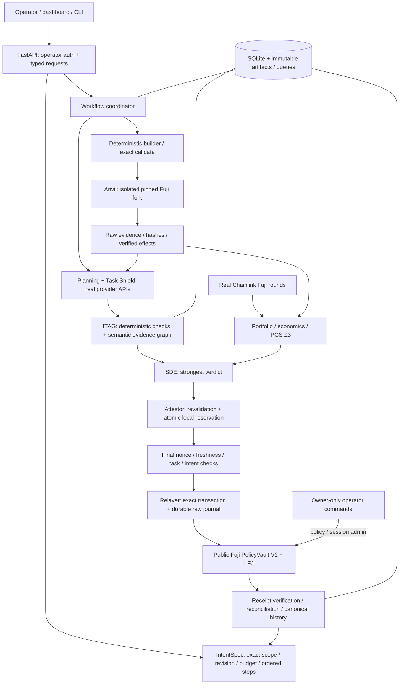

# Rà soát hệ thống thực, kiến trúc và security V2.1

> **DOC STATUS: HISTORICAL_AUDIT - OLD / SUPERSEDED.** Retained checkpoint/reference only; not current system state, readiness or operating instructions.
> Use the [current system design](../AI_Treasury_Security_System_Design_v2.1.md) and [documentation index](../README.md). Addresses, defaults, test counts and limitations below belong to their original checkpoint. Raw evidence keeps its original scope.

Ngày rà soát: 20/11/2026. Checkpoint trước rà soát: `4f3d0ad`, nhánh dự phòng `backup/pre-system-audit-4f3d0ad`. Đã fetch `origin/main`: `70bf6c7`, không có commit main mới chưa nằm trong codebase. Đây là đánh giá source, cấu hình, regression và bằng chứng thực thi; không phải chứng nhận audit bảo mật độc lập.

## 1. Kết luận và phạm vi

PaceVant hiện là modular monolith: một backend Python/FastAPI/Uvicorn, control và execution gọi nội bộ trong cùng process. Frontend là HTML/CSS/JavaScript trên trình duyệt. Solidity V2 và native Anvil/Foundry giữ nguyên vai trò; không cần dịch vụ Node.js backend.

Luồng treasury **USDC → WAVAX trên public Avalanche Fuji** dùng dữ liệu chain/API thật. Nó đã có giao dịch công khai đi qua planner, Task Shield, ITAG, risk, Z3, attestor, relayer và đối soát receipt. [Bằng chứng trước đợt rà soát](../integrations/fuji-itag-live-validation.json) được giữ nguyên như một checkpoint, không đổi nhãn thành kết quả của mã mới.

Đây là sản phẩm demo treasury do operator điều khiển, hỗ trợ tập hành động hẹp. Không mô tả nó là agent giao dịch tự do, hệ thống đa người dùng đã hoàn chỉnh, bằng chứng sinh lời tiền thật, hay hệ thống trustless kiểm chứng SMT trực tiếp trên chain.

Kết quả cuối của đợt rà soát và các lần chạy được ghi trong [report JSON](system-security-real-data-review.json). [Runbook hiện tại](../demo/FUJI_ITAG_LIVE.md) là đường chạy chuẩn.

**Lượt chạy sau sửa đã CONFIRMED:** workflow `workflow_b813ce97ad0542e9b1b667e4e5e07788`, Fuji block **61371323**, [transaction công khai](https://testnet.snowtrace.io/tx/0xf975361607032ec0709140d32c6d5e98a266f8df6917226e1d6ecb6cf6361b10). Planner, Shield và ITAG gọi DeepSeek thật. [Report live mới](system-security-live-validation.json): **14/14** kiểm tra public-chain và **3/3** negative `eth_call` đạt. Giao dịch được đưa vào block trước approval expiry **40 giây**. Bốn batch output evidence trước phê duyệt đều có check ALIGNED được bind trong approval proof. [Năm query SMT](system-security-live-proof/README.md) được kiểm hash và giải độc lập; verifier trên history thực từ chối dùng lại step với `ITAG_STEP_ALREADY_COMPLETE` và `ITAG_BUDGET_EXCEEDED`. Negative calls và kiểm tra dùng lại history chỉ đọc, không broadcast thêm giao dịch.

| Kiểm chứng | Kết quả / phạm vi |
| --- | --- |
| Python toàn repository sau sửa header/runtime | **438 passed, 4 skipped**, 380,51 giây |
| Focused oracle startup / owner journal / extended header / audit sau sửa metadata | **17 passed** |
| Solidity native Foundry | **60 passed**, gồm hai fuzz tests × 256 runs và các ca atomic rollback |
| Dependency compatibility | 68 packages tương thích với lock; không thay cho audit lỗ hổng dependency |
| Ruff / diff / secret scan | Đạt; `.env` private và runtime journals không đưa vào commit/report công khai |
| CLI doctor `--network fuji --live` | `configuration_ready=true`; ba role đúng, owner/relayer có gas và historical reads hoạt động |

Bốn nhóm test opt-in bị skip gồm portfolio public read, Circle fork pipeline, LFJ fork adapter và ablation benchmark đầy đủ; không được tính là pass. Lượt public Fuji nêu trên là kiểm chứng riêng. Hai warning Python là deprecation từ dependency. Timestamp event không phải stopwatch của HTTP request; đối soát receipt có thể kết thúc sau cửa sổ approval, còn inclusion phải nằm trong thời hạn contract kiểm tra.

**Điều kiện cần xử lý trước lượt demo tiếp theo:** kiểm tra chỉ đọc sau giao dịch thành công cho thấy vault còn `1126` base units = **0,001126 Circle test USDC** và `52870741369512` base units WAVAX; ví owner có **0 Circle test USDC**. Swap tiếp 1 USDC base unit sẽ vượt exposure WAVAX 25%, nên `select_goal` từ chối đúng. Không thiếu biến môi trường hay gas. Cần nhận thêm Circle test USDC qua [faucet chính thức](https://faucet.circle.com/) — chọn **Avalanche Fuji**, recipient **vault `0xd8EC86820709505C3779a4Fe5D828e8ADE663E1D`**. Faucet hỗ trợ smart-contract fund flows và có reCAPTCHA cần người dùng xử lý. Có thể nhận vào ví cá nhân/owner rồi chuyển đúng ERC20 vào vault. [Circle xác nhận contract Fuji](https://developers.circle.com/stablecoins/usdc-contract-addresses): `0x5425890298aed601595a70AB815c96711a31Bc65`. Không tự nới cap exposure, rút WAVAX hay tạo số dư giả để ép lượt tiếp theo pass. Receipt đã xác nhận vẫn xem lại được khi chưa nạp thêm.

## 2. Kiến trúc thực tế và ranh giới dữ liệu



| Thành phần | Dữ liệu đang dùng | Vai trò và giới hạn |
| --- | --- | --- |
| Planning | DeepSeek chính thức; fallback Groq, Gemini, Xingchi | Trích direction/amount; compiler độc lập kiểm tra grammar, precision và exact amount. Model không tự chọn vault/router/token |
| Task Shield | Phản hồi API model thật, authenticated user tasks, semantic view của output thật | Có quyền chặn/escalate; không có quyền tự cấp authorization. Các check output trong hardened/pipeline được bind vào approval proof |
| Temporal / ITAG | IntentSpec operator xác thực, revision, reservation, lịch sử outcome đã đối soát | Chặn dùng lại step, vượt budget, sai thứ tự, hủy/revision và lịch sử không chắc chắn. Ledger là off-chain SQLite |
| Portfolio | Balance, decimals, vault policy, block/hash và history thật | PRE/revalidation không đọc thêm các oracle chỉ dùng cho dashboard; giá dùng cho risk/proof vẫn lấy riêng từ Chainlink thật |
| Oracle cho ký | Direct original rounds của Chainlink trên Fuji | Có kiểm tra feed identity, ABI, decimals, round, age, block/hash. USD là reference valuation cho token testnet |
| Fuji Observatory | RPC / Chainlink / Witnet / Pyth / CoinGecko theo adapter | Chỉ quan sát/tham khảo. Unavailable/stale được đánh dấu; không được thay cho giá cấp quyền ký |
| Builder / LFJ | Policy/vault/adapter/pool state thật tại block được pin | Exact calldata, recipient=vault, quote/route/bytecode và giới hạn được kiểm tra độc lập |
| Simulation | EVM chạy thật trên fork Fuji | Dự báo thực thi; không phải public swap. Actor funding, attestor override và reserve stress là giả định chỉ trong fork cô lập |
| Risk / proof | Exact integer/rational arithmetic, giá tham chiếu thật, effects thật của fork, Z3 thật | Ba nghĩa vụ UNSAT, hai feasibility SAT; chứng minh trong mô hình hữu hạn hai token và price bands được owner cho phép |
| Attestor | Approval bundle bất biến + revalidation + private key hệ thống | Trusted signer kiểm chứng off-chain. Không ký arbitrary approval do request tự gửi lên |
| Relayer | ApprovalV2, exact call và key relayer thật | Preflight, journal trước broadcast, nhận hash/receipt thật; lỗi chưa rõ kết quả không tạo swap mới tự động |
| Vault | Solidity thực trên chain 43113 | EIP-712, calldata/Phi binding, nonce, expiry, allowlist, caps, session/global budget, allowance cleanup và atomic postconditions |
| Monitoring | Public receipt/logs, actual balances, block hash, snapshots và gas | Đối soát và xử lý pending/reorg. Receipt thành công không tự được coi là outcome hợp lệ nếu binding/attribution sai |

## 3. Các vấn đề đã sửa trong đợt này

1. **Mất hàng đợi evidence khi batch lỗi:** `flush_data` trước đây xóa pending trước khi kiểm tra hết batch. Nay chỉ loại những batch đã kiểm tra thành công; dữ liệu chưa kiểm tra vẫn chặn tạo proof.
2. **Thiếu binding của các output check:** các check output ALIGNED trong `wallet_pipeline`/`wallet_hardened` nay có trong `task_shield_proof.check_ids`; attestor kiểm tra lại session/revision/config của chúng.
3. **Khả năng fallback fixture khi composition sai:** canonical control client nay từ chối client giả lập trong LOCAL/FUJI và từ chối thiếu execution client, thay vì rơi xuống MockExecutionClient. API cũng giữ lệnh cấm scenario mock ở live mode.
4. **Deadline vượt cuối session:** deadline mới được chặn bởi `session.expires_at` ngoài TTL, policy expiry và UTC day boundary; tránh ký approval mà contract chắc chắn sẽ từ chối gần cuối phiên.
5. **Độ cũ sau preflight:** sau proof/guarded preflight, đọc lại latest Chainlink rounds, xác minh lại head/fork/hash/bytecode/drift và kiểm tra freshness/deadline theo đồng hồ hiện tại. Nonce cũng được kiểm tra lại trước preflight.
6. **Môi trường native child:** runtime Anvil và compiler/Anvil do operator launcher quản lý chỉ nhận các biến OS/path/cache/certificate cần thiết; không kế thừa wallet keys, model keys hoặc service tokens. Đây là giảm lộ lọt qua environment, không phải sandbox filesystem hay HSM.
7. **Cấu hình bật ITAG dễ bị hiểu sai:** flag chỉ nhận `0`/`1`; giá trị sai không được âm thầm biến thành false. `legacy_fixture` bị chặn ở startup live. `doctor` kiểm tra thêm Shield, key presence và yêu cầu ITAG/Shield phù hợp; không gửi key ra output.
8. **Gia hạn owner không bền khi timeout:** thêm raw transaction journal trước broadcast, xác minh sender/hash, khóa ghi và session ID ổn định khi resume cùng operation. Không ký transaction khác khi chỉ retry một kết quả RPC chưa rõ. Journal nằm ở private runtime data.
9. **API không cần cache giá mới để khởi động:** chỉ với đúng Circle/WAVAX và proof policy Chainlink đã xác minh, lỗi refresh cache được báo UNAVAILABLE mà không restamp giá cũ. Runtime vẫn phải đọc direct Chainlink hợp lệ mới được approve/ký. Cấu hình/source/token sai vẫn bị từ chối.
10. **UI khởi tạo ghi “Local mock” trước khi biết mode:** đổi thành trạng thái đang xác minh; chỉ hiển thị chế độ sau phản hồi backend. CLI cũng báo mã ControlError có kiểm soát thay cho một thông báo lỗi chung chung.
11. **Fuji header dài làm builder dừng:** lượt chạy audit phát hiện `ExtraDataLengthError` khi RPC trả `extraData` vượt 32 byte. Các Web3 clients dùng chung middleware chuẩn để đọc header Avalanche và fork; vẫn giữ nguyên hash/number/timestamp và mọi kiểm tra state. Regression kiểm header dài và xác nhận read-only transport vẫn cấm gửi giao dịch. Lượt bị chặn không ký hoặc broadcast.
12. **Metadata session trong manifest:** khi renew, `session_creation_tx/block` nay trỏ receipt tạo session hiện tại; receipt đầu tiên được giữ ở `initial_session_creation_tx/block`, các lần renew vẫn có trong `owner_renewals`. Không gắn session ID mới với receipt tạo phiên cũ.

Các thay đổi này không sửa Solidity, ABI, thuật toán SMT hay nới financial caps.

## 4. Cửa sổ thời gian và độ linh hoạt

Theo quyền operator cho phép nới giới hạn phục vụ test:

| Đồng hồ/giới hạn | Hiện tại | Ý nghĩa |
| --- | --- | --- |
| On-chain session | **86.400 giây / 24 giờ** | Quyền thực thi trong phiên, có ngân sách riêng. Owner đã tạo phiên thật; không cần gia hạn mỗi giờ |
| Approval TTL | **300 giây** | Thời hạn của một giao dịch đã build; vẫn là trần owner/contract hiện tại, không đổi thành 24 giờ |
| Snapshot/fork time age | **300 giây** | Không được ký bằng state cũ quá cửa sổ này |
| Fuji block drift | **200 block**, validator tối đa 240 | Tránh 120 block trở thành thời hạn ngắn hơn TTL khi Fuji ra block nhanh. Giới hạn tuổi thật 300 giây vẫn áp dụng độc lập |
| AVAX Chainlink round age | **600 giây** | Round thật phải còn hợp lệ; không tự restamp |
| USDC Chainlink round age | **86.400 giây** | Heartbeat riêng của feed, không phải snapshot cũ được phép 24 giờ |
| Demo IntentSpec | Khoảng **30 phút**, còn bị ràng buộc mandate/session | Đồng ý cho một goal/step/budget, không phải chữ ký giao dịch sống 30 phút |
| CLI đợi round mới | Tối đa **300 giây trước khi tạo intent** | Chuẩn bị đủ feed headroom; không kéo dài approval đã cấp |

Đã kiểm tra on-chain: đổi session không đổi active policy hash, max swap, daily spend cap, slippage hoặc global/daily counters. Session mới có counter riêng theo thiết kế; **không reset global daily risk/daily spend**. Receipt và so sánh trước/sau được lưu trong report JSON.

Không có cách nới deadline tùy ý mà vẫn tuyên bố dữ liệu mới: nếu RPC/model chậm, round đổi, session hết hoặc budget hết, hệ thống vẫn phải từ chối. Khi thử lại một lượt đã ký hoặc chưa rõ broadcast, phải kiểm tra trạng thái/hash/nonce và expiry trước; không tự nhân đôi giao dịch.

## 5. Mock, giả định và tính năng chưa có

- **MOCK profile:** fixture V1 phục vụ UI/CI; không phải proof/Phi/session V2.1 thật. Không được gắn nhãn Fuji.
- **LOCAL profile:** mock tokens/adapter, nhưng EVM, chữ ký, Z3 và receipt local là thực. Dùng kiểm tra logic, không là public-chain evidence.
- **Test model / benchmark scripted replies:** fixture để kiểm tra cơ chế, không chứng minh accuracy hay attack detection của DeepSeek. Không dùng số benchmark scripted làm tỷ lệ chặn tấn công thực tế.
- **Fork baseline/stress:** chạy EVM thật nhưng là phản thực tế. Không trình bày reserve shifts, funded external actor hay signer override trên fork như giao dịch lịch sử trên Fuji.
- **Giá test token:** original Chainlink rounds thật, valuation USD của Circle test USDC/WAVAX là giả định policy đã công bố. Không chứng minh redeem USD hay P&L mainnet.
- **Fuji LFJ reverse swap:** hiện chủ động bị chặn, không giả lập route WAVAX → USDC trong API live. Reverse mock route có test và cap riêng; thêm reverse LFJ cần implementation/review riêng.
- **Demo User:** account dự phòng trong private env, chưa là hệ thống signup/deposit/authorization đa người dùng. Hiện operator dùng vốn vault và relayer hệ thống trả gas.
- **Strategy/LLM tự do, payments, multi-asset:** không nằm trong phạm vi swap-only đã kiểm chứng. Không giả vờ có chức năng bằng dữ liệu mẫu.

## 6. Security được bảo đảm ở đâu

| Vi phạm | Lớp chặn | Bằng chứng phù hợp |
| --- | --- | --- |
| Goal/amount/direction không khớp | Parser/compiler độc lập, wallet constraints, Shield/ITAG | Regression và request thật; model positive không ghi đè deterministic reject |
| Tool injection / output chưa kiểm tra | Shield, pending evidence, revision/config binding | Test có malicious tail và batch lỗi; không xem test scripted là độ chính xác model thật |
| Dùng lại intent / sai thứ tự / vượt intent budget | ITAG history/reservation và atomic SQLite checks | Native Anvil + read-only verifier trên actual reconciled Fuji history |
| Sửa calldata, Phi, domain, signer hay signed fields | SDK/signing và contract | Golden vectors, từng trường bị mutate, public negative eth_calls |
| Replay / hết hạn / policy/session bị revoke | Backend và contract | Solidity + EVM tests; nonce/deadline/counters trên receipt thật |
| Slippage / output thiếu / allowance còn dư | Risk, guarded preflight, vault Phi/cleanup | Atomic rollback tests; actual output/allowances được đối soát |
| Session/global/daily cap và race | Atomic local reservation + contract counters | Counter/race/fuzz tests, delta counters trên public Fuji |
| Reorg / unknown submission | Journals, canonical block/hash và monitor | Không credit outcome chưa xác minh và không tự tạo replacement swap |

Revert khôi phục token state, allowance, nonce và counters của transaction; gas vẫn bị tiêu tốn. Một transaction đã CONFIRMED không thể bị hệ thống “hoàn tác” sau đó.

## 7. Trust assumptions còn tồn tại

Owner là trust root và có quyền quản trị. Attestor là signer được tin cậy: Z3/ITAG chạy **off-chain**, contract xác minh chữ ký/bindings và enforce Phi/caps, không chạy lại solver và không verify ZK proof. Compromise signer key là rủi ro thực tế; ba role trong demo là tách quyền logic, không phải ba trust domains cách ly vật lý.

RPC/oracle và bytecode/token/router được phép là các giả định nguồn. Hash/binding/canonical checks không tự biến RPC thành light-client consensus proof. Mô hình proof chỉ bao phủ registry và price bands đã công bố. Hosting, secrets/HSM, nhiều instance dùng chung ledger, security audit độc lập và mainnet deployment chưa được nghiệm thu trong phạm vi này.

Các giới hạn trên cần được công bố khi phản biện; chúng không biến dữ liệu/giao dịch đã kiểm chứng trên testnet thành dữ liệu mock.

## 8. Vận hành và tài liệu

```powershell
uv sync --locked
uv run --locked treasury doctor --network fuji --live
uv run --locked treasury serve --network fuji
# Khi backend đã chạy, lệnh này dùng intent và rounds thật
uv run --locked treasury demo --network fuji --goal "Buy WAVAX with 0.000001 USDC"
```

Không chạy serve thứ hai cùng port. Dashboard dùng operator token trong private `.env`, không gửi private key vào browser. `/health` chỉ xác nhận process/config đang chạy; quyền giao dịch còn phụ thuộc chain, session, model, dữ liệu mới và budgets ở thời điểm yêu cầu.

`--network fuji` là profile chuẩn và ghi đè các biến runtime mode/đường dẫn khi compose một backend. Các alias B/A và MOCK defaults giữ cho compatibility/development không có nghĩa CLI Fuji đang chạy fixture. `.env` và template phải khớp tên biến; template không được chứa khóa thật.

Đọc [system design](../AI_Treasury_Security_System_Design_v2.1.md), [module map](../../backend/MODULES.md), README từng module, [DeepSeek configuration](../integrations/DEEPSEEK_PRIORITY.md) và [live runbook](../demo/FUJI_ITAG_LIVE.md). Implementation plan gốc giữ nguyên các checkbox; bằng chứng as-built mới là căn cứ xác nhận chức năng hiện tại, không tự đánh dấu một bản design bên ngoài chưa được cung cấp.
