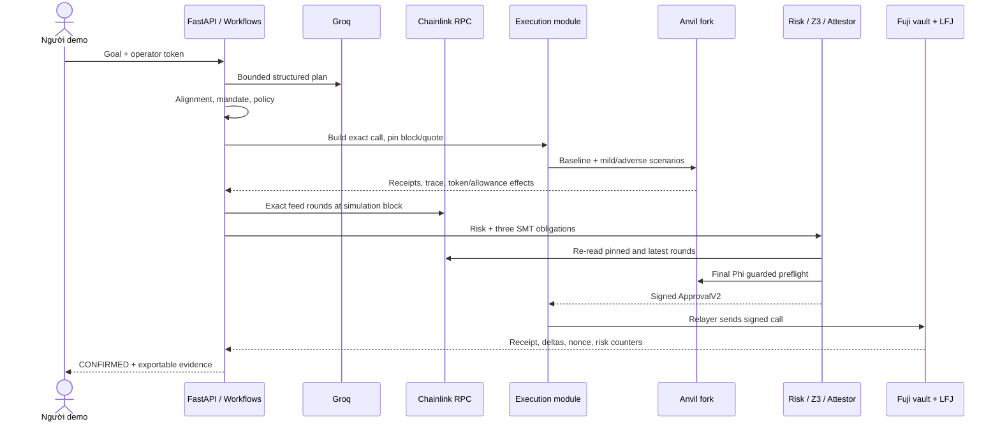

# Demo toàn bộ hệ thống trên Avalanche Fuji

> **DOC STATUS: HISTORICAL_RUNBOOK - OLD / SUPERSEDED.** Retained checkpoint/reference only; not current system state, readiness or operating instructions.
> Use the [current system design](../AI_Treasury_Security_System_Design_v2.1.md) and [documentation index](../README.md). Addresses, defaults, test counts and limitations below belong to their original checkpoint. Raw evidence keeps its original scope.

> **Historical checkpoint:** current configuration, artifact fixes, owner-approved TTL=300, required ITAG, model rotation and validation are documented in [the current Fuji ITAG runbook](FUJI_ITAG_LIVE.md). Statements below about disabled Shield/optional ITAG or the unresolved 16k artifact limit describe the earlier checkpoint, not the current profile.

Tài liệu cho bản code hiện tại: một FastAPI Python, Groq thật, Chainlink đọc RPC, vault V2 và LFJ trên Fuji chain `43113`. Mục tiêu nghiệm thu là chứng minh một yêu cầu đi qua đủ các gate rồi tạo giao dịch có thể kiểm tra độc lập. Testnet token và phép định giá USD tham chiếu không mang ý nghĩa tài sản có thể quy đổi thành USD thật.

**Kết quả đã chạy:** workflow `workflow_58cd85d5d8a246a0b96a3e20fc20d199`, block **61340481**, [giao dịch Fuji thật](https://testnet.snowtrace.io/tx/0x956caf670aa366d86f7950322b0c5781bed77809749bbcfe227b08fb4c4b8182). Vault `0xd8EC86820709505C3779a4Fe5D828e8ADE663E1D`, adapter `0x497d967d003717FA49ce16ac6FFf73a399aFe5D4`. [Report JSON](../integrations/fuji-live-validation.json) có 14 checks và ba negative eth_calls đều pass. [Năm truy vấn SMT](../integrations/fuji-live-proof/README.md) kèm hash để kiểm lại.

## Chạy nhanh với cấu hình hiện có

Từ thư mục gốc, sau khi cài Python/uv và native Foundry theo [hướng dẫn backend](../../backend/README.md):

```powershell
uv sync --locked
# Kiểm tra chỉ đọc, không deploy hoặc chuyển tiền
uv run --locked treasury doctor --network fuji --live

# Dùng vault/funding hiện có, chạy một workflow rồi dừng backend do lệnh tạo
uv run --locked treasury fuji-demo

# Giữ backend và dashboard chạy để trình diễn bằng giao diện
uv run --locked treasury serve --network fuji
```

Dashboard ở `http://127.0.0.1:8000`. Nhập giá trị `PACEVANT_OPERATOR_TOKEN` trong `.env` vào ô kết nối. Token chỉ nằm trong bộ nhớ trang. Backend giữ keys, frontend không cần gắn Core hay cung cấp private key. Goal Fuji mặc định của UI là `Buy WAVAX with 0.000001 USDC`.

Để trình diễn kết quả đã xác nhận mà không gửi swap mới, mở `http://127.0.0.1:8000/?workflow=workflow_58cd85d5d8a246a0b96a3e20fc20d199`, rồi kết nối operator token. Trang đọc workflow/proof/receipt đã lưu; tham số `workflow` không chứa credential và không tự thực hiện giao dịch.

`fuji-demo` chọn giao dịch nhỏ, kiểm quote/exposure rồi chạy. Nó không nạp thêm tiền hoặc tự gia hạn quyền owner. Nếu có backend đang giữ port 8000, dùng `treasury demo --network fuji --goal "Buy WAVAX with 0.000001 USDC"` để gọi backend đó, hoặc dừng nó trước khi dùng `fuji-demo`.

Lần setup cho một cấu hình/vault mới:

```powershell
uv run --locked treasury fuji-demo --setup
```

`--setup` cho phép giao dịch owner: deploy vault/adapter nếu chưa có manifest, tạo policy/session, chuyển tối đa 0,002 test AVAX cho relayer và swap tối đa 0,008 test AVAX thành Circle test USDC. Gas trả riêng. Token nhận được chuyển vào vault, tối đa 0,01 test USDC mỗi lần setup. Manifest có sẵn được kiểm tra và tái sử dụng. Không chạy `--setup` chỉ để làm mới session.

Các giao dịch setup/deploy được journal trước broadcast. Chạy lại dùng signed transaction/hash cũ của bước đã bắt đầu. Không xóa journal để chữa lỗi timeout; kiểm receipt/hash trước để tránh giao dịch lặp. Folder `fuji-setup` chứa signed bytes nên giữ ở private data, không đưa toàn bộ folder này cho reviewer.

## Ba ví và tài sản

| Vai trò | Địa chỉ | Công việc |
| --- | --- | --- |
| Owner | `0x607bd883bd3621378812CF5B4B8dDcCFAeBbab1b` | Deploy, nạp vốn, policy/session, rút tài sản |
| Attestor | `0x5704fA0FF7CBEd213F622c99aC6F9d6E5cbF2989` | Ký ApprovalV2 sau revalidation, không gửi swap |
| Relayer | `0x761B1FFB7AA70C7A946D3970A25F5a3859dA328C` | Trả gas và gửi đúng giao dịch đã ký |

Treasury thực nằm trong **PolicyVault**, không phải ví owner hay relayer. WAVAX thu được cũng nằm trong vault. Native AVAX của relayer dùng trả gas. Attestor ký off-chain nên không cần nạp gas cho workflow thông thường. Backend phục vụ chỉ nhận attestor/relayer keys; owner key chỉ đi vào lệnh vận hành owner.

| Thành phần | Địa chỉ Fuji |
| --- | --- |
| Circle test USDC, 6 decimals | `0x5425890298aed601595a70AB815c96711a31Bc65` |
| WAVAX, 18 decimals | `0xd00ae08403B9bbb9124bB305C09058E32C39A48c` |
| LFJ V1 pool | `0x8436B8c75ed2F015a80b8472526dd1A79BF54E38` |
| LFJ router V2.2 | `0x18556DA13313f3532c54711497A8FedAC273220E` |
| LFJ quoter V2.2 | `0x9A550a522BBaDFB69019b0432800Ed17855A51C3` |

LFJ faucet USDC `0xB607...65c2d` vẫn là token khác. Route đó tiếp tục bị chặn ở định giá/ký. Live profile chọn **Circle** và chỉ hỗ trợ chiều USDC → WAVAX. Không thay asset chỉ dựa vào symbol.

Pool testnet rất nhỏ và tỷ giá khác xa giá tham chiếu Chainlink. Lượng bootstrap có thể chỉ khoảng vài trăm base units USDC. Một base unit là `0.000001 USDC`. Đừng dùng goal 200 USDC của demo LOCAL. Quote, số dư, exposure và proof vẫn được kiểm lại ở mỗi lượt; lệnh không bỏ gate để ép giao dịch thành công.

## Pipeline và bằng chứng



Ở mỗi lượt thành công, kiểm các điểm sau:

1. Workflow ghi planner provider/model, alignment, build và quote có block/hash.
2. Baseline EVM thành công; mild stress thành công an toàn; adverse stress có thể rollback được xác nhận từ trace.
3. Risk `PASS`, proof `VERIFIED`, `check_mode`, `compile_mode`, `risk_bound` đều `UNSAT`. Assumptions và compiled region phải thỏa được, tránh kết quả UNSAT rỗng.
4. Oracle evidence giữ feed address, raw answer, decimals, round ID, answeredInRound, startedAt, updatedAt, code hash, source configuration và block/hash.
5. Attestor revalidates, final Phi preflight thành công, ApprovalV2 ràng buộc exact calldata/proof/Phi/session/nonce.
6. Fuji receipt thành công, sender là relayer, recipient là vault. Input delta đúng `-amountIn`; output đạt minOut/Phi; cả vault→adapter và adapter→LFJ allowance về 0.
7. Vault nonce đã dùng; session/global debit khớp proof. Debit có thể bằng 0 khi miền kết quả đã chứng minh không có mất giá theo mô hình; nó không phải số tiền đầu tư hoặc phí gas.

Xuất lại bằng chứng mà không chạy swap mới:

```powershell
uv run --locked treasury fuji-evidence --workflow-id WORKFLOW_ID --output docs/integrations/fuji-live-validation.json
```

Lệnh chỉ đọc chain/DB và thực hiện ba `eth_call` âm: replay, đổi router calldata và chữ ký không phải attestor. Mỗi phép gọi phải trả đúng selector lỗi vault; lỗi mạng không được tính là pass. Không gửi giao dịch âm lên chain nên không mất gas. Report chứa transaction link, proof, oracle snapshot và simulation; không chứa env/private keys/service credentials. Các `.smt2` đầy đủ nằm ở `<control_data>/proof-queries/` để kiểm lại bằng solver.

Reviewer có thể chạy lại năm truy vấn đã công bố, không cần `.env`, ví hoặc RPC:

```powershell
uv run --locked python tools/evaluation/verify_fuji_queries.py
```

Tool đối chiếu keccak của từng artifact và chạy pinned Z3. Kết quả mong đợi `SAT / UNSAT / SAT / UNSAT / UNSAT`. Tool còn in fingerprint encoder có khớp source hiện tại hay không; fingerprint lịch sử vẫn nằm trong proof. Việc này kiểm lại các phương trình đã encode, không thay bước review giả định/mô hình hoặc các phép đọc public-chain của `fuji-evidence`.

## Oracle và hai cửa sổ thời gian

Nguồn `CHAINLINK_FUJI_CIRCLE_USDC_AVAX_V1` là cấu hình riêng, hash từ JSON canonical của chain, exact asset/feed mapping, heartbeat và ý nghĩa định giá **testnet reference**. Owner `oracleSourceHash` cam kết cấu hình này, không phải hash của file JSON vừa tạo.

| Dữ liệu | Giới hạn hiện tại | Timestamp dùng kiểm |
| --- | --- | --- |
| AVAX/USD, feed `0x5498...06aD` | 600 giây | `updatedAt` gốc |
| USDC/USD, feed `0x97FE...EB73` | 86400 giây | `updatedAt` gốc |
| Pinned oracle observation / simulation / session state | 180 giây | Block timestamp thực |
| Approval deadline | Tối đa 180 giây | Owner TTL on-chain và deadline có chữ ký |
| Fork drift | Tối đa 120 blocks, đồng thời phải đạt age check | Block number/hash |

`price_timestamp` là timestamp cũ nhất của hai round. `oracle_observed_at` là timestamp block quan sát; hai trường không thay thế nhau. Hash oracle gắn cả original rounds. Revalidation đọc lại block đã pin và latest rounds; thay round/giá thì cần đánh giá lại. Stale/unavailable/round sai khiến không ký, không fallback sang giá 1/20 hay giá pool.

Cửa sổ 180 giây thay cho mặc định LOCAL 30 giây để đủ RPC/fork/preflight trên public Fuji. `setApprovalTtl` chỉ owner, giới hạn tối đa 300, và thu hồi policy hiện hành khi thay đổi. TTL được gắn vào active policy hash. Policy phải được cấu hình lại và session mới phải gắn policy mới. `maxOracleAge` ở proof vẫn áp dụng cho observation/state; không tăng nó lên 86400 để lách stale chain state.

## Dữ liệu thực và kịch bản giả định

| Phần | Live demo |
| --- | --- |
| Goal planning | Gọi Groq thật; bounded grammar/schema, cache/quota/cooldown; không fallback fixture |
| Balance, policy/session, token identities | Đọc Fuji RPC thật |
| Giá dùng risk/proof | Chainlink contract rounds thật, giá USD **tham chiếu cho demo testnet** |
| Quote/liquidity | LFJ quoter + reserves + adapter quote thật |
| Giao dịch cuối | Gửi public Fuji, kiểm receipt/log/deltas thật |
| Baseline và final Phi preflight | Chạy EVM trên bản fork của public Fuji; thay attestor/gas của process mô phỏng để kiểm enforcement |
| Stress | Counterfactual: Circle masterMinter được impersonate **chỉ trên Anvil**, mint cho external actor giả định, rồi actor swap qua LFJ để dịch reserves khoảng 20/200 bps. Không mint vào vault và không thay feed/balance/policy của treasury |
| Observatory Witnet/Pyth/CoinGecko | Tham khảo độc lập ở trang ví; không dùng ký policy Chainlink này |
| MOCK/LOCAL profiles và unit fixtures | Còn để phát triển/regression; không nằm trong live execution profile |

Stress là kiểm tra một tình huống giả định trong simulator, không phải sự kiện thị trường đã xảy ra. Artifacts ghi actor funding, các transaction setup, mức shift đo được và `source_writes=false`. Module chặn mọi impersonation/stress mutation ngoài loopback Anvil. Dữ liệu oracle/balance của baseline và receipt Fuji không được thay bằng fixture.

## Nạp thêm và chạy nhiều lần

Bootstrap nhỏ chỉ đủ một số ít giao dịch trước khi exposure WAVAX đạt 25%. Để demo lặp nhiều, dùng [Circle faucet](https://faucet.circle.com), chọn **Avalanche Fuji** và gửi test USDC trực tiếp vào **vault address trong manifest**. Faucet có bước tương tác/reCAPTCHA do người dùng thực hiện. Không gửi vào relayer để làm treasury. Không chọn LFJ faucet USDC khác contract.

Khi session hết hạn:

```powershell
# Owner transaction, chỉ chạy khi chủ quỹ muốn cấp lại session
uv run --locked treasury renew-session --network fuji
# Sau thay đổi risk/source/TTL, cần owner renewal riêng
uv run --locked treasury renew-policy --network fuji
```

Session mới không xóa global/day counters. Khởi động lại backend sau renewal để dùng manifest mới. Nếu receipt pending/không rõ outcome, kiểm workflow và recovery thay vì tạo intent mới ngay.

Các biến mới cho live profile: `TREASURY_ORACLE_MODE=chainlink`, `TREASURY_ORACLE_SOURCE_ID=CHAINLINK_FUJI_CIRCLE_USDC_AVAX_V1`, `TREASURY_MAX_ORACLE_AGE_SECONDS=180`, `TREASURY_APPROVAL_TTL_SECONDS=180`, `TREASURY_FUJI_MAX_BLOCK_DRIFT=120`. `.env` hiện tại đã điền theo lựa chọn triển khai. `.env.example` liệt kê đủ tên; các defaults MOCK/LOCAL không tự cấp quyền owner cho một người dùng mới. Không cần thêm oracle API key: Chainlink dùng RPC on-chain. Groq vẫn cần `GROQ_API_KEY` đã cấu hình.

## Giới hạn nghiệm thu

Một giao dịch thành công cùng các phép gọi âm chứng minh wiring, enforcement và evidence của **lượt đó**. Test hồi quy bổ sung các lỗi policy, proof, signature, slippage, allowances, session/risk caps và rollback. Đây chưa phải audit bảo mật, kiểm chứng mọi trạng thái AMM, bảo đảm lãi, hay chứng minh giá trị USD thật của token testnet. RPC/attestor/token semantics vẫn là các trust assumptions. Hiện backend một instance giữ cả attestor và relayer; owner tách khỏi runtime; chưa có HSM/HA tự động.

Backend deploy trên Render/VPS dùng Python + native Anvil. Compile Solidity chỉ cần lúc build/deploy bởi operator; hợp đồng đã nằm trên Fuji, không cần compiler trong backend phục vụ. Node.js không cần cho backend; Node còn là công cụ tùy chọn để kiểm vectors/frontend/diagram. Xem [hướng dẫn deploy](../deployment/PYTHON_BACKEND_RENDER_VPS.md).
