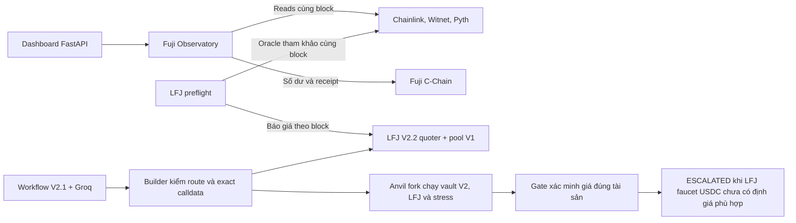

# Oracle Fuji và LFJ trên nền V2.1

> **DOC STATUS: HISTORICAL_REFERENCE - OLD / SUPERSEDED.** Retained checkpoint/reference only; not current system state, readiness or operating instructions.
> Use the [current system design](../AI_Treasury_Security_System_Design_v2.1.md) and [documentation index](../README.md). Addresses, defaults, test counts and limitations below belong to their original checkpoint. Raw evidence keeps its original scope.

Live update 2026-11-20: [Circle / Chainlink / full Fuji demo](../demo/FUJI_LIVE_END_TO_END.md). Earlier faucet-USDC blockers and controlled/mock descriptions below belong to their historical profiles.


Tích hợp chọn lọc từ `origin/main` tại `8e833d3`. Phần oracle và ví xuất phát từ merge `e45f057`. Phần LFJ xuất phát từ `cd9be15`. Runtime dùng các module refactor, Groq và một FastAPI.

| Thành phần | Runtime hiện tại |
| --- | --- |
| Fuji Observatory | `/fuji-wallet` hoặc `/fuji-wallet.html`, dùng operator token qua `GET /v1/fuji/wallet/{address}` |
| Số dư | Test AVAX, Circle test USDC, LFJ faucet USDC và Fuji WAVAX có định danh riêng |
| Oracle | Đọc Chainlink AVAX/USD và USDC/USD, Witnet AVAX/USD và Pyth AVAX/USD. CoinGecko Demo là nguồn tham khảo tùy chọn qua `PACEVANT_COINGECKO_DEMO_KEY` |
| LFJ | Pool V1 trực tiếp, chiều LFJ faucet USDC sang WAVAX, quoter và router V2.2 |
| Vault | `LFJSwapAdapter` sau interface `ISwapAdapter`. Đường V2 dùng `ApprovalV2`, Phi, session và các counters |
| Chữ ký public LFJ | Bị chặn bởi `ORACLE_TOKEN_IDENTITY_MISMATCH` cho đến khi có định giá độc lập của đúng token |



Observer giữ timestamp, round/feed ID, block/hash, source và freshness. API luôn kiểm operator token, kể cả khi dashboard chạy MOCK. Reader chỉ đọc chain 43113 qua RPC cố định. Nó kiểm lại block hash và giới hạn response, thời gian, concurrency và request rate. Cache giữ nguyên block và thời điểm quan sát.

Builder kiểm registry router/quoter, token/decimals, runtime hashes, các trường immutable của adapter, pool/factory và best route ở block đã pin. Công thức reserve V1, quoter và quote adapter phải khớp. Quote gắn vào build và baseline evidence. SDK 1.2.0 thêm enum `lfj-v1-fuji-v1` cho `adapter_version`. Schema wire 1.1, calldata và EIP-712 ApprovalV2 giữ encoding hiện tại.

Simulator fork lại đúng block, kiểm quote và code, chạy baseline với attestor tạm của fork. Stress dùng một swap đi trước qua cùng vault V2 trên fork, với mục tiêu tác động khoảng 20 và 200 bps. Thiếu số dư, giới hạn chi tiêu hoặc tác động không đủ dẫn tới `INCONCLUSIVE`. Receipt facts kiểm đường token qua adapter, pool và tầng allowance bổ sung. Final Phi preflight dùng cùng route và logic stress.

## Rào cản định giá

LFJ test USDC dùng địa chỉ `0xB6076C93701D6a07266c31066B298AeC6dd65c2d`. Circle test USDC dùng `0x5425890298aed601595a70AB815c96711a31Bc65`. Cùng symbol và 6 decimals chưa xác lập peg hay quyền quy đổi. Giá AVAX/USD và USDC/USD thật cũng chưa xác lập được giá USD cho cả hai token của vault. Quote từ cùng pool mô tả giá thực thi và không cung cấp kiểm chứng độc lập cho chính pool đó.

Workflow ghi `ORACLE_TOKEN_IDENTITY_MISMATCH` trước proof và ký. Dashboard giữ số dư chain và bỏ USD snapshot. Proof adapter, revalidation và relayer giữ chốt này. Producer giá demo bỏ qua manifest LFJ. Heartbeat của feed là thông tin quan sát. Freshness và deadline của policy tiếp tục dùng các giá trị đã kiểm tra.

Để mở execution public cần nguồn định giá độc lập của đúng địa chỉ token và owner policy tương ứng. Nếu chọn pool với token khác, cần xác minh lại route/liquidity, cập nhật registry, adapter và proof policy. Chạy public còn cần vault/session đã deploy, funding và test receipt.

## Chạy

```powershell
# Đọc quote và Chainlink tại cùng block
uv run --locked treasury lfj-preflight --output .control-data-v2/lfj-preflight.json

# Mở dashboard V2.1 local và dùng liên kết Ví và oracle Fuji
uv run --locked treasury local

# Đọc state Fuji. Giao dịch test đi vào Anvil loopback.
$env:PACEVANT_LFJ_FORK='1'
uv run --locked python -m pytest backend/tests/execution/test_lfj_v2_fuji_fork.py -q
Remove-Item Env:PACEVANT_LFJ_FORK
```

`treasury deploy --network fuji --adapter lfj` là lệnh gửi giao dịch quản trị để triển khai vault/adapter V2, thiết lập policy/session và ghi manifest. Funding LFJ test USDC cần chuyển riêng vào vault. `treasury local --once` và deploy mặc định dùng mock adapter. Lượt tích hợp hiện tại chỉ đọc public Fuji và thực thi giao dịch trên Anvil.

## Kiểm chứng

- Lượt đọc public Fuji tại block 61338502 xác minh route trực tiếp và quote cho 0,1, 1 và 10 LFJ test USDC. Hai feed Chainlink có round hợp lệ và được ghi nhận trong heartbeat tại block đó.
- Observer qua app gộp đọc đủ bốn loại số dư ở block 61338774. Chainlink nằm trong heartbeat, Witnet trả UNVERIFIED và Pyth trả STALE. Request thiếu token bị từ chối và cache giữ nguyên block của snapshot.
- Opt-in test tạo vault V2 trên fork và lấy quote trên bytecode LFJ thật. Baseline và mild stress thành công. Adverse stress protected revert. Final Phi preflight được chạy với **giá giả định của fixture** để kiểm cơ chế. Giá đó chỉ nằm trong test.
- Full Python checkpoint đạt 219 tests, bỏ qua hai opt-in. Nhóm test chạy sau cập nhật observer đạt 44. Forge đạt 59. Vectors EIP-712 và secret scan đạt.
- Regression SDE xác nhận workflow có evidence LFJ đã kiểm tra vẫn ESCALATE trước khi đọc giá demo. Luồng Groq thật và V2 mock adapter trên Anvil vẫn đạt proof VERIFIED và receipt CONFIRMED.
- [Kết quả kiểm tra](fuji-lfj-validation.json).

## Source

- [Oracle readers](../../backend/src/treasury_backend/modules/oracle/fuji/fuji_data.py) và [API observer](../../backend/src/treasury_backend/api/fuji.py).
- [LFJ registry và quoter](../../backend/src/treasury_backend/modules/execution/dex/lfj.py), [Solidity adapter](../../contracts/src/adapters/LFJSwapAdapter.sol), [LFJ stress](../../backend/src/treasury_backend/modules/execution/simulation/lfj_stress.py).
- [Fork regression](../../backend/tests/execution/test_lfj_v2_fuji_fork.py), [adapter Solidity tests](../../contracts/test/LFJSwapAdapter.t.sol) và [LFJ registry](https://developers.lfj.gg/deployment-addresses/fuji).
