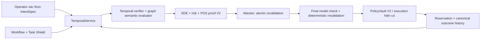

# Tích hợp ITAG từ main vào backend module

> **Historical checkpoint:** current configuration, artifact fixes, owner-approved TTL=300, required ITAG, model rotation and validation are documented in [the current Fuji ITAG runbook](../demo/FUJI_ITAG_LIVE.md). Statements below about disabled Shield/optional ITAG or the unresolved 16k artifact limit describe the earlier checkpoint, not the current profile.

Nguồn: `main@70bf6c7`, gồm `2e24de2` và `dbadd51` (PR #5). Checkpoint trước khi sửa là `9c05936`, nhánh dự phòng `backup/pre-itag-9c05936`. Lần ghép giữ một Python/FastAPI, execution gọi nội bộ, planner rotation Gemini/Groq/Xingchi, proof V2 và Solidity hiện tại.

## Tính năng đã chuyển

- Module `temporal`: intent một lần, swap giới hạn chung ngân sách, chuỗi bước có prerequisites; xác thực revision/cancellation và lịch sử xuyên workflow.
- Graph provenance phân biệt authorization của operator, tool output không tin cậy, dữ kiện chain đã đối soát và nhận định AI.
- Bộ kiểm tra deterministic + semantic evaluator + verdict fusion vào SDE. Verdict temporal không thể nới lỏng risk/proof/mandate.
- Kiểm tra assessment/graph/history/reservation/PRE snapshot trong cùng transaction SQLite khi ký và chuyển sang SUBMITTING. Kiểm tra deterministic cuối diễn ra sau lượt gọi model trước khi gửi.
- Giới hạn timeout/retry của model theo thời gian còn lại của candidate. Giữ TTL do policy hiện tại cấu hình; không mang TTL 30 giây cố định của upstream vào Fuji hiện tại.
- API intent/history/assessment, viewer `/itag`, bộ ca benchmark và công cụ đánh giá. Benchmark nằm trong `operations/itag_benchmark.py`, DTO request chung nằm trong core, đáp ứng ranh giới module.

## Cấu hình và cách dùng

`.env` và `.env.example` bổ sung `PACEVANT_REQUIRE_ITAG=0`; không cần key mới. Launcher chuyển biến này vào backend. Task Shield hiện vẫn `disabled` như trước; ITAG chưa bắt buộc để các workflow hiện tại tiếp tục hoạt động.

Muốn thử luồng ITAG: cấu hình Shield `paper` hoặc `wallet_hardened` cùng provider thật; tạo intent bằng operator bearer token tại `POST /v1/itag/intents`; gửi workflow kèm `temporal_intent: {spec_id, revision, step_id}`. Đặt `PACEVANT_REQUIRE_ITAG=1` nếu muốn bắt buộc intent. Thiếu Shield/provider hoặc proof hợp lệ sẽ bị từ chối, không dùng fixture thay thế.

API chính: `PUT /v1/itag/intents/{spec_id}`, `POST .../cancel`, `GET .../history`, `GET /v1/itag/assessments/{digest}` và `.../nodes/{node_id}`. Viewer `/itag` nhận assessment hash và operator token; API dữ liệu có xác thực. CORS hỗ trợ PUT cho revision. Cấu hình `PACEVANT_SERVE_FRONTEND=false` cũng tắt viewer assets. Đây là quyền operator hiện có, chưa phải dịch vụ user đa tenant.

## Kiểm chứng và giới hạn thực tế

Test ITAG dùng model trả lời theo kịch bản để kiểm tra logic, không đo độ chính xác LLM. Không tái sử dụng metric live trên main để nhận là đã nghiệm thu bản ghép này. Các tài liệu `ITAG_ARCHITECTURE`, `ITAG_EVALUATION`, `ITAG_BENCHMARK` giữ nội dung tham khảo upstream và có ghi chú phạm vi.

**Giới hạn đã tái hiện trên Anvil V2 thật:** artifact mô phỏng vượt giới hạn 16.000 ký tự sau sanitization của Task Shield. Workflow đi tới ESCALATED, không có attestation hoặc giao dịch swap; số dư giữ nguyên. Kiểm tra `test_itag_unified.py` xác nhận sự kiện `OUTPUT_BUDGET_EXCEEDED`. Cần thiết kế representation/budget của artifact và đo latency với provider thật trước khi bật ITAG cho live V2; bản merge này không cắt bỏ phần đuôi dữ liệu hoặc bỏ qua kiểm tra để đạt PASS.

Intent terms upstream ràng buộc cặp token theo mandate; không mặc định hứa rằng reverse swap đã được ITAG hỗ trợ. Workflow V2 hai chiều không chọn ITAG vẫn giữ các gate hiện tại và được kiểm tra hồi quy. Intent budget là gate phía backend dùng chung SQLite, không thêm budget intent vào Solidity; signer độc lập dùng DB riêng cần ledger chung để enforce toàn cục.

Không deploy, broadcast hay gia hạn session Fuji trong lần ghép. Backend đang chạy cần restart để nạp mã/cấu hình; chưa tự push lần ghép này. Kết quả kiểm tra cuối được lưu tại [itag-merge-validation.json](itag-merge-validation.json).
