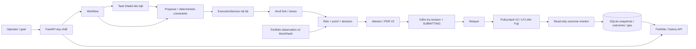

# Đồng bộ main vào codebase module — 20/11/2026

> **DOC STATUS: HISTORICAL_REFERENCE - OLD / SUPERSEDED.** Retained checkpoint/reference only; not current system state, readiness or operating instructions.
> Use the [current system design](../AI_Treasury_Security_System_Design_v2.1.md) and [documentation index](../README.md). Addresses, defaults, test counts and limitations below belong to their original checkpoint. Raw evidence keeps its original scope.

Codebase chuẩn tiếp tục là nhánh `refactor/modular-backend-frontend`: một backend Python/FastAPI, một runtime execution nội bộ, Solidity giữ nguyên. Nguồn tích hợp là `origin/main` tại `08c35df` (PR #3 portfolio/outcome và PR #4 Task Shield). Đây là báo cáo hiện trạng của lần tích hợp này; số liệu trong các báo cáo upstream được giữ làm tham khảo lịch sử.

## Điểm khôi phục và cách ghép

- Commit lưu toàn bộ code trước khi ghép: `f503169`.
- Nhánh dự phòng: `backup/pre-main-sync-20261120-f503169`.
- Merge ghi nhận ancestry của `main`, rồi chuyển tính năng vào namespace `treasury_backend`. Không phục hồi hai ứng dụng `apps/control-plane`/`apps/execution-plane` cũ.
- Không commit `.env`, private key, API key, database hay raw transaction. Các biến mới trong `.env` chỉ bổ sung cấu hình Task Shield; không thay vai trò ví hoặc policy on-chain.

Muốn xem lại code cũ mà không thay đổi thư mục đang làm việc:

```powershell
git worktree add ..\PaceVant-before-main-sync backup/pre-main-sync-20261120-f503169
```

## Tính năng mới và nơi phát triển

| Tính năng từ main | Module hiện tại | Hành vi |
| --- | --- | --- |
| Task Shield theo phương pháp paper | `modules/alignment/{engine,provider,prompts,types,state,runtime}.py` | Trích xuất mục tiêu từ USER đã xác thực; chấm điểm đóng góp; kiểm tra assistant/tool trước khi dùng hoặc gọi; feedback và replan hữu hạn |
| Chống thay mục tiêu giữa lúc duyệt/gửi | `modules/workflows`, `modules/persistence` | Lưu proof của shield vào decision; kiểm tra revision; CAS trong transaction chuyển sang SUBMITTING |
| Xingchi Responses API | `modules/alignment/provider.py` | Chat Completions hoặc Responses, timeout/retry hữu hạn, lọc credential khỏi nội dung đưa tới model |
| Portfolio observation bền vững | `modules/portfolio/observations.py`, `modules/persistence/portfolio.py` | Số dư native/USDC/WAVAX tại block/hash cụ thể; nội dung có hash; lịch sử immutable; phân biệt dữ kiện quan sát và snapshot đủ điều kiện duyệt |
| Đối soát kết quả giao dịch | `modules/monitoring/service.py`, `treasury_contracts/outcomes*.py` | So khớp transaction với build/PDR, receipt canonical, token logs/deltas, nonce, allowance, event, phí gas và ảnh hưởng số dư |
| Poll/recovery không gửi lại giao dịch | `modules/monitoring/worker.py` | Job/lease/backoff trong SQLite; phát hiện reorg, giữ lịch sử; phục hồi hash từ submission journal |
| Lịch sử qua API | `modules/monitoring/api.py` | Portfolio current/history/snapshot, transaction history và reconciliation theo decision |
| Bộ đánh giá shield | `tools/evaluation/*shield*.py`, `fixtures/task_shield` | Smoke provider, bộ ca adversarial và phép kiểm tra live chỉ đọc Fuji; không tự chạy khi serve |



## Các điều chỉnh bắt buộc để giữ đúng V2/Fuji hiện tại

Upstream mới vẫn có một số giả định V1. Bản ghép đã điều chỉnh:

1. **PDR V2:** bộ đối soát nhận V1 và V2; V2 kiểm tra EIP-712, đúng calldata `executeApprovedSwapV2`, Phi hash, `ProofCommitted`, session và risk debit. Receipt monitor cũ có kiểm tra proof/session và protected revert vẫn được giữ.
2. **Token/giá Fuji:** giữ Circle USDC và WAVAX, direct Chainlink có provenance/round/block và owner policy source hash. Chỉ faucet-USDC không có valuation phù hợp mới bị chặn; không mang lệnh chặn toàn bộ Fuji của upstream vào luồng hiện tại. Giá USD vẫn là tham chiếu được policy chấp nhận cho token testnet.
3. **Hai chiều swap:** observation luôn biểu diễn USDC/WAVAX theo danh tính tài sản; build có thể đảo chiều. Replan của shield giữ nguyên chiều giao dịch.
4. **Một backend:** `LocalExecutionSDK` hỗ trợ historical snapshot, submission lookup và reconciliation mà không gọi HTTP nội bộ. Worker read-only chạy trong lifespan của ứng dụng hiện tại.
5. **Planner hiện có:** giữ rotation Gemini → Groq → Xingchi, quota/cache/cooldown và trace provider. Provider của Task Shield độc lập với planner; shield không tự dùng rotation này.
6. **RPC và confirmations:** transport read-only hỗ trợ JSON-RPC batch có kiểm tra ID/allowlist để tương thích các phép đọc proof/session đã tối ưu của codebase hiện tại. Giữ yêu cầu đủ confirmations của execution trước khi monitor ghi nhận CONFIRMED; giữ session budget trong receipt trả về.
7. **Schema/SDK:** pin thống nhất SDK `1.3.1`; EIP-712 domain V2 và Solidity không đổi.

## Trạng thái cấu hình Task Shield

**`.env` hiện đặt `PACEVANT_SHIELD_MODE=disabled`.** Tính năng đã tích hợp nhưng chưa bật mặc định cho live swap. Deterministic alignment, risk, proof và kiểm tra on-chain vẫn hoạt động. Đây không phải xác nhận rằng LLM Shield đã bảo vệ một giao dịch Fuji mới trong lần merge này.

Lý do: mỗi workflow có thể tạo nhiều lượt gọi LLM; thời gian và kích thước artifact phải được đo với cửa sổ phê duyệt đang dùng. Không tự kéo dài TTL hoặc hạ tiêu chuẩn an toàn để vượt lỗi. Khi bật, lỗi provider, output quá lớn hoặc hết hạn sẽ dừng duyệt/gửi; không quay về fixture.

Các biến đã bổ sung đồng nhất vào `.env` và `.env.example`:

```dotenv
PACEVANT_SHIELD_MODE=disabled
PACEVANT_SHIELD_PROVIDER=openai_compatible
PACEVANT_SHIELD_MODEL=gpt-6.1-sol
PACEVANT_SHIELD_BASE_URL=https://xingchiapi.com/v1
PACEVANT_SHIELD_API_STYLE=responses
PACEVANT_SHIELD_USER_AGENT=Cursor/0.45.0
PACEVANT_SHIELD_API_KEY=
PACEVANT_SHIELD_TEMPERATURE=omit
PACEVANT_SHIELD_TIMEOUT=20
PACEVANT_SHIELD_RETRIES=1
PACEVANT_SHIELD_CONTEXT_CHARS=24000
PACEVANT_SHIELD_EPSILON=0
PACEVANT_SHIELD_MAX_REPLANS=2
```

Với đúng provider/endpoint Xingchi ở trên, `PACEVANT_SHIELD_API_KEY` trống sẽ dùng `XINGCHI_API_KEY` đã có, không cần lấy tài khoản hoặc key mới. Endpoint khác cần key riêng. Dùng `wallet_hardened` để cả output không phù hợp cũng bị chặn/quarantine; `paper` giữ feedback và hành vi theo paper; `legacy_fixture` chỉ phục vụ regression rules cũ. Hai mode có LLM yêu cầu operator token kể cả MOCK. Session mục tiêu của shield khác với session budget Solidity.

Đánh giá chỉ đọc trước khi cân nhắc bật cho swap (có sử dụng quota/tín dụng của provider):

```powershell
$env:PACEVANT_SHIELD_MODE='wallet_hardened'
uv run --locked --env-file .env python tools/evaluation/check_shield_provider.py
uv run --locked --env-file .env python tools/evaluation/check_task_shield_live_flow.py
uv run --locked --env-file .env python tools/evaluation/evaluate_task_shield.py
```

Các kiểm tra live LLM trên không được tự chạy trong lần merge này. Scripted tests chứng minh cơ chế tích hợp, không đo độ chính xác phát hiện của model. Shield có thể cho false positive/false negative; không thay thế policy, proof hoặc kiểm tra Solidity.

## API mới

Các endpoint control sử dụng `Authorization: Bearer <operator token>`:

- `POST /v1/task-shield/sessions`; `POST /v1/task-shield/sessions/{id}/user-messages`.
- `GET /v1/task-shield/sessions/{id}` và `/audit`; `POST .../check-content` và `.../check-tool`.
- `GET /v1/portfolio/current`, `/v1/portfolio/history`, `/v1/portfolio/snapshots/{snapshot_id}`.
- `POST /v1/portfolio/observe?chain_id=43113&vault_address=<vault>`.
- `GET /v1/history/transactions?chain_id=43113&vault_address=<vault>`.
- `GET /v1/reconciliations/{decision_id}`; workflow detail cũng trả monitoring/reconciliation.

Endpoint execution trên cùng cổng, sử dụng `X-API-Key`:

- `GET /execution/v1/portfolio/onchain-snapshot?block_number=<height>`.
- `GET /execution/v1/executions/{tx_hash}/reconciliation`.
- `GET /execution/v1/submissions/by-build/{build_id}`.

Đây là lịch sử treasury/workflow của operator, chưa phải dịch vụ tài khoản user đa tenant. Frontend hiện tại tiếp tục dùng luồng cũ; chưa có màn hình quản lý mục tiêu shield hoặc trình xem toàn bộ history mới.

Worker đã nằm trong backend. CLI observer riêng chỉ là lựa chọn vận hành với quyền đọc; không bắt buộc chạy thêm API. Nếu dùng observer riêng với backend hợp nhất, cấu hình `PACEVANT_B_URL=http://127.0.0.1:8000/execution` và `PACEVANT_B_TOKEN` bằng execution API key; observer không đọc private key.

## Kiểm chứng và giới hạn

Phép kiểm đọc public Fuji đã đối soát thành công receipt V2 tại block `61340481`, tx `0x956caf670aa366d86f7950322b0c5781bed77809749bbcfe227b08fb4c4b8182`: `VERIFIED`, `SUCCESS`, `gas_verified=true`, không có reason code. [Kết quả sanitized](main-sync-fuji-outcome.json).

PortfolioReader cũng đọc thành công số dư AVAX/USDC/WAVAX của vault hiện tại ở block `61348783`: snapshot có hash đúng, trạng thái `VERIFIED`, không có reason code, và `authorization_eligible=false` đúng với vai trò observation. [Snapshot public](main-sync-fuji-portfolio.json).

Các test mới kiểm tra objective revision/cancellation, quarantine, feedback/replan, lỗi provider/Responses, persistence, outage/reorg, tránh tính gas trùng, submission recovery, receipt bị sửa và đường gọi trong một backend. Kiểm tra V2 bổ sung cả hai chiều swap và reorg trên Anvil thật. Số lượng chạy cuối cùng được ghi trong [report kiểm chứng](main-sync-validation.json).

Không broadcast, deploy, cấp vốn hay gia hạn session Fuji trong lần merge. Các kiểm tra Anvil dùng tài khoản/chain local biệt lập. Session on-chain đã hết hạn vẫn cần gia hạn theo quy trình demo trước khi gửi swap mới. Process backend đã chạy từ trước cần được khởi động lại để nạp bản code/cấu hình này. Trên Windows cần dừng process `treasury serve` của dự án trước `uv sync --locked` nếu `treasury.exe` đang bị giữ mở.
